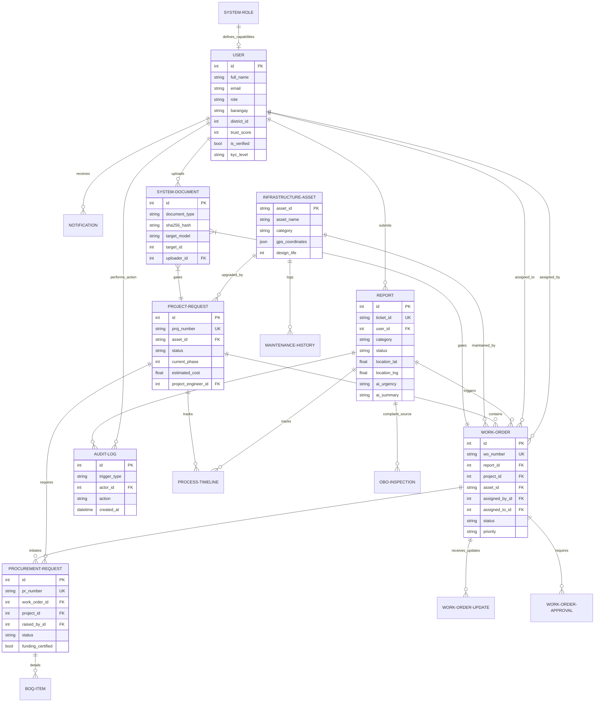

# PULSO Database Architecture — Entity Relationship Diagram (ERD)

This document provides a detailed overview of the database structure for the **PULSO (Public Unified Lifecycle Service Operations)** platform. The system uses a PostgreSQL backend with SQLAlchemy as the ORM.

## 1. System ERD (Mermaid)

## 2. Deep Dive: Component Explanations

### 2.1 Identity & Access Management (RBAC)
This layer manages authentication, authorization, and the territorial jurisdiction of officials.

*   **`users`**: The core profile table.
    *   `role`: Defines the user's base identity (e.g., `resident`, `district_engineer`).
    *   `district_id`: A critical field (1, 2, or 3) for Caloocan, used to filter which reports an official can manage.
    *   `trust_score` & `kyc_level`: Used by the AI to prioritize reports. High KYC levels (Gold) result in lower "noise" filters.
    *   `primary_jurisdiction`: A JSON array of barangays an official is responsible for.
*   **`system_roles`**: Stores the definition of granular permissions. 
    *   `capabilities`: JSON field like `{"projects": ["edit", "delete"], "procurement": ["view"]}`.
*   **`agent_locations`**: Tracks real-time GPS coordinates of field agents for efficient dispatching.

### 2.2 Citizen Engagement & AI Analysis
Manages the entry point for all community-reported issues.

*   **`reports`**: Stores citizen issues (potholes, drainage, etc.).
    *   `ticket_id`: Human-readable identifier (e.g., `RPT-12345678`).
    *   `ai_category` / `ai_urgency`: Populated by the **Gemini AI Service** to automatically classify and prioritize reports without manual triage.
    *   `severity_score`: A calculated float (0.0 - 1.0) derived from image analysis and location sensitivity.
*   **`notifications`**: Personalized alerts for users. High `priority` notifications bypass standard trays for critical updates.

### 2.3 Government Engineering Workflows
The core of the "Operations" side, translating reports into field actions.

*   **`work_orders`**: The primary unit of assignment.
    *   `wo_type`: Can be `standard` (report-driven) or `preemptive` (predictive maintenance).
    *   `status`: `open` → `assigned` → `in_progress` → `completed`.
    *   `priority_score`: AI-generated score used to sort the dispatcher's queue.
*   **`work_order_updates`**: A chronological feed of updates from the field, including image evidence.
*   **`work_order_approvals`**: Tracks sign-offs from senior engineers before a work order can be closed.

### 2.4 Strategic Project Management
Handles large-scale LGU-initiated infrastructure (e.g., building a new health center).

*   **`project_requests`**: Manages a complex **6-Phase Lifecycle**:
    1.  **Request**: Received from Mayor or Barangay.
    2.  **Survey**: Field validation and GPS mapping.
    3.  **Design**: Engineering drawings and technical specs.
    4.  **Budgeting**: Cost estimation and funding certification.
    5.  **Execution**: Construction and milestone monitoring.
    6.  **Certification**: Final inspection and closure.
*   **`obo_inspections`**: Specific to the **Office of the Building Official**, managing parallel tracks for building permits and safety clearances.

### 2.5 Resource & Compliance (The "Smart Gate")
Ensures absolute adherence to RA 9184 and administrative standards.

*   **`procurement_requests`**: Tracks the workflow for buying materials.
    *   `funding_certified`: Hard gate requiring budget approval.
    *   `ntp_issued`: Indicates the **Notice to Proceed** has been formally documented.
*   **`boq_items`**: The "Bill of Quantities" — a detailed list of every item requested (bags of cement, bundles of steel, etc.).
*   **`system_documents`**: The integrity layer.
    *   `sha256_hash`: A cryptographic fingerprint of every file, ensuring that "Design Plans" or "Contracts" cannot be tampered with after upload.

### 2.6 Asset Stewardship (Digital Twin)
The long-term memory of Caloocan's infrastructure assets.

*   **`infrastructure_assets`**: Registry of physical objects (e.g., "EDSA Extension Pavement").
    *   `design_life`: Used to calculate when an asset is expected to fail.
*   **`maintenance_history`**: A ledger of every cent spent on a specific asset over decades.
*   **`environmental_context`**: Stores barangay-level data (e.g., "Barangay 172 is a High-Flood zone"), which the AI uses to adjust maintenance intervals.

### 2.7 System Integrity & Audit Logs
Ensures transparency and accountability for FOI (Freedom of Information) compliance.

*   **`audit_logs`**: Immutable records of "Who did What". If a project status is changed or a role is modified, an audit log is triggered.
*   **`process_timelines`**: The logical history of a ticket. This is what populates the "Step Progress" UI for both citizens and officials.

## 3. Key Architectural Patterns

1.  **Polymorphic Documents**: The `system_documents` table uses `target_model` and `target_id` to link files to various entities without creating multiple association tables.
2.  **Digital Twin Association**: Every `WorkOrder` and `Project` can link to a global `InfrastructureAsset`, allowing the system to track the "Asset Health" over many years of different reports.
3.  **Smart Gate Compliance**: The `status` changes in `ProjectRequest` and `ProcurementRequest` are gated by the presence of specific documents in `system_documents` (e.g., cannot proceed to "procured" without a "contract" document).
4.  **Territorial RBAC**: `User` roles combined with `district_id` and `primary_jurisdiction` ensure that District Engineers only see reports within their assigned areas.
