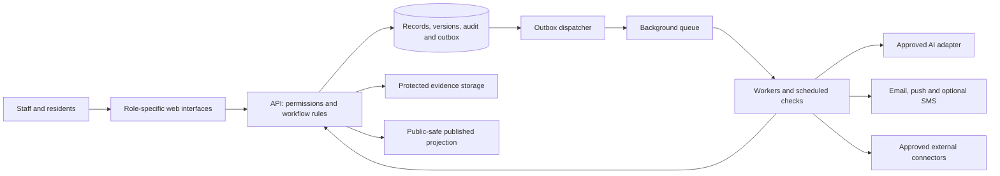

# 04 — Integrations and technology architecture

**Status:** Proposed architecture; no infrastructure provisioned. **Version/date:** 1.0 / 18 September 2026. **Owner to nominate:** Technical delivery lead.

## Recommended foundation

Retain React/Vite, FastAPI, SQLAlchemy and PostgreSQL where current inspection confirms their use. Start as a modular application with separate background workers; avoid adding microservices merely to accommodate AI. Keep one authoritative store of business state.

| Layer | Proposed technology | Reason / condition |
|---|---|---|
| Staff/resident interface | Existing React application and shared accessible components | Preserve product continuity; consolidate duplicated dashboard behavior |
| Business operations | FastAPI services with explicit commands and server permissions | Same rules for UI, jobs and integrations |
| Operational records | PostgreSQL; PostGIS for governed geometry | Linked records, constraints, location queries and authoritative scope |
| Background jobs | Celery with RabbitMQ; transactional outbox in PostgreSQL | Durable asynchronous notifications, scheduled checks and AI jobs |
| Evidence and documents | Approved object storage with controlled access, version metadata and backups | Keep original evidence distinct from public derivatives |
| Search | PostgreSQL text search initially; pgvector if evaluation supports semantic retrieval | Avoid operating a second search platform prematurely |
| Maps | Existing Google Maps integration plus supported layers; evaluate deck.gl for density visualization | Reuse map experience while replacing retired rendering dependencies |
| AI | Server-side provider adapter and task-specific policies | Change models without changing civic workflow authority |
| Monitoring | Structured application/job logs, metrics, tracing and alerting through the hosting environment | Detect stale data, lost jobs and delivery uncertainty |

Google's legacy HeatmapLayer has been deprecated with removal scheduled for May 2026; verify actual API behavior during implementation and replace its use. [Google Heatmap documentation](https://developers.google.com/maps/documentation/javascript/heatmaplayer). Map vendor configuration and rendering are separate from the LGU-approved boundary dataset. Add official geometry provenance and explicit unknown-location handling.

## Architecture and authority

The diagram is a proposed responsibility map, not an existing deployment. Worker commands use the same application rules; workers do not bypass permission, approval or version checks. Public pages read a deliberately restricted projection rather than serializing internal records.

## Integration priorities

| Integration | Useful capability | Priority and dependencies |
|---|---|---|
| PULSO web and in-app notifications | Canonical notices, case updates, staff reminders | First release; actual persisted outcomes and read state |
| Existing approved email service | Review requests, assignment notices and private updates | First release if delivery, credentials, sender domain and bounce handling are established |
| Firebase Cloud Messaging | Optional browser/mobile push pointing to a record | Next; user permission, device/token lifecycle and service-worker support; push receipt is not proof of reading |
| Approved SMS provider / Twilio evaluation | Short notices where SMS is justified | Later; sender registration, costs, consent/purpose, opt-out handling and delivery callbacks |
| Microsoft 365 through Graph OR Google Workspace | Calendar references, approved document links and staff coordination | Use the LGU's actual suite; least-privilege tenant consent and ownership are prerequisites |
| Official GIS/PSGC datasets | Valid location IDs and North/South/full-city views | Early; validate boundaries, versions, licenses and operational ownership |
| PAGASA / GeoRiskPH | Context for planning and authoritative advisory links | Access-dependent; source validity and geographic relevance reviewed by staff |
| Facebook Page publishing | Distribute an approved public notice | Deferred until Page authority, current API permissions and review requirements are verified; manual approved export is fallback |
| LGU finance, procurement or document systems | Reference existing official records | Discovery first; no verified local API assumed; reviewed imports before automated synchronization |

Official references: [FCM web receiving](https://firebase.google.com/docs/cloud-messaging/web/receive-messages), [Philippines SMS provider guidance](https://www.twilio.com/en-us/guidelines/ph/sms), [Microsoft Graph](https://learn.microsoft.com/en-us/graph/overview), [Google Calendar API](https://developers.google.com/workspace/calendar/api/v3/reference), [PAGASA data requests](https://www.pagasa.dost.gov.ph/climate/climate-data), and [HazardHunterPH](https://hazardhunter.georisk.gov.ph/map).

PAGASA data availability does not establish an unrestricted real-time warning API. HazardHunterPH's public map does not establish permission to scrape or redistribute its layers. Official Meta Pages documentation could not be retrieved successfully during this research; its connector remains unverified rather than implementation-ready.

## Integration contracts

Each connector needs a named owner, purpose, data classification, direction, authoritative system, authentication scope, consent/approval requirement, retry policy, rate limit, mapping version, failure queue and disable switch. Use stable external identifiers and trace IDs. Validate webhook signatures and reject replays where supported.

Start calendar integration as a one-way projection of confirmed PULSO assignments with a backlink. Record external event IDs and cancellation state. Do not infer that editing a calendar appointment authorizes reassignment, spending or technical acceptance in PULSO.

Imports go to staging with validation, duplicate detection, preview and accountable acceptance. Never silently overwrite asset identities or verified histories. External feeds retain source, issue time, retrieval time and validity; old hazard context is not a current emergency warning.

## Optional tools, not required infrastructure

[n8n](https://docs.n8n.io/sustainable-use-license/) can support noncritical integration orchestration if hosting and license conditions suit the deployment. Keep approvals, record transitions and reliable delivery state in the application. Do not call its license unrestricted open source or use it to sidestep server authorization.

[Temporal](https://docs.temporal.io/) is worth evaluating only when long-running workflows and compensation become difficult to maintain with the proposed job/state approach. Avoid deploying both orchestration systems without a clear need. [Celery task guidance](https://docs.celeryq.dev/en/stable/userguide/tasks.html) informs the simpler initial worker design.

Keep Power BI or another external BI tool optional for specialist management reporting. The daily workflow dashboard should live in PULSO so staff can act directly and maintain context. Any BI connection needs approved read-only datasets and the same metric definitions; a second dashboard must not invent a second definition of resolved work.

## Deployment decisions still needed

Choose hosting and approved data locations after assessing existing LGU contracts, connectivity, operational support and data handling. Confirm backup recovery objectives, restore tests, environment separation, secrets management, capacity, incident ownership and monthly cost envelope. These are discovery requirements, not claims that the repository already implements them.
