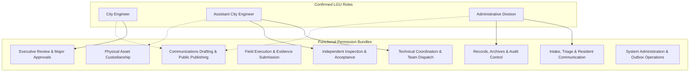
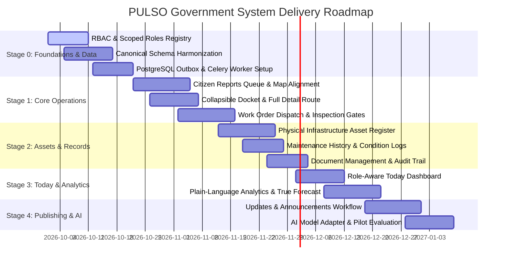

# 09 — Reconciled Government Implementation Plan

**Status:** Proposed Architecture & Implementation Plan  
**Version / Date:** 1.0 / 18 September 2026  
**Target Branch:** `Initial-Defense-PULSO-Refractors`  
**Phase:** Documentation and Architecture Only (No product code modified, no migrations executed, no services provisioned)  
**Authority Hierarchy:** [`PRODUCT.md`](../../PRODUCT.md) > [`09-visual-art-direction-v2.md`](../ui-ux-audit/09-visual-art-direction-v2.md) > [`docs/government-system-proposal/`](README.md) > Observed Code  

---

## 1. Executive Summary & Vision

PULSO transforms a resident's location-aware report and evidence into an accountable, traceable government response. This implementation plan reconciles the eight topic proposals in `docs/government-system-proposal/` and the operating model in `docs/ui-ux-audit/24-government-operating-model-and-automation-proposal-v1.0.md` into an actionable engineering roadmap.

The goal is to establish a **calm, professional, non-technical government workspace** that minimizes administrative friction while connecting records, providing role-aware daily information, ensuring reliable background processing, and integrating accountable AI assistance.

### Key Architectural Resolutions
1. **Scope and Geography:** Government cartography and operations cover the entirety of Caloocan City (all 193 barangays across North and South sectors). In contrast, resident reporting eligibility remains focused on North Caloocan per [`PRODUCT.md`](../../PRODUCT.md) until separate LGU policy expands resident onboarding.
2. **Organization and Roles:** Rather than inventing an unverified organizational hierarchy, the system anchors on the three confirmed local roles (**City Engineer**, **Assistant City Engineer**, and **Administrative Division**) while modeling operational duties as modular **functional permission bundles**.
3. **Module Architecture:** Eight distinct top-level modules are established: **Today**, **Reports**, **Work**, **Assets**, **Records**, **Service Performance**, **Updates & Announcements**, and **Administration**.
4. **Connected Record Chain:** Canonical relationships govern the civic docket:  
   $$\text{Report(s)} \longrightarrow \text{Case} \longrightarrow \text{Work Order(s)} \longrightarrow \text{Inspection} \longrightarrow \text{Accepted Outcome} \longrightarrow \text{Asset Maintenance History}$$
5. **Physical Assets Overhaul:** Disentangles the generic "Assets" navigation (which currently groups projects, OBO, and procurement) into a dedicated Physical Infrastructure Asset Register (Roads, Drainage, Bridges, Public Buildings, Facilities) linked to inspection and repair logs.
6. **Integrity in Automation and Analytics:** Completely eliminates synthetic/random number generation in analytics and predictive endpoints (`/health`, `/schedule`, `/export` in `predictive_router.py`). Introduces an explicit PostgreSQL outbox pattern paired with Celery/RabbitMQ workers for reliable event dispatch, honest delivery status tracking, and validated statistical models.
7. **Advisory AI Doctrine:** AI functions as an assistive draft tool with strict schema validation, provenance links, and human confirmation. No autonomous database mutations, approvals, or engineering certifications are permitted.

---

## 2. Boundaries, Disclaimers & Invariants

| Boundary / Principle | Policy Definition | Enforcement Mechanism |
|---|---|---|
| **Authority Discipline** | Proposals cannot overwrite approved product truths. | Approved items in `PRODUCT.md` and `09-visual-art-direction-v2.md` supersede any proposal. |
| **Confirmed Local Roles** | Only City Engineer, Assistant City Engineer, and Administrative Division are confirmed. | Other roles are modeled as functional capability bundles, not statutory titles. |
| **City Sector Coverage** | Government workspace covers North & South Caloocan (193 barangays). | Resident portal remains North Caloocan pending separate policy. |
| **Truth Before Polish** | No synthetic data fallback, no fake "sent" toasts, no random predictions. | Hardened API responses; distinct states for empty, loading, partial, and failed. |
| **Civic Aperture v0.2** | Morning Field Sheet (Light) & Night Inspection (Dark). | Strict theme parity, Field Blue for gov actions, Signal Cut for state, Field Aperture for evidence. |
| **Separation of Duties** | Field worker cannot independently certify completed work. | Inspector/verifier role required for final technical acceptance. |
| **No Unsolicited Scraping** | No scraping of Meta/Facebook, PAGASA, or HazardHunterPH without API authority. | Manual verified export/import fallback until official access agreements exist. |

---

## 3. Reconciled Information Architecture & Role Model

```
PULSO Government Workspace (Operate Mode)
├── 1. Today (Role-Aware Daily Hub)
│   ├── Leadership View (5 Department Metrics + Escalations + Needs Review)
│   ├── Coordinator / Lead View (Team Workload + Blocker Triage + Due Tasks)
│   └── Field / Inspector View (Assigned Work Orders + Verification Queue)
├── 2. Reports (Citizen Reports & Incident Tracking)
│   ├── Unified Scope (List & Map Views sharing identical filters)
│   ├── Collapsible Right-Side Engineering Docket (Compact handle vs Close)
│   ├── Direct Navigation to Full Docket Page (/gov/reports/:reportId)
│   └── Duplicate Linking, Jurisdiction Check & Information Requests
├── 3. Work (Operations, Execution & Capital Delivery)
│   ├── Work Orders (Dispatch, crew assignment, progress proof, blockers)
│   ├── Inspections (Field verification, acceptance decisions, rework notice)
│   └── Capital Projects (Milestones, engineering phases, contract references)
├── 4. Assets (Physical Infrastructure Register)
│   ├── Asset Categories (Roads, Drainage, Bridges, Buildings, Facilities)
│   ├── Condition & History (Dated inspections, last verified status, repair costs)
│   └── Linked Cases & Planned Maintenance
├── 5. Records (Official Documentation & Audit)
│   ├── Incoming/Outgoing Document Register & Versioning
│   ├── Case Dossiers & Engineering Plans
│   └── Immutable Audit Trail & Retention/Legal Hold Policies
├── 6. Service Performance (Plain-Language Operational Intelligence)
│   ├── "Are We Keeping Up?" (Backlog reconciliation, throughput, dwell time)
│   ├── "Where Are Concerns Recurring?" (Spatial/asset frequency analysis)
│   └── "Plan Ahead" (Verified time-series demand forecasts, overdue maintenance rules)
├── 7. Updates & Announcements (Public & Internal Communications)
│   ├── Public Service Announcements (Draft → Review → Approved → Scheduled → Published)
│   ├── Channel Delivery Tracking (In-App, Email, Push, Twilio SMS)
│   └── Revisions, Visible Correction Notices & Governed Withdrawals
└── 8. Administration (Operational Setup & Health)
    ├── Staff Accounts, Teams & Scoped Permission Bundles
    ├── Service Calendars, Working Hours & Pause Rules
    └── Integration Health, Outbox Queue Monitor & AI Usage Budgets
```

### Role to Functional Bundle Mapping



---

## 4. Module Deep Dives & Engineering Specifications

### 4.1. Role-Aware Daily Dashboard ("Today")
- **Everyday Purpose:** Orient staff immediately upon sign-in with the exact items requiring their action, overdue work, and departmental status without requiring manual role switching.
- **Top 5 Leadership Metrics (Standard Definitions):**
  1. *Unassigned Concerns:* Active cases lacking an assigned accountable team/owner.
  2. *Overdue Actions:* Active work orders/cases past their approved calendar due date.
  3. *Awaiting Verification:* Field work submitted as complete but pending independent inspection.
  4. *Open High-Priority Cases:* Cases with confirmed critical/emergency severity.
  5. *Resolved in Period:* Authoritative resolution events occurring within the selected window.
- **Actionable Modules Below the Fold:**
  - *Needs Attention:* Direct action links with blocker notes and remaining hours.
  - *Where Work is Needed:* Scoped map view showing active cases with North/South sector toggles.
  - *Team Workload & Blockers:* Active load by team (avoiding competitive employee leaderboards).
  - *Publishing Tasks:* Pending review, scheduled releases, and delivery exceptions (visible only to authorized communicators).

### 4.2. Report Tracking, Collapsible Docket & Integrated Cartography
- **Integrated Queue and Map:**
  - Single state model: filtering by category, status, sector, or barangay synchronously updates both list rows and map markers.
  - Unmapped reports (missing coordinates or ambiguous addresses) are explicitly grouped under a `"Location needs review"` banner—never plotted at an arbitrary default coordinate.
- **Collapsible Right-Side Docket:**
  - **Non-Modal:** Staff can continue scrolling, searching, and selecting items in the queue while the docket is visible.
  - **Collapse vs. Close Distinction:**
    - *Collapse:* Minimizes the docket to a compact vertical rail handle on the right edge, preserving selected report ID, applied filters, and map viewport.
    - *Close:* Clears the selection state, removing the docket and returning full width to the queue.
  - **Full Detail Page Link:** The report title inside the docket is a semantic link to `/gov/reports/:reportId`. A secondary button labeled `"Open full report"` provides an explicit alternative affordance.
  - **Context-Preserving Back Navigation:** Navigating back from `/gov/reports/:reportId` restores scroll position, active filters, page index, and docket state.
- **Consistent Cartography for North & South Caloocan:**
  - 193 official barangay boundary geometries (PSGC versioned data, including Barangays 176-A through 176-F).
  - Basemap styling aligned with Civic Aperture (subdued operational tones).
  - Deprecated Google Maps `HeatmapLayer` replaced with `@deck.gl/layers` `HeatmapLayer` or aggregated hexbins.
  - Full keyboard accessibility and text/table alternative for map data.

### 4.3. Work Orders, Inspections & Record Tracking
- **The Linked Lifecycle Chain:**
  ```
  Citizen Report → Triage Verification → Case Created → Work Order Dispatched → 
  Field Execution (Photo Proof Upload) → Inspection Task Created → 
  Independent Inspector Verifies → Accepted Outcome Recorded → 
  Report Marked Resolved → Resident Update Dispatched → Asset Maintenance History Updated
  ```
- **Separation of Duties:** The field foreman who uploads completion evidence cannot execute the inspection acceptance step. A distinct staff member with the Inspector/Verifier bundle must record technical approval.
- **Exception Paths:** Blocked work (materials shortage, utility clash, weather delay), information requests to citizen, referral to outside agency (e.g. DPWH, Meralco), and reopening after resident challenge.

### 4.4. Physical Infrastructure Assets Module Overhaul
- **Problem Statement:** The incumbent system navigates "Assets" to `/gov/projects` and bundles OBO, procurement, and records under it, confusing physical assets with administrative processes.
- **Rebuilt Architecture:**
  - Top-level route: `/gov/assets` (dedicated physical infrastructure register).
  - Categories: **Roads**, **Drainage Networks**, **Bridges**, **Public Buildings**, and **Facilities**.
  - Essential Record Fields: Asset Code, Category, Barangay / Sector, Precise Geometry (LineString/Polygon/Point), Installation/Construction Year, Responsible Maintenance Division, Current Inspected Condition, Last Inspection Date, Open Linked Cases, Maintenance Log.
  - Condition States: `Good`, `Fair`, `Poor`, `Critical`, or `Not yet assessed` (strictly prohibiting default assumptions of "Good" for uninspected assets).
  - Projects remain in the **Work** module; official permits remain in **Records**.

### 4.5. Plain-Language Analytics & Validated Prediction
- **Civic Question Framing:**
  - *Are we keeping up?* (Net backlog trends, receipt vs. resolution velocity).
  - *Where are concerns recurring?* (Barangay and asset recurrence hotspots).
  - *Which work is delayed?* (Dwell time across stages, team bottleneck analysis).
  - *What should we inspect next?* (Rule-based maintenance priority based on asset age, rainy season exposure, and past complaints).
- **Elimination of Synthetic Random Code:**
  - Remove `random.randint` from `predictive_router.py`.
  - Replace fabricated failure probabilities with transparent, rule-based risk tiers (`High Risk: Overdue inspection > 180 days + > 3 repeat reports in 60 days`).
  - Time-series demand forecasting using historical rolling windows (`TimeSeriesSplit` in scikit-learn) with mean absolute error (MAE) baseline comparison.

### 4.6. Updates & Announcements Module
- **Publishing Lifecycle:**
  $$\text{Draft} \longrightarrow \text{In Review} \longrightarrow \text{Approved} \longrightarrow \text{Scheduled} \longrightarrow \text{Published} \longrightarrow \text{Expired / Archived}$$
- **Key Operational Controls:**
  - *Strict Separation:* Public service announcements are completely segregated from private resident report updates and internal staff coordination notices.
  - *Version Locking:* Approval is granted for a specific immutable content revision. Any modification to text, dates, affected areas, or channels reverts the item to `Needs Review`.
  - *Corrections vs. Deletions:* Published notices are never silently overwritten or hard deleted. Corrections publish an amended revision with a prominent, timestamped correction banner. Withdrawals record the authorizing official and mandatory reason.
  - *Delivery Tracking:* Dedicated per-channel delivery telemetry distinguishing `Queued`, `Dispatched`, `Provider Accepted`, `Delivered`, and `Failed`.

### 4.7. Accountable AI Assistance
- **Role & Boundary:** AI is strictly an assistive advisor. No autonomous write operations, work approvals, structural certifications, or citizen communications may be triggered directly by an AI model.
- **Model Evaluation Strategy:**
  - Baseline: Incumbent Gemini 2.5 Flash implementation in `backend/gemini_service.py`.
  - Primary Candidates: **Gemini 3.8 Flash** (multimodal analysis of resident photos, document extraction, bilingual drafting) and **Gemini 3.5 Flash-Lite** (low-cost text categorization and brief summaries).
  - Evaluation Challenger: **GPT-5.6 Luna / Terra** tested on a local, curated, and de-identified 200–300 example dataset reflecting Caloocan operational conditions.
- **Core AI Capabilities:**
  1. *Category Suggestion & Geocode Assistance:* Proposing infrastructure domain and extracting textual street landmarks.
  2. *Bilingual Drafting:* Assisting staff in preparing draft service notices in both English and Filipino from structured work order fields.
  3. *Field Photo Quality & Observation:* Detecting blurred images, rain obstructions, and visible structural damage without claiming definitive engineering diagnosis.
  4. *Document Metadata Extraction:* Evaluating local PaddleOCR for scanned municipal forms before routing to cloud multimodal models.

### 4.8. Integrations & Background Automation
- **Architectural Foundation:**
  - PostgreSQL database with transactional outbox table (`outbox_events`).
  - Celery workers coordinated via RabbitMQ message broker.
  - At-least-once processing with database-level idempotency keys.
- **Integration Priority Matrix:**
  1. *Tier 1 (Core):* PULSO In-App Notifications & Approved LGU Email Service (SMTP/SendGrid).
  2. *Tier 2 (Mobile Outreach):* Firebase Cloud Messaging (Web/Mobile Push).
  3. *Tier 3 (Urgent Alerts):* Approved Philippines SMS Gateway (Twilio/local telco) with explicit character/segment cost controls.
  4. *Tier 4 (Productivity):* Microsoft 365 (Graph API) / Google Workspace one-way assignment calendar sync.
  5. *Tier 5 (Spatial Authority):* Official PSA PSGC boundary datasets & Caloocan GIS layers.

---

## 5. Work Breakdown Structure & Sequencing



### Detailed Agent Work Packages (GOV-01 to GOV-10)

| Package | Name | Primary Objective | Code / Artifact Boundary |
|---|---|---|---|
| **GOV-01** | Role & Permission Registry | Implement scoped capability bundles; map confirmed LGU roles. | `backend/roles_service.py`, `backend/auth.py`, `frontend/src/utils/rbac_utils.js` |
| **GOV-02** | Schema & Outbox Migration | Establish `outbox_events`, harmonized `cases`, `work_orders`, and `inspections`. | `backend/gov_models.py`, `backend/models.py`, Alembic migrations |
| **GOV-03** | Queue, Docket & Detail Page | Build non-modal collapsible docket, full page `/gov/reports/:id`, fix toast defects. | `CitizenReportsPage.jsx`, `GovReportDetailPage.jsx`, `citizen-reports.css` |
| **GOV-04** | Cartography & Geometry Engine | Integrate 193 barangays, deck.gl heatmap, handle unmapped issues. | `backend/utils/geometry_utils.py`, `frontend/src/components/GovMap.jsx` |
| **GOV-05** | Work Orders & Inspection Gates | Implement field evidence upload, independent verification gate, and audit events. | `backend/gov_router.py`, `frontend/src/pages/GovWorkOrdersPage.jsx` |
| **GOV-06** | Physical Asset Register | Create dedicated `/gov/assets` module; unlink projects/OBO/procurement from assets. | `backend/gov_crud.py`, `GovSidebar.jsx`, `GovAssetsPage.jsx`, `GovAssetDetailPage.jsx` |
| **GOV-07** | Role-Aware Today Dashboard | Build 5-metric executive dashboard and personal task triage views. | `frontend/src/pages/GovTodayPage.jsx`, `backend/analytics_service.py` |
| **GOV-08** | Analytics & Model Retraining | Remove synthetic random endpoints; train time-series demand models. | `backend/predictive_router.py`, `backend/predictive_service.py`, `GovAnalyticsPage.jsx` |
| **GOV-09** | Updates & Announcements | Build full publishing lifecycle, editor, revision history, and delivery tracking. | `backend/announcements_router.py`, `GovAnnouncementsPage.jsx`, `GovAnnouncementEditor.jsx` |
| **GOV-10** | Advisory AI & Multi-Model Eval | Replaceable AI provider adapter, local dataset benchmarking, prompt hardening. | `backend/gemini_service.py`, `backend/ai_adapter.py`, benchmark test suites |

---

## 6. Verification & Quality Acceptance Plan

### 6.1. Ten End-to-End Pilot Acceptance Journeys
1. **Intake to Resolution:** Receive report, verify completeness, dispatch work order, submit field evidence, independent inspection acceptance, resolve case, dispatch resident update, and record asset history.
2. **Docket Interaction:** Select report from map or queue, collapse docket (context preserved), expand docket, click title to open `/gov/reports/:reportId`, click Back (selection, page, and filters restored).
3. **Unlocated Concern Handling:** Submit report with ambiguous location; confirm it is retained in queue with `"Location needs review"` banner and excluded from map without crashing or defaulting to coordinate `(0, 0)`.
4. **Access Control & Scope Enforcement:** Attempt unauthorized cross-barangay action or role escalation via direct API calls; verify strict HTTP 403 Forbidden with structured error response.
5. **Publishing & Correction:** Draft bilingual advisory, approve revision 1, schedule publication, amend to revision 2; verify visible correction notice and immutable preservation of revision 1.
6. **Cancellation Safeguard:** Cancel an active roadwork case; verify linked scheduled announcement is automatically blocked from publication with an actionable staff alert.
7. **Failure Injection & Idempotency:** Simulate worker crash during external notification delivery; verify outbox leases prevent duplicate messaging and record truthful delivery state.
8. **AI Fault Tolerance:** Disable external AI model connection; verify staff intake and triage proceed seamlessly using manual classification and static templates.
9. **Metric Consistency:** Verify Today dashboard counts reconcile exactly with raw database records; verify partial-period indicators display when appropriate.
10. **Accessibility & Responsive Reflow:** Execute complete triage and inspection workflows via keyboard only (with visible 3px focus indicator); verify layout at 320px viewport width and 200% zoom.

### 6.2. Quality Gates Matrix
- **WCAG 2.2 AA Compliance:** High-contrast focus boundaries, accessible names for all icon buttons, data table alternatives for all charts, text summaries for maps.
- **Theme Parity:** Morning Field Sheet (Light) and Night Inspection (Dark) preserve identical contrast, operational data density, and interaction states.
- **Zero Mock / Synthetic Fallbacks:** All user-facing numbers, status messages, and charts derive from authoritative server state or display explicit empty/error banners.

---

## 7. Next Actions & Figma Design Reconciliation

This document completes the architectural research and reconciliation phase. **No production code or Figma files have been mutated.**

**Prerequisites for Next Phase:**
1. **LGU Stakeholder Validation:** Confirm operational delegations for the City Engineer, Assistant City Engineer, and Administrative Division.
2. **Figma File Inspection & Component Promotion:** Open the shared file [`PULSO UI Rework — Audit, Core Library & Portal Concepts`](https://www.figma.com/design/1qPgPj4o3smElv8B2B1REi), inspect `Library/Civic Aperture · Production · v0.2`, reconcile the non-modal collapsible docket, and create paired light/dark production frames for the eight proposed modules.
3. **Implementation Authorization:** Await explicit user instruction before initiating code refactoring in `backend/` or `frontend/`.
