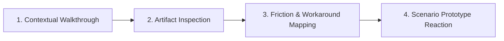

# 10 — User Profiling and Operational Research Framework

**Status:** Proposed User Research & Profiling Framework  
**Version / Date:** 1.0 / 18 September 2026  
**Target Branch:** `Initial-Defense-PULSO-Refractors`  
**Phase:** Documentation & Research Framework (No product code modified, no migrations executed)  
**Authority Hierarchy:** [`PRODUCT.md`](../../PRODUCT.md) > [`09-visual-art-direction-v2.md`](../ui-ux-audit/09-visual-art-direction-v2.md) > [`01-operating-model-modules-and-roles.md`](01-operating-model-modules-and-roles.md) > Observed Code  

---

## 1. Framing: Work-Based Grouping Under Organizational Uncertainty

Caloocan’s complete, formal municipal organizational chart for the City Engineering Department (CED) remains unverified in public records. The only officially verified local roles on record are the **City Engineer**, **Assistant City Engineer**, and **Administrative Division**.

To ensure PULSO delivers an actionable, intuitive workspace without codifying unverified bureaucratic hierarchies, this framework profiles users **strictly by the work they perform and the decisions they make**.

### Core Profiling Principles
1. **Activity-Based, Not Position-Based:** One municipal employee may perform intake in the morning and correspondence in the afternoon. Profiling focuses on job tasks, cognitive load, handoffs, and environmental constraints.
2. **Separation of Duties as a Safety Invariant:** Crucial operational checks (such as field completion vs. technical inspection, or announcement drafting vs. public release) require distinct functional actors, even if both belong to the same administrative division.
3. **Environmental Realism:** Staff and residents operate in vastly different physical and digital conditions—from glaring tropical sunlight on low-bandwidth Android phones to multi-monitor desktop desks in the engineering hall.

---

## 2. Comprehensive User Group Profiles

```
┌─────────────────────────────────────────────────────────────────────────────┐
│                          PULSO User Group Atlas                             │
├─────────────────────────────────────────────────────────────────────────────┤
│ EXTERNAL CIVIC PARTICIPATION                                                │
│ 1. Residents / Report Submitters                                            │
├─────────────────────────────────────────────────────────────────────────────┤
│ EXECUTIVE & STRATEGIC DIRECTION                                             │
│ 2. City Engineer (Department Executive & Final Approver)                    │
│ 3. Assistant City Engineer (Operational Coordinator & Technical Director)   │
├─────────────────────────────────────────────────────────────────────────────┤
│ INTAKE, RECORDS & ADMINISTRATIVE SUPPORT                                    │
│ 4. Administrative Division Staff (Intake, Correspondence & Records)         │
│ 8. Asset Custodians / Records Personnel (Infrastructure Inventory & DMS)    │
├─────────────────────────────────────────────────────────────────────────────┤
│ TECHNICAL OPERATIONS & FIELD DELIVERY                                       │
│ 5. Technical Leads / Dispatchers (Scoping, Assignment & Work Planning)      │
│ 6. Field Personnel / Maintenance Teams (Repairs & Evidence Upload)          │
│ 7. Inspectors / Verifying Engineers (Technical Audit & Acceptance)          │
├─────────────────────────────────────────────────────────────────────────────┤
│ CIVIC COMMUNICATIONS & SYSTEM GOVERNANCE                                    │
│ 9. Communications / Publishing Personnel (Public Advisories & Notices)      │
│ 10. System Administrators / Authorized Auditors (Access & Audit Log Review)  │
└─────────────────────────────────────────────────────────────────────────────┘
```

---

### Group 1: Residents / Report Submitters

*The civic observers whose initial incident reports initiate the entire public work lifecycle.*

- **Main Needs in PULSO:**
  - Submit civic infrastructure concerns quickly (under 2 minutes) with minimal cognitive and typing effort.
  - Capture and attach clear photographic evidence and exact incident location.
  - Track progress transparently through plain-language status milestones.
  - Receive actionable, predictable updates without being overwhelmed by administrative jargon.
- **What to Understand During Profiling:**
  - **Language & Literacy:** Preference between conversational English, formal Tagalog, and colloquial Taglish; comprehension of technical terms (e.g., *culvert*, *sub-base*, *easement* vs. *baradong kanal*, *lubak*).
  - **Device Realities:** Predominance of budget-to-midrange Android devices (e.g., 3GB/4GB RAM, limited local storage); screen brightness outdoors; camera quality in low light or rain.
  - **Connectivity Conditions:** Intermittent cellular data (prepaid mobile data, spotty 4G/5G coverage in dense barangays); offline capture tolerance and background upload resilience.
  - **Accessibility Needs:** 320 px reflow, legible font scales, high-contrast tap targets ($\ge 44 \times 44\text{ px}$), screen-reader readability, voice-input or guided prompts.
  - **Reporting Habits:** When and where issues are submitted (on-the-spot vs. later at home on Wi-Fi); sensitivity around PII and fear of political retaliation or neighborhood friction.
  - **Trust & Cynicism:** Past experiences with ignored government hotlines; expectations regarding response times; fear that report verification will compromise personal privacy.
- **Key Discovery Questions for Interviews:**
  1. *"When you encounter an overflowing drainage or broken pavement, what is your immediate reflex (take a photo, tell the barangay hall, post on Facebook, or ignore it)?"*
  2. *"What information do you hesitate to provide when submitting a report to the city government?"*
  3. *"How would you describe the difference between 'Report Received', 'Verified', and 'In Progress' in your own words?"*

---

### Group 2: City Engineer

*The department executive accountable for overall municipal infrastructure integrity, major escalations, and statutory compliance.*

- **Main Needs in PULSO:**
  - High-level, role-aware daily dashboard ("Today") summarizing department throughput, overdue bottlenecks, and unassigned caseloads.
  - Rapid executive review and formal sign-off on escalated decisions, major capital projects, and high-budget work orders.
  - Evidence-backed performance metrics and geographic trend summaries to report to the City Mayor and City Council.
- **What to Understand During Profiling:**
  - **Decision-Making Style:** Preference for visual trend cards vs. tabulated figures; threshold for what constitutes an executive escalation (e.g., critical hazards, multi-million peso expenditures, severe public safety risks).
  - **Approval Authority & Delegation:** Specific legal and local limits of signing authority; which approvals must remain strictly with the City Engineer vs. delegated to the Assistant City Engineer.
  - **Information Pacing:** Frequency of dashboard access (morning briefing, weekly review, or crisis-driven); tolerance for granular alerts vs. distilled executive summaries.
  - **Reporting Channels:** Need for exportable executive briefings (PDF dockets, high-level summaries) for cabinet meetings.
- **Key Discovery Questions for Interviews:**
  1. *"What are the top three pieces of information you need before you can confidently sign off on an infrastructure project or major repair?"*
  2. *"What types of field issues should never wait for routine weekly review and must reach your desk immediately?"*
  3. *"How do you currently verify that completed projects meet municipal engineering standards?"*

---

### Group 3: Assistant City Engineer

*The operational orchestrator ensuring daily cross-team coordination, resolving field blockers, and maintaining workflow momentum.*

- **Main Needs in PULSO:**
  - Complete operational visibility across all active cases, work orders, and engineering teams.
  - Rapid triage of blocked work orders (e.g., material stockouts, weather delays, ROW/utility clashes).
  - Delegation mechanisms to assign coordination tasks to division heads or team leads.
  - Queue balancing across North and South Caloocan operational sectors.
- **What to Understand During Profiling:**
  - **Daily Coordination Rituals:** Morning dispatch protocols, whiteboard meetings, radio coordination, or Viber groups currently used.
  - **Blocker Resolution Pathways:** How cross-agency blockers (Meralco poles, Maynilad pipe leaks, DPWH national road jurisdictions) are resolved and tracked.
  - **Workload Planning & Team Availability:** How field crew capacity, equipment availability, and rainy-season standby schedules are calculated.
  - **Handoff Friction:** Where cases typically stall between intake, technical assessment, dispatch, and final inspection.
- **Key Discovery Questions for Interviews:**
  1. *"Walk us through how an urgent road hazard report gets assigned to a repair crew on a typical rainy Monday morning."*
  2. *"When a maintenance crew arrives on-site and finds a utility pipe blocking their excavation, what happens next and how is that delay recorded?"*
  3. *"How do you track whether teams in North Caloocan have equal resources and response speed compared to South Caloocan?"*

---

### Group 4: Administrative Division Staff

*The backbone of intake, formal correspondence, citizen communication, and general administrative recordkeeping.*

- **Main Needs in PULSO:**
  - Streamlined intake tools to review incoming reports, request missing citizen details, and filter out duplicates.
  - Standardized correspondence templates for official endorsements, citizen advisories, and inter-agency referrals.
  - Accurate document tracking linked to specific citizen cases and municipal projects.
  - Fast search by ticket ID, citizen name, barangay, or date range.
- **What to Understand During Profiling:**
  - **Current Form & Logbook Ecosystem:** Types of paper intake sheets, logbooks, and routing slips currently maintained.
  - **Repetitive Administrative Overhead:** Which letters, endorsements, and status notices consume the most manual typing time.
  - **Citizen Interaction Handling:** How phone inquiries, walk-ins at the engineering desk, and online reports are currently merged or separated.
  - **Digital Proficiency:** Familiarity with desktop web browsers, keyboard shortcuts, multi-tab workflows, and data entry validation tools.
- **Key Discovery Questions for Interviews:**
  1. *"What are the most common pieces of information missing from a resident's complaint that force you to contact them?"*
  2. *"How do you route an official letter from the Mayor's Office or a Barangay Captain to the right engineering division today?"*
  3. *"What happens when two different residents submit reports about the exact same pothole on the same street?"*

---

### Group 5: Technical Leads / Dispatchers

*The engineering evaluators who translate raw citizen complaints into structured, actionable work orders and assign qualified crews.*

- **Main Needs in PULSO:**
  - Technical assessment tools: viewing true-color photos, street coordinates, and historical repair logs to determine repair scope.
  - Work order creation: selecting equipment, crew specialization (e.g., asphalt patch crew, drainage declogging unit, masonry team), and target completion dates.
  - Blocker identification and material requisition references.
  - Map-based dispatching to cluster nearby repairs and optimize crew travel across Caloocan's road network.
- **What to Understand During Profiling:**
  - **Scope Determination Rules:** How a dispatcher decides whether an issue needs a minor routine repair order vs. a full capital rehabilitation project.
  - **Jurisdictional Boundaries:** How staff distinguish city roads from barangay roads, private subdivisions, and DPWH national highways.
  - **Crew Skills & Equipment Balancing:** Availability of specialized equipment (backhoes, vacuum trucks, asphalt rollers) and certified operators.
  - **Priority Rubrics:** Formal vs. informal criteria for labeling an issue `CRITICAL`, `HIGH`, `MODERATE`, or `LOW`.
- **Key Discovery Questions for Interviews:**
  1. *"Looking at a photo of a collapsed drainage cover, what clues tell you whether this needs an immediate 24-hour dispatch or can be batched for next week?"*
  2. *"How do you ensure you don't accidentally dispatch a city crew to repair a national highway under DPWH jurisdiction?"*
  3. *"What information does the field foreman need on their work order sheet before heading out to the site?"*

---

### Group 6: Field Personnel / Maintenance Teams

*The frontline municipal crews who execute the physical repairs, maintenance, and field evidence capture.*

- **Main Needs in PULSO:**
  - Ultra-simple, high-contrast mobile view of daily assigned work orders.
  - Clear task details: exact street address, landmark notes, specific instructions, and navigation link.
  - One-tap before-and-after photo upload with automatic timestamp and GPS stamping.
  - Quick blocker reporting (e.g., "Heavy Rain", "Blocked by Parked Vehicles", "Lacking Asphalt Premix").
- **What to Understand During Profiling:**
  - **Hardware in the Field:** What devices are actually carried (personal Android smartphones, ruggedized city tablets, or paper job orders carried on clipboards).
  - **Environmental Field Conditions:** Mud, wet hands, direct sunlight glare, dusty work sites, battery depletion over an 8-hour shift.
  - **Time Available for Documentation:** Foreman's time allocation—crews are evaluated on physical meters of road repaired or drains cleared, not hours spent filling out software forms.
  - **Literacy & Input Modes:** Preference for photo-led proof, large tap targets, voice-to-text notes, and minimal manual typing.
- **Key Discovery Questions for Interviews:**
  1. *"When you are out on a job site, what makes using your phone difficult or frustrating?"*
  2. *"How do you currently prove to your supervisor that the drainage line was fully declogged and water is flowing?"*
  3. *"If you run out of asphalt or your truck breaks down in the middle of a shift, how do you report that delay right now?"*

---

### Group 7: Inspectors / Verifying Engineers

*The independent technical auditors who verify that field work was performed correctly before a case is officially closed.*

- **Main Needs in PULSO:**
  - Dedicated verification queue showing completed work orders awaiting inspection.
  - Side-by-side comparison interface: original resident report evidence vs. completed field work photos.
  - Formal acceptance/rejection controls: `Accept & Certify`, `Return for Rework`, or `Reject with Reason`.
  - Punch-list generation tools to document specific technical defects requiring corrective work.
- **What to Understand During Profiling:**
  - **Acceptance Standards & Criteria:** Engineering benchmarks for technical acceptance (compaction quality, concrete curing time, invert levels, debris disposal).
  - **Independence from Execution:** Ensuring inspectors are organizationally and functionally separated from the construction/maintenance foremen who did the work.
  - **On-Site vs. Desktop Verification:** Which jobs require physical on-site re-inspection vs. which can be audited via verified high-resolution photographs.
  - **Legal & Quality Liability:** Personal accountability for signing off on completed civic works; reluctance to accept work without documented proof.
- **Key Discovery Questions for Interviews:**
  1. *"Under what conditions would you reject a field crew's completion report and demand they redo the work?"*
  2. *"Can a photo alone ever be enough to approve a drainage declogging job, or do you always have to see water flowing in person?"*
  3. *"How do you protect yourself from certifying work that turns out to have been done poorly?"*

---

### Group 8: Asset Custodians / Records Personnel

*The municipal stewards responsible for physical infrastructure inventories, historical maintenance records, and official engineering archives.*

- **Main Needs in PULSO:**
  - Dedicated Physical Infrastructure Register (`/gov/assets`) organizing municipal assets into clear categories: Roads, Drainage, Bridges, Public Buildings, Facilities.
  - Asset lifecycle tracking: connecting past inspections, work orders, repair costs, and warranty records to specific physical assets.
  - Document management: uploading and indexing versioned as-built plans, structural inspection forms, and contracts.
  - Controlled exports, retention scheduling, and legal-hold enforcement.
- **What to Understand During Profiling:**
  - **Existing Asset Registers:** Current inventory formats (Excel spreadsheets, GIS shapefiles, CAD drawings, physical ledger cards in file cabinets).
  - **Asset Naming & Identification:** How roads, bridges, and drainage mains are uniquely identified across barangays (and how divided segments are coded).
  - **Condition Assessment Rubrics:** How engineering staff historically graded condition (`Good`, `Fair`, `Critical`, or non-standardized notes).
  - **Audit & Legal Compliance:** Commission on Audit (COA) property inventory requirements, retention periods for municipal engineering plans, and public records disclosure rules.
- **Key Discovery Questions for Interviews:**
  1. *"How do you currently track how many times a particular stretch of road has been asphalted over the last five years?"*
  2. *"When a resident files a lawsuit or COA audits an infrastructure project, how long does it take you to retrieve the original signed inspection reports?"*
  3. *"What system do you use to know which drainage networks are approaching the end of their design lifespan?"*

---

### Group 9: Communications / Publishing Personnel

*The public information officers and designated coordinators who craft, translate, review, and schedule public service advisories.*

- **Main Needs in PULSO:**
  - A dedicated **Updates & Announcements** publishing workspace with clear stage gates: `Draft` $\rightarrow$ `In Review` $\rightarrow$ `Approved` $\rightarrow$ `Scheduled` $\rightarrow$ `Published`.
  - Pre-built municipal templates (Road Closures, Drainage Upgrades, Service Interruptions, Completed Milestones).
  - Dual-language editor for simultaneous English and Filipino composing with character counters for SMS.
  - Public vs. Private segregation: guaranteeing private citizen details are never leaked onto public bulletin boards.
  - Visible correction notice tools and delivery failure monitoring across channels.
- **What to Understand During Profiling:**
  - **Publishing Hierarchy & Delegation:** Who holds the authority to approve a public announcement (City Engineer, Mayor's Public Information Office, or Division Chief).
  - **Bilingual Tone & Vocabulary:** Balancing official government formality with accessible, empathetic public-service language in Tagalog.
  - **Channel Logistics:** How advisories are distributed today (Facebook Page posts, printed barangay flyers, press releases, SMS blasts).
  - **Crisis / Emergency Protocols:** How urgent typhoon flood warnings or sudden road cave-in announcements bypass routine multi-day scheduling.
- **Key Discovery Questions for Interviews:**
  1. *"When a major thoroughfare is closed for drainage replacement, who writes the announcement and who gives the final approval to post it?"*
  2. *"What has been your worst experience with publishing an error in a public advisory, and how did you correct it?"*
  3. *"How do you ensure that technical engineering terms are translated into Filipino words that ordinary commuters understand?"*

---

### Group 10: System Administrators / Authorized Auditors

*The technical and compliance guardians who manage identity, enforce permission boundaries, and audit operational integrity.*

- **Main Needs in PULSO:**
  - Centralized user account management with scoped role bundles, team assignments, and geographic jurisdiction limits.
  - Integration health dashboards: monitoring PostgreSQL outbox processing, RabbitMQ/Celery worker queues, and SMS/Email delivery error rates.
  - Immutable audit trail explorer: querying all user state changes, permission escalations, data exports, and emergency overrides.
  - AI token consumption, latency, and cost telemetry.
- **What to Understand During Profiling:**
  - **Account Lifecycle:** Onboarding, transfer, and offboarding procedures for city employees; temporary delegations when an officer is on leave.
  - **Security & Privacy Standards:** Municipal IT guidelines, National Privacy Commission (NPC) compliance, credential policies, session timeouts.
  - **Audit Inquiries:** What evidence internal COA auditors or the City Legal Office require during administrative investigations.
  - **Disaster Recovery & Backup Protocols:** On-premise vs. cloud hosting constraints, database backup cadences, and restore test frequencies.
- **Key Discovery Questions for Interviews:**
  1. *"What is the protocol when an employee transfers to another division or leaves city employment?"*
  2. *"How do you currently prove who approved a change to a public record or authorized a work order?"*
  3. *"What alerts do you need to see if the background notification system or SMS gateway stops delivering messages?"*

---

## 3. Operational Friction & Separation of Duties Matrix

To prevent operational conflicts of interest and maintain municipal integrity, the profiling framework defines hard boundaries between conflicting duties:

| Role Bundle 1 | Role Bundle 2 | Conflict / Risk if Combined | Enforced System Invariant |
|---|---|---|---|
| **Field Personnel (Executor)** | **Inspector (Verifier)** | Self-certification of incomplete or substandard repairs without independent audit. | Inspector ID $\neq$ Field Submitter ID. Server rejects acceptance attempt. |
| **Intake / Administrative Staff** | **Technical Lead (Dispatcher)** | Administrative personnel making technical engineering assessments without engineering qualification. | Administrative staff can only verify completeness and request info; cannot certify engineering feasibility. |
| **Communications Drafter** | **Publishing Approver** | Unilateral publishing of unverified roadwork claims or sensitive citizen information. | Version approval requires separate authorized publishing credential; self-approval blocked. |
| **City Engineer (Executive)** | **System Administrator** | Executive with full IT root access bypassing audit logs, or IT admin approving engineering certifications. | Separation of operational domain roles from technical system administration. |

---

## 4. Environmental & Device Realities Matrix

The physical environments in which PULSO users operate mandate distinct UI density, touch target sizing, and offline resilience:

| User Group | Primary Devices | Operating Environment | Lighting & Connectivity | Critical UI/UX Requirement |
|---|---|---|---|---|
| **Residents** | Budget/midrange Android phones (Chrome/PWA) | Outdoors, streets, moving vehicles, homes | Glaring sunlight or darkness; intermittent 4G data | Large tap targets ($\ge 44\text{px}$), 320px reflow, offline draft save, low bandwidth. |
| **Field Crews** | Mobile phones, rugged tablets, paper orders | Construction sites, open trenches, roadside | Direct midday sunlight; dusty, wet hands; poor data | High-contrast UI, one-tap photo capture, huge buttons, zero fiddly text inputs. |
| **Inspectors** | Tablets, mobile phones, desktop workstations | Hybrid: on-site field visits and office desk | Bright outdoor light switching to office fluorescent | Side-by-side photo comparison aperture, structured punch-lists, offline inspection draft. |
| **Dispatchers & Admin** | Desktop PCs (1080p, single or dual monitor) | Municipal office desks, high ambient noise | Controlled indoor lighting; stable local intranet | High-density tables, keyboard shortcuts, non-modal dockets, multi-window stability. |
| **Leadership** | Desktop PC, laptop, executive iPad | Executive offices, city council sessions, travel | Controlled indoor lighting; stable Wi-Fi / LTE | Calm summary cards, 5 core metrics, clear drill-through, exportable briefing formats. |

---

## 5. Field Interview Protocol & Phasing

When engaging Caloocan municipal personnel during discovery and prototyping, use this 4-step interview cadence:



1. **Step 1: Contextual Walkthrough (30 mins)**  
   Ask the staff member to describe their typical daily schedule, starting from when they log in or arrive at the department, through their morning rush, handoffs, and end-of-day reports.
2. **Step 2: Artifact & Tool Inspection (20 mins)**  
   Examine their actual working artifacts: paper logbooks, WhatsApp/Viber threads, desktop folders, Excel sheets, routing slips, and camera rolls.
3. **Step 3: Friction & Workaround Mapping (20 mins)**  
   Identify where they feel anxious, where delays occur, what information they have to manually re-type, and who they have to call when something goes wrong.
4. **Step 4: Scenario Prototype Reaction (20 mins)**  
   Present the proposed Civic Aperture module (e.g., non-modal docket for dispatchers, mobile proof capture for field crews, 5-metric dashboard for leadership) and capture unprompted reactions.
