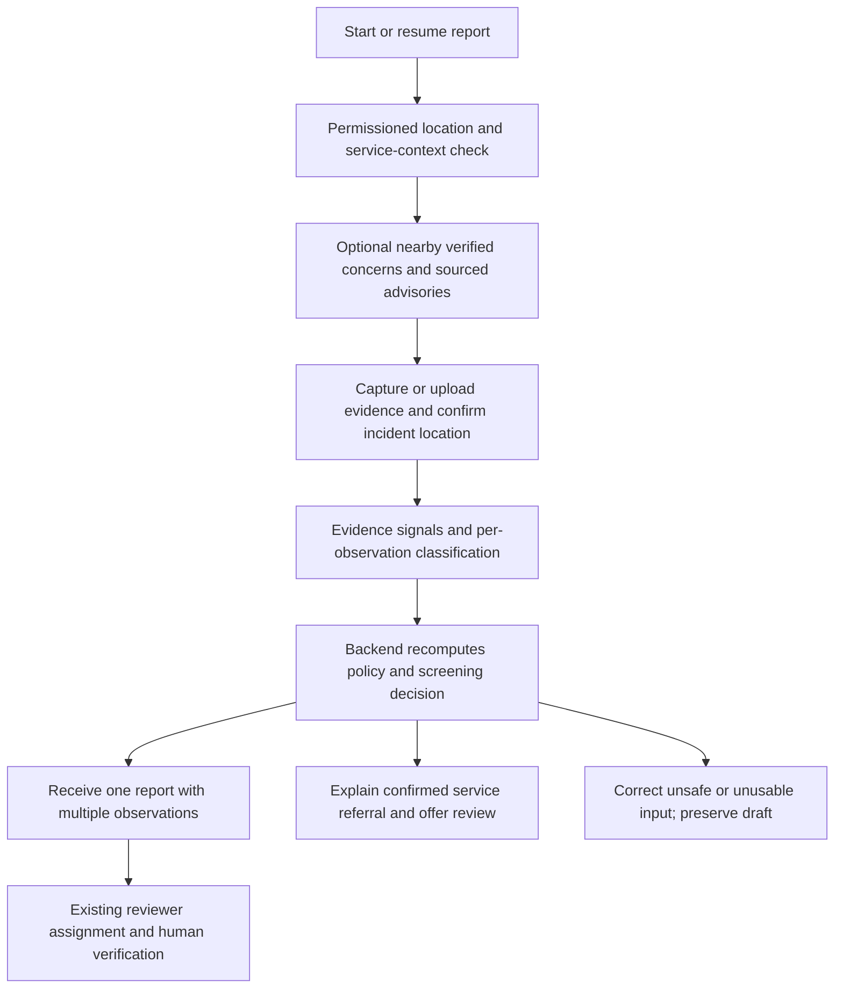

# PULSO RELogic — report eligibility, evidence, and context

**Development phase:** PULSO RELogic

**Artifact status:** Proposed development plan; documentation only. No implementation or deployment is claimed.

**Version / last validated:** 0.1 / 12 November 2026

**Accountable roles to confirm:** PULSO product owner, City Engineering service-policy owner, GIS/data steward, privacy owner, and engineering/model-release owner. These are responsibilities to assign, not named people already approving this plan.

**Implementation follow-up, 12 November 2026:** [RELogic screening foundation](../integration/pulso-relogic-screening-foundation-2026-11-12.md) records the authorized local RELogic 0A increment: independent advisory findings, corrected uncertainty handling, server-side intake recomputation, existing audit/metadata persistence, shared web/Android controls and truthful legacy field coordinates. This does not mark all of stage 0 complete or approve responsibility exclusions, automatic referrals, calibrated screen detection, model release or production deployment.

## 1. Outcome and scope

Help a resident submit a genuine, actionable infrastructure concern with fewer unnecessary steps, while reducing avoidable government validation work. Begin checks when reporting starts, continue when evidence is captured, and recompute the consequential decision on the backend before intake commits.

RELogic separates five questions:

1. **Where is the issue?** Device location, photographed-object location, and a resident's incident pin are different evidence.
2. **Which service is responsible?** Being inside Caloocan or a government-owned facility does not establish City Engineering maintenance responsibility.
3. **What does the evidence support?** A real outdoor scene, an image of a screen, unclear evidence, and unsupported claims require different treatment.
4. **Is this an existing concern?** Nearby or visually similar reports can suggest the same problem without erasing individual reports.
5. **What contextual hazards are known?** Advisories and forecasts can help residents describe a concern; they do not authenticate it.

The target is **automatic screening and explainable routing**, with narrowly governed automatic ineligibility decisions once independently evaluated. Uncertainty must have a review path. No promise of exact phone geolocation, perfect screen detection, complete hazard coverage, or reduced workload is made before measurement.

This plan extends [45 — Reports, concerns, location, and independent data](45-report-concerns-location-and-independent-data-2026-11-01.md) and [46 — Python intelligence stack](46-python-intelligence-stack-recommendation-2026-11-01.md). [PRODUCT.md](../../PRODUCT.md) remains the approved product authority. Decision outcomes, new records, endpoints, responsibility rules, and release stages below are **proposed**, not replacements for the canonical report lifecycle.

## 2. Observed baseline and priority corrections

| Observed source | Reuse or correction required |
|---|---|
| [Gemini analysis](../../backend/gemini_service.py), `analyze_report` | The prompt treats ambiguous/out-of-service content as `is_inappropriate`; normalization also groups `Undetermined` with rejection. Separate authenticity, eligibility, evidence quality, and safety. An unclear category must not become a fraud finding. |
| [Report intake](../../backend/main.py), `analyze_report_only` / `create_new_report` | There is already a pre-submission analysis endpoint, rate limiting, location checks, upload checks, multi-category input, operation replay protection, and provider-failure fallback. Intake still returns an error for `is_inappropriate`. Replace the decision contract coherently across analysis and submission; changing only the prompt or browser is insufficient. |
| [Camera sampling](../integration/camera-location-sampling-2026-11-06.md) and [request provenance](../integration/camera-location-request-provenance-2026-11-06.md) | Local acquisition already records bounded camera-session fixes and capture/request provenance separately from the incident pin. Extend this foundation; synthetic checks do not establish physical accuracy or scene authenticity. |
| [Spatial service](../../backend/services/spatial_service.py) and [router](../../backend/spatial_router.py) | Boundary lookup and nearby reports exist. Audit capability/scope enforcement and public verification rules before reusing them for resident suggestions. A role-shaped attribute must not grant unrestricted staff data access. |
| [Report intelligence](../../backend/report_intelligence_router.py) | Existing intake-receipt reconciliation, per-observation matching and reviewed concern links are integration points. Keep individual tickets and their history. |
| [Weather/flood adapter](../../backend/hazard_feeds.py), [runbook 41](41-hazard-source-integration-runbook-2026-10-29.md), [NOAH 42](42-noah-flood-exposure-integration-2026-10-29.md) | Licensed, configuration-gated rainfall/regional river forecasts and static flood-exposure work exist. They are not street-level live flood detection or automatic report validation. Configuration/deployment/coverage must be verified separately. |
| [Legacy public uploads](../../backend/main.py), `PublicUploadFiles` | Original report-image paths are still served by static mounts; disabling browser caching does not authorize access. Finish protected-media consumer migration before adding pre-intake private captures or exposing nearby photos. |
| [Field workspace](../../frontend/src/pages/FieldWorkspacePage.jsx) | A legacy completion path still substitutes default coordinates when device coordinates are absent. Eliminate fabricated location/precision across affected capture paths before using them as eligibility evidence. |

The boundary contract also needs reconciliation: product users are North Caloocan residents, while spatial data includes North and South city geometry. The policy owner must define intake service coverage separately from the logged-in employee's jurisdiction. A resident must not be rejected because the employee viewing a queue has a narrower assignment.

## 3. Decision policy: what may block and what must remain reviewable

The following are **screening outcomes**, separate from report statuses:

| Proposed outcome | Meaning and next action |
|---|---|
| `ready_to_submit` | Required input is usable and no blocking policy rule applies. This is not government verification. |
| `submit_for_review` | Location, scene, eligibility, responsibility, or provider results are inconclusive. Receive a report with explicit review reasons; route through existing availability/capacity-aware validation assignment. |
| `needs_correction` | A recoverable input problem, such as a corrupt image or malformed coordinate. Preserve the draft, explain the affected field, and offer replacement/manual entry. |
| `refer_out_of_service` | A current, approved responsibility rule establishes another service, with adequate incident-location evidence and no applicable public-safety exception. Show the specific reason, approved service information, and a correction/review route. |
| `restricted_upload` | Objective upload-security failure or separately governed prohibited-content handling. Keep unsafe files out of ordinary previews/queues; provide an allowed text/assisted reporting route where appropriate. |

Initially run new authenticity/eligibility classifications in **shadow mode**: record the recommendation and compare it with reviewed outcomes without using it to block residents. Keep existing objective input/security protections. Enable rule-based ineligibility only after policy approval, a local holdout evaluation, recovery testing, and monitored rollout. A model-only suspicion of a screen remains reviewable.

The following never suffice for automatic decline: no historical reports, no nearby registered asset, no Google place result, a low-end phone, denied location, missing EXIF, an uploaded photo, an AI label of “private,” or absence of an external disaster alert. Resident reputation and report volume are not proof either way.

For the UCC example, record the user's proposed service-boundary scenario as **unverified**. Do not hardcode “UCC is excluded.” Confirm the specific campus/facility, responsibility rule, incident category, adjoining road/drainage, and exceptions. The reporter may be on campus while photographing a public-road defect. A broken private wall threatening a public sidewalk may also require a governed public-safety response rather than rejection.

An automatic referral must not silently archive/delete a report or accuse a resident of fraud. Before ordinary ticket creation, issue a private screening reference for a persisted referral/review request, clearly distinguished from a received report. Provide “This location or responsibility is incorrect” and “Request review.” Do not claim a ticket or referral was sent to another agency unless that transaction actually committed.

## 4. Resident and government flow

Checks are incremental: location alone supports an early context check, not a final authenticity or eligibility decision. Recheck affected results when the pin, image, description, category, responsibility policy, or relevant evidence changes.

**Normal path:** ask for location only after explaining its purpose; use existing capture/upload controls; show suggestions without forcing a detour; keep one review/submission action. Do not require residents to understand asset ownership. A clearly explained additional question is conditional on unresolved context, not a new mandatory questionnaire for everyone.

**Nearby concern:** “May naitalang kaparehong problema malapit sa lokasyong ito. Ito rin ba ang irereport mo?” Offer “Same concern / Parehong problema,” “Different concern / Ibang problema,” and “Not sure / Hindi sigurado.” Show only server-authorized, publicly verified records or the resident's own authorized records. Other residents' pending reports, identities and unreviewed photos remain private. An internal matcher can consider additional authorized candidates without revealing them to the resident.

Choosing “same concern” keeps an independent ticket and observation; store a **proposed association** for the existing governed concern-link process. Proximity, matching category and popularity are insufficient for identity. Consider location uncertainty, object type, road side, timestamps, unresolved versus new recurrence, and multi-angle evidence. “No similar report found” means no authorized candidate found, never “this issue is invalid.”

**Government view:** extend the existing Reports docket with a compact screening summary: rule applied, responsibility source/version, location limitations, evidence flags, provider failures, and the next eligible decision. Preserve the queue's scope/filter/selection. Staff can correct an assessment with a reason and immutable event; a model cannot publish, close, archive, or resolve a report. Existing take/reassign controls remain governed by backend permissions.

## 5. Workstreams

### A. Location evidence and responsibility registry

Store and compare these separately: original device fix; camera-session photo fix; resident-confirmed incident point/address; optional observed asset geometry. Capture the real source, reported accuracy when available, acquisition/capture/server times, manual corrections, and stale/unknown states. A manual pin has no invented sensor precision. Reject malformed coordinates, not the resident's legitimate concern.

Use PostGIS metre-based distance/intersection operations. If the location uncertainty overlaps multiple boundaries, treat responsibility as ambiguous. Model boundary quality as well as device uncertainty. Do not automatically snap a defect to the nearest road, facility, or asset. GPS, EXIF, IP location, and browser timestamps are signals, not tamper-proof proof. Photo position does not establish object position, especially across a road or campus boundary.

Create a versioned **service responsibility registry**, related to existing GIS/assets rather than a competing asset inventory:

- area/facility/road-segment geometry, geometry source, precision and review state;
- asset/facility identifier and independently recorded name;
- geographic jurisdiction, owner if established, responsible maintainer, supported issue categories;
- `candidate`, `verified`, `disputed`, `expired`, or `unknown` responsibility state;
- policy reference, approving role/actor, effective dates, review date and immutable revision;
- exceptions for adjoining public infrastructure, delegated maintenance, shared responsibility, and public-safety effects;
- approved referral destination and contact verification date, where available.

Build initial candidate data through first-party field surveys, reviewed inspections, resident evidence, and appropriately licensed reference layers. Google Places can help identify a probable facility, but does not certify ownership, legal boundaries, or maintenance duty. Independently surveyed geometry can support location; **operational responsibility still needs an accountable service-policy decision**. Unknown ownership/responsibility stays unknown. Reports may propose new inventory candidates; they do not automatically create verified assets or exclusion zones.

Pilot one bounded area and a small reviewed set of responsibility cases, including a campus edge, city road, private boundary, shared drainage, and an unknown asset. Avoid citywide exclusion rules until those cases are understood.

### B. Evidence authenticity and screen-replay screening

Evaluate complementary signals, with explicit failure cases:

| Signal | Useful evidence | Limit and safe response |
|---|---|---|
| Screen/rephotography classifier | Display edges, moire, reflections, pixel/refresh artifacts, flat presentation | Some screens leave few cues; real fences, signage and lighting can look similar. Flag for review; do not call it proven fraud. |
| Broader scene context | Relationship between defect, pavement, surroundings and visible landmarks | A valid close-up can lack context. Offer one optional context photo or text clarification. |
| Bounded additional capture | A consented short burst or changed angle when safe and necessary | Parallax/motion can help investigation but do not prove a real scene; a replay/virtual camera may imitate them. Provide upload/manual-review alternatives. |
| Hash/perceptual similarity | Exact or transformed reuse of previously seen evidence | Legitimate residents may photograph or attach the same concern. Separate operation replay, evidence reuse and concern identity. |
| Capture-session provenance | Server-issued expiring session, upload digest, capture/request records and input binding | Shows transaction lineage, not verified GPS or reality. Browser metadata and device clocks can be altered. |

Use Gemini for structured visual observations and explainable classification. Treat descriptions, OCR text and image instructions as untrusted data. Validate output schemas and allowed labels server-side; model output cannot execute tools or supply authoritative responsibility rules. Model self-reported confidence is not a calibrated probability.

Benchmark a separate lightweight screen/rephotography detector only if it improves local results over Gemini plus simple baselines. LightGBM may later combine evaluated structured signals when reviewed labels exist; it cannot infer physical authenticity from GPS alone. No dependency expansion is justified solely by a vendor accuracy claim. Do not add facial recognition, identity liveness, continuous tracking, compulsory video, or a native attestation service to this web phase.

### C. Backend policy and intake orchestration

Keep deterministic security checks, geographic evidence, responsibility rules, AI assistance, and hazard context as separate modules. Return structured reasons rather than one `is_inappropriate` boolean. Keep authenticity flags independent of harmful-content handling and category confidence.

The backend must independently load current authorization/policy, validate media, and verify input bindings at submission. Never trust client `allowed=true`, a cached precheck, an editable AI result, or a user-supplied concern/asset ID. Bound provider calls, image decoding, dimensions, request volume, task retries and cost. Retain a human-review path when optional providers time out; do not relax unsafe-file protections.

Handle **per-observation** eligibility inside one report. A photo with a road defect and a private-wall concern must not create separate tickets or discard the valid observation. Explain which observations need referral/review; preserve original evidence and decision history.

Use existing operation idempotency and receipt reconciliation. A repeated network request must not create another ticket or re-run consequential decisions inconsistently. Bind any precheck reference to principal/session, input digest, policy version and expiry. If inputs or policy change, recompute and explain the new decision. Screening history is append-only; correction supersedes rather than overwrites it.

### D. External hazard and traffic context

Do not scrape Google Maps screens or assume every consumer Maps feature is an exportable API. Verified primary-source findings on 12 November 2026:

| Source | Supported use | RELogic decision and limitation |
|---|---|---|
| [Google Routes traffic-aware polylines](https://developers.google.com/maps/documentation/routes/traffic_on_polylines) | Speed-condition intervals along requested routes | Optional traffic context for a defined route, with billing/coverage checks. Not a general flood/landslide incident feed; congestion is not proof of damage. |
| [Google Maps JavaScript TrafficLayer](https://developers.google.com/maps/documentation/javascript/trafficlayer) | Traffic visualization in Google Maps | Optional display layer; do not treat rendered tiles as a backend incident database. |
| [Google Flood Forecasting API](https://support.google.com/flood-hub/answer/16364206?hl=en) | Riverine hydrologic forecasts and flood-status products | Candidate adapter only. Verify target-area gauges/quality, available products and freshness. Does not establish observed street/flash flooding. |
| [Flood API access](https://support.google.com/flood-hub/answer/16364306?hl=en) | Pilot application, approved Cloud project/API enablement | Access is currently limited to pilot participants. Request/access verification is a dependency, not a promised deliverable. Global availability claims do not establish coverage in Bagong Silang. |
| [Google Places types](https://developers.google.com/maps/documentation/places/web-service/place-types) and [reverse geocoding](https://developers.google.com/maps/documentation/geocoding/guides-v3/requests-reverse-geocoding) | Probable POIs/categories and address descriptions | Context only. A university label is not a maintenance-authority rule or an accurate surveyed parcel. |
| Existing licensed Open-Meteo adapter | Area rainfall and coarse regional river forecasts | Reuse its configuration/license/freshness controls. Keep forecast, spatial resolution, and validity explicit. Never relabel these as observed barangay flooding. |
| Existing NOAH integration proposal | Static flood exposure | Separate exposure from forecasts, advisories and current observed events. A susceptible site is not necessarily flooded now. |
| [PAGASA flood/advisory definitions](https://www.pagasa.dost.gov.ph/learnings/legend) | Official advisory interpretation and potential sourced advisory integration | Confirm a supported delivery format, permission, coverage and polling rules before automation. A public page alone is not an agreed API. |
| [GeoRiskPH / HazardHunterPH](https://hazardhunter.georisk.gov.ph/index.php/about-hazardhunterph) | Indicative hazard assessments, including relevant agency flood/landslide information | Useful exposure context subject to access/license review; do not describe it as a complete live landslide feed. No general live landslide API was established by this review. |

Google Places has [storage, attribution and map-display restrictions](https://developers.google.com/maps/documentation/places/web-service/policies). The current OSM-based map cannot simply receive Google Places overlays or become a permanent copied Google POI registry. Choose a compliant Google display or an independently licensed source for the affected feature. Retain only provider data/IDs allowed by the applicable product terms; the first-party responsibility registry must have independent provenance. Recheck terms before implementation.

Every adapter needs provider ID/license reference, event/forecast/exposure type, source URL, geometry/resolution/coverage, issued/observed/fetched times, validity/expiry, quality, attribution, and explicit missing/stale/error states. Store immutable source snapshots only where licensed; otherwise retain permitted identifiers and first-party decision provenance without copying restricted payloads. Keep provider outages separate from “no event reported.” External event deduplication must not merge resident concerns automatically.

Match advisories to the **incident** location/uncertainty and validity window, not just a place name or the phone's current position. Show sourced context such as “May flood advisory na sumasaklaw sa lugar na ito,” with issue time and provider link. Allow “Report what I observed.” Do not state the road is flooded from a regional forecast. Do not send residents toward a hazard to collect better evidence. Emergency messaging and contacts require the approved operational policy; PULSO must not imply it dispatches emergency responders.

## 6. Proposed records and API contract

These are conceptual additions to reconcile with existing models before migration:

| Record | Required contract |
|---|---|
| Screening session | Opaque ID; principal/guest-session binding; stage; input digest; expiry; capture/upload references; permission state. A session does not prove scene authenticity. |
| Screening assessment | Separate location, eligibility, authenticity, evidence-quality and safety findings; observation IDs; reason codes; rule/source/model versions; provider state; proposed outcome; created time. |
| Responsibility rule revision | Reviewed spatial/service rule and exceptions; actor, evidence source, effective interval and superseding revision. |
| Resident review request | Private screening reference or report ID; disputed assessment; supplied correction; status, next owner and immutable decision. |
| Context snapshot reference | Licensed hazard/traffic context metadata and permitted payload reference; coverage/validity and attribution. |

Extend the existing `/api/reports/analyze` contract where compatible, or add a versioned precheck contract after inventorying all callers. Do not introduce a second report-creation path. Minimum operations are: begin/resume private screening; update inputs and get current assessment; retrieve authorized nearby suggestions; submit through existing intake; reconcile receipt; request review; retrieve authorized screening history. Exact new route names remain proposed.

Return `assessment_id`, `input_digest`, `expires_at`, `policy_version`, stage, per-observation findings, `reason_codes`, `provider_states`, permitted `next_actions`, and public-safe context. Separate resident explanations from restricted abuse indicators. Missing evidence must be `unknown`/`unavailable`, not a zero-risk score. Access checks apply to every media/assessment/history/reference lookup, including guest recovery tokens. Possession of a random ID alone is not authorization.

Do not introduce new terminal report statuses in this phase. Map received screening flags into existing intake/review/assignment behavior only after lifecycle reconciliation. If all observations are referred before intake, save a clearly labeled screening/review receipt rather than pretending a report was received. If any valid/reviewable observation is submitted, retain one report and its per-observation outcomes.

## 7. Resident interaction and state contract

Reuse the current report form/camera, evidence preview, location picker plus address alternative, inline status/error, nearby-concern selection, review/receipt and government docket primitives. Inventory their actual versions before coding; do not claim a new production component library here. Preserve the current Reports visual reference, brand palette, true-color evidence, and metadata outside images. No Figma work is included, following the user's explicit instruction.

| State | Required behavior and recovery |
|---|---|
| Checking / background refresh | Announce the check briefly; preserve usable input and mark older assessment as stale. Avoid an indefinite spinner blocking the whole form. |
| Location/camera denied or unavailable | Explain what is missing; offer upload, manual incident address/pin and review without declaring fraud or verified location. |
| Nearby first-use/filtered empty | Say no authorized matching concern was found; keep “Different concern” available. No-report-history is never an eligibility failure. |
| Partial / AI or map failure | Identify which check is unavailable; continue through the permitted review path. Never present an error as an empty result. |
| Stale / policy changed | Label stale data; recompute before a consequence; preserve draft and show the revised reason. |
| Suspected screen / unclear evidence | “We could not confirm the scene / Hindi namin matiyak ang kuha.” Offer an optional safe context photo or staff review. Avoid accusations. |
| Confirmed out-of-service rule | Explain the rule and approved destination; provide correction/review. No unrecorded or silent discard. |
| Offline / interrupted upload | Save a policy-permitted local draft scoped to the account/session; show unsent state; retry without duplicating intake. Expired private media references require reauthorization. |
| Session expired / permission-limited | Preserve safe draft content, sign in/resume or use guest recovery as allowed; do not leak another session's assessment. |
| Submission uncertain | Query existing idempotent receipt before creating a fresh operation. Show received only after commit. |
| Success / review requested | Durable report ID or distinct screening-review reference, server time, recorded outcome and next responsible queue. |

All new controls need default/hover/focus/pressed/selected/disabled/loading states. Use native semantics, 44 px public targets, a visible 3 px focus indicator, keyboard-complete selection and map-list alternatives. Inline errors associate with their fields; asynchronous summaries use a polite live region; submission failure focuses an error summary; dialogs restore trigger focus. Do not move focus on every background check.

Provide English/Filipino parity for actions, reason explanations, errors and announcements. Match light/dark content and recovery, support reduced motion/forced colors, reflow at 320 CSS px and 200% zoom, and retain text alternatives for photos/maps. Additional capture must never require unsafe movement or exclude residents unable to perform it. This is a behavioral handoff, not a completed visual or accessibility audit.

## 8. Delivery sequence and exit criteria

| Stage | Deliverable | Exit evidence |
|---|---|---|
| **RELogic 0 — Contract and baseline** | Inventory all resident/guest/quick-report/field/mobile entry points; separate false-claiming legacy AI flags; define responsibility/coverage/exception policy and review outcomes. Prioritize protected media, truthful location and account-scoped draft handling. | Reviewed contracts, negative authorization/media tests, no fabricated fixes in affected paths, baseline attempts/completions and reviewed error samples. |
| **RELogic 1 — Responsibility and location** | Bounded reviewed registry pilot, uncertain-boundary handling and first-party candidate workflow. | UCC-style scenarios adjudicated by policy owner; shared/unknown responsibility stays reviewable; source/version/expiry visible. |
| **RELogic 2 — Pre-intake guidance** | Extend existing analysis and form state; privacy-safe nearby concerns; one-ticket/per-observation semantics; backend input binding and receipts. | Browser/API tests for retries, input changes, mixed categories, private candidate access and accessible bilingual recovery. |
| **RELogic 3 — Authenticity evaluation** | Build consented local real-scene/replay dataset; evaluate Gemini and bounded detector alternatives; shadow screening. | Locked holdout results, device/environment breakdowns, review disagreement and false-flag analysis. No model-only auto-rejection. |
| **RELogic 4 — Governed automation** | Versioned deterministic eligibility rules, review requests, reasoned docket, existing automatic reviewer routing, monitoring and kill switch. | Policy approval plus measured false-referral/rejection bounds, successful appeals/reversal, outage and no-reviewer fallback exercises. |
| **RELogic 5 — Sourced context pilot** | Reuse existing licensed feeds; add one supported source at a time; Google access/coverage spike if available. | Licensed access, real target-area sample, freshness/expiry/attribution checks, no-feed/stale states and measured API cost. Missing Google access does not block core intake. |
| **RELogic 6 — Operational pilot** | Small resident/staff rollout with support, incident runbook and rollback. Extend older mobile clients only with contract parity. | Prospective real-phone and staff usability evidence; monitoring and recovery owners; approved go/no-go record. |

Stages are dependency order, not promised dates. Phases 3 and 5 can be evaluated independently once privacy/data contracts are ready. Full-city expansion and numerical workload-reduction claims wait for the pilot. No destructive migration, mass automated rejection, provider subscription, or agency-message sending is authorized by this plan.

## 9. Data collection and release evaluation

Collect independent ground truth rather than training on the AI's own decisions. Use consented first-party captures on ordinary Android/iPhone devices: genuine infrastructure, valid close-ups, screens showing infrastructure, prints, cropped/full-screen replays, compressed uploads, low light, reflective surfaces, real scenes containing incidental screens, private/public boundary cases, and legitimate new issues without history. No need to collect resident identity documents for this task.

Reviewers independently label scene authenticity, location support, responsibility/eligibility and concern identity; preserve disagreements and unknowns. For responsibility, use the accountable policy decision and reviewed geometry. For location trials, use independently established reference points/bounds. Split by physical site, underlying source image, capture session, device and time so a screen replay of a training photo cannot leak into the holdout. Synthetic cases verify software contracts; they do not prove field accuracy.

| Measure | Interpretation |
|---|---|
| False blocks/referrals among independently eligible genuine attempts | Primary protection metric; include pre-intake attempts, not only accepted reports. |
| Screen/replay detection and genuine-scene false flags | Report together, with uncertainty and phone/lighting/display breakdowns. “AI confidence” is not evaluation. |
| Eligibility coverage / responsibility unknown rate | Measures what the registry can support; unknowns must not be counted as correctly declined. |
| Nearby-candidate precision and missed same-concern cases | Evaluate per physical problem/episode, including adjacent similar assets and changed camera angle. |
| Completion, abandonment, added questions and latency | Measure resident burden and timeouts across good/poor connectivity; protect privacy in attempt logs. |
| Human validation time, review backlog and appeal overturns | Compare with the observed baseline and queue mix; do not count rerouted work as eliminated work. |
| Feed age, target-area coverage, provider failures and cost | Establish useful context without inventing real-time reliability. |

Before any blocking rollout, the product/service owner must set acceptable error bounds and required sample sufficiency, with engineering reporting uncertainty intervals. No invented accuracy target or universal confidence threshold is pre-approved here. Test a frozen holdout before rollout and prospective attempts after rollout. Human acceptance is not automatically a correct training label; corrections and disputed outcomes need adjudication.

Store only the minimum attempt telemetry needed to measure failures, with reviewed notice, retention/deletion rules and access controls. Avoid retaining raw movement histories or raw pre-intake images indefinitely. Scope local drafts to accounts/sessions, clear inappropriate cross-account remnants, and separate ephemeral screening uploads from retained civic evidence. Keep raw screening media private and out of public logs/analytics.

Do not feed rejected/unreviewed classifications directly into LightGBM maintenance or ETA training. Review outcomes, concern identity and eligibility changes require explicit lineage; maintain the existing distinct targets for time-to-resolution versus physical deterioration. Weather/traffic correlations are not failure labels.

## 10. Required acceptance scenarios

1. Campus interior, campus boundary and adjoining public road produce distinct responsibility checks. The name UCC alone never decides eligibility.
2. A private wall with no public impact and one threatening a public footpath follow the approved exception policy; unknown ownership remains reviewable.
3. A genuine first report in an area with no prior report/asset history can be received.
4. Two adjacent poles, one pole photographed from different angles, and a new defect after a resolved episode do not collapse by radius/category alone.
5. A resident choosing an existing concern still receives an individual report; a replay of the same submission operation receives the same receipt.
6. A multi-category capture keeps one report; category-specific referral does not lose its eligible/reviewable observation.
7. A TV/laptop replay, a print, and a valid scene with a screen in the background exercise different detector limits without automatic fraud accusations.
8. Denied/stale GPS, manually moved pins, boundary uncertainty and absent photo EXIF retain truthful unknown states and correction/review paths.
9. A caller tampers with coordinates, precheck outcome, concern ID, screening reference or AI response; server authorization and current-policy recomputation still apply.
10. Optional Google/Gemini/weather providers fail or return no local coverage; intake review remains usable and no-event claims are not fabricated.
11. A stale forecast and static landslide/flood susceptibility cannot become a current event; a regional advisory does not assert this street is flooded.
12. Pending/private report photos and screening media cannot be obtained through nearby results, guessed URLs, static mounts, another account's cache or guest token reuse.
13. Offline retry, concurrent submit, account switch, policy revision and an uncertain network response preserve draft/receipt integrity and avoid duplicate tickets.
14. Malicious OCR/description instructions, decompression bombs and corrupt images cannot control routing policy, execute tools or bypass bounded media handling.
15. Review correction creates a superseding assessment, restores the appropriate queue/next action, retains reasons and respects retention/legal holds.
16. A reviewable report arriving with no available validator stays in a visible recoverable queue; no false assignment or silent drop occurs.
17. Keyboard/screen-reader, Filipino expansion, 320 px, 200% zoom, both themes, reduced motion and denied permissions complete the core and review-request paths.

## 11. Decisions and next implementation package

| Decision owner | Required decision before dependent release |
|---|---|
| City Engineering service-policy owner | Actual UCC/facility responsibility, category scope, geographic service coverage, private-property/public-safety exceptions, and approved referral destinations. |
| GIS/data steward | Authoritative boundary provenance, positional limitations, change review and acceptable evidence for responsibility mapping. |
| Product + operations owner | Screening-to-lifecycle mapping, review/appeal ownership and service expectations; error tolerances and rollout cohort. No new SLA is assumed. |
| Privacy owner | Pre-intake consent/notice, provider sharing, minimum telemetry, evidence retention/deletion, public-safe projection and recovery-token policy. |
| Engineering/model-release owner | Provider/version inventory, calibration/holdout method, budget/timeouts, compatibility, monitoring and rollback. |

**First planned development package:** RELogic 0, followed by the bounded RELogic 1 responsibility pilot. Fix the conflated screening contract and truth/privacy prerequisites before expanding automatic rejection. Produce a reviewed implementation contract, additive migration proposal if needed, bilingual reason catalog, source/permission matrix, and independent pilot dataset specification. Product implementation requires a separate instruction; this artifact makes that work reviewable.

**Rollback contract:** independently disable model-assisted screening, automatic eligibility referral and each external adapter. Preserve objective security protections, existing intake/manual review, private evidence and durable receipts. Record which rule/model version produced prior assessments; disabling automation must not rewrite them.

**Validation of this artifact:** current source review and primary-source API research only. No live Google access, physical phone trial, model evaluation, policy approval, runtime acceptance or deployment was performed for this plan. Visual redesign/Figma, typography/token changes, procurement, and emergency dispatch are outside this planning deliverable.
