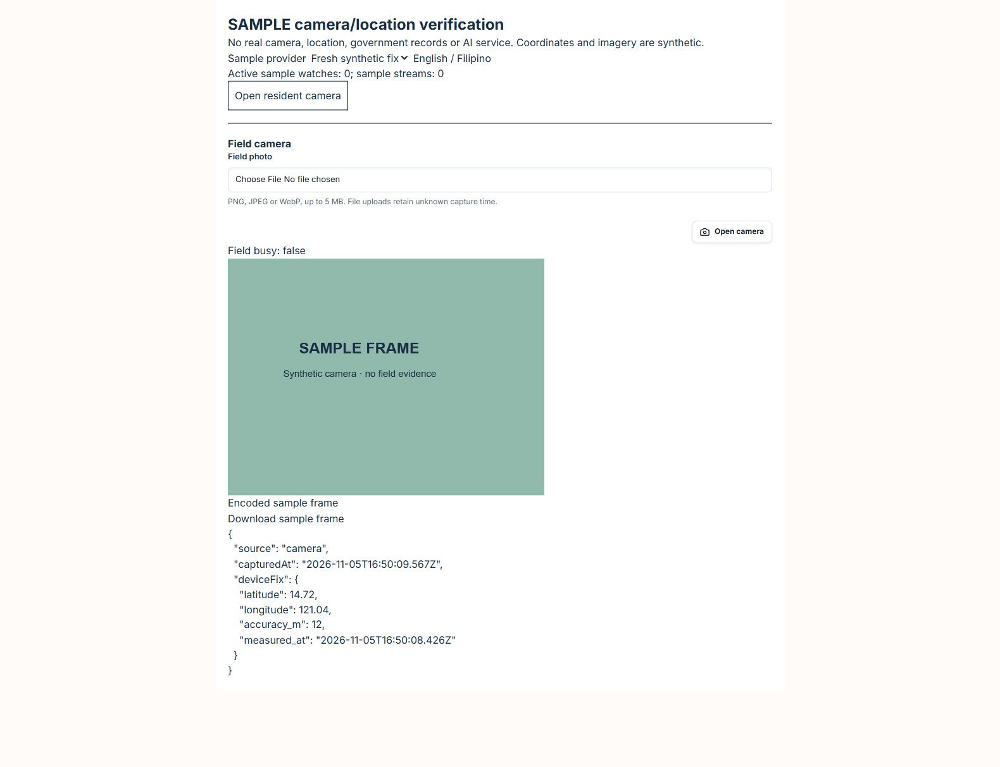

# Camera-session location sampling — 6 November 2026

**Status:** Implemented locally in the existing resident issue camera and government field camera. Not deployed. Owner: PULSO engineering. Continues the [ordinary-phone pilot tools](location-pilot-tools-2026-11-06.md). This changes acquisition/provenance handling; it does not establish a measured phone accuracy improvement, verified object location or automatic concern association.

## Observed gap and resulting behavior

The resident issue camera previously copied an existing parent location fix at shutter time, without sampling during the camera session or rejecting a stale/post-capture fix. It also burned location/time text into the encoded evidence image. The field camera similarly copied its parent fix. A map point, address or watermark cannot prove where the photographed defect is.

The shared `captureLocation` utility now performs a bounded high-accuracy `watchPosition` request while the actual issue/field camera is ready. The issue pin and original report/field location are unchanged by this sampler. It records actual provider coordinates, accuracy when positive/valid, and the original acquisition timestamp. It does not average fixes, invent a timestamp for an unknown reading, choose a map default or fit a location model.

At frame selection, the camera snapshots the latest eligible acquisition at or before that time and stops the watch. The selected fix is copied into the photo provenance. Later delivery, a later geolocation request and AI analysis cannot rewrite it. Missing, malformed, stale or future readings produce null photo location while preserving the captured image/time. An earlier valid fix is never relabeled as a new acquisition.

The existing intake contract is preserved: camera time and `photo_device_fix` remain separate from the original `device_fix` and resident-confirmed issue point. The main report wizard and Quick Report receive the camera File's existing `pulsoCapture` metadata; field capture receives its explicit photo metadata. Manual pin correction still has unknown sensor precision. No new API fields, schema migration or production database operation was introduced.

## Bounded resource and failure contract

| State/event | Result |
|---|---|
| Ready issue/field camera | Request high accuracy, zero provider cache age, a 20-second acquisition window. ID/document captures and developer sample previews do not request location. |
| Valid reading | Preserve raw coordinates and timestamp; retain positive reported accuracy up to the existing server limit. Prefer the most recent eligible acquisition time, not the smallest accuracy radius. |
| Capture | Freeze photo provenance and stop geolocation immediately; stop the camera stream once its frame is selected. |
| Permission denied / unsupported | Stop or skip sampling; keep the image capture and manual issue-pin path available. |
| Transient provider failure | Show unavailable/timed-out state; the same watch remains bounded by the overall deadline. |
| Deadline | Clear the watch even if it has returned earlier readings; do not silently extend collection. |
| Page hidden / pagehide | Stop location sampling. Returning to the page does not automatically restart that session; reopen/retake to request a new session. This location hook does not claim to control every browser's background media policy. |
| Close/unmount/replacement | Clear watch/timer; discard late callbacks. Close also cancels in-flight image analysis. A camera request that resolves after close has its tracks stopped. |
| Uploaded image | Preserve the upload path and unknown camera time; no new location/capture claim is inferred. |

The 120-second maximum association age follows the existing backend provenance freshness heuristic. It is **not** an approved accuracy tolerance, suitable matching radius or proof the phone stayed at that point. Acquisition duration and fix age are separate from positional uncertainty. They remain subject to the physical pilot's measured results and approved policy. No automatic matching behavior is enabled by these values.

## Evidence, metadata and interaction

The issue camera no longer burns metadata into camera image bytes or places its old location watermark over the live/accepted image. The accepted image uses containment so the whole encoded photo is available for review. Existing chosen aspect ratio and camera zoom/crop behavior still define the captured frame; this increment does not claim an untouched native sensor file or a redesigned camera composition.

A reusable status paragraph in an opaque control region communicates acquisition, a reported estimate/time, denial, pause, unavailable location and separate capture time. New status/error copy has English/Filipino equivalents and a polite atomic status announcement. It explicitly asks for checking the issue pin and makes no verified-location claim. Evidence remains true-color. Existing camera controls and surfaces are reused; no new accent/status palette is introduced.

The resident camera now uses a native modal dialog outside standalone developer previews. Opening focuses its Close control; background controls become inert; Escape/Close stop acquisition and return focus to the trigger. Asynchronous accepted preview focuses `Use this photo`. Field capture/close returns focus to `Open camera`. The shared camera bar's touched controls have 44 px targets and a 3 px focus treatment. The rest of the legacy camera's localization, responsive composition and accessibility are not certified by this increment.

## Design authority and limitations

Impeccable hardening/craft guidance and the PULSO frontend skill governed the existing component changes. The shared Figma file was inspected read-only on 6 November: the three pages, paired Resident Home and Government Citizen reports Reviewer final template names, and the paired layouts were observed. Guest access still displayed the sign-up/edit/inspect restriction. No binding, component-key completeness, camera-specific approved template or Figma write is claimed. PRODUCT.md and the approved evidence/provenance requirements govern where the observed watermark behavior conflicted with product truth.

**Next Figma action:** carry the reusable camera provenance rail and acquisition/denied/unknown/captured states into the appropriate shared pattern with both languages, focus transitions, real/source/sample labels and paired theme annotations using the official connector skills. The current connector/tool availability does not provide that handoff here.

## Verification

- **17 client checks passed**: bounded cleanup including watch ID zero, synchronous/provider failures, latest eligible reading, stale/future/out-of-order fixes, late callback rejection, preserved timestamps, separate issue/photo positions, and retained field-draft/intake recovery behavior. The report-intake entry also runs its existing assertion script; the total is the Node runner's count, not a count of individual assertions.
- Targeted ESLint completed with zero errors. Existing unused-symbol and effect-dependency warnings remain in the legacy camera components. The production frontend build passed with the existing large-bundle advisory.
- A local Vite-only fixture at `/tests/capture-location-review.html` supplies explicitly synthetic MediaStream frames and geolocation callbacks, and returns an unavailable AI response locally. It makes no real camera/location/AI/database requests. It exercises the actual resident and field components and displays remaining provider subscriptions and the encoded frame/provenance.
- Browser checks verified fresh-fix capture in both cameras; denied location with null photo fix and a preserved image; zero watches/streams after capture and close; modal focus, Escape and return; field capture focus; and English/Filipino status rendering. A requested 320 px viewport was actually clamped to **355 CSS px** by the browser. The camera dialog had matching 356 px client/scroll widths there, without internal horizontal overflow. Exact 320 px is not claimed.
- Synthetic screenshot below shows the encoded frame, its explicit source label and separate provenance receipt. It contains no real location or civic outcome. Physical Android/iPhone accuracy, permission prompts on those devices, exposure-time synchronization, 200% zoom, forced colors and full screen-reader behavior remain unverified. The pilot toolkit remains the route to measuring real behavior.

Camera provenance is preserved for the current capture and existing pending-operation recovery. The subsequent [resident draft recovery increment](resident-draft-recovery-2026-11-06.md) adds account-scoped original-photo reload recovery to both resident flows. Neither increment authorizes a training dataset. Reliable same-object association, reviewed corrections, real outcome collection and evaluated ETA/maintenance models remain part of the active development objective.

Follow-up: [Camera request provenance](camera-location-request-provenance-2026-11-06.md) adds explicit attempt start/end, first callback delivery, outcome and stop reason to retained camera-frame metadata and pilot extraction. Legacy request history remains unknown; these client observations do not verify accuracy.
