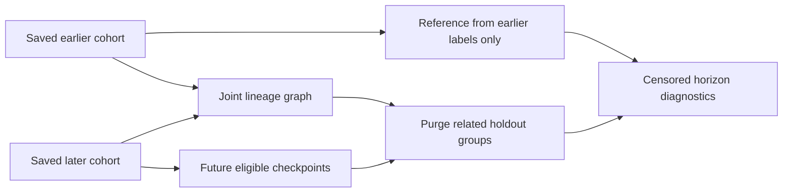

# Checkpoint temporal baseline diagnostics

Status: implemented local offline analysis, November 7, 2026. Technical owner: PULSO engineering; physical-episode/outcome adjudicators and model-release owners remain outstanding. This follows the [frozen-checkpoint cohort](checkpoint-outcome-cohort-2026-11-07.md). It provides a global descriptive reference for later model comparison. Personalized/live ETA, validated performance and production release remain pending. An [offline experimental LightGBM comparison](checkpoint-lightgbm-experiment-2026-11-07.md) now builds on this reference; it does not approve a release dataset or live serving.

## Two saved snapshots, one training clock

`backend/scripts/evaluate_checkpoint_baseline.py` requires an earlier saved cohort export and a strictly later saved cohort export. Each contract is verified before analysis. Current labels cannot be split retrospectively by prediction date and presented as historical training knowledge: completion, invalidation or membership information might have arrived later.

The earlier export's `as_of` is the training cutoff. Only its eligible verified/censored rows contribute to the reference curve. A holdout checkpoint must have a prediction clock strictly after that cutoff, be eligible in the later export, and belong to a group absent from the entire earlier source footprint. Excluded earlier records still contribute grouping keys, preventing a hidden bridge from leaking related later cases into the holdout.



Repeated checkpoints must preserve their immutable checksum, concern/version, clocks, features and frozen lineage across exports. Asset-review references can change as later knowledge arrives; a joint concern/report/asset/area graph uses them only for conservative purge/audit. Training support requirements use groups known in the **earlier snapshot only**. Later discovered linkage cannot turn an earlier reference on/off or change its input labels.

Later changes to a historical row's outcome/eligibility are counted separately; they never filter or rewrite its earlier training label. A checkpoint newly visible in the later snapshot with a pre-cutoff prediction time is counted as newly visible nonfuture context and is not retroactively inserted into training or treated as future holdout.

The source-instance key is an operator claim, not an authenticated issuer identity. Frozen-content consistency checks detect some mixups; they cannot prove two files came from the same installation. Input origin remains unattested, or explicitly synthetic if either snapshot is synthetic.

## Reference curve and support

The implementation uses the installed `scipy.stats.ecdf(CensoredData(...))` survival function. SciPy documents this as Kaplan–Meier estimation for right-censored samples. The runtime version is recorded in output. No new dependency was installed. [SciPy ECDF documentation](https://docs.scipy.org/doc/scipy/reference/generated/scipy.stats.ecdf.html)

Verified rows contribute event times; open right-censored rows contribute their observed follow-up bounds. Competing/excluded outcomes remain excluded with their state counts. They are never converted into zero-day repairs or ordinary censoring. The curve describes the **provided eligible checkpoint population**, conditioned on export-time outcome/membership eligibility. Independent censoring, stable service processes and representativeness have not been established.

The working policy explicitly supplies grouping, horizons, minimum training groups and minimum completion events. These are user-selected analysis settings, not approved acceptance thresholds. Empty/insufficient training support produces an unavailable reference. An all-censored sample can leave the median unreached; the output is null. A requested horizon beyond maximum observed training follow-up also returns an unavailable value, rather than extrapolating the flat tail.

Each checkpoint is an analysis unit. Related checkpoints retained within one partition are dependent; counts/groups are shown separately and no independent-sample confidence intervals are emitted. Report/asset/area grouping options are explicit. Requesting asset-based grouping requires scoped reviewed-reference coverage in both snapshots. This does not certify that the physical inventory or episode grouping is complete.

## Holdout diagnostics and missing status

At a horizon `h`, the observed binary status is known when a verified completion time is recorded, or a censored checkpoint was followed unresolved for at least `h`. Censoring earlier than `h` leaves status unknown. Unknowns are counted and retained in the full holdout denominator.

The output reports known-status coverage and squared error on that known subset. It also supplies PULSO-defined worst-case bounds on the full eligible holdout's binary squared error, conditional on the provided operational labels being correct. For a constant completion reference `p`, `k` unknown statuses and `n` total holdout rows:

```text
lower = (known_error_sum + k * min(p², (1-p)²)) / n
upper = (known_error_sum + k * max(p², (1-p)²)) / n
```

These are algebraic missing-status bounds, not sampling confidence intervals, ETA intervals or proof of calibration. No independent-censoring weighting is implemented. Standard time-dependent Brier scoring uses censoring adjustments such as IPCW and training-support restrictions; the selected-subset diagnostic here must not be renamed that metric. [scikit-survival Brier-score documentation](https://scikit-survival.readthedocs.io/en/stable/api/generated/sksurv.metrics.brier_score.html)

No eligible independent future holdout produces null error/coverage values and an explicit holdout status. Perfect-looking scores are not manufactured from empty sets, unsupported horizons or filtered unknown outcomes. All future entries are accounted for as purged, eligible holdout or excluded; assignments retain private checkpoint/group references.

## Offline use

Retain the first authorized export at the actual training cutoff, then collect a second authorized export after later checkpoints and follow-up exist. Keep both in an existing controlled private directory. Use the collector's `--dataset checkpoints` workflow from the cohort notes.

All settings in the following **SAMPLE syntax** must be replaced by the actual working analysis choices. The numbers are not a production support or service policy:

```powershell
backend/.venv/Scripts/python.exe backend/scripts/evaluate_checkpoint_baseline.py `
  --training C:/PrivatePulso/earlier-cohort.json `
  --evaluation C:/PrivatePulso/later-cohort.json `
  --source-key pilot-installation-01 `
  --grouping shared_report_or_reviewed_survey_asset `
  --horizon-days 2 --horizon-days 4 `
  --min-train-groups 1 --min-train-events 1 `
  --output C:/PrivatePulso/baseline-analysis-01.json
```

Group choices are `shared_report`, `shared_report_or_reviewed_survey_asset` and `shared_report_asset_or_recorded_area`. Working horizons are positive elapsed 24-hour days, not business-day schedules. The implementation bounds each file at 64 MiB, each snapshot at 5,000 rows, horizons at 20 distinct values up to 3,650 days, and support counts at 5,000. These are resource bounds. Existing output is never overwritten; invalid input/runtime saves no result and errors omit private values.

This command does not access a database, provider or network and does not deserialize an executable learned-model artifact. Its output remains private operational data, not anonymized. `training_release_eligible` and `live_inference_allowed` are always false, with explicit source/adjudication, censoring, conditional-selection, working-policy and prospective-comparison blockers. Existing live resolution estimates remain unreleased.

## Verification and SAMPLE artifacts

**40 focused offline checks passed** across the temporal reference and cohort contract. They cover hand-computable event/censor ties, censor-aware horizon truth, missing-status bounds, unsupported tails, all-censored/empty support, future label changes, newly visible old points, frozen-context conflicts, group purge, asset-reference changes, working-policy errors, private errors and exclusive output. A standalone subprocess passed with networking, database and provider access blocked.

**1 actual API-export integration check passed** on disposable PostGIS. It saved successive real product exports with synthetic reports, recognized a genuinely later independent checkpoint, then purged related future checkpoints after a later grouping decision without rewriting the earlier training source. Schema remains `30b4c5d6e7f8`; no migration, UI/Figma change or production deployment occurred.

Constructed **SAMPLE contract fixtures only**, including illustrative references/hashes and manually assigned event times:

- [Earlier snapshot](evidence/checkpoint-baseline-SAMPLE-training-2026-11-07.json)
- [Later snapshot](evidence/checkpoint-baseline-SAMPLE-later-2026-11-07.json)
- [Descriptive analysis](evidence/checkpoint-baseline-SAMPLE-result-2026-11-07.json)

These demonstrate arithmetic and software behavior, not observed city repair times or model accuracy. The next model stage requires authentic independently adjudicated outcomes, observation-level evidence coverage, representative prospective collection and a separately reviewed LightGBM candidate/release policy. The global reference does not supply those missing guarantees.
