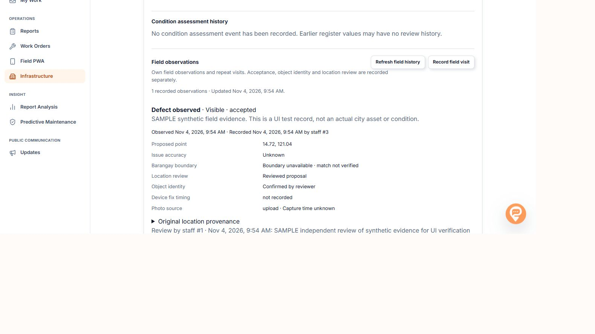

# Field-survey workspace — 4 November 2026

**Status:** Implemented locally, not deployed. Extends the existing Infrastructure register and asset record; no new primary navigation or report lifecycle is introduced. This is the UI increment following [first-party field inventory](first-party-field-inventory-2026-11-03.md) and [resolution learning history](report-resolution-learning-2026-11-03.md).

**User/job:** Authorized staff record an infrastructure candidate or repeat site visit from their own observations. A separate authorized reviewer reads the evidence and records acceptance/rejection, identity confirmation and location review. Outcome: one persisted observation with traceable private evidence and an actual server receipt.

**Owner/version:** PULSO engineering/product; implemented increment v1, last validated 4 November 2026. Pilot boundaries, survey rubric, real-phone accuracy tolerance, identity adjudication, evidence governance and model release remain owner decisions. Implementation authorization does not establish an LGU service policy.

## Where it appears

- `/gov/assets`: **Record field candidate** is available only when the field-permissions API authorizes it. Existing search, category/condition filters and selection continue to work.
- Selected and full asset records: **Field observations**, **Refresh field history**, **Record field visit**, paginated findings and private evidence. Record selection remains in the existing URL; the full-record route uses the same component.
- Server-authorized independent reviewers receive Accept/Reject controls for another person's pending observation. Visible findings require opening the private evidence before the UI enables acceptance. The backend independently enforces eligibility, evidence requirements and immutable review.

New candidates use the existing register with unknown owner, condition score, material and completion data. Acceptance does not constitute official asset approval or a calibrated condition assessment. The existing reviewed-inspection and official registry workflows remain visibly separate.

## Capture, point quality and device drafts

The form records name/category/barangay for a new candidate, claimed observation time, proposed point, visibility, condition and notes. The observed time starts blank; **Use current time** records an explicit operator choice. Repeat visits target an existing stable asset ID. Unsafe, missing and invisible sites remain `not_assessed` and cannot be selected as no-defect findings.

**Use device location** requests an uncached high-accuracy estimate, retains its measurement time/accuracy, and leaves issue-point confirmation to the operator. Manual input remains available after denied/unavailable location. Moving the point retains the original sensor fix and does not transfer its accuracy to the edited pin. Neither phone coordinates nor reviewer confirmation establish exact object position.

Camera capture uses the actual frame boundary for `photo_captured_at` and retains the latest available original device fix with its own time. It does not relabel that fix as a simultaneous independently verified object measurement. Streams stop on close, replacement, unmount or submission. Denied/unsupported camera access retains file upload. Uploaded files retain unknown capture time; file selection time is not substituted for shutter time. Photographs are displayed in their natural colors with metadata outside the image.

Draft values and original photo bytes are stored in the existing device IndexedDB store, under staff/target-specific keys. The UI distinguishes Saving, Saved, Restored, storage failure and unconfirmed submission. A pending operation freezes the original payload, photo and random operation key. Receipt recovery runs before an uncertain retry; edits never silently replace that original operation. Definitive validation/auth/rate-limit rejection permits correction. Missing/malformed receipts remain uncertain. Device storage failure prevents a new network submission, and unsaved changes have a browser unload guard.

Web Locks serialize supported tabs; a local promise queue coordinates operations within a tab. These controls do not establish a cross-browser/device synchronized draft service. Device drafts contain private field context and require the pilot's shared-device/retention policy. A confirmed server receipt remains authoritative even if local draft cleanup fails; the old operation can be recovered again safely.

## Atomic photo intake and storage coordination

New multipart endpoints commit candidate metadata, its first observation, audit and private-photo metadata in one database transaction. Repeat capture similarly commits one visit/photo against the existing asset. The image bytes form part of the request fingerprint. Concurrent unchanged replays create one observation/photo; changed payload or photo with the same operation key conflicts.

Pre-commit failures remove staged bytes and roll back rows. If commit acknowledgement is uncertain, bytes are retained so an actually committed receipt never points to a deleted photo. Existing inspection uploads use the same image validation/storage helper. Exclusive filename collision cannot overwrite or remove existing bytes.

The existing scoring maintenance worker now also reconciles old orphan image files. Only canonical UUID image names within the private root, older than 24 hours and absent from evidence metadata, qualify. Producing transactions hold a per-image PostgreSQL lock; cleanup skips active producers and uses read-committed checks. A persistent cursor advances through batches of 100 eligible filenames, including referenced files, to avoid starving later orphans. Known evidence metadata is handled by the existing unattached-evidence retention checks, which preserve attached field observations. This work does not start or schedule a production worker and does not promise deletion exactly at 24 hours.

An evidence reference can support only one field observation. Fresh content/physical revisit authenticity still requires review; this increment does not detect re-encoded/copied photographs or provide content-level fraud detection.

## API additions and compatibility

| Method/route | Contract |
|---|---|
| `GET /api/gov/field-inventory/permissions` | Authorized record/review flags, current staff ID and scoped valid barangays. No role grants or presence mutation. |
| `POST /api/gov/field-inventory/assets/capture` | Multipart `payload` JSON plus optional `image`; a visible finding requires a photo. Required `Idempotency-Key`. |
| `POST /api/gov/field-inventory/assets/{id}/capture` | Same atomic multipart visit against the existing scoped asset. |
| `GET /api/gov/field-inventory/receipt` | Own committed operation, identified by the key header and original `create_capture`/`observe_capture` kind/target. Missing result returns 404 without declaring an in-flight request failed. |

Existing JSON collection/CLI endpoints remain available. Candidate input uses singular class labels; storage now follows the existing register's canonical category names. Legacy singular categories remain discoverable through the matching category filter. The API continues to enforce active/accepted staff status, capabilities, district scope and source/evidence ownership. Read permissions do not confer recording or review authority.

No schema migration is added by this UI increment. The application still requires head `27e1f2a3b4c5` from earlier increments. Configured application and production databases were not migrated.

## State, accessibility and design contract

- Native shared `GovConfirm`, `GovButton`, fields and record components; server fields drive success, permission and review state. Empty history is shown only after a successful response. Failed/denied fetches expose a retry, not a legitimate empty list.
- Candidate/visit form focuses the first meaningful field after device-draft restoration. Uncertain recovery focuses the original-save action. Cancel returns to its trigger. Successful review returns focus to the stable Field observations heading after asynchronous row replacement, preserving context when action buttons disappear.
- Keyboard/Escape use the native dialog boundary. Saving blocks mutation/cancel controls; storage and device operations have explicit states. The new `GovConfirm.confirmDisabled` option preserves the existing busy behavior for other dialogs while avoiding a false Saving label during camera/location acquisition.
- Shared light/dark tokens, visible 3 px focus, form targets at least 44 px, single-column narrow form, wrapped history actions, text location alternatives and explicit non-color state labels. Government copy is English; no resident localization contract changes.
- No new model predictions, verified GPS claim, automatic asset merge, provider identity claim or manufactured public metric.

The live Figma file was inspected read-only on 4 November. The three pages and both government Reviewer final template names were observed, with the paired layouts and a closer dark-docket view. Guest access exposed the sign-up/inspect restriction. No component/binding completeness, current token rebinding, prototype behavior or Figma write is claimed. The implementation inherits the existing Infrastructure/GovWorkspace controls and the user-approved current Reports presentation, including the later palette corrections in PRODUCT.md; older template color values are not silently promoted over those corrections.

**Next Figma action:** use the official connector skills to extend the shared asset record/dialog patterns with field-candidate, revisit, recovery, evidence and independent-review states; annotate both themes, narrow layout, permissions, source metadata and focus behavior. This remains an implementation handoff limitation.

## Verification

The backend checks cover atomic capture/replay, byte fingerprints, scoped receipt recovery, rollback, uncertain commit acknowledgement, private evidence access, permission projection and register filtering. Client checks cover original-payload/photo recovery, incomplete receipts, definitive rejection, account/target partitioning and storage/cleanup failure. Storage reconciliation checks cover age/name boundaries, active producers, committed metadata, cursor progress, isolation and exclusive-write collisions.

- Final backend regression: **70 passed** across capture, reconciliation, field inventory, existing inspection routes and report learning. A subsequent focused exclusive-filename collision check passed after adding that guard; these results are reported separately.
- Client recovery/payload checks: **8 passed**. ESLint passed on the new survey components/utilities and affected asset components. The shared GovWorkspace module retains its pre-existing Fast Refresh export advisories.
- Production frontend build passed; its existing large-chunk advisory remains. Python compilation and Git whitespace checks passed. No benchmark or complete WCAG certification is claimed.

Live browser/API verification used the named disposable PostGIS database and explicitly synthetic staff, area, notes and photo. A sample inspector created one candidate and one evidence-backed observation, reloaded/restored the original draft/photo before submission, recorded an unsafe revisit on the same asset, and could not self-review. A separate sample engineer opened private evidence, accepted the visible finding and rejected the unsafe sample. A further synthetic pending fixture exercised asynchronous focus return. The register retained unknown ownership/condition and the candidate state. After test resets, a separate synthetic API fixture supplied the final screenshot record; the full-record UI confirmed its private image and original-location disclosure. Screenshot identifiers/times are test records, not field outcomes.

Desktop light/dark and a requested 320 px breakpoint were inspected. The browser actually clamped the narrow viewport to **355 px**; dialog scroll/client widths matched there. Exact 320 px, physical Android/iPhone camera/GPS accuracy, camera permission fallback on actual hardware, 200% zoom, forced colors and full screen-reader behavior remain unverified. No model performance, real infrastructure record or production outcome is inferred from this QA. The legacy asset detail also loaded its existing Google map and clearly marked Open-Meteo testing context at synthetic coordinates; these were not GPS measurements or approved failure-model results.

## Remaining work

Carry the field patterns into reusable Figma artifacts; run the real-phone/position-reference pilot and accessible device checks; define the condition rubric, consent/retention and reviewed identity/correction rules; then add evaluated image/object matching and versioned learning-data exports. ETA and recurrence models still require authentic collected outcomes and prospective validation. The broader PULSO development objective is not complete merely because this increment passes local checks.
