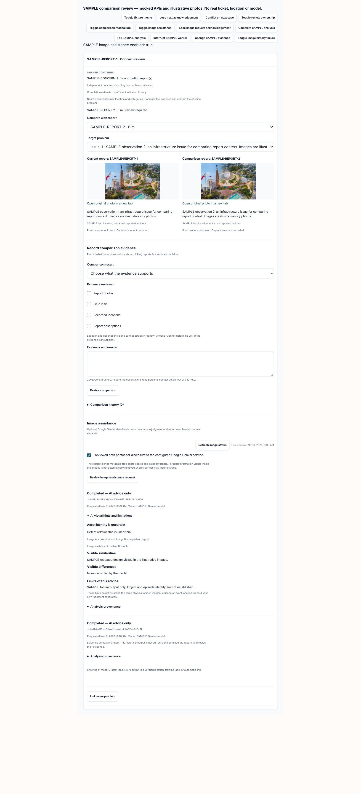

# Staff image-assistance request and advisory UI

**Status:** observed local implementation; not deployed. **Version:** 1. **Owner:** PULSO development. **Last validated:** 6 November 2026. The actual provider feature remains disabled by default. The UI does not approve provider disclosure policy, model selection, empirical matching accuracy or automatic association.

## Staff outcome and flow

The existing observation comparison now includes **Image assistance**, below the separate human judgment/history controls. A reviewer can inspect provider status, explicitly request analysis of the two recorded photos, recover an interrupted request, and read bounded visual advice with provenance. The original comparison photographs and manual review remain available.

Requesting requires a fresh checkbox acknowledging review of both photos for disclosure to the configured Google Gemini service, followed by a native confirmation dialog. Copy explains that metadata-free derivatives and category focuses are sent, visible personal information inside the pixels is not automatically removed, and a provider call can incur charges. The acknowledgment is not restored as a new consent after reload, success, failure or conflict. Recovery of an already confirmed command uses its original acknowledgment/key, not a new disclosure request.

The server returns `can_request` and a blocking explanation derived from the deployment flag, ownership of both report-review decisions, recorded photo references and any active pair job. The web UI uses this eligibility together with the fetched pair context. POST independently enforces authorization, scope, ownership, versions and disclosure acknowledgment. Disabling the feature prevents new requests; authorized historical jobs and original-key receipt recovery remain readable. The feature flag is not a provider-health guarantee.

After a confirmed request receipt, the UI shows its actual job ID and directs the reviewer to job history for current status. It does not invent queued/completed state or estimate a finish time. A waiting job explicitly needs an operated worker. History supports queued, running, interrupted/expired lease, failed, cancelled, completed and stale-context states. Failed or interrupted calls may already have incurred a charge; another analysis is a new explicit request. There is no automatic POST/resend loop.

## Advice and provenance

Completed output is labeled **AI advice only** and distinguishes asset appearance from visible defect similarity. It displays visible similarities, visible differences and limitations as separate text. Image A/B are mapped back to the current/comparison report using the server's canonical observation IDs, not assumed to follow request order. Usability flags do not certify infrastructure identity.

The component refuses to render a result as current advice unless the job is complete, the server says its record context is current, and its result retains the required review/episode/location/training limits. Stale-context hints are hidden and replaced with a clear historical-output explanation. Incomplete or contradictory wire contracts are errors, never legitimate empty results or request receipts. Generated text is rendered as ordinary React text; no HTML, executable instructions or provider-suggested actions are accepted.

The model's result does not prefill the human result selector, reason or evidence basis. There is no apply-match control. Recording a human judgment and linking reports retain their separate confirmations and backend permissions. Job details expose requested/finished time, model identifier, provider-reported model version when available, prompt/derivative recipe, and original/derivative SHA-256 checksums. Missing model-version/time data stays explicitly unrecorded. History shows at most 10 latest jobs and is not an exhaustive archive.

## Request durability and failure handling

`pairImageAssistance.js` prepares the four source/target report/concern versions from the canonical pair context without sending the human label. Before POST it atomically persists the original payload and a random operation key to an account/pair-specific IndexedDB slot. Concurrent prepares and retries reuse a pending original command. Missing/corrupt storage prevents a new request. The authenticated subject is checked again before transmission and the captured token is used for that request; backend authentication remains authoritative.

A lost acknowledgement or incomplete receipt freezes new requesting and exposes **Recover original analysis request**. Reload restores that operation. Recovery replays the original key/body and checks that the returned UUID, expected observation IDs, states and required safety flags form a complete job receipt. Edited context cannot substitute a new payload for an uncertain command. If device receipt cleanup fails after a valid server response, the received job remains confirmed and the retained original can be recovered before another request.

Definitive rejection allows a corrected command. A version conflict resets the disclosure checkbox and offers **Reload report evidence and status**, which refreshes both source and target evidence as well as the pair context. This refresh is also used by the existing human comparison conflict action, so newly fetched versions are not presented against old photograph references. The existing device draft behavior preserves the human reason where safe; a new request needs a fresh photo review/confirmation.

Local command records contain private operational references and are partitioned by session subject; this is neither encryption nor backend authorization. Browser-profile sharing, eviction, clearing and device loss retain the limitations documented in the existing draft workflow. Pending requests are not silently discarded or replaced. Device records are replaced on a subsequent prepared command; they are not an authoritative current job archive.

## Freshness, layout and accessibility

The component uses the incumbent engineering docket's `GovButton`, `GovState`, `GovConfirm`, theme variables and quiet ruled sections. Human review remains visually and semantically separate. The new checkbox has a 44 px label target; controls inherit the existing 44 px/3 px focus treatment and native dialog/checkbox/button/details semantics. Long identifiers, hashes, disclosure text and model limitations wrap. No new navigation, brand palette, font stack or decorative animation was introduced.

Manual **Refresh image status** exposes a last-checked time. While a known job is queued/running, GET status polling runs every five seconds only while the document is visible. It stops on a terminal/expired job, fetch/contract error or unmount. It never invokes the provider or repeats POST. Background refresh is explicitly labeled; old hints are not shown as current while their history is being refreshed or has failed. There is no real-time claim or fabricated progress percentage.

Loading, disabled, empty, recoverable error, permission-limited, incomplete-response, uncertain-request, conflict, stale and success states use text and status/alert roles. Native confirmation starts with Cancel focused and makes the background inert. A successful request focuses its receipt; an uncertain request focuses recovery; other errors focus their explanation. Light/dark preserve content/actions and raw evidence. This staff addition follows the existing English workspace contract; it is not a resident-language expansion. No analytics event was added without a measurement plan.

## Design source and handoff

Impeccable hardening/craft guidance and the PULSO frontend skill governed this increment. The live [shared Figma file](https://www.figma.com/design/1qPgPj4o3smElv8B2B1REi) was inspected read-only again: its three pages, paired Government Citizen reports Reviewer final names and paired overview layouts were observed. Guest access continued to show edit/inspect restrictions. Official Figma connector capabilities were unavailable. No Figma write, comparison-specific approved frame, binding audit or prototype interaction is claimed.

Next official Figma handoff: add paired request/disclosure, queued/running/interrupted, failed-fetch, current/stale advice and original-command recovery states to the shared government report comparison pattern, with canonical image mapping, bounded history, copy/focus and provider-disclosure annotations. This repository implementation is observed behavior; the broader proposed lifecycle and provider-release decisions still need their named owners.

## State matrix

| State | UI behavior |
| --- | --- |
| Feature disabled | Manual review remains; no new request control. Existing authorized jobs can be inspected. |
| Read-only ownership | Server explanation; no new request. Backend still enforces writes. |
| Loading/refresh | Explicit progress and last-checked context; no empty-history substitution. |
| True empty | No jobs only after a validated successful read. |
| Disclosure/confirmation | Fresh checkbox plus protected, consequence-aware confirmation. |
| Received | Actual job receipt; inspect history for progress. |
| Queued/running | No completed advice or invented duration. GET-only updates. |
| Interrupted lease | Explain uncertain progress and operator check; no automatic resend. |
| Failed/cancelled | Plain failure text, manual path and possible prior-call/new-charge distinction. |
| Completed/current | Explicit visual advice, image mapping, limitations and provenance. |
| Completed/stale | Hide visual hints; explain that the evidence context changed. |
| Lost acknowledgement | Recover original stored command before a new request. |
| Storage/incomplete response | Block new requesting and retain recoverable state. |
| Version conflict | Reset acknowledgment; reload both reports before confirming again. |

## Verification and limits

- **39 client checks passed**, including seven new disclosure/version/protocol/idempotency/storage/advice-gating checks plus existing comparison, draft, intake, capture and field recovery. The Node runner count includes an intake assertion-script entry. A later focused seven-check rerun also covers malformed/inconsistent histories; it overlaps the first run.
- **46 backend checks passed** across image jobs, observation review and report intelligence. A subsequent **15-check job rerun** includes the added server ownership/eligibility test; these runs overlap. No new migration or dependency was added; head remains `29a3b4c5d6e7`. The configured application database was unchanged. Existing warnings remain.
- Targeted ESLint completed with zero errors. Production frontend build passed with the existing large-bundle advisory.
- The browser fixture mounts real components and native IndexedDB but intercepts all API requests and uses SAMPLE jobs/results plus illustrative local city photographs. It never invokes a real provider, report API, worker or geolocation service. Browser checks are component checks, not a live browser-to-backend integration or a vision benchmark.
- Browser checks covered disabled/manual continuity; fresh disclosure and native confirmation; lost acknowledgement, reload and original-job recovery even after disabling new requests; completed/uncertain advice; stale-output hiding; evidence-version conflict and refreshed source/target context; interrupted worker and failed-provider states; failed history recovery; and unchanged empty human-judgment fields. Light/dark, wrapped notes/IDs and narrow dialog behavior were inspected. Requested 320 px was clamped to **355 CSS px**; the document scroll width matched 355 px. Exact 320 px, 200% zoom, full screen-reader/forced-colors certification and empirical accuracy are not claimed.

Real provider/account acceptance, physical-phone position trials, representative angle/lookalike datasets, automatic association evaluation, independent asset identity corrections, authentic repair outcomes, LightGBM ETA/maintenance evaluation, mobile parity and deployment remain in the active PULSO objective.
