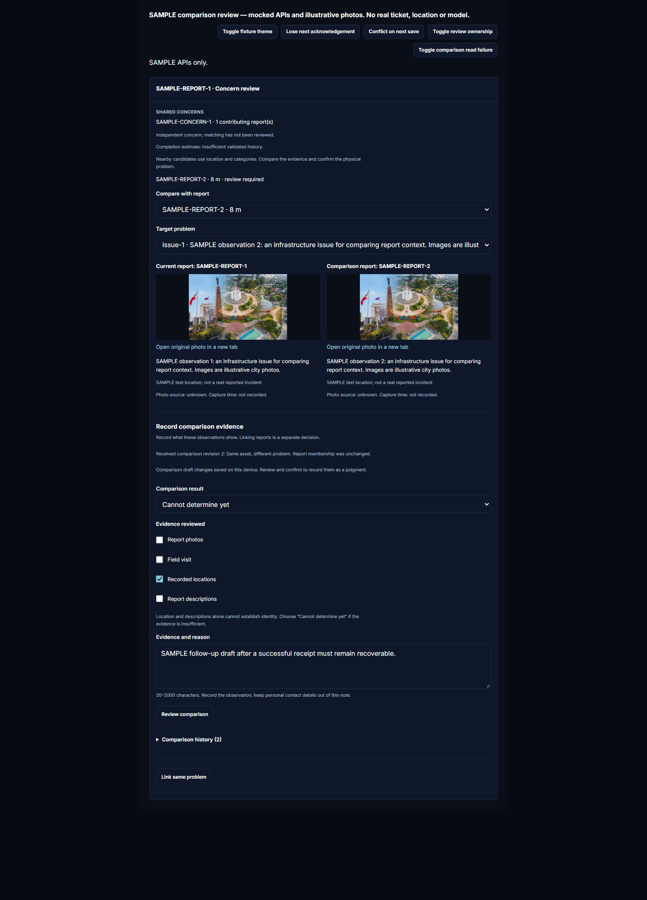

# Staff observation comparison controls

**Status:** observed local implementation, not deployed. **Version:** 1. **Owner:** PULSO development. **Last validated:** 6 November 2026. This implements the existing backend [pair-review contract](observation-pair-review-2026-11-06.md); it does not approve the proposed wider government lifecycle or release an automated matching model.

## Staff job and flow

Within the selected report's **Shared concerns** section, an authorized reviewer selects a nearby report and one of its observations. The comparison shows both recorded photos, observation descriptions, address descriptions and photo source/capture-time claims outside the true-color images. Photos link to their originals; absent and failed-image states retain a text path through the report. Opening a comparison does not establish that its coordinates or physical object identity have been verified.

**Record comparison evidence** offers four results: Same problem episode; Same asset, different problem; Different assets; Cannot determine yet. Evidence basis includes report photos, field visit, recorded locations and descriptions. A decisive result requires photos or a field visit; location/description alone remains insufficient. The reason is required (20–2000 trimmed characters). A native confirmation dialog names the consequence before saving. Field-visit and photo judgments remain staff assertions, not automated object recognition or independent proof of a visit.

A returned receipt identifies the recorded comparison revision and result. History displays the latest 20 immutable judgments, their reasons, basis, staff ID/time and whether their evidence context has changed. The view explicitly explains its bound and that these are reviewer judgments. A comparison label does **not** change report membership, tickets, statuses or assignment. The existing **Link same problem** and **Separate this observation** commands remain separate, consequence-aware decisions with their own reason/version checks. Distinct-asset/problem labels are disabled when both observations already share a concern; membership must be reviewed and separated first.

## Shared components and visual authority

`ObservationPairReview` extends the existing `ReportConcernReview` inside the engineering docket, using `GovButton`, `GovState`, `GovConfirm`, the existing government theme variables, ruled sections and a quiet two-image comparison region. The paired region is secondary to the docket's original evidence aperture. At 540 CSS px and below, the photos stack; controls and notes wrap instead of shrinking the desktop composition. Native fields use 16 px text, touched targets are at least 44 px high, and focus uses the existing 3 px theme treatment. No new palette, font stack, motion or navigation model is introduced. Existing product-approved government surfaces take precedence over older conflicting accent proposals.

Impeccable hardening/craft guidance and the PULSO frontend-design skill governed the work. The live [shared Figma file](https://www.figma.com/design/1qPgPj4o3smElv8B2B1REi) was inspected read-only in this increment. Its three pages, paired Government Citizen reports Reviewer final template names, and paired overview layouts were observed. Guest access still showed the sign-up/edit/inspect restriction. Official Figma connector capabilities were unavailable; no binding audit, comparison-specific approved frame, Figma write or prototype behavior is claimed.

**Next Figma handoff:** add the reusable comparison/result/basis/history pattern and restored-draft, uncertain-save, ownership-limited, failed-photo, failed-fetch and conflict states to the appropriate paired government Citizen reports docket references, using the required official Figma skills. Preserve source/target identity, focus transitions, permission and bounded-history annotations. The current repository implementation is observed behavior, not retroactive visual approval.

## Authoritative data and permissions

The staff-only intelligence projection adds `staff_evidence` and `can_review_pairs`; owning residents do not receive these staff fields. Existing report access and scope checks run before they are returned. The pair endpoint returns `can_record_review`, `current_user_id` and an ownership-limited explanation. The UI uses this server decision; POST independently rechecks identity, active/invitation state, capability, jurisdiction, ownership, report/concern versions and pair revision. It does not infer permissions from the role label. Linking also requires source and target `can_associate` eligibility.

Canonical pair ordering does not swap source and target versions: the browser maps `source_observation_id`/`target_observation_id` back to the canonical left/right evidence before preparing the command. API failures retain their error state and retry path, never an empty-history claim. Existing nearby retrieval remains bounded and review-required. No numerical ETA, confidence score, exact-location claim or automatic duplicate merge is introduced.

## Drafts and interrupted commands

The form uses the shared account-partitioned, revision-checked IndexedDB draft controller with a dedicated pair-specific key. It preserves relation, basis and reason while navigating between comparisons or reloading and requires a fresh confirmation against the fetched evidence. The inherited 24-hour restore window is a logical restore limit, not physical deletion. Browser storage clearing/eviction, lost devices and private-browsing restrictions remain unrecoverable by this device-only store.

`observationPair.js` separately persists a frozen command and random idempotency key in an atomic IndexedDB transaction **before POST**. Concurrent prepare/retry calls reuse a pending original payload rather than replacing it with edited text. If acknowledgement is lost, the form freezes and offers **Recover original comparison**, which replays the original key/payload through the backend's idempotent receipt path. A reload restores this recovery state. A complete receipt must identify the expected observation pair and relation and explicitly report unchanged membership. Incomplete responses and transient failures remain uncertain.

Definitive rejected commands allow a corrected attempt. Version conflict preserves the form and locks recording until **Reload comparison** fetches current evidence/history; staff must review and confirm again. Storage read/write failures block a new command. A confirmed server receipt remains successful if its device receipt write fails; replaying its original key recovers that receipt. Device confirmation records are replaced on the next prepared command, not treated as authoritative current server history.

Cache partitions use the session subject for continuity, not authentication or encryption. The request captures the current token and checks that its subject still matches the comparison's subject before transmitting. Local drafts/notes and command records are private operational data in the browser profile, not anonymized information or a substitute for governed retention. Sharing a browser profile shares its device storage. These new controls do not add a resident/public view of staff judgment notes.

The shared draft hook now explicitly resumes saving after clearing a completed draft and reloading its controller. Browser verification covers a second form edit after a successful comparison, followed by reload and restoration; it no longer silently stops autosave after the first receipt.

## State and accessibility contract

| State | Behavior and recovery |
| --- | --- |
| No target selected | Existing report context and bounded candidate choices; no invented comparison. |
| Loading | Explicit fetch/device-recovery progress; recording unavailable. |
| First-use / empty history | Form after successful reads; explicit no recorded judgments. |
| Restored / saving / saved draft | Device-only wording, fresh evidence review/confirmation; no server-save claim. |
| Expired draft | Explicit 24-hour restore limit; no silent deletion claim. |
| Unavailable or failed photo | Text remains; open the authorized report to inspect evidence. |
| Failed or denied fetch | Error and retry/session path; no legitimate empty history. |
| Ownership-limited | Server explanation; form disabled while history remains readable when authorized. |
| Inconclusive evidence | Cannot determine yet is an explicit valid result. |
| Validation failure | Specific correction text; input retained; no request for a location-only decisive label. |
| Confirmation | Native modal, background inertness, Cancel initial focus, explicit recording consequence. |
| Uncertain save | Original result/reason shown, new recording frozen, recover original key. |
| Version conflict | Input retained; reload current context, review and confirm again. |
| Draft conflict | Explicitly load saved version and replace this tab; no silent overwrite. |
| Confirmed receipt | Actual revision/result, unchanged-membership consequence and refreshed history. |

Native form/select/fieldset/legend/checkbox/textarea semantics support keyboard operation. Errors use alerts; progress and receipts use status announcements. Confirmation closes back to the trigger when usable; an uncertain-save error focuses recovery, validation/conflict focuses its explanation, and a successful command focuses the receipt. The form then supports another draft. Light and dark contain the same fields/actions/content. English follows the existing staff workspace language contract; this increment is not a resident-facing localization expansion. No analytics event was added without a measurement plan.

## Verification and remaining limits

- **32 client checks passed**, including six new pair/version/label/replay/storage/receipt checks and the prior shared draft, intake, capture and field-recovery checks. This is the Node runner count, not an additive assertion count; one intake entry also executes its existing assertion script.
- **32 backend checks passed** across observation matching and report intelligence, including staff-only evidence projection, source/target review ownership and server-supplied recording eligibility. No migration was added; head remains `28f2a3b4c5d6`. The configured application database was not migrated or reset.
- Targeted ESLint completed with zero errors. Production frontend build passed with the existing large-bundle advisory. Existing backend warnings remain (132 in the selected run).
- The Vite fixture `/tests/fixtures/report-intelligence.html` mounts the actual components and native IndexedDB but intercepts all API requests. Its SAMPLE records, receipt dates and illustrative city photographs do not depict real report matches. No actual report/provider/AI/geolocation call occurs.
- Browser checks exercised two-report selection and evidence rendering, draft reload, original-key recovery after a lost acknowledgement and reload, receipt/history consistency, retained input after conflict, ownership-limited controls, failed fetch, location-only validation, modal focus and success/error focus, and a second autosaved draft after a successful receipt. Desktop columns and narrow stacking were checked in light/dark. Requested 320 px was clamped to **355 CSS px**; document scroll width matched 355 px. The confirmation dialog fit within that width. Exact 320 px is not claimed.
- This is component-browser verification plus separate real HTTP/backend contract tests, not a live browser-to-backend end-to-end claim. Physical Android/iPhone accuracy, different-angle object recognition, image-model evaluation, full screen-reader/forced-colors behavior, 200% zoom and deployment remain unverified.

Remaining PULSO work includes measured real-phone location trials, actual same-object/adjacent-lookalike labels, image-assisted comparison with provider/failure provenance, evaluated automatic association, authentic completion/recurrence outcomes and validated ETA/maintenance models. This UI makes first-party review data collection usable; it does not establish those model capabilities.
