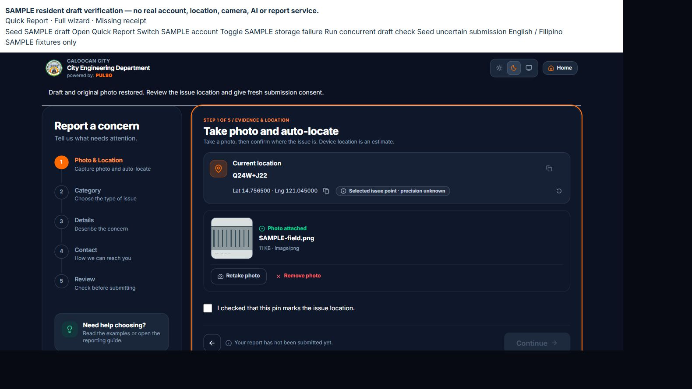

# Resident draft and original-photo recovery

**Status:** observed local implementation, not deployed. **Version:** 1. **Last validated:** 6 November 2026. **Implementation owner:** PULSO development. Product/LGU approval of the broader proposed lifecycle, retention policy and location thresholds is not implied.

## Job and behavior

A resident can reload Quick Report or the full report wizard and recover the saved original photo, its separate provenance, issue point, categories and entered details on the same browser/account. A restored draft is still unsubmitted. The resident must check the issue pin and give fresh submission consent. Restoring coordinates does not restart GPS and silently move the point. A camera timestamp is retained only with its original camera photo; a file upload does not inherit one. Manual points have unknown precision and neutral informational styling.

`residentReportDraft.js`, `useResidentReportDraft.js` and `ResidentDraftStatus.jsx` share the behavior between the two existing flows. The versioned IndexedDB record stores the Blob and metadata with the form snapshot in a single transaction; object URLs are reconstructed and revoked in memory. Storage unavailability is an explicit failure, not a successful photo save. New submissions with an image require successful local original-photo persistence before POST.

Draft slots are partitioned by flow and decoded session subject (with account/guest fallback). This is a local cache partition, not authentication or encryption: backend authorization remains authoritative, and users sharing a browser profile share its local storage. Guest drafts do not automatically migrate to an authenticated account. Account changes hide the previous editor while loading the new slot and reject a submission whose account changed. Legacy unscoped draft keys are neither imported nor deleted automatically.

Autosave waits 400 ms after changes, and submission explicitly flushes the current snapshot. Unsaved changes trigger a browser unload warning; SPA unmount saves are best effort. Restoring is limited to 24 hours after the last save. Expiration suppresses restoration; it is not physical deletion or a retention-policy approval. Device storage eviction, browser clearing, a lost device or private-browsing limits cannot be recovered by this local-only store.

## Conflict and submission contract

Each record has a monotonically increasing revision. The read/compare/write happens inside one native IndexedDB readwrite transaction, so competing tabs cannot silently overwrite one another. Clearing retains a tombstone revision to prevent a stale tab resurrecting an old draft. Conflict recovery explicitly replaces this tab with the saved version. After a server receipt, a local completion marker provides fallback suppression if database cleanup fails; cleanup failure does not revoke the receipt or erase a newer competing revision.

An uncertain submission is separate from an editable draft. Its original fields, SHA-256 photo digest and idempotency key are retained. Recovery first calls authenticated `GET /api/report-intelligence/intake-receipt` using the original key. This lookup works even if local photo storage is unavailable. Only a 404 permits replay of the original command, with its original bytes and key. Digest mismatch, corrupt operation state, missing original bytes or other reconciliation failure keeps the operation unresolved rather than substituting edited content. The UI cannot reconstruct lost bytes or guarantee recovery after all browser storage is cleared.

Both flows listen for local operation changes and cross-tab storage events. A pending operation hides editing and exposes recovery. This increment uses the existing backend API and idempotency contract; it adds no migration, dependency or permission. Report IDs, ticket IDs, timestamps, status and tracking links on the receipt come from the returned report. Missing route receipt state shows an explicit unavailable receipt; no sample ticket, current-time fallback, queued status or dispatch is fabricated.

## State and accessibility contract

| State | Behavior and recovery |
| --- | --- |
| Loading/account change | Previous editor is hidden; no empty-state or successful save claim. |
| First use | Empty editable form after successful storage read. |
| Restored | Original photo and provenance restored; fresh pin review and consent required. |
| Saving/saved | Autosave progress/result announced; no server-submission claim. |
| Expired | Explains restore limit; no silent deletion. |
| Read failure | Editor locked; retry storage read. |
| Write failure | Keep current in-memory content; retry save before submitting. |
| Concurrent change | Freeze editing; explicitly load saved version and replace this tab. |
| Uncertain submission | Recover original operation before another submission; no assumed empty draft. |
| Confirmed receipt/cleanup failure | Display returned report; explain device cleanup issue without inviting duplicate submission. |

New recovery/status copy has English/Filipino equivalents, text cues, polite announcements and alert behavior for failures. Recovery controls have 44 px targets and 3 px focus treatments. Quick Report now uses a native modal dialog, initial title focus, background inertness and receipt focus; the full wizard moves focus to the current step. These changes reuse existing layout primitives and themes. They do not certify all legacy controls, nested discard-dialog focus behavior, localization, forced colors, screen-reader behavior or 200% zoom. No new analytics event or unverifiable real-time claim was added.

## Design provenance

Impeccable hardening/craft guidance and the PULSO frontend skill governed this increment. The shared Figma file was inspected read-only on 6 November during the preceding camera increment: its three pages and paired Reviewer final templates were observed. Existing surfaces are reused here; no recovery-specific approved frame, binding audit or Figma write is claimed. Official Figma connector capabilities were unavailable. **Next design handoff:** add the reusable restored/expired/storage-error/conflict/original-operation recovery states, account partition and focus/consent annotations to the shared resident patterns using the official Figma skills. The detailed proposed lifecycle and retention policy still require their named owners.

## Verification and limits

- **26 client checks passed**, covering draft reload/bytes/provenance, account and flow partition, competing writers/tombstones, expiry, storage and cleanup failures, immutable original submission replay, corrupt state/photo digest rejection, receipt truthfulness and previous capture/field recovery checks. This is the Node runner count; the report-intake entry also runs its existing assertion script.
- Targeted ESLint completed with zero errors. Existing legacy warnings remain. The production frontend build passed with the existing large-bundle advisory.
- `/tests/resident-draft-review.html` exercises the actual React components and native IndexedDB with explicitly SAMPLE account/photo/location/receipt fixtures. API responses are intercepted locally; camera/location access is denied locally. No real account, report service, AI provider, hardware camera or device-location measurement is used.
- Browser checks covered reload restoration of an actually decoded 720×480 photo, account separation, storage read failure, native IndexedDB writer conflict, uncertain-operation recovery without reload, returned receipt and receipt focus, full-wizard restored fields and fresh pin/consent, a complete synthetic full-wizard submission, and the missing-receipt route. Light/dark and English/Filipino recovery states were inspected. Requested 320 px was clamped to **355 CSS px**; document scroll width matched 355 px there. Exact 320 px and full accessibility conformance are not claimed.
- This is local development verification. No backend integration test, deployment, physical-phone accuracy trial or predictive-model validation is claimed for this increment. Real outcome data, reviewed same-object associations and evaluated ETA/maintenance models remain pending.

