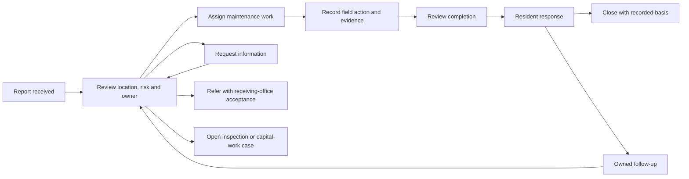

# QC iReport and MyNaga: infrastructure and civic-reporting benchmark

**Product judgment:** QC iReport is the stronger reference for a focused, browser-accessible reporting service and visible public accountability. MyNaga is the stronger reference for an ongoing citizen relationship spanning services, reporting, notifications, and resolution feedback. A municipal engineering system should combine those strengths with explicit asset ownership, reliable evidence handling, and a closure process that distinguishes completed work from a resident-confirmed outcome.

Evidence was checked on **11 September 2026**. This comparison concerns Quezon City and Naga City, Camarines Sur. It uses public interfaces, official LGU material, authorized-developer publications, app-store documentation, and clearly identified citizen reviews. Authenticated report submission, native-app operation, staff consoles, and backend integrations were not tested. No reports or accounts were created.

**Evidence labels:** **Observed** means visible in the public interface; **documented** means stated by the LGU or developer; **anecdotal** means a citizen account without independent verification; **unverified** means the available evidence does not establish the feature. An unverified feature is not necessarily absent. Published app mockups establish illustrated design, not working controls or live case outcomes.

## 1. Overview and service scope

### Platform and access snapshot

| Dimension | QC iReport | MyNaga |
|---|---|---|
| Delivery | Web reporting service, reachable through QC eServices and the QCitizen mobile app. Its public page also offers installation; a standalone native iReport app was not established. | Android and iOS mobile app. The supplied website is a download, information, support, and policy surface; browser-based MyNaga report submission was not established. |
| Primary audience | People reporting incidents within QC, including non-residents. | Primarily Nagueños accessing local services and information; the city also promotes visitor information. |
| Product scope | Focused non-emergency issue reporting and tracking. | Broad civic gateway containing reporting alongside service access and participation. |
| Access observations | Public EN/FIL switch, guest and eServices entry points, and a public overview. Email verification precedes guest reporting. | Free app-store distribution; Apple lists English and iOS/iPadOS 17.6 or later. |
| Accessibility evidence | Browser access and visible language switching reduce some access barriers. Full bilingual parity, keyboard completion, screen-reader support, and offline operation remain unverified. | Store availability does not establish accessibility. Full Filipino/Bikol support, assistive-technology compatibility, and offline submission remain unverified. |

Delivery and access evidence: [QC launch announcement](https://quezoncity.gov.ph/qc-govt-boosts-transparency-accountability-with-qcitizen-data-platforms/), [QC FAQ](https://quezoncity.gov.ph/faqs/faq-ireport/), [observed QC public site](https://qcireport.quezoncity.gov.ph/), [MyNaga website](https://mynaga.app/), [Google Play](https://play.google.com/store/apps/details?id=com.easybusph.myNaga&hl=en), and [Apple listing](https://apps.apple.com/ph/app/mynaga/id6748720972).

QC launched iReport's beta on 18 May 2026. MyNaga launched on 18 August 2025, with a 2.0 launch on 18 August 2026. Consequently, launch-era descriptions should not automatically be treated as complete current functionality. The dates displayed above QC's global navigation are website clocks, not publication dates for its undated guides. [QC launch](https://quezoncity.gov.ph/qc-govt-boosts-transparency-accountability-with-qcitizen-data-platforms/), [MyNaga 2.0 announcement](https://explore-with-easybus.ph/articles/news/naga-city-govt-rolls-out-mynaga-2-0-updates/).

### Service catalog and infrastructure intersections

**QC's published iReport catalog** contains eight issue types: potholes; clogged drainage; busted streetlights on steel posts; no building permit; illegal parking; uncollected residential garbage; no business permit; and illegal gambling. The first five have direct engineering, mobility, or building-enforcement relevance; waste collection can also affect drainage and pedestrian access. This is a documented catalog, not an inspection of the current authenticated selector. [QC program page](https://quezoncity.gov.ph/program/qc-ireport/).

There is a material label discrepancy: QC's FAQ uses **illegal structure**, while the program page uses **no building permit**. These do not describe identical conditions. A dangerous permitted structure, suspected unpermitted work, and an encroachment require different investigations. The live selector and routing definitions need reconciliation before copying this taxonomy. [QC FAQ](https://quezoncity.gov.ph/faqs/faq-ireport/), [QC program page](https://quezoncity.gov.ph/program/qc-ireport/).

**MyNaga's documented catalog spans several types of service:**

| Module or service family | Infrastructure relevance and boundary |
|---|---|
| Report Issue Forms / community reports | Maintenance, obstruction, environmental, and other civic concerns. |
| DisipliNaga Cam | Photo/geotag reporting for illegal parking; a specific traffic-enforcement flow. |
| Services and request tracking | Access to requirements and government services. Civil registry, business permits, and real-property tax are documented examples; this does not prove every transaction completes inside the app. |
| Transparency / People's Budget Portal | Public spending and governance context that can support infrastructure accountability. |
| i-Engage | Participation in proposed ordinances. It is not the general incident-reporting module. |
| Emergency contacts, news, and advisories | Context for access disruptions, local assistance, and public safety. |
| Utilities, jobs, transport, events, and tourism | Broader city-service access. CASURECO II bill viewing/payment redirects do not establish utility-fault case integration. |

Sources: [Google Play feature description](https://play.google.com/store/apps/details?id=com.easybusph.myNaga&hl=en), [Naga operational account](https://www2.naga.gov.ph/asian-con-cites-mynaga/), and [developer's 2.0 announcement](https://explore-with-easybus.ph/articles/news/naga-city-govt-rolls-out-mynaga-2-0-updates/). The announcement claims twenty integrated LGU services but does not enumerate a complete transactional catalog. MyNaga Shop is presented there as forthcoming; it should not be assumed fully operational from a navigation label.

## 2. Infrastructure and engineering reporting mechanisms

### Coverage against the requested issue families

| Infrastructure concern | QC iReport evidence | MyNaga evidence |
|---|---|---|
| **Potholes** | Explicit published category. | Dedicated category not confirmed in accessible material. |
| Damaged curbs and sidewalk surfaces | Dedicated selector not confirmed. QC Engineering separately advertises these maintenance services. | Dedicated category not confirmed. |
| Sidewalk obstructions | Illegal parking is explicit; coverage of every non-vehicle obstruction is not established. | City reports handling sidewalk obstructions and illegal parking. |
| Bridge or walkway defects | Dedicated category not confirmed. | Dedicated category not confirmed. |
| **Clogged gutters, canals, drainage** | Clogged drainage explicit; city reports also demonstrate damaged-drainage repair. | Declogging is a documented handled concern; gutter/canal subtypes are not established. |
| Open manholes | Dedicated selector not confirmed; manhole-cover maintenance exists in the wider Engineering service catalog. | Dedicated category not confirmed. |
| Flooding hot spots | No dedicated reporting type verified. Drainage reporting is related but not equivalent to flood-risk reporting. | No dedicated reporting type verified. |
| **Streetlights and wiring** | Busted steel-post streetlights explicit. Exposed wiring and utility-owned equipment need separate validation. | Broken streetlights and faulty traffic signals are documented handled concerns. Wiring-specific intake remains unverified. |
| **Illegal structures / missing permits** | Explicit structural/permit concern, with the label conflict noted above. | General-report category unverified; a separate city building-complaint service is documented. |
| Dangerous structures / demolition requests | Specific intake, technical assessment, and demolition authorization not established. | Specific in-app flow not established. |
| Damaged parks and public facilities | Dedicated category not confirmed. | Dedicated damage-report category not confirmed; a facilities-use service is not equivalent. |
| **Hazardous trees** | Dedicated category not confirmed. | Tree trimming is a demonstrated use case; emergency tree-risk classification is not established. |
| Damaged public signs or markings | Dedicated category not confirmed. An official iReport outcome includes pedestrian-lane repainting. | Faulty traffic signals are evidenced; that does not establish a general damaged-signage category. |

Coverage sources: [QC catalog](https://quezoncity.gov.ph/program/qc-ireport/), [QC Engineering services](https://quezoncity.gov.ph/departments/quezon-city-engineering-department/), [QC drainage outcome](https://quezoncity.gov.ph/qc-ireport-resolved-issues/), [QC road/marking outcomes](https://quezoncity.gov.ph/qc-ireport-resolved-issues-3/), [Naga reported outcomes](https://www2.naga.gov.ph/asian-con-cites-mynaga/), and [Naga building complaints](https://www2.naga.gov.ph/ccgovernment-service/filing-building-related-complaints/).

### What the operational evidence establishes

QC's 27 May 2026 report attributes drainage repairs in Commonwealth and Gulod to QC Engineering following iReport submissions. This is concrete evidence of reporting connected to engineering work. It does not expose dispatch rules, repair duration, or an independent inspection record. [QC drainage repairs](https://quezoncity.gov.ph/qc-ireport-resolved-issues/).

Naga's 17 October 2025 account documents completed work across several municipal functions and acknowledges queues caused by limited equipment and resources. This suggests a broader operational coordination problem than simply directing every infrastructure-related report to one engineer. The account describes a centralized record of recurring issues, without establishing automated duplicate detection. [Naga operational account](https://www2.naga.gov.ph/asian-con-cites-mynaga/).

Three city service guides clarify the distinction between an issue and its responsible office:

- **Streetlights:** Naga identifies General Services as the responsible service. Its guide asks for location/post details and describes job-order approval and scheduling. This is an adjacent service workflow, not proof of MyNaga's internal assignment logic. [Streetlight service](https://www2.naga.gov.ph/ccgovernment-service/availing-of-streetlights-maintenance-services/).
- **Building concerns:** Naga names the Engineer's Office / Office of the Building Official. The guide describes complaint letter and vicinity map, enforcement review, inspection, notices, hearing when needed, and possible legal referral. These administrative steps must not be mistaken for a deployed app workflow. [Building-complaint guide](https://www2.naga.gov.ph/ccgovernment-service/filing-building-related-complaints/).
- **Trees:** The city guide places assessment and approval/endorsement with Environment. A reported hazard should therefore initiate evaluation; a resident report is not itself authorization to cut a tree. [Tree service](https://www2.naga.gov.ph/ccgovernment-service/request-for-cutting-and-or-trimming-trees/).

**Product implication:** expose citizen descriptions of conditions while maintaining a separately governed routing catalog. Location, asset owner, maintenance responsibility, hazard severity, and case type jointly determine the receiving team.

## 3. UX and functional architecture

### Incident intake and location

**QC:** The filing guide specifies location details plus an incident pin on a map, then type, description, up to five photos, and submission. Tracking is through My Reports; guests return with the same email and OTP. The instructions also describe opening a redirected/popup page from the surrounding service. GPS capture, reverse geocoding, landmark autocomplete, pin accuracy, and the exact manual-address fields are not documented. The observed landing heatmap uses Leaflet/OpenStreetMap; this does not prove the intake picker uses the same implementation. [Filing guide](https://quezoncity.gov.ph/qcitizen-guides/how-to-file-a-complaint-in-qc-ireport/), [public site](https://qcireport.quezoncity.gov.ph/).

**MyNaga:** A published 2.0 illegal-parking illustration shows a location map, a street/barangay line, camera control, removable photo previews, and a description field. This establishes the illustrated form's anatomy. It does not demonstrate draggable pins, automatic address lookup, GPS correction, or operation without permissions. General address-detail fields are documented in release history; built-in geotagging is explicitly advertised for DisipliNaga. [Published report illustration](https://explore-with-easybus.ph/wp-content/uploads/2026/08/5.-Report.png), [Apple history](https://apps.apple.com/ph/app/mynaga/id6748720972), [Google Play](https://play.google.com/store/apps/details?id=com.easybusph.myNaga&hl=en).

**Design lesson:** store device position, resident-selected incident position, accuracy/source, and textual directions separately. A person reporting after returning home must not accidentally locate the pothole at their current position. Preserve a manual-address path and staff-review path when geocoding or jurisdiction checks fail.

### Evidence gathering and metadata

| Evidence capability | QC iReport | MyNaga |
|---|---|---|
| Photo support | Documented; maximum five photos. | Documented for DisipliNaga; illustrated multiple removable previews. |
| Maximum count | Five in the guide. | Unverified. Two pictures in a mockup are not a two-file limit. |
| Video support and duration | Unverified. | General-report video intake and duration unverified. Traffic policy recognizes video evidence, which is a different evidentiary claim. |
| File-size / format limits | Not publicly established. | Not publicly established. |
| Camera vs gallery | Supporting uploads documented; precise capture options unverified. | Camera shown for illegal parking; general gallery behavior unverified. |
| EXIF, compression, original preservation | Not publicly established. | Implementation unverified; traffic policy discusses metadata. |
| Mandatory before/after verification | Not established by repair-news photographs. | Not established by resolution feedback or a promotional image. |

Sources: [QC guide](https://quezoncity.gov.ph/qcitizen-guides/how-to-file-a-complaint-in-qc-ireport/), [MyNaga report illustration](https://explore-with-easybus.ph/wp-content/uploads/2026/08/5.-Report.png), and [Naga Ordinance 2026-062](https://www2.naga.gov.ph/sp_ordinances/ordinance-no-2026-062/).

Naga's enacted **Ordinance 2026-062, 26 May 2026**, concerns Transport and Traffic Code enforcement. It recognizes authenticable photo/video, calls for practicable GPS/time/device metadata, and requires in-app capture/geotag integration. TMC within Public Safety reviews reports, with audit logging and appropriate-office referrals. Conditional anonymous evidence is allowed. This is traffic-specific legal authority and a system requirement, not proof that every mandated capability operates in every report form. Its legal-decision deadlines are not maintenance SLAs. [Ordinance, sections 3–5](https://www2.naga.gov.ph/sp_ordinances/ordinance-no-2026-062/).

**Recommended evidence contract:** publish count, format, and size limits before selection; support resumable/retryable upload; retain approved original evidence separately from public derivatives; disclose capture time versus upload time and any modification. Remove unnecessary identifying metadata from public copies under an approved policy. EXIF can assist review but cannot alone prove authenticity. Do not require a resident to approach a dangerous asset for a better photograph.

### Categorization

QC documents a short list that can support a simple initial picker, but the public documentation does not establish its current selector hierarchy, tags, or search. MyNaga documents category expansion; its published tracking example combines a department/workstream with an issue name, but this does not prove a nested category picker. Search-to-categorize and automated classification remain unverified for both. [QC catalog](https://quezoncity.gov.ph/program/qc-ireport/), [MyNaga tracking illustration](https://explore-with-easybus.ph/wp-content/uploads/2026/08/13.-Track.png), [Google Play](https://play.google.com/store/apps/details?id=com.easybusph.myNaga&hl=en).

**Recommended taxonomy:** four citizen-facing groups—roads and access; drainage and utilities; buildings and structures; parks and public facilities—with plain issue names and a staffed “Not sure” route. Keep building-permit suspicion separate from immediate structural danger. Index local terms and English/Filipino synonyms, allow a suggested category to be corrected, and version the taxonomy independently of office names. These are proposed additions, not observed features.

### Ticketing, triage, and internal routing

QC documents automatic forwarding to the office responsible for the incident type, followed by validation and action. Drafts are supported, but submitted reports cannot be edited or cancelled. A full department-routing table and staff work-order/approval sequence are not public. [QC FAQ](https://quezoncity.gov.ph/faqs/faq-ireport/).

QC launch material explicitly describes ticket-number tracking for concerns originating with Helpline 122. My Reports supports portal submissions, but the direct-submission ticket format was not independently verified. MyNaga release history documents report control numbers. [QC launch](https://quezoncity.gov.ph/qc-govt-boosts-transparency-accountability-with-qcitizen-data-platforms/), [Apple history](https://apps.apple.com/ph/app/mynaga/id6748720972).

MyNaga's developer identifies Engineering, General Services, Public Safety, Environment, solid waste, barangays, and other participating task-force units. This establishes organizational participation, not automatic routing. City Planning assignment, general-case transfer acceptance, DPWH integration, field-team scheduling, and supervisor approval behavior remain unverified in both platforms. [MyNaga 2.0 announcement](https://explore-with-easybus.ph/articles/news/naga-city-govt-rolls-out-mynaga-2-0-updates/).

### Accountability, statuses, and notifications

Neither source set establishes a complete citizen-facing lifecycle. It would be misleading to label a generic Submitted → Assigned → In Progress → Closed chain as observed in either platform.

- **QC:** the published commitment is an action or update within **72 hours**, with engineering repairs potentially taking longer. A visible countdown, overdue escalation, per-status notification channels, citizen approval, rating, and reopening were not verified. [QC FAQ](https://quezoncity.gov.ph/faqs/faq-ireport/).
- **MyNaga:** release notes establish pending confirmation, a negative confirmation response, and ratings/feedback on resolved cases. Push notifications are documented, but status-by-status delivery and fallback channels are unverified. A formal same-ticket reopen action is not established. [Apple history](https://apps.apple.com/ph/app/mynaga/id6748720972), [Naga operational account](https://www2.naga.gov.ph/asian-con-cites-mynaga/).
- **Illustrated MyNaga status:** the promotional tracking image shows a resolved report and a separate service request under review. It is not evidence that every report follows the request's state model. [Tracking illustration](https://explore-with-easybus.ph/wp-content/uploads/2026/08/13.-Track.png).

**Recommended resident status contract:** always show what happened, accountable office, last update, next action, and next update date. Use “inspected,” “made safe,” and “repair complete” only when the corresponding evidence exists. Keep internal work-order stages linked to, but distinct from, public report labels.

### Anonymity, authentication, and identity verification

QC's guest form requires an email verification code. Its public identity suppression should therefore be understood as **confidential/contact-verified reporting**, not identity-free submission. QCID is not mandatory. Email ownership is not proof of residency or legal identity. [Observed guest form](https://qcireport.quezoncity.gov.ph/login/guest), [QC FAQ](https://quezoncity.gov.ph/faqs/faq-ireport/).

MyNaga's policy describes name/mobile and barangay address for accounts, with email/photo optional. This does not establish government-ID or biometric KYC, nor a general guest-reporting flow. The traffic ordinance's conditional anonymity cannot be generalized to all app intake. [MyNaga privacy policy](https://mynaga.app/privacy-policy), [traffic ordinance](https://www2.naga.gov.ph/sp_ordinances/ordinance-no-2026-062/).

There is an unresolved disclosure discrepancy: the retrieved Google Play listing states no data collected, while MyNaga's privacy policy explicitly describes collection. This merits reconciliation with the operator; it is not a technical finding about actual storage or security. [Google Play disclosure](https://play.google.com/store/apps/details?id=com.easybusph.myNaga&hl=en), [privacy policy](https://mynaga.app/privacy-policy).

## 4. Feature comparison matrix

The matrix summarizes the evidence above. “Unverified” should not be read as “No.”

| Feature | QC iReport | MyNaga |
|---|---|---|
| **Platform type** | Browser service; QC eServices/QCitizen entry. | Android/iOS civic app; informational website. |
| **Infrastructure categories** | Published road, drainage, streetlight, structural/permit, parking types. | Demonstrated maintenance/obstruction use; expanded taxonomy not fully public. |
| **Location and mapping** | Incident pin plus location details documented. | Map/address illustrated; DisipliNaga geotagging documented. |
| **Ticket tracking** | My Reports; hotline ticket linkage documented. | Control number and report tracking documented. |
| **Push notifications** | iReport-specific behavior unverified. | Push supported; complete report-event coverage unverified. |
| **Guest / anonymity** | Email-OTP guest; identity kept from public view. | General guest path unverified; traffic-policy anonymity is conditional. |
| **Public transparency** | Observed public incident heatmap; separate Open Infra project dashboard. | Budget/legislative transparency; public incident map unverified. |
| **Resolution feedback** | Rating, negative confirmation, and reopen unverified. | Negative confirmation and resolved-case feedback documented; exact reopen behavior unverified. |
| **Service-time expectations** | 72-hour action/update commitment. | No verified universal engineering completion target. |
| **Automatic triage / deduplication** | Office forwarding documented; duplicate engine unverified. | Multi-office coordination documented; automatic routing/deduplication unverified. |

### Transparency and performance interpretation

QC's observed public overview contains a geographic heatmap and seven-day submitted/resolved counters. In the inspection, these displayed 288 and 324 respectively. They cannot be divided into a meaningful completion rate without cohort definitions: resolved cases may have arrived before the reporting window. Refresh cadence, heatmap weighting, and data completeness were not established. [QC public overview](https://qcireport.quezoncity.gov.ph/).

**QC Open Infra is a separate product.** Official launch material describes city-funded projects from 2019 onward, including locations, budgets, timelines, completion targets, status, and project photographs. This is valuable inspiration for linking complaints to capital works, but project transparency is not the same as an open maintenance-ticket map. [QC launch announcement](https://quezoncity.gov.ph/qc-govt-boosts-transparency-accountability-with-qcitizen-data-platforms/).

Naga reported **2,074 submissions and 1,213 resolved** in October 2025. The August 2026 developer account later cited **more than 6,000 complaints and 84.2% success across the app and web messaging**. These are historical, self-reported figures with different coverage; neither supports a current app-only success comparison with QC. [Naga October account](https://www2.naga.gov.ph/asian-con-cites-mynaga/), [August 2026 account](https://explore-with-easybus.ph/articles/news/naga-city-govt-rolls-out-mynaga-2-0-updates/).

## 5. Strategic recommendations and product inspiration

All recommendations below are proposals for a municipal engineering service. They are not claims that either benchmark implements them, nor approvals of new PULSO requirements.

### Must-have MVP capabilities

| Priority capability | Recommended behavior | Acceptance evidence |
|---|---|---|
| Accessible entry and recovery | Mobile web reporting, clear tracking, a staffed assisted-service channel, and an identity policy proportional to the case. Preserve work through email/app switching and sign-in. | Complete the flow on a low-end phone, with denied permissions, keyboard/screen reader, English/Filipino, and interrupted connectivity. |
| Accurate, correctable location | Optional GPS assistance, manual pin/address/landmark, barangay confirmation, accuracy/source, and jurisdiction review. | A report made away from the site retains the selected incident location; provider failure allows review. |
| Guided classification | Small useful catalog, synonyms, short description, and “Not sure.” Separate condition, severity, asset, and office. | Staff can correct a category without creating a replacement ticket or losing the original description. |
| Reliable evidence | Publish limits, preview/remove, retry failed files, distinguish saved draft from uploaded/submitted, and record provenance. | A dropped connection preserves safe work and never claims a file is received before server confirmation. |
| Durable case receipt | One reference across web, phone, barangay, and messaging intake, with authoritative received time and deduplicated submission retries. | Retrying an uncertain submission retrieves the existing case or safely creates one, never two unnoticed records. |
| Accountable triage | Named receiving unit; jurisdiction and severity review; accepted transfers; controlled work-order creation and escalation. | Every active case has an owner; unauthorized staff cannot assign, expose information, or change state. |
| Useful progress | Public timeline, update due date, blocked reason, and a retained notification inbox with links to the exact case. | Residents can distinguish waiting for materials from an unreviewed report; a failed fetch is visibly an error. |
| Verifiable closure | Work description, completion evidence appropriate to the asset, reviewer where required, resident response, and follow-up ownership. | “Still unresolved” and “Issue returned” remain distinct and preserve prior history. Silence is not recorded as resident agreement. |
| Privacy and audit | Separate reporter identity, internal evidence, public-safe derivatives, and legal/enforcement records; backend permission enforcement. | Public maps cannot expose private identities or unrestricted originals; consequential decisions record actor, reason, and time. |

For ordinary hazards, evaluate contact-verified reporting without compulsory civic-ID onboarding. Keep eligibility checks for services that actually need them. This is a **policy decision** for the LGU and privacy/product owners, particularly because PULSO's detailed verification model remains proposed.

### Proposed operational lifecycle

The following is a service-blueprint proposal, not either platform's observed state machine and not a replacement for PULSO's pending canonical lifecycle.

An incident, work order, inspection/enforcement case, capital project, and asset should have separate identifiers with explicit links. Multiple reports can describe one asset failure; one report may require multiple work orders. A referral records a handoff, while an accepted work order records responsibility to act. Neither proves the underlying condition was corrected.

### Operational bottlenecks to avoid

**1. Clearance that does not last.** A MyNaga review dated 10 September 2025 described quick obstruction removal followed by recurrence. Release history subsequently added a negative pending-confirmation response in September and resolved-case feedback in December. The sequence addresses that class of concern; causation from one review is unproven. The historical missing option must not be reported as a current defect. [MyNaga review and release history](https://apps.apple.com/ph/app/mynaga/id6748720972).

Design implication: distinguish incomplete work from a new occurrence after successful work. The former needs a disputed-completion review; the latter needs a related occurrence, site history, and possibly a different enforcement response.

**2. Fragmented entry and tracking.** A QCitizen Google Play review dated 30 May 2026 complained about multiple complaint/tracking routes and explicitly proposed consolidation into iReport. A 23 May review described the guest OTP screen resetting after switching to email. These are anecdotes about the surrounding QCitizen app and its integrations, not independently reproduced defects of the standalone current iReport website. [QCitizen reviews](https://play.google.com/store/apps/details?hl=en&id=ph.gov.quezoncity.qcitizen).

Design implication: preserve the case/draft across authentication and channel changes. Track one record across intake channels and retain the citizen's chosen category even when staff correct it.

**3. A queue concealed by vague status.** Naga publicly acknowledged equipment and resource constraints. A system needs “waiting for crew,” “materials required,” “utility coordination,” or “capital work assessment,” each with an accountable office and next update date. Do not imply work is underway merely because an office received the report. [Naga operational account](https://www2.naga.gov.ph/asian-con-cites-mynaga/).

**4. Ghost resolution and distorted incentives.** The evidence does not establish widespread false closure in either platform. Treat it as a design risk: measure field action, technical verification, and resident feedback separately. A photograph should show the relevant outcome, and a low rating should enter an owned review queue rather than disappear into an aggregate score.

**5. Duplicate reports handled as duplicate citizens.** No automatic deduplication engine was verified. Preserve every person's evidence and tracking relationship even when reports concern the same incident. Report volume is an imperfect demand signal and should not outrank hazard severity or underserved locations.

### High-impact innovations and their dependencies

| Enhancement | Product value | Required foundation and guardrail |
|---|---|---|
| **Asset-aware jurisdiction routing** | Propose city, barangay, DPWH, utility, or other responsible team using the selected asset. | Maintained asset/road register, ownership and maintenance source/date, office agreements, and an uncertainty queue. Geographic city boundaries alone are insufficient. Retain external reference, receiving acceptance, city liaison, and next follow-up. |
| **Nearby-report suggestions** | Before submission, offer an existing relevant issue to follow or supplement. | Compare asset, position/accuracy, type, time, and state. A nearby manhole and pothole are not automatically duplicates. Let staff approve or reverse a merge. |
| **Separate service clocks** | Show time to acknowledgment, risk assessment, next update, and repair commitment. | Approved category/severity calendars, pause reasons, escalation owners, and event history. Record overdue performance honestly; do not silently reset clocks on reassignment. |
| **Operational GIS and equitable prioritization** | Identify persistent drainage clusters, road defects, and recurring outages for preventive work. | Governed asset layers, timestamps, deduplication, privacy aggregation, map/list alternatives, and coverage indicators. Raw report density measures reporting as well as physical need. |
| **Maintenance-to-project linkage** | Explain when repeated patching has become a funded rehabilitation or drainage project. | Link reports, inspections, estimates, approved projects, budgets, dependencies, and public-safe progress. Keep the issue open or clearly deferred until its actual disposition is recorded. |
| **Field completion checks** | Compare pre/post condition and detect implausible or reused evidence for review. | Stable asset IDs, capture provenance, secure originals, human inspection, and a challenge process. AI may flag uncertainty; it must not certify safety or automatically close cases. |

The ownership recommendation is supported by QC Engineering's expressly city-road remit and Naga's different service owners. Neither benchmark establishes an available DPWH integration API; start with a verified routing directory and accepted referrals before automating external exchange. [QC Engineering remit](https://quezoncity.gov.ph/departments/quezon-city-engineering-department/), [Naga streetlight ownership](https://www2.naga.gov.ph/ccgovernment-service/availing-of-streetlights-maintenance-services/).

### Measurement and sequencing

First establish a measured operational baseline. For each metric, declare eligibility, cohort, exclusions, clock, and source events. Proposed measures are time to first meaningful update; time to accepted owner; time to mitigation and repair by issue type; aging unresolved inventory; transfer bounce rate; disputed completions; and repeat incidents per asset. Median and upper-percentile times should accompany counts. Treat resident satisfaction as a separate outcome with its response rate visible.

Sequence delivery by operational readiness:

1. **Define ownership and outcomes:** approve category-to-service mapping, hazards/escalation, public state meanings, evidence/privacy, and response commitments with frontline offices.
2. **Deliver a complete service loop:** intake, durable receipt, triage, assignment, evidence, updates, closure review, and resident follow-up for a small pilot catalog.
3. **Improve coordination:** unify assisted channels, asset links, duplicates, referrals, and field schedules.
4. **Expand transparency and prediction:** publish well-defined aggregates and project links; introduce advisory automation only after its error rates and review capacity are understood.

### PULSO applicability and decision dependencies

This benchmark is **research evidence and proposed inspiration**, version 1.0. It does not approve routes, lifecycle names, ID requirements, office permissions, numerical SLAs, or implementation. PULSO's [approved product commitments](../../PRODUCT.md) and [proposed shared lifecycle/API contract](../ui-ux-audit/14-end-to-end-system-lifecycle-and-api-contract.md) retain their respective authority.

Decision ownership should be assigned to product and LGU service owners for catalog/lifecycle; Engineering, Building Official, Environment, General Services, and external counterpart offices for routing; privacy/legal and records owners for identity/evidence/retention; and accessibility/localization owners for bilingual and assistive use. These role assignments require named people before implementation readiness.

The next design phase should inspect the [existing PULSO Figma file](https://www.figma.com/design/1qPgPj4o3smElv8B2B1REi), reconcile its current library and resident/government templates, then prototype location recovery, accepted referral, resolution evidence, and resident follow-up in paired themes. Preserve Civic Aperture and reusable components. This research phase makes no visual-design or Figma-completion claim. Component states, responsive screens, API bindings, and implementation acceptance matrices remain work for that approved design phase.

### Remaining validation questions

The most valuable follow-up is an operator walkthrough using consented or synthetic cases in a demonstration environment. Request the current category configuration; a complete report event history; office transfer and DPWH/utility examples; upload policy including EXIF; the precise citizen confirmation/reopen rules; notification delivery behavior; resource-delay codes; public-data definitions; and assisted/guest recovery paths. For Naga, reconcile app-store privacy disclosures and identify which traffic-ordinance requirements have actually shipped. For QC, reconcile the building-category labels and verify direct-submission identifiers.

## Sources and evidence register

All sources were accessed or checked on 11 September 2026. Undated means no reliable article publication date was established. App-store listings are dynamic and may differ by region or crawl; relative release times are not used as fixed dates.

| Source | Publisher / date | Evidence used and limits |
|---|---|---|
| [QC iReport public site](https://qcireport.quezoncity.gov.ph/) and [guest entry](https://qcireport.quezoncity.gov.ph/login/guest) | QC Government; observed 11 Sep 2026 | Public navigation, language control, heatmap/counters, guest email gate. No authenticated intake. |
| [QC iReport program](https://quezoncity.gov.ph/program/qc-ireport/) | QC Government; undated | Published catalog and service scope. |
| [iReport FAQ](https://quezoncity.gov.ph/faqs/faq-ireport/) | QC Government; undated | Eligibility, drafts, routing, identity visibility, 72-hour action/update policy. |
| [How to file a complaint](https://quezoncity.gov.ph/qcitizen-guides/how-to-file-a-complaint-in-qc-ireport/) | QC Government; undated | Documented intake and five-photo limit. |
| [QCitizen Data platforms launch](https://quezoncity.gov.ph/qc-govt-boosts-transparency-accountability-with-qcitizen-data-platforms/) | QC Government; 18 May 2026 | Beta launch, hotline tracking, distinction between reporting and Open Infra. |
| [Drainage repairs](https://quezoncity.gov.ph/qc-ireport-resolved-issues/) | QC Government; 27 May 2026 | Engineering completion account; not an independent audit. |
| [Road/marking outcomes](https://quezoncity.gov.ph/qc-ireport-resolved-issues-3/) | QC Government; 23 Jun 2026 | Road repairs and pedestrian marking outcome. |
| [Engineering Department](https://quezoncity.gov.ph/departments/quezon-city-engineering-department/) | QC Government; undated | Wider service remit; does not prove report-category coverage. |
| [QCitizen Google Play](https://play.google.com/store/apps/details?hl=en&id=ph.gov.quezoncity.qcitizen) | QC IT Development Department / citizen reviews; May 2026 reviews | Anecdotal app integration and login friction; distinct from verified standalone iReport behavior. |
| [MyNaga website](https://mynaga.app/) | City/developer public site; undated | Download surface and stated civic purpose. |
| [MyNaga Google Play](https://play.google.com/store/apps/details?id=com.easybusph.myNaga&hl=en) | Easybus PH; current listing | Android distribution, feature description, developer privacy disclosure. |
| [MyNaga Apple listing](https://apps.apple.com/ph/app/mynaga/id6748720972) | Easybus PH / citizen reviews; dynamic, 2025–2026 history | Compatibility, control/address improvements, confirmation and feedback, anecdotal recurrence. |
| [MyNaga privacy policy](https://mynaga.app/privacy-policy) | City/developer; v2.0, last updated 16 Aug 2025 | Account collection and stated processing; no technical security audit. |
| [Asian conference / MyNaga operations](https://www2.naga.gov.ph/asian-con-cites-mynaga/) | Naga City; 17 Oct 2025 | Historical cases, outcomes, queue/resource limits, notifications. |
| [MyNaga 2.0 launch](https://explore-with-easybus.ph/articles/news/naga-city-govt-rolls-out-mynaga-2-0-updates/) | Cecilia Aderes, Easybus PH; 18 Aug 2026 | Expanded services and participating offices; mixed-channel statistics. |
| [Report illustration](https://explore-with-easybus.ph/wp-content/uploads/2026/08/5.-Report.png) and [tracking illustration](https://explore-with-easybus.ph/wp-content/uploads/2026/08/13.-Track.png) | Easybus PH; published with Aug 2026 launch | Visually inspected promotional/sample forms, not authenticated app operation. |
| [Ordinance 2026-062](https://www2.naga.gov.ph/sp_ordinances/ordinance-no-2026-062/) | Naga Sangguniang Panlungsod; enacted 26 May 2026, page marked Active | Traffic-specific legal requirements; not a deployment audit or generalized maintenance workflow. |
| [Building complaints](https://www2.naga.gov.ph/ccgovernment-service/filing-building-related-complaints/) | Naga City; undated service guide | Engineer/Building Official process outside verified MyNaga implementation. |
| [Streetlight inspection and repair](https://www2.naga.gov.ph/ccgovernment-service/availing-of-streetlights-maintenance-services/) | Naga City; undated service guide | GSO ownership and job-order context. |
| [Tree cutting/trimming](https://www2.naga.gov.ph/ccgovernment-service/request-for-cutting-and-or-trimming-trees/) | Naga City; undated service guide | Environment assessment/approval context. |
