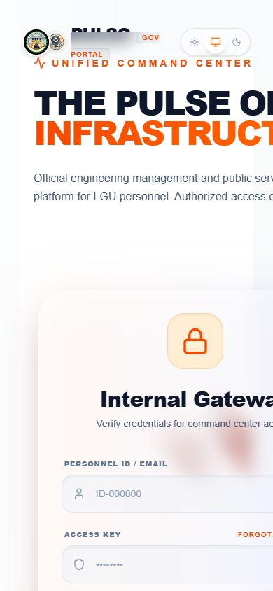
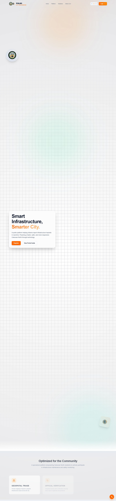

# Current-state frontend, UI, flow, and UX assessment

| Field | Value |
|---|---|
| Status | Audited; requires integrated-environment validation |
| Version | 0.1 |
| Last validated | 23 August 2026 |
| Baseline commit | `7d7486377c6ab8f7387bdc5b018582d6af94b842` |

## 1. Summary verdict

PULSO is a feature-rich prototype with a credible civic-service operating model, but its current frontend is not ready for a broad visual rewrite. The most important blockers are:

- contradictory authorization and navigation rules;
- resident reporting states that overstate verification or lose user input;
- staff layouts that do not reflow on small screens;
- inaccessible custom controls and modals;
- large page monoliths with a high regression radius;
- inconsistent status, error, empty, copy, and component behavior;
- no frontend automated test, component documentation, visual-regression, or accessibility pipeline.

The rework should treat trust, task completion, and operational truth as design requirements.

## 2. Baseline scorecard

This is an expert heuristic and code/runtime assessment, not a user-research score.

| Area | Current maturity | Evidence-based assessment | Target |
|---|---:|---|---:|
| Product model | 4/5 | Strong resident-to-LGU lifecycle, role dashboards, maps, analytics, and field concepts | 5/5 |
| Information architecture | 2/5 | Route breadth is high; government navigation mirrors departments more than tasks; resident tabs are not URL-addressable | 4/5 |
| Responsive behavior | 2/5 | Resident has partial mobile behavior; government shell is fixed-width and clips at 390 px | 5/5 |
| Accessibility | 1/5 | Few ARIA attributes, almost no programmatic label associations, hidden scrollbars, no shared dialog/focus contract | 5/5 |
| Visual consistency | 2/5 | Strong recognizable brand, but tokens and reusable primitives are incomplete and page-local styling dominates | 5/5 |
| Content design | 2/5 | Good intent, but technical/militarized copy and internal statuses leak into civic-service tasks | 5/5 |
| State/error design | 2/5 | Several states exist, but failures often become empty lists and feedback patterns diverge | 5/5 |
| Authorization UX | 1/5 | Role/capability definitions and route/sidebar/action rules disagree | 5/5 |
| Frontend maintainability | 1/5 | Several 2,500–4,000-line pages combine data, business rules, maps, overlays, and UI | 4/5 |
| Quality automation | 1/5 | No frontend tests/Storybook/axe/visual regression; lint baseline has 170 problems | 5/5 |

## 3. What should be preserved

- Clear public/resident/government entry separation.
- A genuine PULSO brand mark rooted in mapping, infrastructure, pulse, and civic systems.
- Role-specific government landing dashboards.
- Evidence capture, geolocation, AI feedback, confirmation, proof, and report retraction concepts.
- English/Filipino infrastructure and theme support.
- Map, analytics, predictive-maintenance, dispatch, and work-order transitions.
- Workflow/approval-chain content already encoded in the role dashboards.
- Early reusable assets such as branding, sidebar, theme toggle, error boundary, and select components.

## 4. Architecture and delivery risk

The app is React 19, React Router 7, Vite 7, and Tailwind 4 with Framer Motion, Google Maps, Three.js/React Three Fiber, Spline, date-picker, i18next, Axios, and direct `fetch` calls. Routes are eagerly imported in `frontend/src/App.jsx:5-18`.

| File | Approx. lines | Risk |
|---|---:|---|
| `frontend/src/pages/ResidentDashboard.jsx` | 4,040 | Resident shell, maps, reporting, notifications, settings, AI, modals, and data access are coupled |
| `frontend/src/pages/DispatcherDashboard.jsx` | 3,842 | Queue, map, assignment, assistant, routing, and destructive actions are coupled |
| `frontend/src/pages/GovDivisionPage.jsx` | 2,565 | Many pathname-driven modules share one component and state surface |
| `frontend/src/pages/Register.jsx` | 1,658 | Identity capture, custom controls, consent, account, and OTP are coupled |
| `frontend/src/pages/GovAnalyticsPage.jsx` | 1,241 | Analytics, AI narratives, procurement, and export behavior share one page |

The first implementation should not mechanically split files. Start with characterization tests and extract one vertical slice at a time behind stable routes and contracts.

## 5. P0 findings: resolve before visual implementation

### P0.1 Government responsive shell fails at narrow widths

`GovSidebar` always renders a 256 px full-height sidebar (`frontend/src/components/GovSidebar.jsx:233-244`). Government pages compose fixed desktop workspaces around it. At 390×844, the gateway itself clips its headline, explanation, form, and header controls even before authentication.

Required outcome:

- ≥1280 px: 256 px expanded sidebar.
- 1024–1279 px: 72 px navigation rail.
- <1024 px: hidden sidebar opened as an accessible navigation drawer.
- Every route retains a visible page title, scope, and primary action.
- Dense records become cards/detail pages or an explicitly scrollable data region.

### P0.2 Resident mobile shell has competing and oversized navigation

The resident top navigation reserves two `min-w-[200px]` regions (`ResidentDashboard.jsx:2352,2412`) at every width while a bottom navigation appears on small screens. The main feed sets `min-w-[350px]` (`ResidentDashboard.jsx:3783`). The AI panel defaults to 360 px.

Use one navigation model per breakpoint: compact masthead + bottom navigation on mobile, top/side navigation on larger screens, with a central **Report an issue** action.

### P0.3 Jurisdiction is presented as verified when the check always succeeds

`checkJurisdiction` returns `true` unconditionally (`ResidentDashboard.jsx:2577-2581`) while the UI presents verified location language. The report location also starts at a default coordinate (`ResidentDashboard.jsx:2906`).

Required outcome:

- represent `unknown`, `checking`, `inside`, `outside`, `permission-denied`, and `error` as separate states;
- never call a location verified until the server or a trusted boundary check confirms it;
- do not submit a default map center as if it were user-confirmed;
- provide address/manual pin alternatives.

### P0.4 Exact location description is collected but not submitted

The reporting UI captures `locationDescription` (`ResidentDashboard.jsx:1669-1677,2901`) but the payload sends only category, general notes, coordinates, and reverse-geocoded `location_string` (`ResidentDashboard.jsx:3341-3346`).

Required outcome: map every visible field to a named API field, show it in review, persist it, and verify it in an integration test.

### P0.5 Report details and timeline are effectively unreachable

`handleViewReport` opens details and fetches the timeline (`ResidentDashboard.jsx:2813-2823`) but the `MyReports` composition does not receive that handler (`ResidentDashboard.jsx:3817-3827`). Notification navigation switches tabs and toasts rather than reliably deep-linking to a report.

Required outcome: each report has a URL, for example `/dashboard/reports/:reportId`; cards, notifications, and search results navigate to it; reload and browser back preserve context.

### P0.6 Notification dismissal references an undefined session variable

The resident top navigation sends a delete request using `token` (`ResidentDashboard.jsx:2476-2485`), but that component scope does not define it. ESLint reports the same `no-undef` issue.

Required outcome: use one session provider/API client and cover dismiss, undo, failure, and expired-session behavior.

### P0.7 Role, route, navigation, and action permissions disagree

Role/capability definitions are duplicated across:

- `frontend/src/components/ProtectedRoute.jsx:27-40`
- `frontend/src/utils/rbac_utils.js:8-30`
- `frontend/src/components/GovSidebar.jsx:23-32`
- `frontend/src/pages/GovLanding.jsx:86-92`
- `frontend/src/pages/GovernmentUserManagementPage.jsx:8-27`

Examples:

- Settings is visible to every government user (`GovSidebar.jsx:325`) but `/gov/settings` is guarded by `AdminOnly` (`App.jsx:184-187`).
- Analytics navigation and route guards use different permission actions.
- Broad module access can expose mutating controls without a matching action check.
- Specialized division-chief roles exist in some lists and not others.

Required outcome: one versioned role/capability registry, executable role/action matrix, backend enforcement, and tests for sidebar visibility, deep links, and actions for every role class.

### P0.8 Dispatcher assignment contains hard-coded personnel IDs

The dispatcher flow contains seeded/dummy assignees (`DispatcherDashboard.jsx:748-753,3102-3107,3195-3206`). This is unsafe for an operational UI and makes prototypes look more complete than they are.

Required outcome: fetch eligible assignees by jurisdiction, capability, availability, and work-order type; show a clear no-eligible-team state; record who made the assignment.

### P0.9 Permanent deletion conflicts with auditability

Dispatcher report cards expose permanent deletion that describes bypassing the ledger (`DispatcherDashboard.jsx:918-969,2011-2017`).

Required outcome: governed archive/void/legal-hold workflows, reason capture, permission check, confirmation, audit event, and recovery policy. Permanent deletion must not be a routine card action.

### P0.10 Keyboard and assistive-technology contracts are absent

Static inventory found roughly 398 buttons, 102 form controls, 70 visual labels, only 3 `htmlFor` associations, 5 `aria-*` attributes, no `role="dialog"`, no `focus-visible`, and 93 `outline-none` uses. These counts are diagnostic, not a conformance test.

High-risk examples:

- custom select without combobox/listbox semantics or complete keyboard behavior (`components/OrangeSelect.jsx:45-133`);
- modal overlays without role, title association, inert background, focus trap, Escape, or focus restoration;
- sidebar disclosure without `aria-expanded`, `aria-controls`, or `aria-current` (`GovSidebar.jsx:43-147`);
- clickable non-controls, clickable rows with nested controls, and icon-only buttons without dependable names;
- global scrollbar removal (`index.css:53-58`).

Target [WCAG 2.2 Level AA](https://www.w3.org/TR/WCAG22/) and use the [WAI-ARIA Authoring Practices](https://www.w3.org/WAI/ARIA/apg/patterns/) for behavior only when a native HTML control cannot satisfy the requirement.

## 6. P1 findings: address in the foundation and first vertical slices

### P1.1 The primary orange is not a safe text/button color on white

The global `#F97316` has insufficient contrast with white for normal text and should be a decorative pulse/accent. Use `#C2410C` for resident actions/text on light surfaces; keep status meaning paired with icon and label.

### P1.2 Typography is declared but not loaded

`Inter` and `Oswald` are declared in `index.css:17-18`, but `index.html` does not load them. The rendered system therefore depends on fallbacks. The design-system specification proposes explicit, licensed roles and fallback stacks.

### P1.3 Motion and rendering weight exceed the job

Authentication screens can mount light and dark remote Spline scenes; landing uses 3D; looping animations lack a reduced-motion system. Motion should explain one event—status change, successful submission, or route progress—rather than decorate basic access tasks.

### P1.4 Error, empty, and permission states are conflated

Several government fetch failures become empty arrays and render **No records found**. Users cannot tell first-use empty, filtered empty, permission-limited empty, offline, or service failure apart.

Required hierarchy:

1. field error;
2. section alert;
3. nonblocking toast;
4. blocking confirmation dialog;
5. persistent banner for system/permission/emergency context.

### P1.5 Visible controls include dead or prototype affordances

Examples include landing actions without handlers, static recent-search rows, non-persisted notification settings, and generic **coming soon** modules. Every control must be classified as functional, intentionally disabled with an explanation, or removed.

### P1.6 Dark mode changes functional map information

The resident dark-map configuration can omit the map identifier/boundary treatment (`ResidentDashboard.jsx:2583-2598`). Theme must never remove jurisdiction or safety information.

### P1.7 Localization is partial

The global language control changes i18next but the document remains `lang="en"`; login/registration contain hard-coded English; government routes hide the switcher. Resident English/Filipino parity is a release gate, including errors, dates, names, accessibility labels, and long strings.

### P1.8 Content tone undermines public-service trust

Terms such as **Initialize session**, **Unified Command Center**, **Strategic Failure**, **Tactical Blackout**, and **Asset Purge** are dramatic but less clear than the job. Use calm action language:

- Resident: Report an issue, Check status, Save draft, Submit report, Retract report, Keep report.
- Staff: Review, Assign, Request changes, Approve, Escalate, Resolve.

AI recommendations must identify source data, limits/confidence, and the accountable human decision-maker.

### P1.9 Trust Score needs policy, explanation, and appeal—or removal

A resident-facing score influenced by accepted/rejected reports can discourage legitimate reporting. If it affects service, the product must disclose the purpose, inputs, consequences, correction/appeal route, and human oversight. The safer recommendation is to remove it from the resident interface until policy is approved.

## 7. Public and authentication experience

The entry screens have a recognizable composition and strong typography, but they prioritize a promotional headline over the user’s immediate task. Government copy is especially command-oriented. The public landing uses approximately 6,192 px of vertical content at 1440×900 and 12,106 px at 390×844. In the captured desktop full page, the hero headline begins several viewports below the navigation, leaving a large low-information field.

Recommendations:

- make the first screen’s thesis and action visible without waiting for 3D/scroll animation;
- give residents three obvious choices: **Report an issue**, **Track my report**, **City updates**;
- keep **Staff sign in** visually separate but easy to find;
- describe identity verification before asking for ID;
- use an opaque authentication surface with dependable contrast;
- move secondary city-service directories below the primary PULSO job.

## 8. Tooling and quality baseline

- `frontend/package.json` provides `dev`, `build`, `lint`, and `preview`; there is no frontend test script.
- No Playwright, Cypress, Vitest, Testing Library, Storybook, axe, visual-regression, analytics, or Web Vitals package is present.
- `npm run lint` reports **170 problems: 148 errors and 22 warnings** on this baseline.
- `npm ci` reports **12 dependency vulnerabilities: 2 low, 1 moderate, and 9 high**. Audit and remediation require a separate dependency/security workstream; do not run automated major-version fixes inside the visual rework.
- The frontend and mobile READMEs are starter documentation and do not describe real architecture, flows, or release checks.

## 9. Validation still required in Phase 0

1. Run all protected pages against an integrated backend/database with accounts for each role class.
2. Verify every action and status transition against API behavior and audit logs.
3. Capture baseline performance on production-like builds and networks.
4. Test keyboard, NVDA/Chrome, VoiceOver/Safari, 200% zoom, reduced motion, forced colors, and 320 px reflow.
5. Test camera/location denied, slow/offline, OCR/AI inconclusive, API timeout, expired token, and duplicate report.
6. Interview residents and staff before freezing terminology or information architecture.
