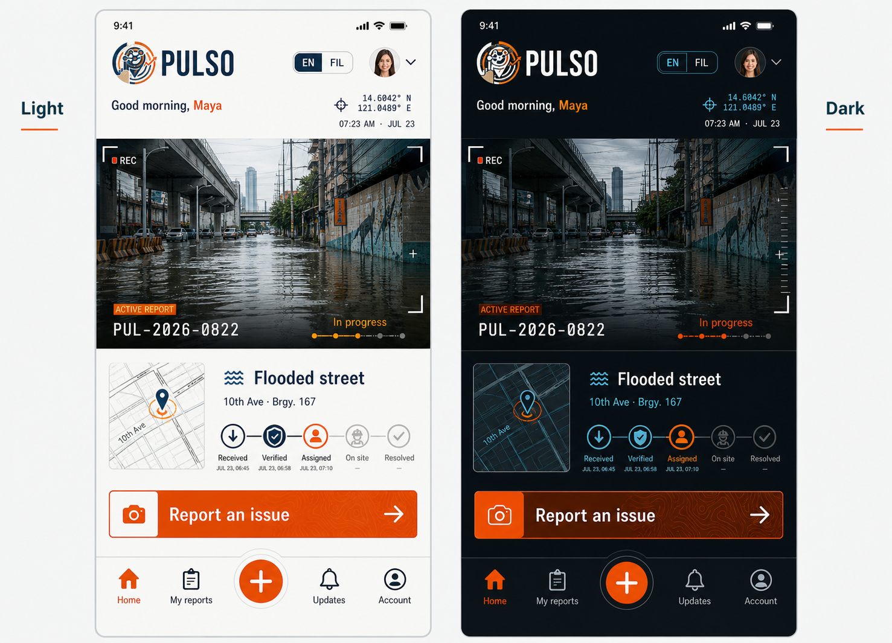
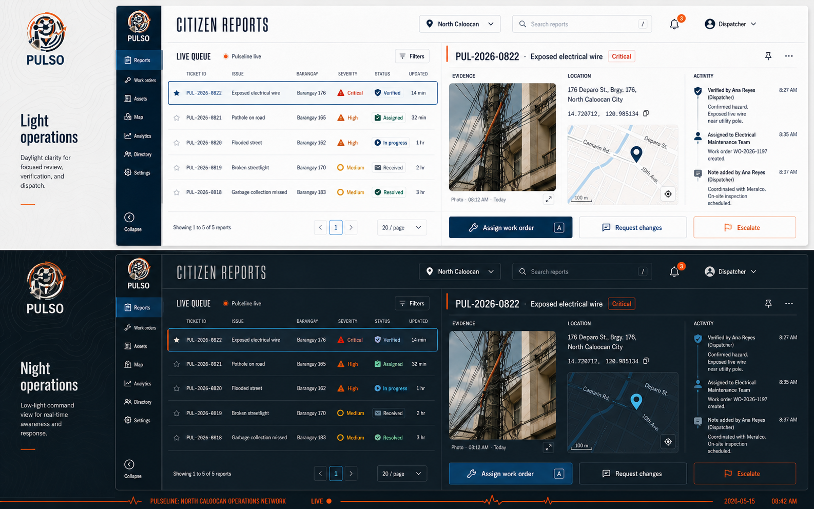
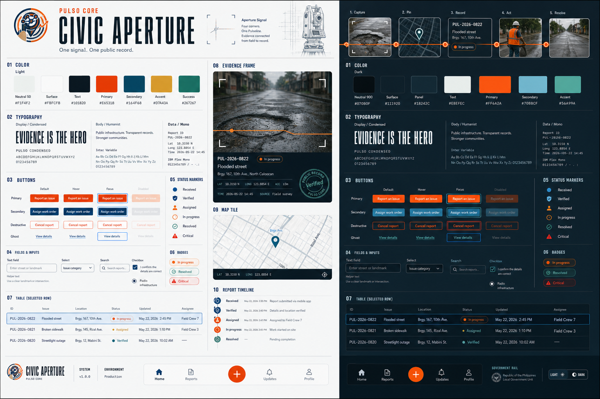

# PULSO Core Figma and design-system specification

| Field | Value |
|---|---|
| Status | Civic Aperture v0.2 foundations, library, and portal templates created in editable Figma; variable consolidation remains plan-limited |
| Version | 0.2 |
| Last validated | 23 August 2026 |
| Figma | [PULSO UI Rework — Audit, Core Library & Portal Concepts](https://www.figma.com/design/1qPgPj4o3smElv8B2B1REi) |

## 1. Library purpose

PULSO Core is one governed component language serving two experiences:

- **Resident mode:** comfortable density, resident-action orange, plain language, guided progress.
- **Government mode:** compact/comfortable density, survey-blue primary actions, role-aware data and operations.

Portal mode may change semantic accent, default density, and composition. It must not fork component anatomy, status meaning, accessibility, or behavior.

## 2. Current Figma file

The connected Figma Starter account permits three pages and one mode per variable collection. The file is organized as:

1. `00 Overview & Foundations` — charter, direction, palette, type, spacing, motion.
2. `01 Core Library` — reusable components and component sets.
3. `02 Portal Concepts & Handoff` — editable resident and government screens, accessibility/handoff annotations, and raster exploration boards.

Current editable assets:

- `Action/Button` component set: Primary, Secondary, Destructive × Default, Focus, Disabled, Loading.
- `Data/StatusBadge` component set: Received, Verified, Assigned, In progress, Resolved, Critical.
- `Field/Text` component set: Default, Error, Disabled.
- `Progress/Pulseline` v0.1 component, planned to migrate to `Progress/SignalCut`.
- `Gov/NavRail` component.
- `Resident/BottomNav` component.
- `Feedback/InlineAlert` component.
- `Resident/Home · 390×844` editable screen.
- `Gov/Citizen reports · 1440×900` editable screen.
- `Foundations/Civic Aperture · v0.2` editable production board.
- `Library/Civic Aperture · Production · v0.2` editable production board.
- `Signature/Evidence + record`, `Action/Controls + fields`, `Feedback/Status + alerts`, `Navigation/Portal + decisions`, and `Feedback/System states` reusable v0.2 component specimens.
- `Template/Resident Home · Light · Reviewer final` and `Template/Resident Home · Dark · Reviewer final` reusable components at 390×844.
- `Template/Government Citizen reports · Light · Reviewer final` and `Template/Government Citizen reports · Dark · Reviewer final` reusable components at 1440×900.

The file includes 13 light semantic color variables, 13 paired dark variables, 8 spacing variables, and 6 text styles. Because Starter supports one mode per collection, light and dark are temporarily separate collections. On a Professional plan, migrate to one `Theme` collection with `Light` and `Dark` modes.

The v0.1 objects remain as the structural baseline and migration comparison. Civic Aperture v0.2 now exists in the same file as editable foundations, component specimens, and paired resident/government templates. The imported SVG source retains live text and semantic groups; it does not create production code or guarantee variable bindings. The Starter MCP limit prevented programmatic consolidation of all v0.2 fills, typography, and component properties into multi-mode variables. Until a Professional-plan migration, the token table below and the [Figma production handoff](./10-figma-production-handoff.md) are the binding semantic contract.

## 3. Variable architecture

Intended collections:

| Collection | Modes | Purpose |
|---|---|---|
| `Color / Primitive` | Default | Raw ramps; designers do not apply directly to product components |
| `Theme` | Light, Dark, High Contrast | Semantic surfaces, text, borders, focus, status |
| `Portal` | Resident, Government | Semantic primary action/accent only |
| `Density` | Comfortable, Compact | Control/table spacing and row heights |
| `Scale` | Default | Spacing, radius, size, elevation, layout |
| `Motion` | Full, Reduced | Durations and allowed transition behavior |

Temporary Starter collections:

- `PULSO Core / Light`
- `PULSO Core / Dark`
- `PULSO Core / Scale`

## 4. Semantic color tokens

| Token | Light | Dark | Contract |
|---|---:|---:|---|
| `bg/canvas` | `#F4F7F5` | `#071A2B` | Page environment |
| `bg/surface` | `#FFFFFF` | `#0E283E` | Primary work surface |
| `bg/subtle` | `#F8FAF9` | `#15364D` | Focused docket, filters, secondary regions |
| `text/primary` | `#0C2436` | `#F4F7F2` | Main content |
| `text/secondary` | `#465D6C` | `#B9C7CF` | Supporting content |
| `border/default` | `#C9D4D9` | `#335166` | Inputs, dividers, panels, inactive lifecycle |
| `brand/pulse` | `#B9380B` | `#FF8A3D` | Signal Cut and restrained brand accent |
| `action/resident` | `#B9380B` | `#FF8A3D` with Survey Night text | Resident primary action |
| `action/government` | `#0B4F6C` | `#82C7D8` with Survey Night text | Staff primary action |
| `state/success` | `#0B756B` | `#66D2C8` | Resolved/completed |
| `state/warning` | `#B45309` | `#FBBF24` | Needs attention/delayed |
| `state/danger` | `#B42318` | `#FDA29B` | Critical/error/destructive |
| `focus/ring` | `#2563EB` | `#93C5FD` | Visible keyboard focus |

Rules:

- use semantic variables, never isolated hex values in a component;
- text and controls must meet target contrast in every mode;
- status always combines text + icon/shape; never color alone;
- resident and government action colors do not redefine state colors;
- dark mode provides the same information and boundaries as light mode.

## 5. Typography

Target roles:

| Style | Typeface | Size/line | Use |
|---|---|---:|---|
| `display/lg` | Archivo Variable 700, width 82–90% | 52/56 | Public hero only |
| `display/md` | Archivo Variable 700, width 82–90% | 40/44 | Major section statement |
| `heading/1` | Archivo Variable 700 | 32/38 | Page title |
| `heading/2` | Archivo Variable 700 | 26/32 | Section title |
| `heading/3` | Source Sans 3 700 | 20/26 | Card/panel title |
| `body/lg` | Source Sans 3 400 | 18/28 | Resident explanation |
| `body/default` | Source Sans 3 400 | 16/24 | Default body/form content |
| `body/small` | Source Sans 3 400 | 14/20 | Table/supporting content |
| `utility` | Source Sans 3 600 | 12/16 | Short metadata; absolute minimum |
| `data/id` | IBM Plex Mono 500 | 14/20 | Ticket IDs, coordinates, hashes |

The current Figma prototype uses Inter styles as a safe placeholder: Heading 1, Heading 2, Body, Body Small, Utility, and Data ID. Replace only after Archivo and Source Sans 3 licensing, Filipino glyph coverage, variable-width behavior, Windows rendering, and fallback validation.

Content rules:

- sentence case for labels and actions;
- do not use uppercase for instructions, errors, or long metadata;
- ticket IDs never truncate their identifying suffix;
- permit 200% zoom and Filipino long strings without overlap;
- use tabular numerals where staff compare metrics.

## 6. Geometry and layout tokens

### Spacing

`4, 8, 12, 16, 24, 32, 48, 64`

### Radius

| Token | Value | Use |
|---|---:|---|
| `radius/none` | 0 | tables, rails, edge-aligned regions |
| `radius/sm` | 4 | compact tags/internal items |
| `radius/md` | 8 | controls |
| `radius/lg` | 12 | cards/panels |
| `radius/xl` | 16 | resident feature panels/dialogs |
| `radius/full` | 999 | badges/avatar/pills |

Avoid arbitrary 32–48 px radii on routine operational panels.

### Elevation

- `none`: default page/card hierarchy uses borders, rules, and spacing.
- `raised`: dropdown, sticky toolbar, selected detail panel.
- `overlay`: drawer, modal, popover.

Static cards do not lift on hover. Official marks do not animate or scale.

### Width and grid

| Surface | Grid |
|---|---|
| Resident mobile | 4 columns, 16 px margins, 12 px gutters |
| Resident tablet | 8 columns, 24 px margins, 16 px gutters |
| Resident desktop | 12 columns, max 1200 px, 24 px gutters |
| Government desktop | 12 columns, max 1600 px; 256/72 px nav excluded from content grid |
| Reading/modal | max 680 px for long text |

Breakpoints: `480, 768, 1024, 1280, 1440`.

Control heights: 44 px default; 36 px compact staff-only controls when spacing and target requirements remain valid.

## 7. Motion

| Token | Value | Use |
|---|---:|---|
| `motion/fast` | 120 ms | pressed/selected/focus-adjacent state |
| `motion/standard` | 180 ms | simple reveal/replace |
| `motion/overlay` | 220 ms | dialog/drawer |
| `motion/signal` | 320–450 ms | one-time Signal Cut lifecycle advance |

Rules:

- no infinite motion except a genuine time-critical live indicator;
- never animate essential text or official marks;
- status changes may animate once and then settle;
- reduced mode removes parallax, looping pulse, marquee, blur, scale, and layout transforms;
- do not make motion the only indication of change.

## 8. Component hierarchy

```text
Foundations
└─ color, type, iconography, spacing, radius, elevation, motion, layout
Primitives
└─ button, link, icon button, field, badge, surface, divider
Composites
└─ dialog, drawer, filters, pagination, table, toast, notification
Shared patterns
└─ shell, page header, Signal Cut, Field Aperture, approval chain, empty/error states
Portal patterns
├─ resident reporting and tracking
└─ government queues, cases, decisions, and approvals
Templates
└─ route-specific composition only
```

### Shared component inventory

- `Brand/Lockup`: horizontal, compact, seal-only; clear-space rules; no animation.
- `Surface/Open`, `Surface/Ruled`, `Surface/PersistentPanel`, `Surface/FocusedDocket`, `Surface/Overlay`.
- `Action/Button`: primary, secondary, tertiary, destructive, link, icon-only.
- `Action/SegmentedControl`: theme, view, scope.
- `Field/Wrapper`: label, optional marker, helper, error, success, character count.
- `Field/Text`, `Textarea`, `NativeSelect`, `Combobox`, `Date`, `OTP`, `Checkbox`, `Radio`.
- `Upload/Dropzone` and capture review.
- `Navigation/PageHeader`, `Breadcrumb`, `Tabs`, `Pagination`.
- `Data/StatusBadge`, `PriorityBadge`, `Metric`, `RecordTable`, `RecordCard`.
- `Feedback/InlineAlert`, `Banner`, `Toast`, `EmptyState`, `ErrorState`, `Skeleton`.
- `Overlay/Dialog`, `ConfirmationDialog`, `Drawer`, `Popover`, `Tooltip`.
- `Progress/Stepper`, `SignalCut` (supersedes the generic Pulseline visual), `ApprovalChain`.
- `Media/FieldAperture` and `Data/CoordinateRail` with evidence-integrity rules.
- `Map/Marker`, `MapLegend`, `MapInfoCard`, governed local-cartography tile, map/list toggle.
- `Chart/Frame`: title, range, freshness, definitions, accessible summary, data-table link.

### Resident components

- `Resident/AppShell`
- `Resident/BottomNav`
- `Resident/ReportCTA`
- `Resident/VerificationExplainer`
- `Resident/VerificationProgress`
- `Resident/EvidenceCapture`
- `Resident/LocationConfirm`
- `Resident/IssueDetails`
- `Resident/ReportReview`
- `Resident/ReportReceipt`
- `Resident/ReportCard`
- `Resident/PublicStatusSignalCut`
- `Resident/AdvisoryCard`
- `Resident/ServiceLink`
- `Resident/EmergencyContact`

### Government components

- `Gov/AppShell`: expanded, rail, drawer.
- `Gov/NavSection`, `NavItem`, `ScopeSelector`.
- `Gov/MyWorkQueue`.
- `Gov/QueueToolbar`, `SavedView`.
- `Gov/ReportRow`, `WorkOrderRow`, `ProjectRow`.
- `Gov/CaseDetailPanel`.
- `Gov/StickyActionBar`.
- `Gov/InternalStatusSignalCut`.
- `Gov/ApprovalDecision`.
- `Gov/EmergencyAccess`.
- `Gov/DocumentCard`, `HashRecord`, `AuditEvent`.
- `Gov/ProcurementStage`.
- `Gov/ChartWorkspace`.

## 9. Variant and state contract

Every interactive component must specify:

- kind/intent;
- size;
- density;
- portal mode;
- leading/trailing icon;
- default, hover, focus, pressed/active, selected, disabled, loading;
- validation error, system error, success;
- theme behavior;
- truncation, wrapping, and 200% zoom;
- accessible name, role, state, keyboard behavior, focus destination, announcement;
- English and Filipino examples.

Page patterns must also specify loading, first-use empty, filtered empty, permission-limited, offline, stale data, partial data, error, and success.

## 10. Figma naming and construction rules

- Pages use numbered lifecycle names where plan limits permit.
- Components use `Domain/Component` and properties use `Property=Value`.
- Layers use semantic names: `Label`, `Helper`, `Leading icon`, `Status`, not `Rectangle 43`.
- Auto Layout is required for resizable components and all production frames.
- Use Fill/Hug intentionally; avoid fixed text containers unless the layout requires truncation.
- Bind semantic variables; no detached one-off color in approved components.
- Keep touch/click targets separate from visual icon size.
- Descriptions contain anatomy, use, do-not-use, content, accessibility, and change notes.
- Raster concept boards remain clearly labeled exploration; do not detach/copy them into production frames.

## 11. Accessibility annotation template

Each component/page annotation records:

```text
Name:
Purpose:
Accessible name source:
Role / native element:
State and properties:
Keyboard interactions:
Initial focus / return focus:
Announcement behavior:
Touch target:
Contrast requirement:
Zoom/reflow behavior:
Reduced-motion behavior:
English / Filipino examples:
Known limitations:
```

Dialog behavior must follow the [WAI-ARIA dialog pattern](https://www.w3.org/WAI/ARIA/apg/patterns/dialog-modal/): focus enters the dialog, stays within it, Escape closes when safe, and focus returns logically. Prefer native controls. A custom combobox must follow the [combobox keyboard and semantic contract](https://www.w3.org/WAI/ARIA/apg/patterns/combobox/).

## 12. Design-to-development handoff

Every implementation-ready frame links:

- user/job statement and measurable outcome;
- component/version inventory;
- responsive rules;
- state matrix;
- content and localization;
- API fields and fixtures;
- permission/capability rule;
- analytics events;
- accessibility annotations;
- acceptance tests;
- rollout/rollback notes;
- owner, version, last validated, changelog.

A screenshot is never sufficient handoff. An implementation ticket is not ready until the above contract exists.

## 13. Concept boards







These v0.2 boards establish hierarchy, density, theme behavior, and visual character. Their editable foundations, component specimens, and four paired portal templates are now in the shared Figma file. Product behavior, text, status mapping, and accessibility remain governed by this dossier; see the [production handoff](./10-figma-production-handoff.md) for the exact object and source map.
