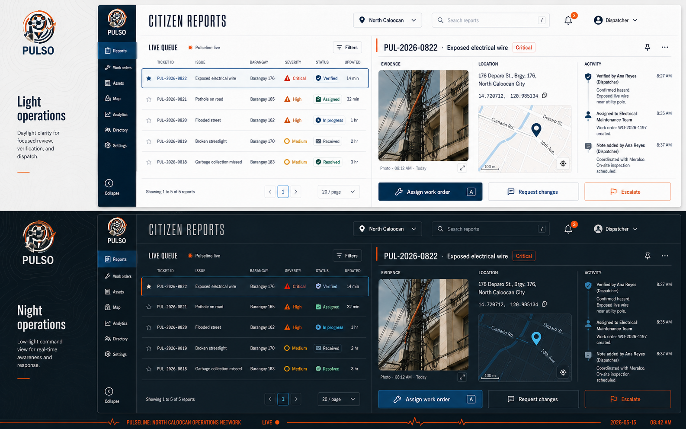

# Government experience specification

| Field | Value |
|---|---|
| Status | Proposed; validate with representative LGU roles |
| Version | 0.2 |
| Last validated | 23 August 2026 |
| Target stream | `codex/ui-reworks-government` consuming `codex/ui-reworks` |

## 1. Experience goal

Every authorized staff member sees the work they can perform, understands why it needs attention, retains context from queue to decision, and leaves a traceable outcome without navigating the organization chart or guessing at system status.

Primary outcomes:

- shorter time from receipt to human review and assignment;
- fewer permission dead ends and unauthorized affordances;
- fewer status-transition mistakes and rework;
- higher queue freshness and operational visibility;
- complete decision/evidence/audit history;
- usable staff workflows from 1280×720 through 200% zoom and smaller field devices.

## 2. Role classes and capability model

The source currently duplicates specific roles. Before design freeze, approve one backend-owned registry that maps staff to capabilities and scopes. Figma prototypes and tests should use representative capability classes rather than assuming role names imply permissions.

| Capability class | Representative jobs | Typical modules/actions |
|---|---|---|
| Executive | City/assistant engineer, authorized senior leadership | review performance, approve/escalate, audit, view cross-jurisdiction insights |
| Operations | Dispatcher, authorized operations manager/clerk | verify reports, assign work, coordinate response, update incident |
| Administration/records | Admin officer/clerk, records officer | register documents, retain/archive, manage records, controlled PII |
| Design/planning | Design engineer, CAD, design division lead | design requests, analysis, project documents |
| Survey/estimation | Project engineer, estimator, survey lead | field survey, BoQ, estimates, project preparation |
| Construction/field | Foreman, field worker, project engineer | assigned work, field updates, proof, blockers |
| Inspection/OBO | Building/electrical/mechanical inspector | permits, scheduled inspections, findings, compliance |
| Procurement | BAC/procurement-authorized staff | requests, bidding, approvals, procurement stages |
| System administration | System administrator | people, roles, configuration, security/audit administration |

Capability contract:

- route visibility;
- navigation visibility;
- record/data scope;
- field visibility, including PII;
- allowed actions/status transitions;
- bulk/export permissions;
- emergency override permissions;
- audit requirements.

The backend is authoritative. Frontend hiding improves clarity but is not security.

## 3. Target navigation

```text
My work
  Assigned to me
  Waiting for my review
  Recently completed

Operations
  Citizen reports
  Work orders
  Projects

Records
  Documents
  Reports archive
  Audit trail

Insights
  Operational overview
  Predictive maintenance

Administration
  People and roles
  Resident accounts
  System settings
```

Only permitted groups/items render. Department, team, barangay, jurisdiction, date, and status live in a persistent scope/filter system.

## 4. Responsive shell

| Width | Navigation | Workspace behavior |
|---|---|---|
| ≥1280 | 256 px expanded sidebar | Queue + detail; full toolbar; sticky actions |
| 1024–1279 | 72 px rail with tooltips | Queue + narrower detail/drawer; filters condense |
| 768–1023 | Drawer + compact masthead | Queue and detail alternate; filter sheet |
| <768 | Drawer | Record cards; detail as full route; primary action sticky but unobtrusive |

Shell requirements:

- page title/breadcrumb, current scope, search, alerts, and user available at every size;
- skip link and landmarks;
- `aria-current` for route, `aria-expanded`/`aria-controls` for navigation groups;
- current filters and selection survive detail actions/back navigation;
- visible narrow scrollbars for independent regions;
- no 256 px fixed sidebar on a 320–390 px canvas;
- capability-denied deep link renders a clear denied page, not a resident redirect.

## 5. My Work dashboard

The role-specific dashboard is a strength and should become a consistent task landing.

Sections:

1. **Needs attention** — actionable items ordered by policy/urgency, not decorative metrics.
2. **Assigned to me** — current work, blocker, due/target, last update.
3. **Waiting for my review** — explicit approval/decision tasks.
4. **Recently completed** — confirmation and easy return to context.
5. **Operational context** — only metrics that change a decision.

Each item includes:

- object/ticket ID;
- plain task title;
- current status and priority;
- why it is in this user’s queue;
- time/freshness;
- responsible owner/team;
- direct scoped destination including saved filters/query.

Quick actions must preserve their intended tab/filter; broad links that discard context are not acceptable.

## 6. Citizen reports: queue and case detail

### Desktop workspace

```text
┌ Navigation ┬ Page title / jurisdiction / search / alerts ┐
│            ├ Saved view · status · severity · barangay   │
│            ├ Queue/table                ┬ Case detail     │
│            │ Ticket / issue / location  │ Evidence        │
│            │ severity / status / age    │ Location/map    │
│            │                            │ Signal Cut      │
│            │                            │ Activity/audit  │
│            │                            │ Sticky actions  │
└────────────┴────────────────────────────┴─────────────────┘
```



### Queue contract

- saved personal/team views with visible ownership;
- URL-addressable filters/sort/selection where practical;
- freshness and result count;
- checkbox only for valid bulk actions;
- native table semantics for static tabular data; separate links/buttons in cells;
- no clickable row that contains nested interactive controls;
- selected row remains visible after action/refresh;
- error retains last known data and offers Retry;
- maps always have a list/table equivalent.

Default columns:

- ticket;
- issue/category;
- barangay/location summary;
- severity/priority;
- canonical status;
- owner/team;
- age/updated;
- permitted quick action.

### Case detail contract

1. ticket, issue, severity, status, freshness;
2. privacy-safe reporter identity with controlled reveal where permitted;
3. evidence with metadata and quality/safety notes;
4. map + textual address/landmark/jurisdiction;
5. AI suggestion labeled as suggestion, source, confidence/limits;
6. internal Signal Cut lifecycle and approval chain;
7. chronological immutable activity/audit history;
8. related/duplicate incidents;
9. sticky role-aware actions.

Actions use explicit labels: **Verify report**, **Request information**, **Assign work order**, **Escalate**, **Mark duplicate**, **Close as outside scope**.

Every decision captures reason, actor, time, source status, target status, and related object. Irreversible decisions require confirmation; safe reversible actions offer undo where feasible.

## 7. Triage and assignment flow

```text
Open scoped queue
→ inspect evidence and location
→ compare duplicate/related incidents
→ review AI suggestion (optional)
→ choose: verify / request info / duplicate / outside scope
→ select eligible team or create work order
→ review assignment, scope, priority, and target
→ confirm
→ see persisted event and next owner
```

Assignment requirements:

- eligible staff/teams come from the server; no seeded/hard-coded IDs;
- filter by capability, jurisdiction, availability, team, and work type;
- show why a person/team is eligible or unavailable;
- no-eligible-team state provides an escalation route;
- assignment confirmation names ticket, team, work order, priority, and notification effects;
- failure retains the selection and explains whether anything was saved;
- successful assignment updates queue/detail consistently.

## 8. Work orders and projects

### Work-order record

- source incident(s);
- scope/description;
- location/jurisdiction;
- assignee/team;
- priority and target policy;
- parts/equipment/dependencies;
- field updates and evidence;
- blockers/changes;
- completion proof;
- review/approval and closure.

### Project lifecycle

The current source uses conflicting five-, six-, and thirteen-phase models. Product and operations must approve one model before UI implementation. A candidate normalized lifecycle:

```text
Request → Assessment → Survey → Design/Estimate → Approval
→ Procurement → Construction → Inspection → Resolution/Turnover → Close
```

Each phase needs entry criteria, owner, required artifacts, permissible actions, exit event, resident visibility, and audit/retention behavior.

The UI should display canonical stages and show detailed departmental tasks inside a stage rather than presenting competing phase counts.

## 9. Approvals and decisions

Approval component anatomy:

- decision requested and why;
- source object/version;
- evidence and required checks;
- prior decisions/conditions;
- conflicts or missing information;
- **Approve**, **Request changes**, **Reject** where policy permits;
- required comment/reason rules;
- consequences and next owner;
- immutable decision event.

Do not place destructive decisions beside routine navigation without separation. Confirmation copy names the object and consequence.

## 10. Records, documents, and audit

- distinguish working documents, official records, archived records, and deleted/void requests;
- show document owner, version, classification, checksum/hash where relevant, created/updated, and retention state;
- archive instead of routine permanent deletion;
- audit trail is chronological, filterable, exportable only when permitted, and links to source objects;
- privacy/PII reveal is logged and capability-gated;
- record fetch failure never renders as a legitimate empty archive.

## 11. Analytics and predictive maintenance

Every metric/chart identifies:

- definition;
- period and comparison period;
- jurisdiction/scope;
- data freshness;
- source records;
- exclusions/limitations;
- accessible summary and **View data table**;
- permitted operational next action.

AI narrative/procurement suggestions must link to underlying clusters/records and remain drafts until a named staff decision.

Do not use decorative KPIs. A metric belongs on the dashboard only if it changes prioritization, staffing, approval, or investigation.

## 12. Administration and RBAC

People/role screens must separate:

- identity/account state;
- plantilla/role assignment;
- capabilities and data scope;
- temporary delegation;
- MFA/session/security state;
- last access and audit;
- deactivate versus delete.

Changing permission requires before/after summary, effective time, reason, actor, audit event, and confirmation. The UI must not imply that frontend-only visibility is the security boundary.

## 13. Emergency access

An emergency override must never be a casual toggle.

Required flow:

1. explain why normal scope is being overridden;
2. select affected area/records and time window;
3. enter a required reason/incident reference;
4. show expanded data/action scope;
5. confirm that access is logged and reviewed;
6. show a persistent active-emergency banner;
7. provide **End emergency access**;
8. notify/review according to policy.

No emergency access implementation proceeds until legal/security/operations owners approve the policy.

## 14. Staff content design

| Avoid | Use |
|---|---|
| Strategic Failure | Couldn’t load citizen reports |
| Tactical Blackout | Live map updates are unavailable |
| Asset Purge | Request archive / Request deletion review |
| Execute operation | Start work / Approve / Assign |
| Success | Name the result: Work order assigned |

Errors follow this shape:

```text
What failed.
What remains saved or visible.
What the staff member can do now.
Reference/correlation ID when useful.
```

## 15. Government screen matrix

| Surface | Primary job | Required exceptional states |
|---|---|---|
| My Work | Act on owned/review tasks | no assigned work, stale data, permission change |
| Citizen reports | review/triage | filtered empty, API error, duplicate, outside scope |
| Case detail | decide and hand off | missing evidence, AI unavailable, no eligible team |
| Work orders | plan/execute/close | blocked, overdue, reassigned, completion rejected |
| Projects | advance lifecycle | missing artifact, dependency, approval rejected |
| Records | register/find/retain | permission-limited, integrity issue, retention hold |
| Analytics | understand/act | no data, stale/partial data, definition change |
| People & roles | govern access | pending invite, locked, deactivated, conflict |
| Settings | configure safely | unsaved change, conflict, validation, rollback |

## 16. Accessibility and quality acceptance

- every role sees only permitted routes, fields, and actions;
- denied deep links fail safely and explain scope;
- routine queue → evidence → triage → assignment completes without losing filters/selection;
- all actions work with keyboard and have visible focus and accessible names;
- dialogs, drawers, popovers, menus, and comboboxes follow documented keyboard/focus contracts;
- native tables use caption/header scope; interactive widgets remain separate tab stops;
- charts provide summaries/data tables;
- maps provide list/table alternatives;
- high-density screens remain usable at 1280×720 and 200% zoom;
- no essential horizontal scrolling at 320 px outside a deliberate labeled data region;
- status is not color-only;
- no critical/high accessibility defect or keyboard trap;
- destructive/irreversible changes require clear confirmation and audit;
- routine staff usability task completion ≥90%; critical dispatch scenarios achieve 100% in pilot validation.

## 17. Government product metrics

Primary:

- time to first human review;
- time from verified to assigned;
- queue age by priority/status;
- routine task completion time;
- decision reversal/rework rate;
- blocked/no-owner duration;
- status-transition error rate;
- successful source-record drill-through from analytics.

Guardrails:

- unauthorized route/action attempts;
- PII reveal volume and anomaly rate;
- permanent/destructive action requests;
- stale data and API failure rate;
- duplicate assignment/work orders;
- accessibility/performance regression;
- support/escalation volume caused by navigation or status ambiguity.
