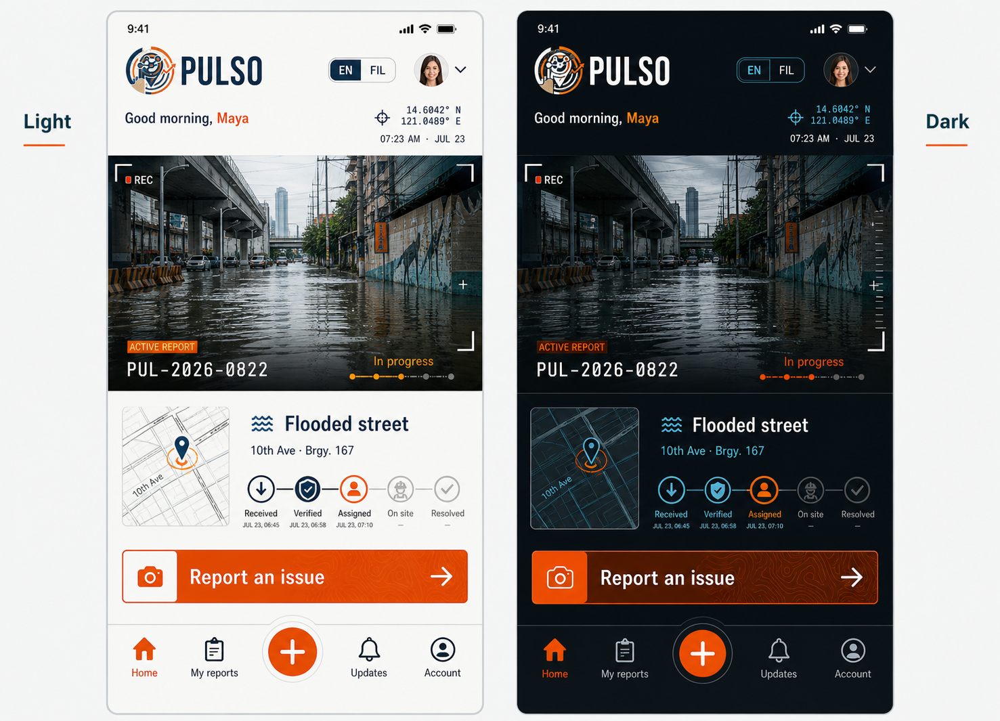
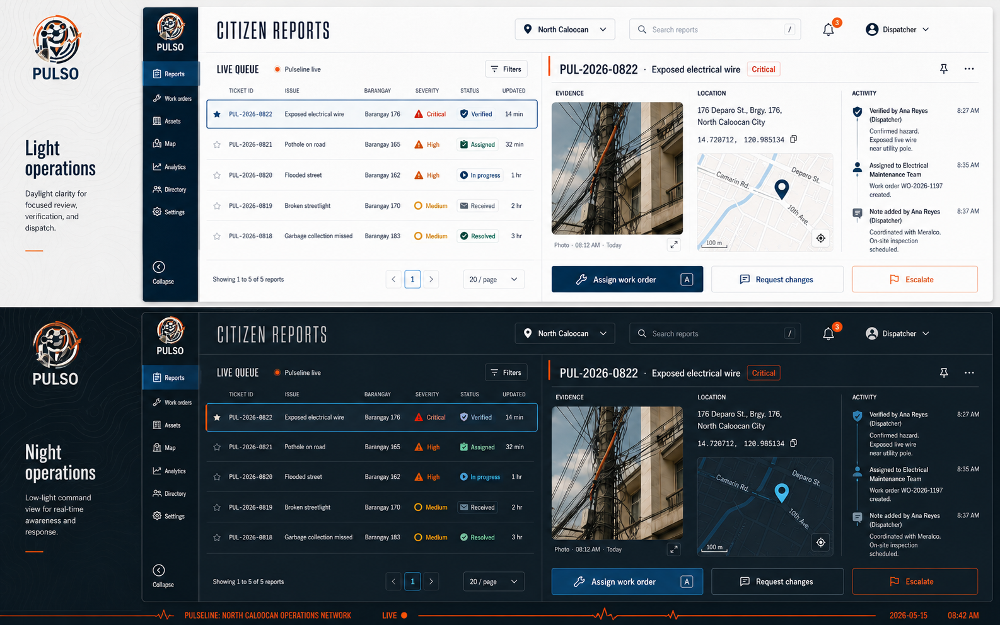
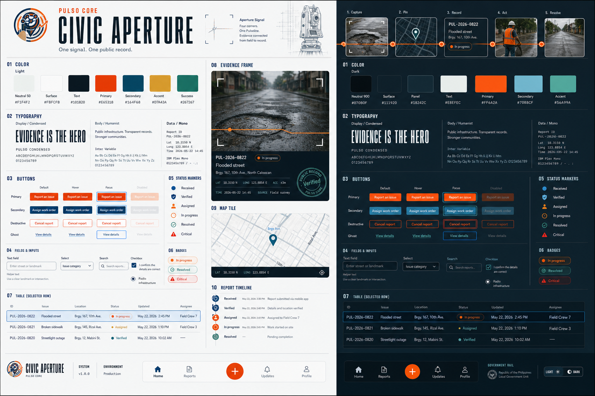

# PULSO visual art direction v0.2 — Civic Aperture

| Field | Value |
|---|---|
| Status | User-approved direction; migrated into reviewer-final editable Figma components |
| Version | 0.2 |
| Last validated | 23 August 2026 |
| Scope | Public entry, resident portal, government portal, PULSO Core, light and dark modes |
| Implementation | Documentation and visual exploration only; no frontend code changes |

## 1. Revised verdict

The v0.1 proposal established a sound interaction architecture, but its visual layer was too interchangeable with generic civic, banking, telecom, and enterprise-ticketing products. Removing the PULSO logo exposed the problem:

- the resident screen relied on a sequence of similarly weighted rounded cards;
- the government screen used the familiar navy-sidebar, white-table, blue-selection pattern;
- the component board resembled a general-purpose SaaS kit;
- orange and blue carried brand, portal, selection, status, and warning duties simultaneously;
- dark mode existed as tokens, not as a complete, intentional visual environment;
- the straight-dot lifecycle did not yet express the pulse/route idea in the PULSO identity.

Retain the information architecture, role separation, queue/detail model, report lifecycle, semantic components, and accessibility contracts. Replace the presentation layer.

## 2. Design thesis

> A field observation becomes visible, accountable public work.

The visual system is **Civic Aperture**. It is grounded in the materials of the service:

- resident and inspector evidence;
- road paint and hazard markings;
- survey instruments and coordinate records;
- barangay boundaries and street linework;
- work orders, timestamps, signatures, and audit history;
- the heartbeat-route form already present in the PULSO mark.

“Cinematic” means controlled framing, scale, light, contrast, and pacing. It does not mean black gradients, glass panels, neon, particles, or decorative 3D.

## 3. The signature system

### 3.1 Field Aperture

One panoramic evidence or map region anchors an important screen. Four quiet corner marks frame the source without covering or altering it.

Use it for:

- the public landing thesis;
- the resident’s active report or current city condition;
- government case evidence and location;
- field-inspection proof;
- before/after resolution evidence.

Rules:

- user-submitted evidence stays true-color and unfiltered;
- metadata is placed on an opaque rail below or beside the image;
- informative images have a text alternative; maps have a list/address alternative;
- do not place explanatory text directly over evidence;
- use no more than one dominant aperture in a viewport.

### 3.2 Signal Cut

The generic progress line becomes a two-pixel route derived from the PULSO heartbeat. One sharp notch identifies the current state, selected record, or active location.

The Signal Cut may become:

- report and work-order progress;
- the left edge of a selected queue row;
- a route or jurisdiction segment on a map;
- an approval or audit timeline;
- the transition between observation, verification, action, and resolution.

Completed segments use resolve teal; current resident action uses ember; current government action uses field blue; future segments use the mode’s neutral rule. Every point retains an icon/shape and label.

### 3.3 Coordinate rail

Ticket context can be expressed as a compact, monospaced record line:

```text
BRGY 176  /  14.720712, 120.985134  /  UPDATED 08:37
```

Only real data appears in this rail. Fake coordinates, arbitrary blueprint labels, and decorative technical language are prohibited.

### 3.4 Local cartography

PULSO needs one governed map style:

- quiet road and place labels;
- waterways in field blue;
- visible barangay boundaries in both modes;
- selected jurisdiction indicated by a solid Signal Cut boundary plus text;
- unchanged functional information between light and dark;
- a list/table alternative for nonvisual access.

A North Caloocan street or boundary pattern may appear inside headers or aperture regions at 2–3% opacity. It must not become a global graph-paper texture.

### 3.5 Engineering pictograms

Commission a small custom icon family using a two-pixel stroke and the Signal Cut geometry:

- road/bridge;
- drainage/flood;
- streetlight/electrical;
- waste obstruction;
- public facility;
- inspection/work crew.

Use established accessible icons for universal actions such as search, close, back, download, and settings. Custom pictograms are for PULSO’s domain, not novelty.

## 4. Light and dark modes

### Light — morning field sheet

- cool mineral canvas and white operational surfaces;
- crisp rules and restrained shadows;
- natural evidence photography;
- orange reads like inspection or road-marking paint;
- local cartography appears only in contextual regions.

### Dark — night inspection

- deep blue survey night rather than pure black;
- separation through tonal surfaces and rules, not glowing outlines;
- government blue becomes a pale operational cyan;
- resident ember resembles reflective safety marking without bloom;
- evidence remains true-color and equally legible;
- selected records may receive one subtle inner edge, never a large glow.

Both modes retain identical content, information boundaries, status labels, target sizes, and hierarchy. Theme selection defaults to the operating-system preference, can be overridden by the user, and persists without a flash of the wrong theme.

## 5. Semantic palette

| Token | Light | Dark | Intended role |
|---|---:|---:|---|
| `canvas` | `#F4F7F5` | `#071A2B` | Page environment |
| `surface` | `#FFFFFF` | `#0E283E` | Primary work surface |
| `surface/elevated` | `#F8FAF9` | `#15364D` | Overlay or focused docket |
| `text/primary` | `#0C2436` | `#F4F7F2` | Main content |
| `text/secondary` | `#465D6C` | `#B9C7CF` | Supporting content |
| `rule/default` | `#C9D4D9` | `#335166` | Dividers, boundaries, inactive lifecycle |
| `action/resident` | `#B9380B` | `#FF8A3D` with Survey Night text | Resident primary action |
| `action/government` | `#0B4F6C` | `#82C7D8` with Survey Night text | Staff primary action |
| `state/resolved` | `#0B756B` | `#66D2C8` | Completed/resolved |
| `state/critical` | `#B42318` | `#FDA29B` | Critical, error, destructive only |
| `focus/ring` | `#2563EB` | `#93C5FD` | Three-pixel keyboard focus |

Baseline contrast spot checks:

- light primary text on canvas: `14.74:1`;
- dark primary text on canvas: `16.31:1`;
- light resident action with white text: `5.78:1`;
- dark resident action with Survey Night text: `7.51:1`;
- light government action with white text: `8.94:1`;
- dark government action with Survey Night text: `9.32:1`.

These checks validate only the named token pairs. Every real component state still requires automated and manual contrast review.

Color proportion on routine screens:

- 75–80% canvas and surface;
- 12–15% ink and structural blue;
- 3–5% portal accent;
- remaining color reserved for meaningful state.

There is no blue–orange brand gradient. Orange must not simultaneously mean branding, warning, selection, navigation, and staff action.

## 6. Typography

| Role | Proposed family | Use |
|---|---|---|
| Display and civic heading | Archivo Variable, width approximately 82–90%, weight 650–700 | Public thesis, page title, important state statement |
| Interface and long-form copy | Source Sans 3, 400/600/700 | Forms, bilingual content, navigation, tables |
| Record and engineering data | IBM Plex Mono, 500/600 | Ticket IDs, coordinates, time, measurements, hashes |

Typography rules:

- public headline: 52–64 px desktop, 34–40 px mobile;
- resident and government page titles: 28–32 px;
- resident body: 16/24; compact staff body: 14/20;
- utility content never below 12/16;
- sentence case by default;
- uppercase only for short record labels such as `TICKET`, `BARANGAY`, or `UPDATED`;
- mono is never used for ordinary explanatory text;
- test English and Filipino strings, variable-font support, licensing, Windows rendering, 200% zoom, and fallback behavior before approval.

## 7. Composition rules

### Resident

- Use a 40–44 px brand lockup, not a giant masthead.
- Let a Field Aperture or current report establish the first visual focus.
- Preserve one clear thumb-level `Report an issue` action.
- Give only persistent objects—such as an active report—panel containment.
- Present updates and nearby reports as open lists separated by spacing and rules.
- Replace emergency icon tiles with accessible call rows containing organization, number, and consequence.
- Keep five stable bottom-navigation destinations; the central report action may be emphasized.
- Resident tone is spacious, human, and action-led. Ember is the sole primary-action color.

### Government

- Use a compact 72 px rail plus contextual navigation when required.
- Preserve queue/detail, but make the selected case an engineering docket rather than a generic drawer.
- Mark selection with a Signal Cut and surface shift—not a blue outline around the full row.
- Let evidence and location carry the visual emphasis; keep routine rows nearly monochrome.
- Use color only for severity, active state, and actionable exceptions.
- Keep a sticky decision rail with neutral `Request changes`, field-blue `Assign work order`, and ember-outline `Escalate`.
- Government tone is cooler, denser, and record-led. Field blue is the primary action; ember means escalation or urgent attention.

### Public and authentication

- Retain the useful asymmetric composition but replace generic slogans, 3D, glow, and glass with one real civic image or map aperture.
- Resident thesis: `Report what needs fixing. Track what the city does next.`
- Staff thesis: `Move every case forward. Review, assign, and resolve with a complete record.`
- Forms remain on solid, opaque surfaces with clear labels and recovery paths.

## 8. Motion

- Lifecycle advance: draw the Signal Cut once to the next state over 320–450 ms, then settle.
- Government record selection: crossfade the docket with no more than 8 px movement over 160–180 ms.
- Drawer: 220 ms translation; no scale or background blur.
- Map selection: one pulse, never an infinite loop.
- Public landing: the Signal Cut may draw once from observation to resolution.
- Reduced motion: immediate state change or short opacity fade.

Prohibited: card lifting, logo scaling, parallax, marquees, floating particles, background breathing, repeated shimmer, and ornamental loading motion.

## 9. Component implications

| Existing concept | v0.2 direction |
|---|---|
| Straight-dot `Progress/Pulseline` | Signal Cut with pulse notch, icon, label, and audit time |
| Uniform rounded card | `Surface` variants: open, ruled, persistent panel, focused docket, overlay |
| Rainbow outline badges | Quiet neutral badges; color reserved for the active exception/state |
| Generic selected table row | Signal Cut edge + surface change + selected semantics |
| Generic media card | Field Aperture with evidence integrity and metadata rail |
| Generic map tile | Governed local-cartography tile plus list alternative |
| Repeated icon tiles | Custom engineering pictograms only for domain categories |
| Theme toggle as decoration | Accessible system/light/dark preference with persisted state |

## 10. Explicit anti-patterns

- A card around every section.
- Navy sidebar plus blue selected row as the entire government identity.
- Giant logo mastheads or stock resident portraits.
- Glassmorphism, neon glow, aurora blobs, blue–orange gradients, or full-screen 3D.
- Generic straight-dot steppers.
- Tiny tracked uppercase metadata.
- More than one large-radius feature panel in a viewport.
- Pills for ordinary navigation and every label.
- Equal visual emphasis for every status color.
- Decorative KPI grids.
- Filtered user evidence or copy placed over evidence.
- Fake coordinates, survey marks, or blueprint language.
- “Cinematic dark mode” implemented as pure black, glow, and reduced readability.

## 11. Accessibility gates

- Target WCAG 2.2 AA in both modes.
- Validate every semantic foreground/background pair, including hover, focus, disabled, and selected states.
- Focus uses a clearly separated three-pixel ring that overrides the art direction.
- Status and lifecycle never rely on color alone.
- Evidence and maps have text/list equivalents.
- Text stays on opaque surfaces.
- Test 320 px reflow, 200% zoom, English/Filipino expansion, reduced motion, forced colors/high contrast, and keyboard-only operation.
- Cinematic composition may never displace the resident’s primary action or a staff member’s case decision.

## 12. Visual studies

### Resident light and dark



### Government light and dark



### Shared visual system



These raster studies establish hierarchy, atmosphere, and theme behavior. They are not pixel specifications and must not be implemented literally without the component, accessibility, content, and responsive contracts in this dossier.

## 13. Figma migration status

The approved direction has been migrated into the existing three-page Figma file without removing the v0.1 structural baseline. The file now includes:

1. an editable Civic Aperture foundations board;
2. an editable paired light/dark component and state library;
3. Field Aperture, Coordinate Rail, and Signal Cut specimens;
4. reviewer-final resident light/dark components at 390×844;
5. reviewer-final government light/dark components at 1440×900;
6. semantic layer names, live text, and native-size source SVGs for versioned handoff.

The connected Starter plan still limits the file to three pages and one mode per variable collection. The Figma API limit also prevented automated rebinding of every v0.2 property. Consolidating the paired collections, validating production font licensing/glyph coverage, and completing variable/component-property binding remain normalization tasks—not blockers to using the new templates for design iteration. The [Figma production handoff](./10-figma-production-handoff.md) records the exact boundary.
