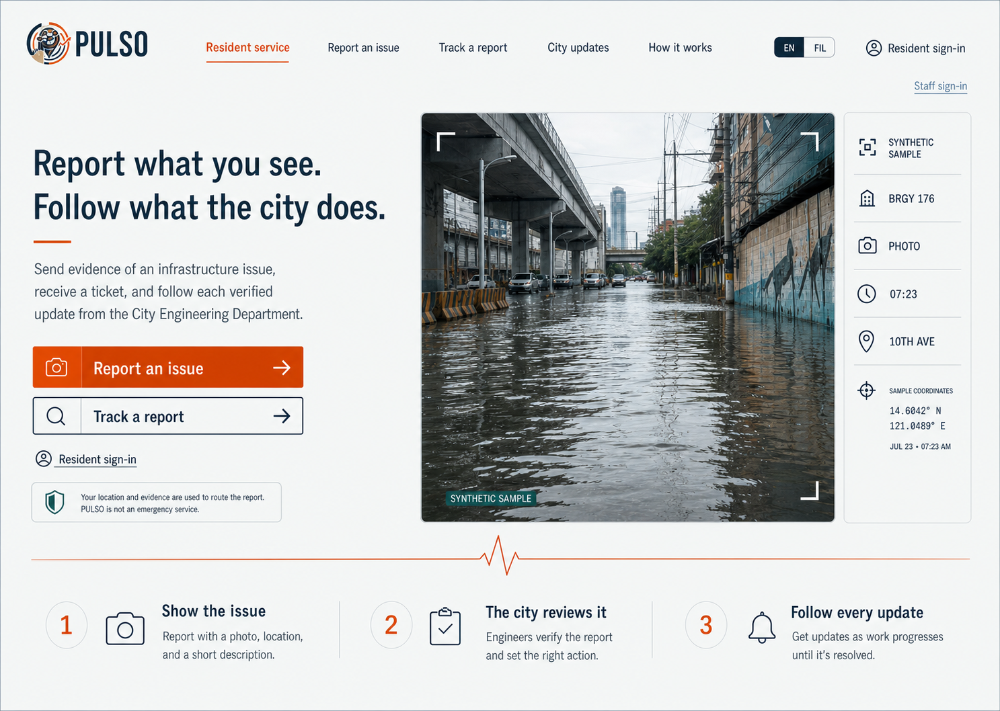
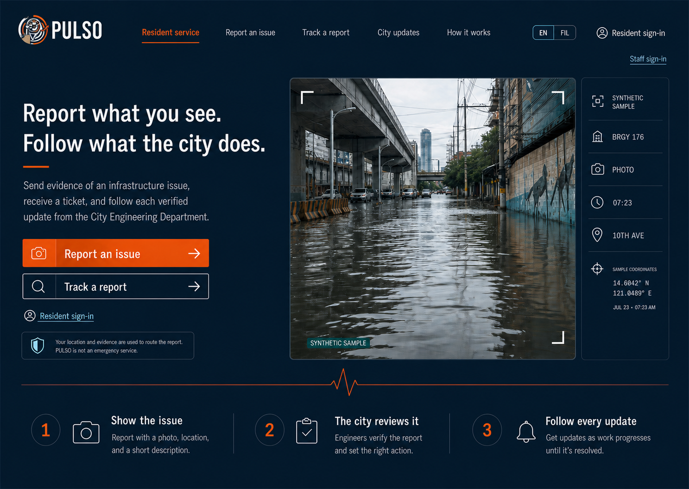
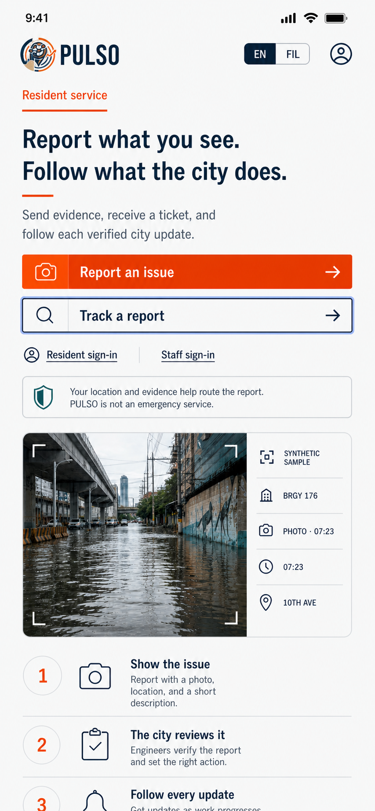
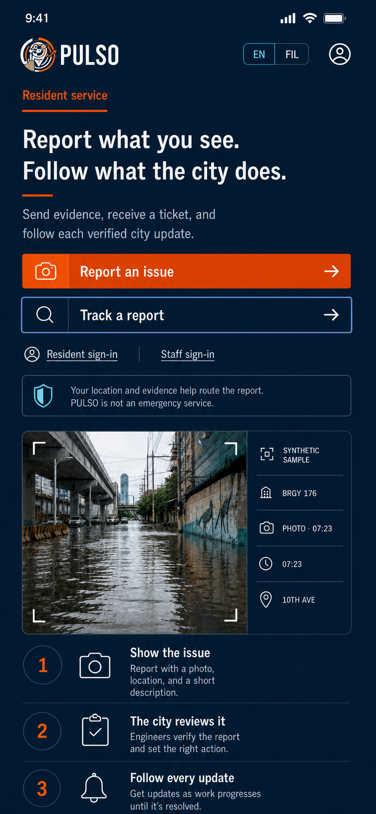

# Resident public home — visual comp v0.3

| Field | Value |
|---|---|
| Branch | `codex/ui-reworks-residents` |
| Status | Approved-direction visual comp; awaiting component-driven Figma construction |
| Experience | Public resident website |
| Direction | Civic Aperture |
| Themes | Morning Field Sheet / Night Inspection |
| Last validated | 24 August 2026 |
| Product code | Unchanged |

## 1. Outcome

This comp set begins the resident redesign with the public website, using the approved resident reviewer-final pair as visual authority. It replaces the current marketing-led first viewport with a civic task surface that immediately supports reporting, tracking, and resident sign-in.

These PNGs are spatial and art-direction references. They are not substitutes for editable Figma components, semantic variables, responsive constraints, accessibility annotations, or production behavior.

## 2. Visual references

### Desktop — Morning Field Sheet

### Desktop — Night Inspection

### Mobile — Morning Field Sheet

### Mobile — Night Inspection

## 3. Direction contract

### Thesis

`Report what you see. Follow what the city does.`

The first viewport demonstrates PULSO's mechanism instead of describing a platform: a resident can send evidence, receive a ticket, and follow verified city action.

### Own-world

- mineral field-sheet canvas and deep survey-blue night environment;
- ember reserved for resident action;
- true-color civic evidence inside one Field Aperture;
- opaque coordinate rail for sample/live state, barangay, source, time, and place;
- heartbeat-derived Signal Cut used only for the real service sequence;
- thin engineering rules and two-pixel pictograms;
- open composition rather than a grid of generic cards.

### First viewport

Desktop uses an asymmetric task/evidence split. The left column contains the thesis, report and tracking actions, sign-in, and trust guidance. The right side gives dominant scale to one truthful evidence aperture and its record rail. The lifecycle explanation begins immediately below.

Mobile converts the same hierarchy into one vertical task sequence. Reporting, tracking, sign-in, and trust guidance precede the evidence aperture. The public surface does not use the authenticated five-destination bottom navigation.

### Signature risk

Evidence occupies substantially more visual territory than a conventional government landing page. This is intentional: PULSO should be remembered as an evidence-to-action civic record, not a city marketing site. Task clarity, legibility, and privacy remain the limits on that scale.

## 4. Screen anatomy

| Region | Resident job | Figma construction requirement |
|---|---|---|
| Civic masthead | Confirm service, language, account context, and wayfinding | `Navigation/Public masthead`; real PULSO SVG; restrained 40–44px lockup |
| Thesis | Understand what PULSO does | Archivo-like heading role; no decorative eyebrow; sentence remains the visual anchor |
| Task controls | Start a report or track a ticket | Instances from `Action/Controls + fields`; 44px minimum target; complete states |
| Account access | Sign in without confusing staff and resident portals | Resident action visible; staff access quiet and separated |
| Trust line | Understand location, evidence, and emergency limits | `Feedback/Trust line`; opaque and readable in both themes |
| Field Aperture | See the kind of evidence PULSO carries | `Signature/Field Aperture`; true-color evidence; four quiet corners |
| Coordinate rail | Understand sample state, place, source, and time | `Signature/Coordinate Rail`; real fields only; copyable IDs when applicable |
| Service sequence | Understand what happens after reporting | `Navigation/Signal Cut`; three meaningful stages, not an even-dot stepper |

## 5. Required Figma frames

| Frame | Geometry | Content behavior |
|---|---:|---|
| `Screen/Resident Public Home · Desktop · Light · v0.3` | 1440 × 1024 | Full first desktop reference |
| `Screen/Resident Public Home · Desktop · Dark · v0.3` | 1440 × 1024 | Identical task and content parity |
| `Screen/Resident Public Home · Mobile · Light · v0.3` | 390 × 844 | Initial mobile viewport with vertical-scroll prototype |
| `Screen/Resident Public Home · Mobile · Dark · v0.3` | 390 × 844 | Identical task and content parity |

The source mobile PNGs show the scroll composition rather than claiming that all content fits within 844px. The Figma mobile frame must be 390×844 with vertical scrolling; the first viewport must retain the thesis, both task actions, resident sign-in, trust guidance, and the beginning of civic evidence.

## 6. Figma corrections before reviewer-final promotion

Generated visual comps contain details that must not become structural decisions without correction:

1. Replace every generated logo rendering with `frontend/public/pulso-logo.svg` or the approved Figma logo component.
2. Normalize the masthead lockup to 40–44px and prevent the mobile identity from consuming excessive vertical space.
3. Keep staff sign-in visually quieter than resident sign-in, particularly on mobile.
4. Avoid duplicate resident sign-in actions when the masthead account action remains visible and unambiguous.
5. Bind all controls, surfaces, rules, text, spacing, and radii to existing v0.2 variables or documented semantic roles.
6. Replace generated pictograms with approved component instances or imported project SVGs.
7. Preserve the evidence crop across themes and do not apply dark-mode filters.
8. Keep `SYNTHETIC SAMPLE` adjacent to the evidence and metadata. Coordinates, time, place, and ticket values remain sample until an LGU owner provides approved data.
9. Use the intended type roles only after Archivo, Source Sans 3, and IBM Plex Mono pass Figma availability and Filipino-glyph validation; otherwise use the documented provisional fallback.
10. Validate that the mobile trust line, metadata rail, and service sequence reflow at 320px without tiny type or horizontal scrolling.

## 7. Component and state matrix

| Component | Required properties or states |
|---|---|
| `Navigation/Public masthead` | viewport, theme, language, menu, resident-auth state |
| `Action/Resident primary` | default, hover, focus, pressed, disabled, loading |
| `Action/Track secondary` | default, hover, focus, pressed, disabled, loading |
| `Feedback/Trust line` | privacy, location, emergency, offline |
| `Signature/Field Aperture` | sample/live authority, evidence source, loading, unavailable |
| `Signature/Coordinate Rail` | source, location, time, jurisdiction, sample/live authority |
| `Navigation/Signal Cut` | current, complete, future, failed, unavailable |
| `Content/Service step` | English/Filipino, compact/comfortable, light/dark |

Every applicable component also requires accessible names, non-color state cues, long-string behavior, and forced-color notes.

## 8. Theme parity

The light and dark comps deliberately retain:

- identical navigation and information order;
- identical reporting, tracking, and sign-in actions;
- identical evidence crop and sample label;
- identical metadata fields;
- identical service sequence and explanatory copy;
- identical trust and emergency meaning.

Dark mode changes atmosphere through deep survey blue, tonal surfaces, pale rules, and reflective ember. It must not add glow, black entertainment styling, or reduced evidence fidelity.

## 9. Accessibility and responsive acceptance

- WCAG 2.2 AA contrast in both themes.
- Visible 3px focus treatment.
- Public interaction targets generally at least 44×44px.
- Logical keyboard order: masthead utilities, report, track, resident sign-in, trust/help, evidence, service sequence.
- No essential horizontal scrolling at 320px.
- Reflow at 200% zoom.
- Full English/Filipino functional parity, including errors and accessible names.
- Evidence alternative text; address/list alternative for map or coordinate context.
- Status and selection never depend on color alone.
- Reduced-motion behavior for any Signal Cut transition.

## 10. Current Figma blocker

Figma MCP continues to return the Starter-plan tool-call limit for metadata and library discovery. The production Figma workflow cannot safely begin Phase 1 until structural inspection is available. Browser-only manual construction would bypass variable, component, instance, and binding validation and must not be called reviewer-final work.

The exact restart point is:

1. inspect local variables, styles, components, instances, and bindings;
2. call `get_libraries`, then search local/available design-system assets;
3. reconcile v0.2 tokens and aliases;
4. build or extend public masthead, tracker, trust line, and service-step components;
5. assemble the four frames above from linked instances;
6. validate metadata and screenshots after every meaningful section;
7. complete paired-theme, 320px, 200% zoom, and bilingual QA.

## 11. Asset provenance

The four PNGs were generated with the built-in image-generation tool from the approved `concept-v2-resident-light-dark.png` reference and the resident v0.3 public-home brief. They contain synthetic infrastructure evidence and must remain labelled as visual comps.

No generated raster is authorized for production website use without LGU evidence, privacy, licensing, and content approval.
