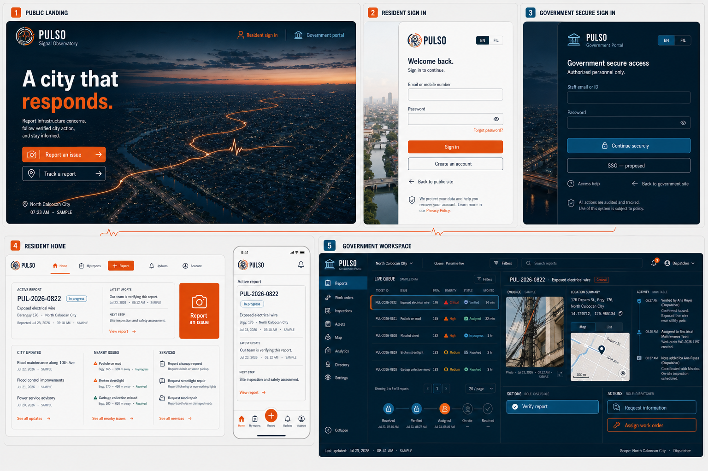
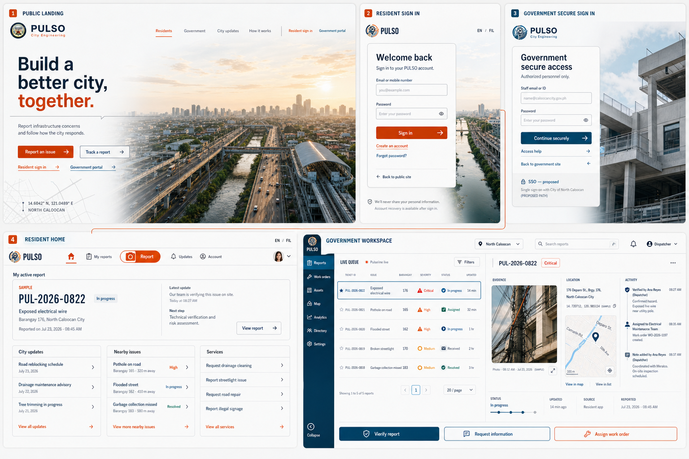
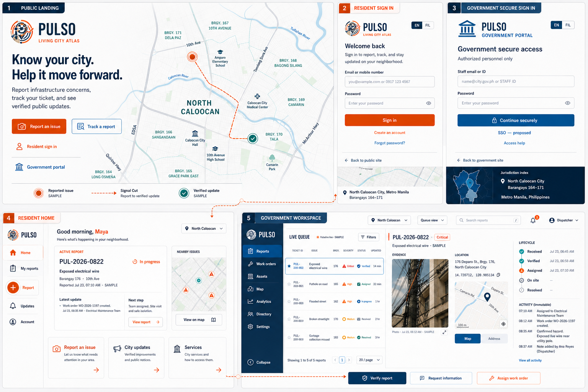

# PULSO cross-portal UI family examples v0.4

| Field | Value |
|---|---|
| Status | Proposed design exploration; not implementation authority |
| Version | 0.4 |
| Last validated | 24 August 2026 |
| Scope | Public hero, resident sign-in, government sign-in, resident home, government workspace |
| Visual authority | Approved Civic Aperture v0.2 |
| Product behavior | Proposed pending product, resident, security, and LGU operations validation |
| Content | Generated study content; tickets, places, people, times, maps, and outcomes are SAMPLE |
| Implementation | Not started; no frontend product code changed |

## Outcome

PULSO should feel like one civic service with two deliberately different operating environments:

- residents receive a spacious, reassuring, action-led experience;
- government employees receive a compact, capability-aware, record-led workspace; and
- both sides see the same civic record, lifecycle vocabulary, evidence provenance, and PULSO identity.

The public landing page is no longer a camera screen. Its hero explains the service and offers `Report an issue`, `Track a report`, and `Resident sign in`. Staff access is separate and quiet. Camera capture appears only after a resident intentionally begins the report flow.

## Proposed route model

```text
/
├─ /report                           Public report start; auth may be requested in context
├─ /track                            Public ticket lookup
├─ /updates                          Public city updates
├─ /resident/sign-in                Resident authentication
├─ /resident/register               Resident account creation
├─ /resident/home                   Authenticated resident home
├─ /resident/reports                Resident report history
├─ /resident/reports/:ticket        Resident-safe report detail
├─ /resident/report/*               Guided evidence, location, details, review, receipt
├─ /government                      Government institutional landing
├─ /government/sign-in              Government secure authentication
└─ /government/work/*               Capability-authorized operational workspace
```

All routes above are proposed. Authentication must return the user to the intended safe route, draft, ticket, filter, or record. Government denial must show a staff permission state rather than redirecting into the resident experience.

## Direction A — Signal Observatory



**Character:** cinematic, precise, low-light, operational.

The public hero frames North Caloocan at dusk as a calm city signal. The Signal Cut is meaningful: it connects place to an accountable service journey. Resident authentication moves into a quiet mineral form so usability is not sacrificed to atmosphere. Government authentication and the workspace inherit Night Inspection, Field Blue, visible scope, evidence provenance, and dense queue-to-docket continuity.

Best when PULSO wants the strongest cinematic first impression and a highly distinctive dark mode. Its main risk is drifting into generic command-center or sci-fi styling. The route line must always represent a real lifecycle, selected record, or location relationship.

## Direction B — Civic Horizon



**Character:** luminous, architectural, welcoming, institutional.

The city itself becomes the hero through one true-color infrastructure panorama and bold editorial typography. Authentication uses calm daylight, opaque forms, and strong separation between resident account access and government secure access. Post-login screens become restrained field sheets: generous for residents and compact for employees.

Best when broad public trust, accessibility, and immediate familiarity are the highest priorities. Its main risk is becoming a generic municipal campaign if the photography is not recognizably local, governed, and consistently art-directed.

## Direction C — Living City Atlas



**Character:** locally specific, navigable, civic, uniquely PULSO.

The public hero is a living North Caloocan atlas rather than a decorative map. A report marker, Signal Cut, and verified-update marker explain the PULSO mechanism without a generic three-card process. Resident authentication uses only a quiet jurisdiction strip. Resident home uses nearby context as a secondary aid. Government screens use cartography only where location affects a decision.

Best when PULSO wants the most ownable identity and clearest connection between place, report, city action, and public update. Its main risk is accuracy: map labels, jurisdiction, privacy, data freshness, and list alternatives must be authoritative.

## Five-surface experience contract

| Surface | Primary job | Required anatomy | Distinctive treatment | Must avoid |
|---|---|---|---|---|
| Public landing | Understand PULSO and choose a civic task | Thesis, one civic aperture, Report, Track, resident sign-in, quiet staff gate, trust/privacy/help | Cinematic scale spent on city, infrastructure, or local cartography | Camera as hero, generic feature cards, fake live statistics |
| Resident sign-in | Resume a resident task safely | Visible identity fields, password, recovery, create account, EN/FIL, privacy note, return path | Morning Field Sheet, ember action, compact contextual city crop | Full-screen marketing image, staff terminology, hidden labels |
| Government sign-in | Establish secure authorized access | Staff ID/email, password, recovery, authorized-personnel notice, audit/security note, proposed SSO path | Cooler Field Blue, separate URL and identity composition | Resident registration, friendly social-login treatment, unapproved SSO claim |
| Resident home | Continue the latest civic task | Active report, status, latest update, next step, report action, updates, nearby issues, services, stable five-part navigation | Spacious active-report object with open ruled supporting lists | Camera/evidence hero, engagement feed, repeated card grid |
| Government workspace | Move an authorized record to a persisted next state | Scope, freshness, capability nav, quiet queue, selected docket, evidence, location, lifecycle, activity, eligible decisions | Dense Night Inspection or Field Sheet; queue-to-docket continuity; one Field Aperture | KPI decoration, generic status dropdown, hidden scope, failed fetch shown as empty |

## Authentication must be intentionally different

Resident and government sign-in can share field primitives, focus behavior, error anatomy, password controls, theme tokens, and recovery foundations. They should not share the same page composition.

| Resident | Government |
|---|---|
| `Email or mobile number` | `Staff email or ID` |
| `Create an account` is available | No resident-style self-registration |
| Plain privacy and draft-continuity reassurance | Authorized-personnel, audit, policy, and access-help context |
| Ember primary action | Field Blue primary action |
| Returns to public report, ticket, or resident destination | Returns to authorized route, scope, queue, or docket |
| Comfortable density | Compact, security-conscious density |

`SSO — proposed` remains visibly proposed until identity architecture, tenant policy, MFA, recovery, session, and audit behavior are approved. The design must not imply that SSO or MFA exists merely because it appears in a concept.

## Resident home formation

Desktop uses a persistent masthead and a max-width two- or three-region composition. Mobile uses exactly five stable destinations: `Home`, `My reports`, `Report`, `Updates`, and `Account`.

Recommended order:

1. active report and any resident action required;
2. ticket, plain status, latest update, next step, and `View report`;
3. one prominent `Report an issue` action;
4. chronological city updates;
5. privacy-safe nearby issues;
6. services and emergency contacts.

Only the active report needs strong containment. Updates and nearby issues should be open ruled lists so the home does not become an AI-looking grid of identical rounded cards.

## Government workspace formation

On capable desktop widths, use a queue/detail workspace:

```text
capability navigation | scoped queue | selected engineering docket
                      |              | evidence + location
                      |              | lifecycle + immutable activity
                      |              | sticky eligible decisions
```

The shell preserves jurisdiction, department/team scope, filters, sort, saved view, selected record, freshness, lifecycle, and authorized next actions. A successful decision either keeps the selected record in context or explicitly tells the employee where it moved.

At narrow widths, the same contract becomes navigation drawer, filter sheet, record cards, full-page docket, and sticky decision region. It must not shrink the desktop master/detail canvas horizontally.

## Light and dark mode

Every family supports both themes:

- **Morning Field Sheet:** mineral canvas, white work surfaces, ink hierarchy, restrained rules, ember resident action, Field Blue government action.
- **Night Inspection:** deep survey blue, tonal surfaces, pale operational accents, unchanged true-color evidence, no glow.

Theme may change atmosphere, never capability or meaning. Copy, hierarchy, status, evidence crop, targets, privacy statements, recovery, and actions remain identical. Status colors remain semantic and are never replaced by portal accent colors.

## Responsive and accessibility requirements

- WCAG 2.2 AA target in light and dark.
- Visible 3 px keyboard focus; no focus obscured by sticky regions.
- Public controls generally at least 44×44 px.
- Resident reflow at 320 CSS px and 200% zoom without essential horizontal scrolling.
- Government essential work remains usable at 1280×720, narrow field layouts, and 200% zoom.
- Evidence requires meaningful text alternatives; every map requires address/list access.
- Status, lifecycle, selection, error, and severity use text plus icon/shape, never color alone.
- English and Filipino resident experiences have functional parity, including errors and accessible announcements.
- Reduced motion changes Signal Cut drawing into an immediate state change or short opacity fade.

## Figma production structure

Once Figma access permits writes, build the selected family into the existing shared file rather than importing the board as a flattened final design.

Proposed frames:

```text
Screen/Public Landing · Direction · Light
Screen/Public Landing · Direction · Dark
Screen/Resident Sign In · Light
Screen/Resident Sign In · Dark
Screen/Government Sign In · Light
Screen/Government Sign In · Dark
Template/Resident Home · Light · v0.4
Template/Resident Home · Dark · v0.4
Template/Government Workspace · Light · v0.4
Template/Government Workspace · Dark · v0.4
```

Reusable components to create or normalize before route composition:

- `Navigation/Public Masthead`
- `Navigation/Resident Primary`
- `Navigation/Government Capability Rail`
- `Auth/Identity Field`
- `Auth/Password Field`
- `Auth/Recovery Notice`
- `Record/Active Report`
- `Record/Queue Row`
- `Record/Engineering Docket Header`
- `Evidence/Field Aperture`
- `Location/Map + List Alternative`
- `Lifecycle/Signal Cut`
- `Decision/Eligible Action`
- `Feedback/System State`

Every component needs default, hover, focus, pressed, disabled, loading, validation, error, and applicable empty/stale/offline/permission states. Screen annotations must name authoritative API state, permission rules, privacy, responsive behavior, bilingual content, keyboard/focus behavior, and sample-data replacement ownership.

## Senior design recommendation

Use **Living City Atlas** as the leading identity candidate because it is the least interchangeable with another city-service platform and expresses PULSO's real mechanism: place becomes a report, the report becomes accountable work, and work becomes a verified update. Preserve **Signal Observatory** as the Night Inspection expression and art-direction benchmark, not as a separate product identity. Use **Civic Horizon** as the photography and daylight composition standard for pages where a map would not support the task.

This recommendation is a proposed design decision, not approval. The selected direction should be validated with residents and representative LGU roles before its Figma templates are marked implementation-ready.

## Next design action

1. Select one family as the system foundation.
2. Reconcile the live Figma variables and reviewer-final templates.
3. Build shared authentication, navigation, Field Aperture, Signal Cut, active-report, queue-row, and docket components.
4. Compose paired light/dark frames for all five surfaces.
5. Add mobile/narrow variants and complete state annotations.
6. Validate with resident comprehension, staff task completion, bilingual expansion, keyboard/screen-reader use, and permission/failure scenarios.
