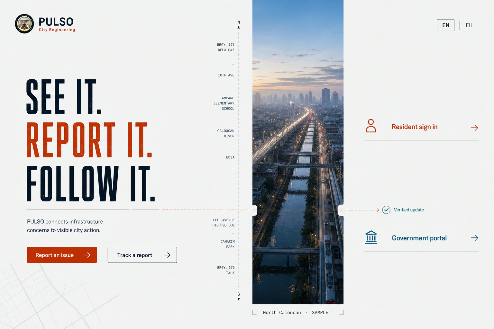
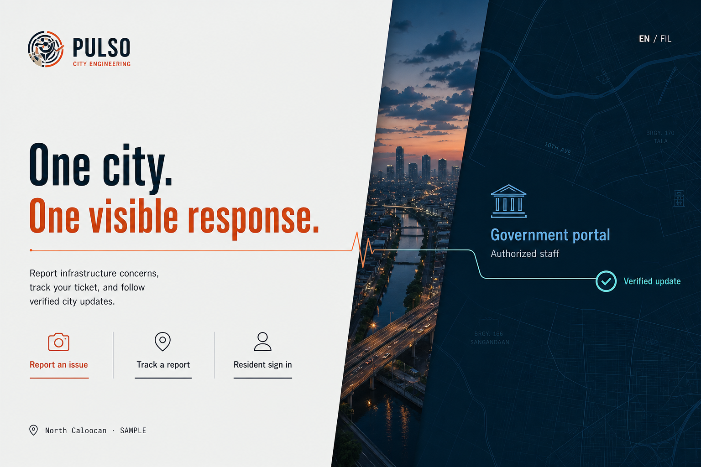

# PULSO futuristic minimal landing exploration v0.5

| Field | Value |
|---|---|
| Status | Proposed visual exploration; selection required |
| Version | 0.5 |
| Last validated | 24 August 2026 |
| Scope | Public landing first viewport and cross-portal visual implications |
| Visual authority | Civic Aperture v0.2 retained |
| Product behavior | Proposed; no new capability is implied |
| Content | Images, places, coordinates, times, and outcomes are generated SAMPLE material |
| Implementation | Not started; no product code changed |

## Design response

The requested change is not “add more futuristic decoration.” It is a reduction:

- one cinematic civic aperture rather than a full-screen camera or image collage;
- one Signal Cut with lifecycle meaning rather than glowing technical lines;
- extreme negative space and more authored typography;
- resident and government entry points that visibly belong together without sharing the same interface;
- motion concentrated into one reveal and one lifecycle transition; and
- no feature-card grid, fake HUD, neon, glass, 3D, decorative KPI, or social-feed language.

The Impeccable surface reroll eliminated the earlier Signal Observatory, Civic Horizon, and Living City Atlas landing structures. These are three genuinely new compositions inside the approved Civic Aperture identity.

## Direction A — City Aperture Zero


**Thesis:** one impossibly wide civic window makes the city the only spectacle; everything else is quiet, exact, and actionable.

This is the most cinematic and minimal direction. Roughly two-thirds of the viewport is deep survey-blue negative space. The headline reads like an architectural film title. A thin panoramic city aperture occupies the lower third, followed by one compact resident action rail and a physically separated government gate.

The single authored motion is a horizontal aperture reveal followed by one Signal Cut draw. It settles permanently; it does not pulse or loop. Reduced motion renders the final state immediately.

**Cross-portal implication:** resident pages inherit mineral negative space, ember action, and wide ruled task objects. Government pages inherit the deep survey field, Field Blue selection, compact docket rails, and the same precise horizon alignment. Authentication remains opaque and form-led.

**Risk:** this direction depends on excellent local photography, typography, and spacing. Weak assets would make it feel empty rather than intentional.

## Direction B — Vertical City Section



**Thesis:** a single vertical cut through the city connects issue, report, and verified update as one civic section.

This is the strongest light-mode composition. A tall infrastructure aperture occupies less than one-third of the viewport. The thesis and resident actions remain on the mineral field; resident and government access remain separate across the section. The Coordinate Rail behaves like an architectural datum rather than fake decoration.

The authored motion is a single upward aperture reveal while the Signal Cut crosses it and settles. On mobile, the section becomes a shallow horizontal aperture between the thesis and actions; it must not become a generic top photo.

**Cross-portal implication:** resident home can use a narrow vertical active-report rail on desktop and a full-width report object on mobile. Government detail can use a vertical evidence/location section beside a quiet queue. The aperture stays task-relevant instead of becoming permanent decoration.

**Risk:** the section geometry requires deliberate responsive recomposition; merely shrinking it would break the concept.

## Direction C — Signal Fold



**Thesis:** two civic field sheets part just enough to reveal the city and the route from resident concern to government response.

This is the strongest expression of two connected portals. The resident surface is a light mineral plane. The government surface is a recessed Night Inspection plane. The narrow true-color city aperture is the shared civic record between them—not a decorative diagonal.

The Signal Cut begins in resident ember, passes through the city aperture, becomes Field Blue only where it represents government handoff, and ends in resolved teal. Color therefore communicates ownership and state without redefining semantic status.

The authored motion is a single sheet separation on first load. Reduced motion shows the separated state. The fold does not continuously float or react to the pointer.

**Cross-portal implication:** the root landing can explain the shared system while `/resident/sign-in` and `/government/sign-in` become separate full surfaces. Authenticated portals share lifecycle and evidence primitives while maintaining different density, action color, navigation, and permission behavior.

**Risk:** if the fold is used repeatedly it becomes a fashionable split-screen gimmick. Reserve it for the public gateway and major cross-portal explanations.

## Comparative decision

| Direction | Cinematic | Minimal | PULSO distinctiveness | Public clarity | Cross-portal clarity |
|---|---:|---:|---:|---:|---:|
| City Aperture Zero | Highest | Highest | High | High | Medium-high |
| Vertical City Section | High | High | High | Highest | Medium |
| Signal Fold | High | High | Highest | High | Highest |

## Senior recommendation

Select **City Aperture Zero** as the primary public landing structure. It answers the current critique most directly: it is more futuristic, more cinematic, more aesthetic, and more minimal without borrowing generic science-fiction styling.

Carry **Signal Fold** into the cross-portal transition and portal-selection documentation rather than repeating its geometry on every page. Use **Vertical City Section** as the light-mode and content-page composition reference where a daylight evidence or infrastructure aperture supports comprehension.

The result is one system, not three mixed themes:

```text
Public landing       City Aperture Zero composition
Portal transition    Signal Fold relationship principle
Resident surfaces    Morning Field Sheet, comfortable density, ember action
Government surfaces  Night Inspection, compact density, Field Blue action
Evidence/location    Vertical City Section only when task-relevant
Lifecycle            One semantic Signal Cut across every surface
```

## Responsive contract

- Desktop first viewport keeps one dominant aperture and at least 40% intentional negative space.
- Tablet reduces display scale and shortens the aperture without creating extra cards.
- Mobile stacks thesis, primary report action, aperture, Track, Resident sign in, and quiet Government portal.
- Resident mobile keeps exactly five authenticated destinations: Home, My reports, Report, Updates, Account.
- Government narrow layouts replace queue/detail with queue then full-page docket; the cinematic composition never overrides operational usability.
- At 320 CSS px and 200% zoom, actions, labels, ticket status, recovery, and portal separation remain available without essential horizontal scrolling.

## Theme contract

Light and dark preserve identical content, action order, targets, status meaning, privacy, evidence crop, and recovery. The cinematic aperture may use a different time-of-day image only if the source and meaning remain equivalent and both assets are approved. Evidence itself remains true-color and unfiltered.

## Figma production action

After a direction is selected and Figma write access is available:

1. create paired `Screen/Public Landing · v0.5` light and dark frames;
2. normalize `Signature/Field Aperture`, `Lifecycle/Signal Cut`, `Navigation/Public Masthead`, and `Navigation/Portal Gate` before composing the screen;
3. annotate the one-time reveal, reduced-motion state, focus order, 320 px recomposition, 200% zoom, EN/FIL expansion, and map/evidence alternatives;
4. extend the selected composition into separate Resident Sign In and Government Secure Sign In frames; and
5. validate both authenticated portal templates against the selected horizon, fold, type, and spacing grammar without copying the landing composition into operational screens.
