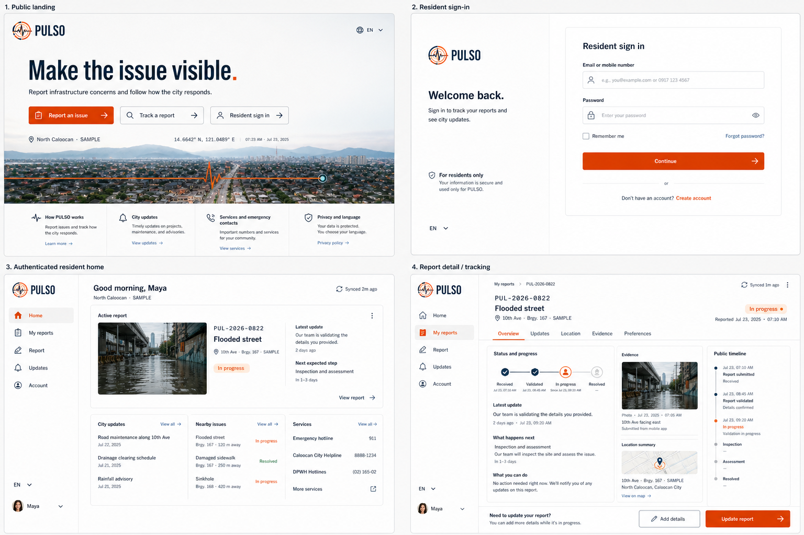
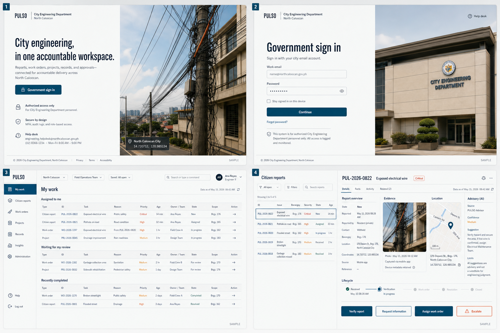
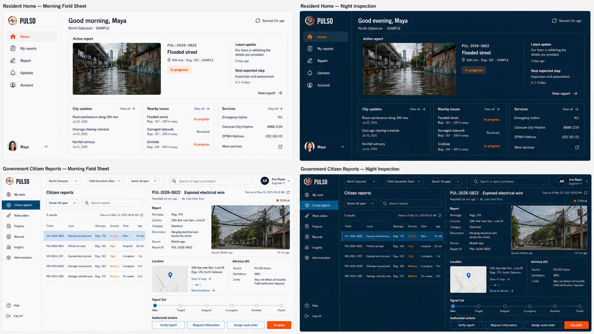

# PULSO robust minimal civic workspace v0.8

| Field | Value |
|---|---|
| Status | Proposed visual and interaction correction; stakeholder approval required |
| Version | 0.8 |
| Last validated | 24 August 2026 |
| Scope | Resident public entry, resident authentication and portal, government entry, authentication, and operations workspace |
| Visual authority | Approved Civic Aperture v0.2 |
| Product behavior | Proposed; no visual artifact creates a capability, permission, lifecycle, or endpoint |
| Content | Tickets, people, locations, maps, coordinates, dates, states, and outcomes are generated `SAMPLE` material |
| Implementation | Not started; no product code changed |
| Figma | Read-only page inspection succeeded; subsequent inspection/write was blocked by the Starter MCP call limit |

## Decision

PULSO will use a **robust minimal civic workspace** rather than a sparse glass interface or a generic dashboard.

> Minimalism removes friction, not information.

The rejected resident v0.7 pass treated fewer visible elements as better design. It reduced the product until reporting, tracking, context, lifecycle, services, operations, and accountability felt secondary. The correction preserves the complete civic job and makes it calm through hierarchy, typography, rules, whitespace, progressive disclosure, and precise state—not through feature removal.

Notion is an interaction-quality reference, not a visual template. PULSO borrows calm page hierarchy, persistent navigation, structured properties, database-like views, search, saved context, and progressive disclosure. It keeps its own Civic Aperture identity, public-service language, local cartography, true-color evidence, Signal Cut lifecycle, portal accents, and role-specific density.

Glassmorphism, neon, glow, decorative telemetry, and command-center styling are removed from the system foundation.

## Why the previous pass failed

| Failure | Product consequence | v0.8 correction |
|---|---|---|
| Minimalism became subtraction | Core jobs appeared missing or unimportant | Begin every screen with a feature and state inventory; reduce chrome only |
| Glass was the visual identity | The interface looked generic, fashionable, and less institutional | Opaque field sheets, crisp rules, restrained depth, true-color evidence |
| The hero carried most of the personality | Authenticated screens became ordinary or sparse | Carry page hierarchy, Field Aperture, Signal Cut, and Coordinate Rail across the system |
| The resident home showed one report but little ecosystem | Updates, nearby context, services, reporting, and recovery lost prominence | One contained active report plus open ruled supporting sections |
| Government capability depth was underrepresented | PULSO looked like a report viewer rather than a department system | My work, reports, work orders, projects, records, insights, and administration remain visible when authorized |
| Small type and low-contrast dark surfaces implied sophistication | Readability and public trust weakened | Normal reading sizes, opaque surfaces, WCAG contrast, light-first public review |
| Generic cards replaced relationships | Lifecycle, provenance, scope, and next ownership were obscured | Property rows, database views, activity history, and meaningful persistent context |

## Visual response

### Resident family



The resident family contains four separate, connected surfaces:

1. a public landing page that explains PULSO and exposes reporting, tracking, and resident sign-in;
2. a dedicated resident-only sign-in page;
3. an authenticated home that resumes the latest civic task and retains updates, nearby context, services, and reporting; and
4. a report detail that makes status, evidence, location, next action, and public history understandable.

The public hero is cinematic because the city and its infrastructure are framed deliberately. The authenticated product is calm because recurring information uses a consistent page, list, property, and record grammar.

### Government family



The government family contains four distinct surfaces:

1. a government-only institutional entry;
2. a dedicated secure staff sign-in;
3. `My work`, a cross-object personal task view; and
4. `Citizen reports`, a scoped queue with a selected engineering docket.

The government portal is not a resident dashboard with a denser sidebar. It is an Operate workspace: capability-aware, record-led, scope-preserving, keyboard-efficient, and traceable from queue to persisted decision.

### Light and dark parity



The paired frames preserve content, hierarchy, evidence crop, actions, and status meaning. Morning Field Sheet creates daylight clarity through mineral canvas, white surfaces, and crisp rules. Night Inspection uses deep survey-blue tonal separation rather than black, glow, or translucent glass. Theme changes atmosphere only; it does not change task capability.

## Portal separation contract

The latest user direction explicitly separates resident and government access. The route model remains proposed pending product and security approval, but the design rule for v0.8 is firm:

- no government or staff login link appears on the resident landing, resident login, or resident portal;
- no resident login, registration, or public reporting link appears on the government landing, government login, or government workspace;
- shared primitives do not create a shared authentication composition;
- a denied government deep link produces a government permission state, never a resident redirect; and
- authentication returns the user to the safe intended draft, report, scope, queue, or docket.

```text
Resident/public family                 Government family

/                                      /government
├─ /report                             ├─ /government/sign-in
├─ /track                              └─ /government/work/*
├─ /updates                               ├─ /my-work
├─ /resident/sign-in                      ├─ /citizen-reports
├─ /resident/register                     ├─ /work-orders
└─ /resident/*                            ├─ /projects
   ├─ /home                               ├─ /records
   ├─ /reports                            ├─ /insights
   ├─ /report/*                           └─ /administration
   ├─ /updates
   └─ /account
```

The government URL should be distributed through approved staff channels, bookmarks, device management, or an institutional intranet. The public resident hero is not a portal selector.

## Notion principles translated into PULSO

| Notion-inspired principle | PULSO translation | PULSO-specific safeguard |
|---|---|---|
| Calm persistent navigation | Stable resident destinations; compact capability-aware staff sidebar | Do not copy Notion icons, sidebar appearance, vocabulary, or nested-page metaphor |
| Strong page identity | Plain page title, breadcrumb, scope, freshness, and object context | Titles name civic jobs and records rather than internal modules |
| Database-like views | Saved report views, filters, sort, result count, table/card adaptation | Backend scope and permission remain authoritative |
| Properties | Ticket, state, severity, barangay, owner, source, freshness, and next step | Properties expose real data only; no decorative technical labels |
| Progressive disclosure | Secondary facts, history, related incidents, and advisory detail can expand | Critical action, status, privacy, consequences, and recovery never hide by default |
| Block hierarchy | Open ruled sections with clear content purpose | Do not wrap every block in a rounded card |
| Search and command access | Scoped search, deep links, saved views, keyboard command access for staff | Commands expose authorized actions only and show current scope |
| Confident density | Comfortable resident density; compact government density | Type, focus, targets, and reflow remain accessible |
| Continuity | Preserve draft, filter, scope, selection, freshness, and next owner | A mutation explains where a record moved when it leaves the current view |

## Experience framework

### One civic record, two useful views

```text
Resident observation
        │
        ▼
 evidence + location + details + consent
        │
        ▼
 authoritative civic record
        │
        ├──────── Resident view
        │         public status, latest update, next step,
        │         required resident action, public-safe history
        │
        └──────── Government view
                  scope, evidence provenance, engineering facts,
                  assignment, decisions, internal lifecycle, audit
```

Lifecycle meaning does not fork by portal. Copy, visibility, and action eligibility differ, but the server-owned civic record and persisted event history remain the authority.

### Three levels of presentation

1. **Page context:** route, title, scope, saved view, freshness, search, user context.
2. **Persistent task object:** active report, selected docket, work order, project, or approval that needs containment.
3. **Open supporting information:** updates, nearby issues, services, activity, related incidents, properties, and tables separated by rules.

This hierarchy creates a robust presentation without a card grid.

## Feature-preservation matrix

| Capability | Public/resident expression | Government expression | Presentation rule |
|---|---|---|---|
| Understand PULSO | Thesis, civic aperture, report and track actions, process and privacy | Institutional purpose, authorized-access context | First viewport explains the job; no invented statistics |
| Authentication | Resident-only sign-in, registration, recovery, language | Government-only sign-in, approved MFA/SSO status, access help | Separate routes and compositions; shared field primitives only |
| Report creation | Evidence, location, details, review, receipt | Intake record and triage context | One decision per step; preserve draft and return intent |
| Evidence | Capture/upload, true-color preview, source state | True-color Field Aperture with provenance and review state | Metadata is outside the image on an opaque rail |
| Location | Permission explanation, search, pin, text/list alternative | Map, address/list alternative, jurisdiction and coordinates when authorized | Never treat default center or provider success as confirmed location |
| Tracking | Ticket, public status, latest update, next event, history | Internal lifecycle, ownership, related work and audit | Signal Cut plus labels, shapes, and time; no generic dot stepper |
| Active work | Latest active report | My work across reports, work orders, projects, and approvals | The most resumable task is visible first |
| Reports history | Active, needs information, resolved; detail deep links | Citizen report saved views, scoped queue, archive | Desktop table; mobile cards; filters have a visible result context |
| City updates | Chronological updates and advisories | Operational communications when authorized | Open ruled list; no engagement ranking |
| Nearby issues | Privacy-safe civic context | Related or duplicate incidents with staff visibility rules | No resident profiles, likes, shares, or exact private location |
| Services and contacts | Emergency and assisted-service routes | Escalation and organizational contacts | Emergency access is governed, not a normal visual mode |
| Work orders | Public-safe relationship where allowed | Assignment, team, schedule, evidence, safety, proof, inspection, approval | Preserve source report and next ownership |
| Projects | Public updates where approved | Canonical project lifecycle, dependencies, records, approvals | Lifecycle conflict remains a named decision; do not invent a stage count |
| Records | Resident receipts and downloadable public-safe records | Documents, archive, tombstone, retention, legal hold, audit | No routine hard-delete presentation |
| Insights | Plain public summaries only when verified | Defined, fresh, permission-safe operational analysis | No decorative KPI wall; charts need summary and data table |
| Administration | Resident account, privacy, language, accessibility | People, capabilities, resident accounts, system settings | Render only server-authorized routes, fields, data, and actions |
| AI/advisory | Editable suggestions and manual/human fallback | Labeled source, confidence, limits, and accountable human decision | AI never silently verifies, rejects, assigns, or resolves |
| Notifications | Deep-linked updates and preferences | Work notifications and direct scoped tasks | Deep link restores safe context; stale state is disclosed |
| Offline/recovery | Draft, upload retry, uncertain submission reconciliation | Stale/partial data, failed mutation, conflict, preserved safe input | State says what committed, what remains saved, and what to do next |
| Accessibility | EN/FIL parity, 44px targets, map/evidence alternatives | Keyboard tables, focus-safe overlays, chart/table alternatives | WCAG 2.2 AA in light/dark, 320px reflow, 200% zoom |

## Resident screen contracts

### Public landing

**Job:** understand the service and begin a resident task.

**First viewport:** restrained masthead, direct thesis, one paragraph, three resident actions, and one true-color North Caloocan aperture with real/sample provenance. The following ruled band previews How PULSO works, City updates, Services and emergency contacts, and Privacy and language.

```text
PULSO                                    EN / FIL

Make the issue visible.
Report infrastructure concerns and follow how the city responds.

[Report an issue] [Track a report] [Resident sign in]

┌────────────────── true-color city aperture ──────────────────┐
│ location · source · time · SAMPLE         Signal Cut         │
└───────────────────────────────────────────────────────────────┘

How PULSO works | City updates | Services | Privacy and language
```

The hero is visually memorable because the city aperture is authored and local. It does not need glass, 3D, a giant logo, a camera surface, or a feature-card wall.

### Resident sign-in

Use an opaque, resident-only form with visible labels, password recovery, account creation, language, privacy reassurance, validation, rate-limit behavior, offline failure, and a safe return path. Marketing imagery may support orientation but may not compete with the form.

### Authenticated home

The active report is the only strongly contained object. It shows ticket, title, public state, location, latest update, freshness, next expected step, and `View report`. Report creation remains obvious. City updates, nearby issues, and services use open ruled sections.

Desktop may use a quiet sidebar or masthead. Mobile always uses exactly five stable destinations: Home, My reports, Report, Updates, Account. There is one thumb-visible report action and one navigation model per breakpoint.

### Report detail

Report detail prioritizes:

1. ticket, plain issue title, authoritative public state, and freshness;
2. Signal Cut lifecycle with event labels and time;
3. latest update, what happens next, and what the resident can do;
4. true-color evidence and provenance;
5. location summary with map and address/list alternative;
6. chronological public-safe history;
7. notification/help preferences; and
8. only the actions permitted in the current authoritative state.

## Government screen contracts

### Institutional landing and sign-in

The government landing explains reports, work orders, projects, records, and approvals as one accountable City Engineering workspace. It offers one `Government sign in` action and authorized-access, security, accessibility, and help information. It contains no resident access.

The sign-in page uses staff language, approved identity behavior, account recovery, security/audit notice, and access help. SSO, MFA, device trust, and session policy remain visibly proposed until identity and security owners approve them.

### Government shell

The shell preserves:

- current route and capability-aware navigation;
- jurisdiction, department/team, date, status, and saved view;
- search/command access;
- freshness/sync state;
- selected object and related lifecycle context; and
- only authorized next actions.

`My work`, `Citizen reports`, `Work orders`, `Projects`, `Records`, `Insights`, and `Administration` remain available as proposed capability groups. The 72px rail versus 256px expanded navigation default remains an explicit usability fork; v0.8 demonstrates a compact labeled sidebar rather than deciding the production default.

### My work

`My work` is not a KPI dashboard. It is a cross-object task page with three database-like views:

- Assigned to me;
- Waiting for my review; and
- Recently completed.

Rows show object type, durable ID, plain task, reason, priority, age/freshness, owner/team, state, scope, and direct deep link. Metrics appear only when they change prioritization, staffing, approval, or investigation.

### Citizen reports and engineering docket

On capable viewports, keep the queue and selected docket visible together. Routine rows remain nearly monochrome. Selection uses a subtle surface change and two-pixel Signal Cut, not a thick blue border.

The docket order is:

1. ticket, issue, severity, state, and freshness;
2. privacy-safe resident context;
3. true-color evidence and provenance;
4. location map and text/list alternative;
5. advisory AI with source, confidence, and limits;
6. internal lifecycle or approval chain;
7. facts and related/duplicate incidents;
8. immutable activity and safe staff notes; and
9. sticky eligible decisions with consequence-aware confirmation.

No generic status dropdown is permitted. The backend supplies valid transitions and eligible assignees.

## Reusable component framework

The system should be built from shared anatomy with portal-specific density, copy, permission, and action accent.

| Component family | Proposed Figma name | Essential variants/properties |
|---|---|---|
| Page shell | `Layout/Page shell` | Portal=Resident/Government, Theme=Light/Dark, Density=Comfortable/Compact, Navigation=Sidebar/Masthead/Bottom |
| Public masthead | `Navigation/Public masthead` | Language, account state, advisory state |
| Workspace sidebar | `Navigation/Workspace sidebar` | Expanded/collapsed proposal, capability groups, active destination, badge state |
| Page header | `Navigation/Page context` | Breadcrumb, title, scope, saved view, freshness, command/search |
| Action | `Action/Button` | Portal accent, hierarchy, size, default/hover/focus/pressed/disabled/loading |
| Field | `Action/Field` | Input type, helper, validation, disabled, loading, permission-limited |
| Database view | `Data/Collection view` | Table/card, loading, true empty, filtered empty, partial, stale, failed, permission-limited |
| Property | `Data/Property row` | Label, value, provenance, copy action, masked/withheld/unknown |
| Active report | `Record/Active report` | Public state, resident action required, stale/offline, light/dark |
| Engineering docket | `Record/Engineering docket` | Report/work order/project/approval, eligible actions, conflict, permission |
| Evidence | `Signature/Field Aperture` | Source, time, location, review state, loading/error/removed/withheld |
| Lifecycle | `Lifecycle/Signal Cut` | Current/completed/future/failed/unavailable, time/event, resident/staff vocabulary |
| Location | `Location/Map + list` | Checking/confirmed/denied/outside/provider error, list alternative |
| Activity | `Record/Activity history` | Immutable event, staff note, public-safe event, load more, failure |
| Feedback | `Feedback/System state` | Empty, filtered empty, stale, offline, validation, permission, conflict, system error, success |

Repeated patterns belong in `01 Core Library` before route composition. Do not detach reviewer-final templates simply to restyle them.

## Token and density contract

### Color

| Role | Morning Field Sheet | Night Inspection |
|---|---:|---:|
| Canvas | `#F4F7F5` | `#071A2B` |
| Surface | `#FFFFFF` | `#0E283E` |
| Focused/subtle surface | `#F8FAF9` | `#15364D` |
| Primary text | `#0C2436` | `#F4F7F2` |
| Secondary text | `#465D6C` | `#B9C7CF` |
| Rule | `#C9D4D9` | `#335166` |
| Resident action | `#B9380B` | `#FF8A3D` |
| Government action | `#0B4F6C` | `#82C7D8` |
| Resolved | `#0B756B` | `#66D2C8` |
| Warning | `#B45309` | `#FBBF24` |
| Critical | `#B42318` | `#FDA29B` |
| Focus | `#2563EB` | `#93C5FD` |

Routine screens should remain approximately 75–80% canvas/surface, 12–15% ink/rules, and 3–5% portal accent. Status colors retain their semantic roles and never become decorative theme colors.

### Typography

- Archivo Variable character for restrained public thesis and civic page titles;
- Source Sans 3 character for UI, body, forms, lists, and tables; and
- IBM Plex Mono character only for real tickets, coordinates, time, measurements, and hashes.

Production approval is still pending font licensing, Filipino glyph coverage, Windows rendering, 200% zoom, and fallback validation. Inter remains the safe Figma placeholder.

Recommended scale:

| Role | Desktop | Mobile/compact |
|---|---:|---:|
| Public thesis | 52–64 / 1.02 | 38–44 / 1.06 |
| Page title | 28–36 / 1.15 | 26–32 / 1.18 |
| Section title | 18–22 / 1.25 | 18–20 / 1.25 |
| Body | 16–17 / 1.55 | 16 / 1.5 |
| UI/control | 14–16 / 1.35 | 15–16 / 1.35 |
| Metadata | 12–13 / 1.35 | 12–13 / 1.35 |

Minimal does not mean tiny. Utility text must never fall below 12/16.

### Density

- Resident comfortable density: 44px public targets, 12–20px internal spacing, generous section separation.
- Government compact density: 36–40px visible rows and controls only where target spacing and keyboard operation remain usable; compact is not compressed.
- Both densities use the same data meaning, status language, state behavior, focus treatment, and content order.

## Responsive behavior

| Width/state | Resident | Government |
|---|---|---|
| Large desktop | Editorial public grid; authenticated sidebar or masthead; two/three-region home | Persistent capability navigation; queue/detail; sticky eligible decisions |
| Tablet | Shorter aperture; active report first; supporting lists flow below | Navigation drawer/compact rail; queue plus full-width or overlay detail |
| Mobile | One column; exactly five bottom destinations after sign-in; thumb-visible Report | Navigation drawer; card queue; full-page docket; bottom sticky decision region when safe |
| 320px / 200% zoom | No essential horizontal scrolling; evidence, ticket, status, next action, recovery remain visible | Table adapts to cards or deliberate labeled scroll region; scope and decisions remain visible |

The desktop master/detail government layout must never be scaled down as a wide canvas. The resident product must never show competing top and bottom navigation at the same breakpoint.

## State and failure-path matrix

Every material list, record, field, evidence block, map, decision, and route defines, where applicable:

- default, hover, focus, pressed, selected, disabled, and loading;
- first-use empty and filtered empty;
- background refresh, partial, stale, cached, and offline;
- permission-limited, transition-ineligible, session-expired, and denied deep link;
- validation, provider, system, and conflict/version errors;
- failed upload, unsaved draft/input, uncertain submission, and retry/reconciliation;
- AI/OCR inconclusive, human/manual review, no eligible assignee, blocked work, and escalation; and
- success with durable ticket/event, persisted state, next step, and next owner.

Each state must say:

1. what happened;
2. what committed;
3. what remains saved;
4. what may be stale;
5. what the user can do next; and
6. where responsibility moves.

A failed fetch is never a legitimate empty queue. A default map center is never a confirmed location. A suggestion is never a verified classification.

## Accessibility, localization, privacy, and evidence

- Target WCAG 2.2 AA in both themes.
- Use a visible 3px focus treatment that is not obscured by sticky regions.
- Keep public targets generally at least 44×44px.
- Provide keyboard-complete critical paths and focus return for dialogs, drawers, menus, popovers, and confirmation.
- Preserve meaning without color or motion; status includes text and shape/icon.
- Evidence has useful text alternatives; maps have address/list alternatives; charts have summaries and data-table access.
- Support forced colors/high contrast and reduced motion.
- Resident-facing English and Filipino have functional parity across visible copy, errors, dates, statuses, accessible names, announcements, and help.
- Explain collection, use, retention, visibility, and alternatives before requesting identity, camera, location, or contact information.
- PII reveal is purpose-bound, capability-gated, masked where appropriate, and logged.
- Evidence stays true-color. Source, capture/upload state, time, location, review state, and modification policy remain explicit.

## Motion

One authored moment per surface family is enough:

- public aperture reveals once, then rests;
- Signal Cut advances once when authoritative lifecycle state changes;
- government selection crossfades with no more than 8px movement;
- map selection pulses once; and
- reduced motion renders final state immediately or uses a short opacity transition.

No floating cards, parallax, pulsing glows, background breathing, logo scaling, or ornamental shimmer.

## Figma production plan

Use the existing file: [PULSO UI Rework — Audit, Core Library & Portal Concepts](https://www.figma.com/design/1qPgPj4o3smElv8B2B1REi).

### Verified in this pass

The live read confirmed these pages still exist:

1. `00 Overview & Foundations`
2. `01 Core Library`
3. `02 Portal Concepts & Handoff`

The Starter plan then returned its MCP call-limit error before the Core Library, reviewer-final templates, bindings, variants, and instance relationships could be reinspected. No Figma mutation is claimed.

### Next write sequence when quota resets

1. Reinspect `01 Core Library` and both reviewer-final resident/government theme pairs.
2. Record existing variables, aliases, styles, component/instance relationships, Auto Layout, constraints, and local overrides.
3. Add a `Robust minimal v0.8 — Review` section to `02 Portal Concepts & Handoff`.
4. Normalize shared patterns in `01 Core Library` before route screens:
   - `Navigation/Page context`
   - `Navigation/Workspace sidebar`
   - `Data/Collection view`
   - `Data/Property row`
   - `Record/Active report`
   - `Record/Engineering docket`
   - `Signature/Field Aperture`
   - `Lifecycle/Signal Cut`
   - `Feedback/System state`
5. Build paired light/dark route frames from linked components:
   - `Screen/Resident Public Landing · v0.8`
   - `Screen/Resident Sign In · v0.8`
   - `Screen/Resident Home · v0.8`
   - `Screen/Resident Report Detail · v0.8`
   - `Screen/Government Landing · v0.8`
   - `Screen/Government Sign In · v0.8`
   - `Screen/Government My Work · v0.8`
   - `Screen/Government Citizen Reports · v0.8`
6. Add mobile/narrow variants for resident home/report detail and government queue/docket.
7. Annotate job, status, components, state matrix, content/localization, API authority, permissions, privacy, accessibility, responsive behavior, owner, version, and last validation.
8. Validate metadata and screenshots after each meaningful mutation. Do not claim completion until layer structure, instances, bindings, clipping, wrapping, target geometry, contrast, and theme parity are inspected.

## Approval questions before implementation

1. Approve v0.8 as the replacement for the rejected v0.7 visual family.
2. Confirm the no-cross-login rule as product routing policy, not only a visual concept rule.
3. Validate the resident IA, routes, status vocabulary, verification/manual-review path, and lifecycle with representative residents.
4. Validate the government capability model, IA, 72px versus 256px navigation fork, lifecycle, emergency policy, and transition eligibility with representative LGU roles.
5. Resolve the canonical report and project lifecycle and authorize one backend-owned transition model.
6. Resolve token aliases and production font approval before machine-binding implementation.
7. Replace generated SAMPLE evidence, maps, people, tickets, coordinates, timestamps, metrics, and outcomes with governed content.

## Acceptance gate

The v0.8 direction is ready for implementation planning only when:

- every preserved feature maps to a route, component, state, and authoritative data source;
- resident and government authentication are demonstrably separate;
- light/dark and comfortable/compact variants preserve identical meaning and capability;
- complete failure, permission, stale, offline, and recovery states exist;
- 320px reflow, 200% zoom, keyboard, screen reader, forced colors, and reduced motion pass review;
- English/Filipino resident parity is complete;
- Figma frames use reusable linked components, variables, semantic names, Auto Layout, and documented behavior; and
- product, security, accessibility, resident, government-operations, and data owners sign the named decisions.

The raster boards are visual planning evidence. This document remains the behavior and handoff contract until the live Figma artifacts are rebuilt and validated.
