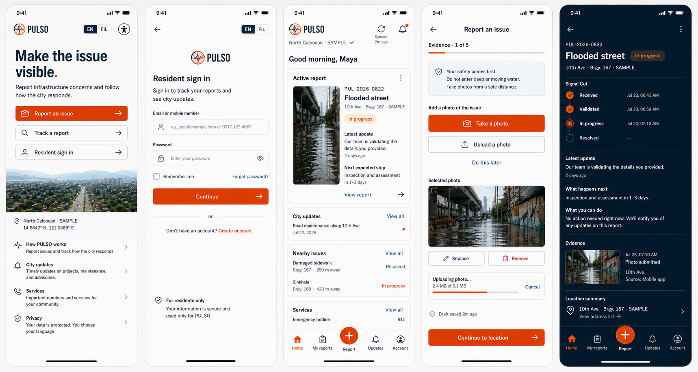
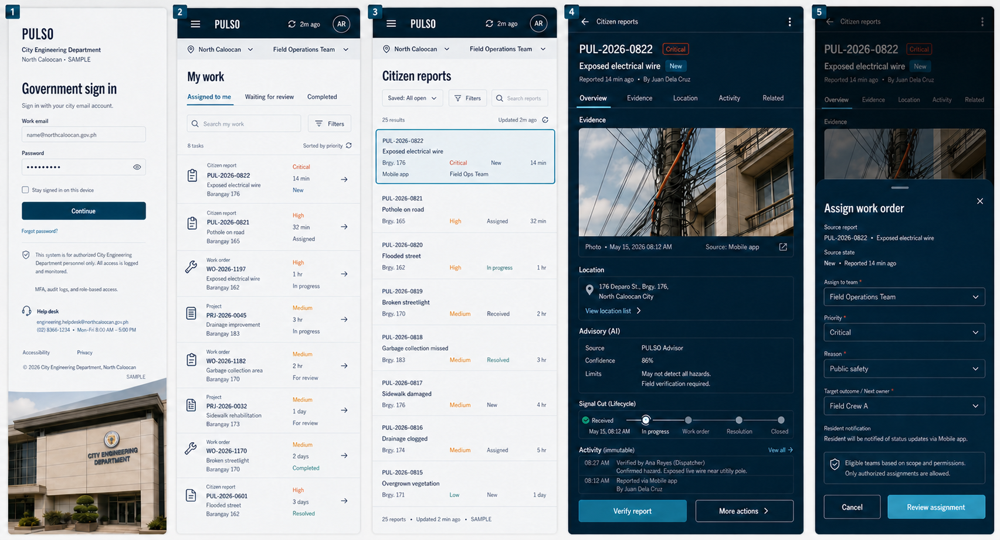

# PULSO mobile responsive UI v0.9

| Field | Value |
|---|---|
| Status | Proposed mobile responsive design and interaction contract |
| Version | 0.9 |
| Last validated | 24 August 2026 |
| Primary scope | Resident mobile web, then government narrow/field web |
| Native application | Outside this artifact; requires a separate iOS/Android adaptation |
| Visual authority | Approved Civic Aperture v0.2 and robust minimal v0.8 correction |
| Product behavior | Proposed; visuals do not create capabilities, permissions, lifecycle states, endpoints, or real-time guarantees |
| Content | Tickets, people, locations, evidence, times, states, and outcomes are generated `SAMPLE` material |
| Implementation | Not started; no product code changed |
| Figma | Figma-ready handoff only; Starter MCP limit prevented live mutation in this pass |

## Outcome

PULSO mobile is not a reduced desktop dashboard. It is a task-preserving recomposition for touch, narrow viewports, outdoor use, intermittent connectivity, camera/location permissions, and one-handed operation.

The mobile thesis remains:

> Minimalism removes friction, not information.

Resident mobile web is prioritized because residents are likely to report, check status, and read updates from a phone. Government mobile/narrow web supports quick review and governed field action, while complex analysis, bulk administration, and dense comparison remain more efficient on larger screens.

This document does not claim a native iOS or Android application is designed. A native application may reuse the information architecture and visual system, but must later define platform navigation, camera/media permissions, background upload, secure storage, offline queues, notifications, biometrics, OS accessibility, and release behavior separately.

## Visual response

### Resident mobile journey



The resident board demonstrates:

1. public landing without a camera takeover;
2. dedicated resident-only sign-in;
3. authenticated Home with active work and stable navigation;
4. Evidence as the first intentional reporting step; and
5. report detail/tracking in Night Inspection.

### Government mobile and narrow-field journey



The government board demonstrates:

1. dedicated secure government sign-in;
2. My work as a cross-object task list;
3. Citizen reports as a scoped narrow queue;
4. a full-page engineering docket; and
5. a protected, consequence-aware Assign work order sheet.

The generated government queue originally contained an unapproved `live` claim. The final saved artifact replaces it with `25 reports · Updated 2 min ago · SAMPLE`. This correction is part of the product-truth gate: freshness is shown, but real-time behavior is never implied without proof.

## Mobile adaptation principles

1. **Recompose; do not scale.** Desktop columns become sequential pages, tabs, lists, and protected sheets.
2. **Preserve the job.** Mobile never hides a core task merely because it does not fit.
3. **One navigation model per breakpoint.** Resident and government portals use different mobile navigation because their destination count and work patterns differ.
4. **Touch before hover.** No action, explanation, or status depends on hover.
5. **Context survives.** Draft, route, scope, filters, selection, freshness, and safe input survive back, authentication, refresh, and recoverable failure.
6. **Outdoor and intermittent use are normal.** Legibility, contrast, retry, draft state, and permission alternatives are primary behavior.
7. **Cinematic emphasis stays useful.** Evidence, location, or the city may become a Field Aperture; routine controls remain quiet.
8. **Compact is not tiny.** Mobile body copy remains approximately 16px; metadata remains at least 12/16; public touch targets are generally at least 44×44px.

## Resident mobile information architecture

### Public and authentication

```text
Public mobile
├─ Home
├─ Report an issue
├─ Track a report
├─ City updates
├─ Services and emergency contacts
├─ How PULSO works
├─ Accessibility, language, and privacy
├─ Resident sign in
└─ Resident registration
```

The resident public and authentication family contains no government or staff access link. Government access remains a separate route and distribution channel.

### Authenticated resident navigation

Mobile uses exactly five persistent destinations:

```text
Home | My reports | Report | Updates | Account
```

- `Report` occupies the most obvious thumb zone and is visually prominent.
- Home, My reports, Updates, and Account remain stable around it.
- A destination has a readable label and non-color selected state.
- The navigation respects the device home-indicator safe area.
- The report detail remains under My reports while Report continues to create new work.
- There is no competing hamburger, sidebar, or duplicate top-level navigation at this breakpoint.

The public landing and resident sign-in do not display authenticated bottom navigation.

## Resident screen contracts

### Public landing

**Job:** understand PULSO and choose a resident task within seconds.

Order:

1. compact PULSO identity, EN/FIL, and accessibility;
2. `Make the issue visible.` and one plain explanation;
3. `Report an issue`, `Track a report`, and `Resident sign in`;
4. one shallow true-color local civic aperture with source/location/sample metadata;
5. open ruled links for How PULSO works, City updates, Services, and Privacy.

The city aperture orients the resident. It is not a camera preview, autoplay hero, map requiring interaction, or full-screen image that pushes the actions below the fold.

### Resident sign-in

The dedicated sign-in page contains:

- resident identity and purpose;
- visible `Email or mobile number` and `Password` labels;
- password visibility control with an accessible name;
- `Continue`, password recovery, and account creation;
- EN/FIL and privacy reassurance;
- validation, rate limit, offline, session, and recovery states; and
- a return path to the intended safe report, ticket, draft, or destination.

The form remains visible above the keyboard. Errors move focus to the summary or first invalid field and remain associated with their control.

### Authenticated Home

Order:

1. top context, freshness, and any real urgent advisory;
2. active report with evidence, ticket, title, public state, location, latest update, next expected step, and `View report`;
3. thumb-visible `Report an issue` action;
4. chronological City updates;
5. privacy-safe Nearby issues;
6. Services and emergency contacts; and
7. stable five-destination bottom navigation.

The active report is the only strongly contained task object. Updates, nearby issues, and services use open ruled sections so the phone does not become a vertical stack of identical cards.

### My reports

Desktop tables become a mobile list, not a horizontally squeezed table.

Each row contains:

- ticket and plain issue title;
- status with non-color cue;
- location summary;
- latest update/freshness;
- required resident action when present; and
- one row-level deep link.

Views for Active, Needs information, and Resolved may use tabs or a single filter control. The URL/history contract remains intact. A filtered empty state names the active filter and offers `Clear filters`; a fetch failure never appears as `No reports yet`.

### Report an issue

The proposed five-step sequence is stable across devices:

```text
Evidence → Location → Details → Review → Receipt
```

Each step has a real route/history entry, one primary decision, visible draft state, back behavior, and recovery.

#### Evidence

- show safety guidance before capture;
- explain camera use before permission is requested;
- provide Take a photo, Upload a photo, and safe fallback;
- keep evidence true-color;
- show source, upload progress, cancel, retry, replace, and remove;
- keep the sticky Continue action above the safe area and keyboard; and
- never require the resident to approach danger for a better image.

#### Location

- distinguish unknown, checking, inside jurisdiction, outside jurisdiction, denied, and provider error;
- offer address search, manual pin, landmark/exact-location text, and list alternative;
- keep a default map center visibly unconfirmed; and
- preserve exact-location text in review and submission.

#### Details

- use plain category and description;
- keep advisory classification editable;
- provide manual continuation when AI/provider service fails; and
- support long Filipino labels and help text without truncating meaning.

#### Review

- show evidence, exact location, details, contact/privacy choice, and possible duplicate;
- offer an explicit Edit action for every section;
- explain what Submit report will do and what becomes public or staff-visible; and
- keep the action above the safe area.

#### Receipt

- show durable ticket ID, authoritative Received state, and server time;
- explain the next step and notification behavior;
- reconcile uncertain network outcomes before offering another submission; and
- preserve a downloadable/copyable receipt where policy allows.

### Report detail

The narrow report detail uses one vertical reading path:

1. ticket, title, state, location, freshness;
2. Signal Cut lifecycle with labels and times;
3. latest update, next event, and resident action;
4. true-color evidence with external metadata rail;
5. location summary and address/list alternative;
6. public-safe chronological history;
7. notification/help preferences; and
8. state-permitted actions.

Tabs are acceptable only when each tab has a real deep-linkable state and essential status/next action remain visible. A collapsed section may not hide required resident action or privacy consequences.

## Government mobile information architecture

Government mobile uses one top-level navigation model: a capability-aware drawer.

```text
Menu
├─ My work
├─ Citizen reports
├─ Work orders
├─ Projects
├─ Records
├─ Insights
└─ Administration
```

Only authorized groups render. Jurisdiction, department/team, saved view, date/status scope, and freshness are context filters, not destinations.

There is no resident-style bottom navigation. Record navigation uses back/deep links. The app bar, scope rail, and route title keep employees oriented.

## Government screen contracts

### Government sign-in

The dedicated staff-only page contains:

- PULSO City Engineering identity;
- work email or approved staff identifier;
- password and recovery;
- approved MFA/SSO/device behavior only when authoritative;
- authorized-personnel, access logging, security, accessibility, and help context; and
- no resident login, public report, or resident self-registration.

### My work

Desktop cross-object tables become open ruled task rows grouped by:

- Assigned to me;
- Waiting for review; and
- Completed.

Each row retains object type, durable ID, plain task, reason, priority, age/freshness, state, owner/team, scope, and direct link. Search, filter, sort, result count, and freshness remain visible. No KPI wall replaces work.

### Citizen reports queue

The desktop left queue becomes a full-page list.

Each record row contains:

- ticket and issue;
- barangay/location;
- severity and lifecycle state;
- age/freshness;
- ownership/team; and
- the most decision-relevant exception.

Saved view, filters, search, result count, and freshness remain above the list. The active selection may use a subtle Field Blue surface and two-pixel Signal Cut. Rows are single deep links; nested row controls are prohibited.

### Engineering docket

Selecting a queue row opens a full-page docket rather than squeezing detail beside the list.

Persistent header information:

- back to the scoped queue;
- ticket, issue, severity, state, and freshness;
- current scope and permission where relevant; and
- safe More actions access.

The body retains:

1. privacy-safe resident context;
2. true-color evidence and provenance;
3. map plus textual location/list alternative;
4. labeled advisory AI source, confidence, and limits;
5. Signal Cut lifecycle;
6. facts and related incidents;
7. immutable activity and safe staff notes; and
8. sticky eligible decisions.

Tabs may organize Overview, Evidence, Location, Activity, and Related. Each tab requires a URL/history state, visible focus, swipe-independent access, and preservation after refresh/back. Tabs never hide the primary state, freshness, or eligible next action.

### Governed action sheet

Consequential actions use an opaque protected-focus sheet, not a casual menu.

`Assign work order` includes:

- source report and source state;
- server-provided eligible team;
- priority and reason;
- target outcome and next owner;
- resident notification summary;
- consequence statement;
- permission/eligibility state;
- `Cancel` and `Review assignment`; and
- a second explicit confirmation when policy requires it.

The sheet states whether anything committed on failure. Safe input remains recoverable. Focus begins at the sheet title or first required field, stays within the sheet, and returns to the invoking control when dismissed.

### Work orders and field updates

Mobile government access should prioritize quick, authorized field tasks:

- review work order and safety requirements;
- confirm assignment and current state;
- view location and list/address alternative;
- add progress note or evidence;
- upload proof with offline-aware queue and provenance;
- request help/escalation; and
- submit only a server-eligible transition.

Complex bulk scheduling, cross-project analysis, role management, retention policy, and large analytics may remain desktop-preferred, but mobile must provide an honest supported/unsupported state and a deep link—not a dead or clipped control.

## Responsive transformation matrix

| Desktop pattern | Tablet | Phone/narrow web |
|---|---|---|
| Public hero with editorial columns | Two regions or stacked thesis/aperture | One column; actions before shallow aperture |
| Resident masthead/sidebar | Compact masthead | Stable five-destination bottom navigation |
| Resident active report plus context columns | Active report plus one contextual column | Active report first; ruled lists below |
| Resident reports table | Two-column or compact table | Open record rows/cards with labels |
| Report wizard split preview/form | Preview beside form in landscape | One decision per full-width step; sticky continuation |
| Government persistent sidebar | Collapsible rail/drawer | Capability drawer only |
| Government queue/detail | Two-pane in landscape | Queue page → full-page docket |
| Government data table | Reduced columns plus detail | Labeled open rows; no squeezed table |
| Docket evidence/location/activity columns | Two-column or tabs | One Field Aperture plus deep-linked tabs/sections |
| Decision dialog/drawer | Side sheet or modal | Opaque bottom/full-height sheet with protected focus |

Breakpoints are content-driven. Reference ranges are mobile 320–767px, tablet 768–1023px, and desktop 1024px+, but the layout changes when content, target geometry, or reading measure fails—not merely at a device label.

## Mobile component framework

| Component | Proposed Figma name | Mobile behavior |
|---|---|---|
| App bar | `Navigation/Mobile app bar` | Portal, back/menu, title/context, freshness, safe-area top |
| Resident navigation | `Navigation/Resident bottom` | Five destinations, selected/focus/pressed, safe-area bottom |
| Government drawer | `Navigation/Government drawer` | Capability-filtered groups, focus trap/return, current scope |
| Scope rail | `Navigation/Scope + freshness` | Jurisdiction/team/saved view, stale/partial/offline |
| Mobile row | `Data/Mobile record row` | Resident/government density, state, selection, exception |
| Active report | `Record/Active report · Mobile` | Evidence, ticket, state, update, next step, action |
| Docket header | `Record/Docket header · Mobile` | Back, ID, severity, state, freshness, permitted actions |
| Evidence | `Signature/Field Aperture · Mobile` | Preview, source rail, upload/retry/permission states |
| Lifecycle | `Lifecycle/Signal Cut · Mobile` | Vertical/horizontal based on readable label fit |
| Wizard header | `Navigation/Report progress` | Named step and count, URL/history state, draft status |
| Sticky action | `Action/Mobile sticky region` | One primary outcome, safe area, keyboard/zoom behavior |
| Governed sheet | `Overlay/Decision sheet` | Protected focus, reason, consequence, recovery, confirmation |
| System state | `Feedback/Mobile system state` | Offline, stale, partial, permission, validation, conflict, error, success |

Components remain shared where anatomy and state meaning match. Portal accent, density, copy, permissions, and navigation behavior are properties—not reasons to fork semantic status or evidence behavior.

## Light and dark mode

Morning Field Sheet and Night Inspection preserve:

- identical content and information order;
- the same identifiers, status vocabulary, time, next event, and actions;
- the same target geometry and navigation;
- identical evidence source, crop, provenance, and sample label;
- equivalent focus, contrast, forced-colors, reduced-motion, and recovery; and
- identical EN/FIL behavior.

Dark mode uses deep survey blue and tonal surfaces. It does not use pure black, glow, translucent glass, or different evidence filters. Outdoor readability must be tested in both high and low ambient light.

## Safe areas, keyboard, and touch

- Apply top, bottom, left, and right safe-area insets.
- Sticky actions and bottom navigation sit above the home indicator.
- The virtual keyboard cannot cover the active field, error, helper, or primary action.
- Bottom sheets adapt to keyboard height and allow content scrolling without losing Cancel/Review actions.
- Public/coarse-pointer targets are generally at least 44×44px.
- Adjacent destructive and primary actions have sufficient separation.
- Swipe may accelerate navigation but never becomes the only way to access a tab or action.
- Long press is optional enhancement, never required behavior.
- Orientation change preserves draft, scroll context where safe, selected record, and open task.

## Connectivity, permissions, and recovery

### Resident

- camera denied → upload, retry permission, or safe take-later/assisted path;
- location denied → search, manual pin, landmark/exact-location text, list alternative;
- upload failed → retained preview, progress/error, retry, replace/remove;
- offline → explicit local draft state and policy-limited storage explanation;
- session expired → sign-in without draft loss;
- uncertain submission → idempotent reconciliation before resubmission;
- AI/provider unavailable → manual details and staff review remain possible.

### Government

- stale/partial queue → freshness and affected fields are explicit;
- fetch failure → recoverable system error, never empty state;
- permission-limited → allowed record fields/actions only, with staff-specific denied state;
- version conflict → reload/compare and preserve safe note input;
- no eligible team → governed escalation, not hard-coded fallback;
- mutation failure → state whether anything committed and retain safe input;
- offline field evidence → policy-approved queued upload with source, retry, and conflict handling.

## Accessibility and localization acceptance

- WCAG 2.2 AA in Morning Field Sheet and Night Inspection.
- Visible 3px focus and complete keyboard operation, including mobile web with external keyboard.
- Correct accessible name, role, state, error association, route/state announcement, initial focus, and focus return.
- Status, severity, selection, completion, and errors use text plus shape/icon; never color alone.
- Evidence has useful text alternatives; maps have address/list alternatives.
- Forced colors/high contrast and reduced motion are supported.
- Reflow at 320 CSS px and 200% zoom without essential horizontal scrolling.
- Resident English and Filipino have full functional parity, including errors, dates, statuses, accessible names, announcements, help, and long-string expansion.
- Screen-reader order follows the visual task order; sticky regions do not duplicate or reorder essential actions.

## Performance and environmental quality

- Optimize civic/evidence images for viewport, density, connection, and art-directed crop.
- Do not load full desktop assets or hidden desktop panels solely to display mobile.
- Keep core content server-renderable or progressively enhanced where architecture permits.
- Preserve useful content when optional map, AI, analytics, or media providers fail.
- Avoid blur, continuous animation, heavy shader effects, or permanent polling.
- Respect reduced data/save-data preferences where feasible.
- Test one lower-end Android device, one iPhone, one tablet, landscape orientation, throttled connection, offline transition, and outdoor brightness.

## Figma production plan

Use [PULSO UI Rework — Audit, Core Library & Portal Concepts](https://www.figma.com/design/1qPgPj4o3smElv8B2B1REi) when Starter MCP capacity becomes available.

### Core Library first

1. Reinspect the current mobile reviewer-final resident templates and government responsive patterns.
2. Normalize the mobile app bar, resident bottom navigation, government drawer, scope rail, mobile record row, report progress, sticky action region, and governed decision sheet.
3. Bind light/dark semantic roles and document comfortable/compact density.
4. Define default, focus, pressed, selected, disabled, loading, stale, offline, permission, error, conflict, and success variants.
5. Test long English/Filipino copy, 320px width, 200% zoom, and safe-area geometry.

### Proposed route frames

Resident:

- `Screen/Resident Public Landing · Mobile · Light · v0.9`
- `Screen/Resident Sign In · Mobile · Light/Dark · v0.9`
- `Screen/Resident Home · Mobile · Light/Dark · v0.9`
- `Screen/Resident My Reports · Mobile · Light/Dark · v0.9`
- `Flow/Resident Report · Mobile · Light/Dark · v0.9`
- `Screen/Resident Report Detail · Mobile · Light/Dark · v0.9`

Government:

- `Screen/Government Sign In · Mobile · Light/Dark · v0.9`
- `Screen/Government My Work · Narrow · Light/Dark · v0.9`
- `Screen/Government Citizen Reports · Narrow · Light/Dark · v0.9`
- `Screen/Government Docket · Narrow · Light/Dark · v0.9`
- `Overlay/Government Decision · Narrow · Light/Dark · v0.9`
- `Flow/Government Field Work · Narrow · Light/Dark · v0.9`

Each frame requires user/job, artifact status, component/version inventory, state matrix, responsive rules, EN/FIL examples where resident-facing, API/state/permission authority, privacy/evidence/freshness notes, keyboard/focus/screen-reader behavior, acceptance tests, owner, version, and last validation.

No Figma write is claimed in this pass.

## Acceptance gate

Mobile UI is ready for implementation planning only when:

- resident and government access remain explicitly separate;
- every desktop-critical task has a mobile composition or an honest supported/unsupported handoff;
- resident navigation contains exactly Home, My reports, Report, Updates, Account;
- government narrow layouts use drawer → list → full-page record rather than squeezed master/detail;
- draft, scope, filter, selection, freshness, and safe input survive navigation and failure;
- camera/location/AI/provider denial has a manual or human-supported path;
- light/dark, 320px, 200% zoom, EN/FIL, keyboard, screen reader, safe area, forced colors, and reduced motion pass review;
- no screen implies live, verified, assigned, resolved, or authorized state without backend authority; and
- the Figma screens are composed from validated linked components and annotated behavior.

## Decisions still required

1. Confirm mobile web as the resident release priority before native application design.
2. Confirm which government jobs are supported, view-only, or desktop-preferred on phones.
3. Approve offline draft/evidence storage, retention, encryption, reconciliation, and device-loss policy.
4. Approve identity, MFA/SSO, session, device-trust, and recovery behavior.
5. Approve the canonical resident and government lifecycle vocabulary and transition model.
6. Validate the mobile flows with residents, dispatchers, field personnel, supervisors, accessibility users, and lower-end devices.

The raster boards are visual planning evidence. This specification is the mobile behavior and handoff contract until the Figma frames are created and structurally validated.
