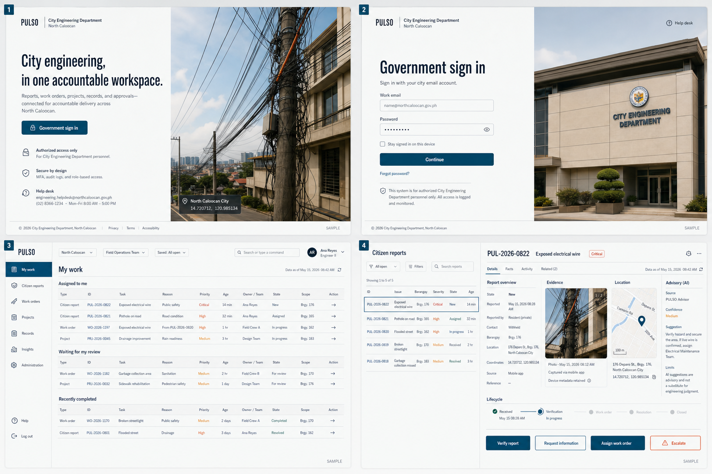
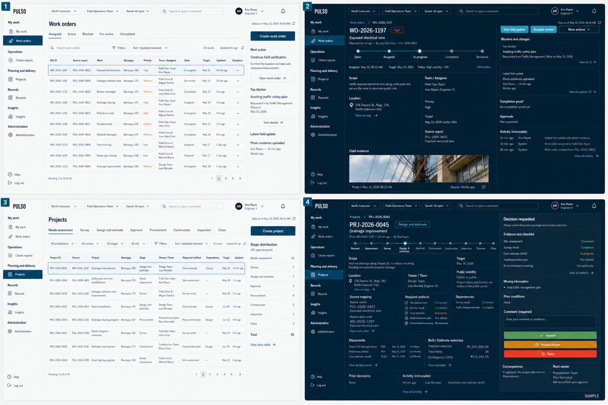
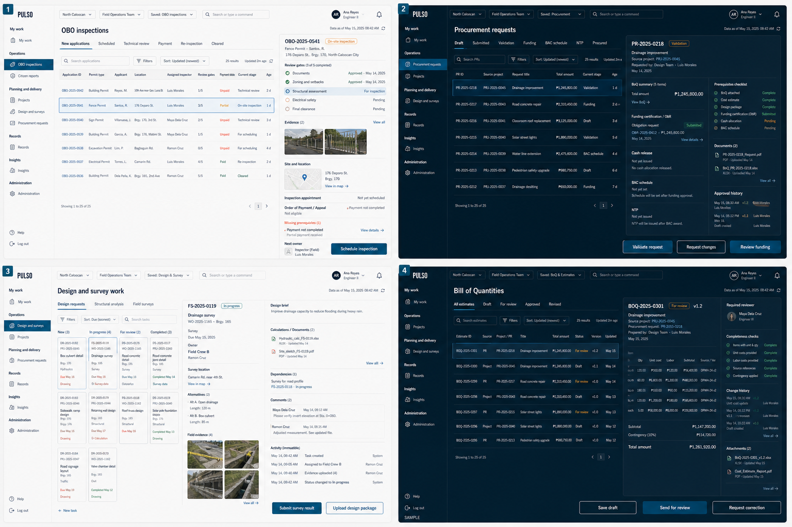
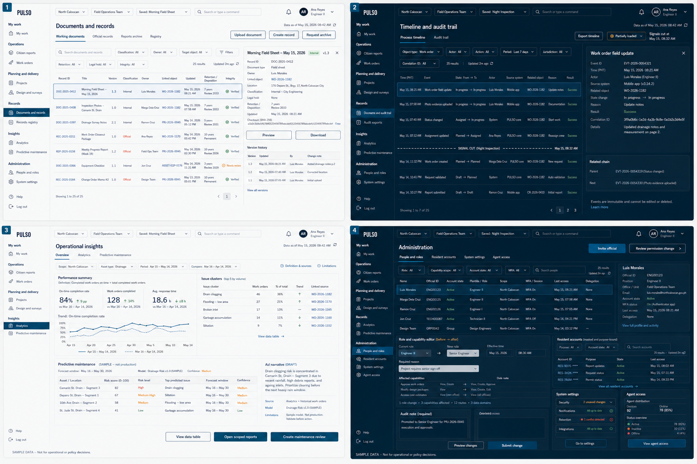
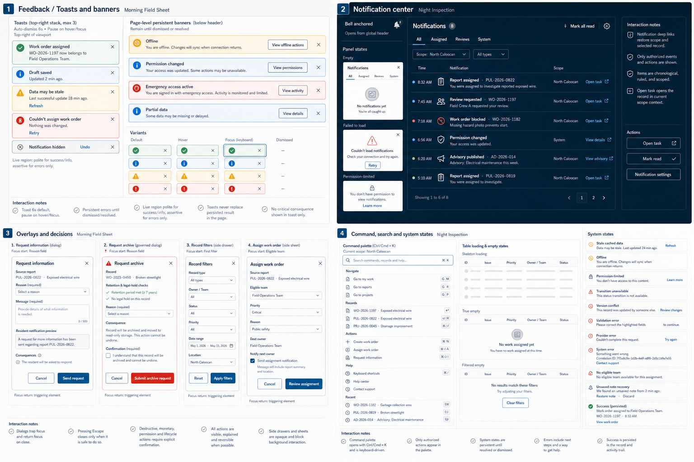
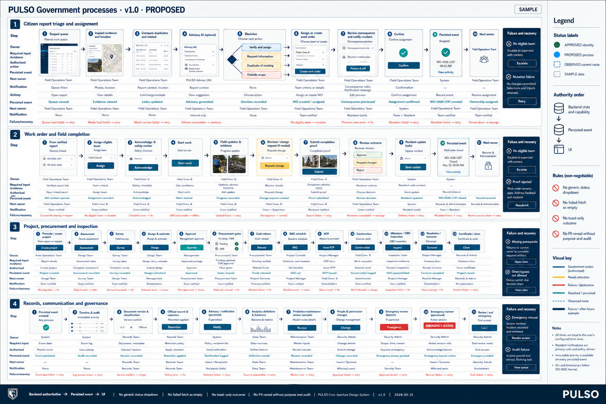
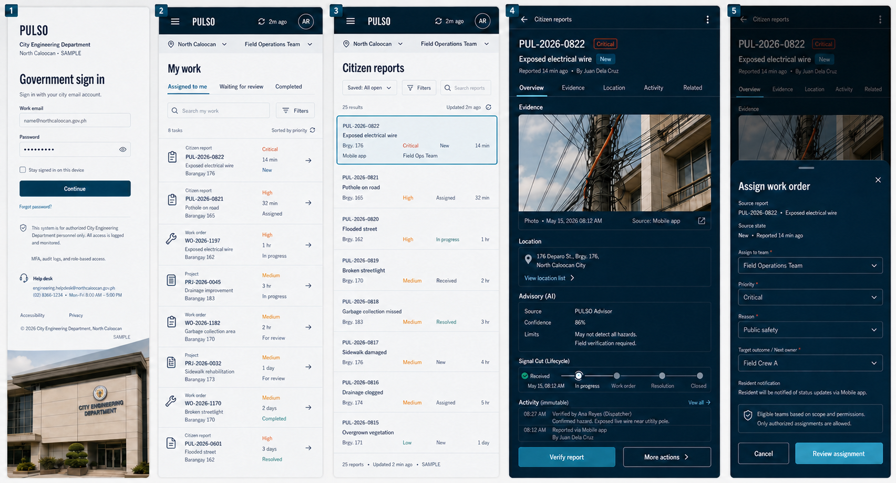

# PULSO government website complete design v1.0

| Field | Value |
|---|---|
| Status | Proposed complete government website design and interaction contract |
| Version | 1.0 |
| Last validated | 24 August 2026 |
| Audience | Authorized City Engineering employees, supervisors, executives, records/administrative staff, inspectors, technical staff, procurement staff, and field personnel |
| Visual authority | Approved Civic Aperture v0.2; robust minimal v0.8/v0.9 direction retained |
| Current implementation | Observed evidence only; it does not override approved product truth |
| Routes, IA, lifecycle, capabilities | Proposed until product, security, records, and representative LGU owners approve them |
| Content | People, tickets, coordinates, projects, costs, documents, times, metrics, and outcomes are generated `SAMPLE` material |
| Implementation | Not started; no frontend, backend, or mobile source changed |
| Figma | Figma-ready visual and behavioral handoff; live mutation blocked by the Starter MCP call limit |

## Outcome

This package extends the liked robust minimal government direction into the complete website. It covers every observed government route, every proposed target page, overlays, notifications, toasts, feedback, responsive behavior, process continuity, permissions, exceptional states, and Figma production structure.

The central design law is unchanged:

> Minimalism removes friction, not information.

The website behaves like a calm, precise civic workspace. Notion remains an interaction-quality inspiration for persistent navigation, page hierarchy, properties, saved views, search, and progressive disclosure. PULSO retains its own evidence-led Civic Aperture, Signal Cut lifecycle, Coordinate Rail, Field Blue government action, local cartography, and public-accountability language.

The interface never uses glass, neon, decorative telemetry, command-center language, or a KPI wall as a substitute for operational depth.

## Visual page families

### Entry, My work, and Citizen reports



This existing approved-for-review family remains the visual source for:

- government institutional landing;
- dedicated secure government sign-in;
- My work; and
- Citizen reports queue plus engineering docket.

### Work orders and projects



### Technical, inspection, and procurement



### Records, insights, and administration



### Toasts, notifications, overlays, search, and system states



### End-to-end process blueprints



### Responsive narrow/field design



The raster boards are visual planning evidence. Exact behavior, permissions, data, copy, states, and lifecycle contracts in this document remain authoritative until structurally validated Figma frames exist.

## Design system position

### Character

- minimalist through hierarchy, alignment, and reduction of chrome;
- robust through complete data, context, states, and decisions;
- professional through plain language, consistency, authorization, and traceability;
- aesthetic through typography, negative space, precise rules, and one meaningful evidence/location aperture;
- futuristic through freshness, provenance, role awareness, scoped search, intelligent suggestions with limits, and subtle state transition—not science-fiction decoration.

### Core shell

Every authenticated page contains, when permitted:

1. capability-aware navigation;
2. route title and breadcrumbs;
3. jurisdiction, department/team, date/status, and saved-view scope;
4. scoped search/command access;
5. notification access;
6. signed-in official and delegation/emergency context;
7. freshness/sync state; and
8. page-specific primary work.

The shell preserves route, scope, filters, sort, saved view, selected object, freshness, lifecycle, and authorized next actions through detail, mutation, refresh, back, and safe deep link.

## Target information architecture

Only groups and destinations allowed by the server-provided capability set render.

```text
Access
├─ Government landing
├─ Government sign in
├─ MFA / verification challenge
├─ Password and account recovery
└─ Permission denied / session ended

My work
├─ Assigned to me
├─ Waiting for my review
├─ Needs attention
└─ Recently completed

Operations
├─ Citizen reports
├─ Dispatch and assignment
├─ Work orders
├─ Projects
└─ Advisories

Planning and delivery
├─ Design requests
├─ Structural analysis
├─ Field surveys
├─ OBO inspections
├─ Procurement requests
├─ Bill of Quantities
└─ Cost estimation

Records
├─ Documents and records
├─ Reports archive
├─ Process timeline
└─ Audit trail

Insights
├─ Operational overview
├─ Analytics
└─ Predictive maintenance

Administration
├─ People and roles
├─ Resident accounts
├─ System settings
└─ Agent access
```

The 72px rail and 256px expanded sidebar remain a proposed design fork. v1.0 demonstrates a compact labeled sidebar at large widths, a rail at constrained desktop widths, and a drawer below tablet width. The production default requires staff testing.

## Observed-route reconciliation

The current frontend exposes the routes below. The target IA preserves their functions while removing duplicate shells and clarifying which routes are pages, saved views, specialist queues, or unresolved gaps.

| Observed route | Observed job | Proposed target treatment | Status/decision |
|---|---|---|---|
| `/gov` | Government entry/sign-in | Government landing; dedicated `/government/sign-in` composition | Route naming and authentication split proposed |
| `/gov/my-dashboard` | Role-specific task dashboard | `My work` | Preserve role queues; remove decorative counts |
| `/dispatcher` | Reports, map, triage, assignment, resolution | Citizen reports + Dispatch saved workspace | Preserve deep links; resolve FQA/action defects |
| `/management` | Executive dashboards and mixed admin tabs | Executive saved view across My work, Insights, Records, Administration | Avoid separate incompatible shell |
| `/gov/work-orders` | Work-order list/detail/actions | Work orders list and `/work-orders/:id` docket | Canonical status and update APIs required |
| `/gov/projects` | Project list/detail/advance | Projects list and `/projects/:id` docket | Canonical lifecycle required |
| `/gov/timeline` | Cross-object process timeline | Records → Process timeline | Preserve report/WO/project deep links |
| `/gov/audit-logs` | Audit review | Records → Audit trail | Current backend route gap; never render false empty |
| `/gov/obo` | Inspection and permitting | Planning and delivery → OBO inspections | Sequence/gates require approval |
| `/gov/procurement` | Request, BoQ, funding, BAC, NTP | Planning and delivery → Procurement requests | Financial prerequisites/adjacency required |
| `/gov/records` | Finalized records projection | Records → Official records saved view | Distinguish projection from canonical DMS |
| `/gov/document-registry` | Document registry and controls | Documents and records → Registry | Current model/permission gaps remain blockers |
| `/gov/reports` | Incoming report read/triage | Operations → Citizen reports | Merge duplicate report surfaces |
| `/gov/reports-archive` | Resolved/rejected report records | Records → Reports archive | Terminal vocabulary decision required |
| `/gov/design-requests` | Design-phase projection | Planning and delivery → Design requests saved view | Preserve specialist ownership |
| `/gov/analysis` | Structural-analysis projection | Planning and delivery → Structural analysis saved view | Define required artifacts and outcomes |
| `/gov/surveys` | Survey projection | Planning and delivery → Field surveys saved view | Preserve location/evidence workflow |
| `/gov/boq` | BoQ projection | Procurement/Cost workspace → Bill of Quantities | Versioned line-item contract required |
| `/gov/estimation` | Cost projection | Procurement/Cost workspace → Cost estimation | Source/version/reviewer required |
| `/gov/users` | Government accounts/roles | Administration → People and roles | Canonical capability authority required |
| `/gov/residents` | Resident account administration | Administration → Resident accounts | PII purpose, masking, audit required |
| `/gov/settings` | System settings placeholder | Administration → System settings | Settings schema, conflict, rollback required |
| `/gov/analytics` | Clusters, forecasts, narrative, exports | Insights → Analytics | Authorization/PII/export gates required |
| `/gov/predictive` | Health/risk/planned maintenance | Insights → Predictive maintenance | Mock/random outputs cannot be operational truth |
| `/gov/agent-app` | Agent app distribution | Administration → Agent access | Distribution/security/support contract required |
| `/gov/advisories` | Government advisory operations | Operations → Advisories | Draft/review/publish/version flow required |

## Complete page atlas

### Access family

#### 1. Government institutional landing

**Job:** identify the City Engineering workspace and reach authorized access.

Required anatomy:

- restrained PULSO City Engineering identity;
- `City engineering, in one accountable workspace.`;
- reports, work orders, projects, records, and approvals explanation;
- one `Government sign in` action;
- authorized-access, security, accessibility, and help information;
- one true-color engineering/local aperture with real/sample metadata; and
- no resident sign-in, registration, or public reporting link.

States: normal, service advisory, maintenance window, authentication unavailable, accessibility/help contact.

#### 2. Government sign-in

**Job:** establish an authorized staff session and return safely to the intended route.

Required anatomy:

- work email or approved staff identifier;
- password and visibility control;
- Continue, recovery, security/audit notice, help desk;
- approved MFA/SSO/device behavior only when authoritative;
- return-intent summary when arriving from a safe deep link; and
- no resident self-registration.

States: validation, invalid credentials, rate limited, locked account, inactive official, password expired, MFA required, provider unavailable, offline, session conflict, successful redirect.

#### 3. MFA / identity challenge

Show challenge purpose, masked destination/device, expiration, resend limit, alternate approved method, recovery/help, and attempt state. Do not reveal whether an unknown account exists. Successful challenge returns to the preserved intended route and scope.

#### 4. Password and account recovery

Use a neutral account-recovery sequence: identify account, verify approved channel, set password, revoke/retain sessions per policy, confirmation. Never mix resident recovery or public identity verification into this page.

#### 5. Permission denied, suspended access, and session ended

Denied staff pages remain inside the government identity. They show requested resource, current scope when safe, missing/changed access in plain language, reference ID, safe alternatives, and contact/support. They never redirect to the resident portal.

### My work and management

#### 6. My work

**Job:** act on owned work and review requests.

Views:

- Needs attention;
- Assigned to me;
- Waiting for my review; and
- Recently completed.

Each row shows object type, durable ID, plain task, why it is present, priority/severity, age/freshness, owner/team, state, scope, and direct scoped destination. Metrics appear only when they change prioritization, staffing, approval, or investigation.

States: no assigned work, filtered empty, stale/partial, permission changed, load failure, recently completed confirmation.

Primary endpoints observed: `GET /api/gov/dashboard/stats` and domain lists. Current stats access is under-authorized; the target requires authenticated capability-scoped aggregation.

#### 7. Executive operational overview

This is a saved, permission-scoped view—not a separate visual shell. It combines decision queues, overdue/blocker summary, approval requests, staffing/operational exceptions, record integrity alerts, and links to defined metrics. No vanity counts or unrelated chart grid.

### Citizen reports and dispatch

#### 8. Citizen reports queue

Saved views, search, filters, sort, result count, freshness, URL-addressable state, table semantics, and selection continuity. Default fields: ticket, issue, barangay/location, severity, canonical status, owner/team, age/updated, decision-relevant exception.

States: loading, background refresh, true empty, filtered empty, stale, partial, offline, permission-limited, failed fetch, selected record moved after mutation.

Primary observed endpoints: `GET /api/reports`, `GET /api/gov/reports`, report stats. Duplicate surfaces require consolidation.

#### 9. Citizen report engineering docket

Order:

1. ticket, issue, severity, state, freshness;
2. privacy-safe reporter context and logged reveal when permitted;
3. true-color evidence with source/time/review metadata;
4. map plus address/list/jurisdiction alternative;
5. advisory AI source, confidence, limits, and human accountability;
6. internal Signal Cut lifecycle;
7. facts and related/duplicate incidents;
8. immutable activity and safe staff notes; and
9. sticky eligible decisions.

Actions: Verify report, Request information, Assign work order, Escalate, Mark duplicate, Close as outside scope. The server supplies valid transitions and eligible assignees.

#### 10. Dispatch and assignment workspace

Map and list are peers; map never becomes the only queue. Show scoped teams, availability/freshness, assignment load, route only when relevant, evidence/location, and safe list alternatives. The current dispatcher route’s tactical language is replaced with plain operational labels.

Assignment captures eligible team, reason, priority, target, consequence, resident notification, and next owner. No eligible team becomes a governed escalation state.

#### 11. Reports archive

Read-only by default. Show terminal status vocabulary, closeout proof, resident-safe resolution relation, owner, retention, linked work/project, and audit. Search/filter/export only when permitted. Fetch failure is never empty. Reopen or follow-up requires a governed transition, not editing archived state.

### Work orders

#### 12. Work orders list

Views: Assigned, Active, Blocked, For review, Completed. Table fields: WO ID, source report/project, work, barangay, priority, team/assignee, state, target, updated, exception.

Actions: Create work order when authorized, open docket, valid bulk export only. No bulk arbitrary status mutation.

Observed endpoints: `GET/POST /api/gov/work-orders`, legacy `GET/POST /api/work-orders`. The target must choose one canonical API.

#### 13. Work-order docket

Contains source incident(s), scope, location/list alternative, assignee/team, priority/target, parts/equipment/dependencies, safety, field updates/evidence, blockers/changes, completion proof, review/approval, immutable activity, and resident-safe notification summary.

Eligible actions: Add field update, Start work, Request change, Submit completion proof, Request review, Approve, Request changes, Reject, Promote to project, Cancel where state/policy permits.

Current generic update/status routes permit unsafe transition flexibility; the design exposes only server-authorized adjacency.

#### 14. Field update and completion proof

Full-page or governed sheet. Show source work order/state, update type, text, location/time, true-color evidence, offline/upload state, safety, blocker, resident visibility, and persisted outcome. Completion proof cannot resolve work until review policy passes.

### Projects

#### 15. Projects list

Views: Needs assessment, Survey, Design and estimate, Approval, Procurement, Construction, Inspection, Turnover, Close. Show source, project, barangay, canonical stage, owner, required artifact, dependency, target, updated, risk/exception.

#### 16. Project docket

Contains source report/work-order mapping, scope, location, owner, target, canonical Signal Cut, phase entry/exit criteria, required artifacts, dependencies, documents, survey/design/BoQ/estimate, procurement link, construction/milestone evidence, inspection/turnover, public visibility, prior decisions, and activity.

The current source has conflicting project stage counts and competing certificate paths. The design labels the stage model proposed until operations approves one canonical lifecycle.

#### 17. Project decision and advancement

Decision region shows requested action, object/version, evidence/checklist, missing information, prior conditions, comment, consequences, next owner, and Approve / Request changes / Reject as permitted. There is no arbitrary phase selector. Certificate/close requires approved canonical evidence gates.

### Technical planning

#### 18. Design requests

Specialist saved view of project work. Show project/source, discipline, brief, owner, due, required design package, dependencies, comments, versions, activity. Actions: Upload design package, Send for review, Request clarification.

Observed endpoint: `GET /api/gov/design-requests`.

#### 19. Structural analysis

Specialist queue/docket. Show project/source, analysis type, assumptions, input documents, calculations, reviewer, version, exceptions, safety/limitations, decision, activity. Never present AI or generated analysis as signed engineering judgment.

Observed endpoint: `GET /api/gov/analysis`.

#### 20. Field surveys

Queue and selected survey task. Show source, location/list alternative, required measurements, team, schedule, permission/safety, true-color evidence, result document, offline state, review, activity. Actions: Start survey, Save draft, Submit survey result, Request assistance.

Observed endpoint: `GET /api/gov/surveys`.

### OBO and procurement

#### 21. OBO inspections

Views: New applications, Scheduled, Technical review, Payment, Re-inspection, Cleared. Show application ID, permit type, applicant masked, location, inspector, discipline review gates, payment state, current stage, age.

Selected docket includes required technical reviews, evidence, appointment, order of payment, appeal, missing prerequisites, decision, and next owner. General update cannot skip review/payment sequence.

Observed endpoints: `POST/GET /api/gov/obo`, `GET/PATCH /{id}`, technical-review, appeal, order-of-payment.

#### 22. Procurement requests

Views: Draft, Submitted, Validation, Funding, BAC schedule, NTP, Procured, Rejected. Selected docket includes source project, versioned BoQ, totals, funding/ObR, cash release, BAC, NTP, documents, prerequisites, approval history, activity.

Actions: Create draft, edit items, submit, validate, request changes, review funding, record cash release, schedule BAC, issue NTP only when backend prerequisites pass. Do not claim legal compliance solely from UI presentation.

#### 23. Bill of Quantities

Versioned line-item table: item, description, unit, quantity, unit cost, labor, subtotal, source/version. Show source project/request, totals, contingency, completeness, reviewer, change history, attachments, accessible export.

Actions: Save draft, Send for review, Request correction. Deleting an item requires parent ownership, state eligibility, confirmation, and audit.

#### 24. Cost estimation

Show source BoQ/version, methods/assumptions, item and labor totals, contingency, exclusions, author, reviewer, comparison/history, attachments, decision, and activity. Currency/market assumptions must be dated and sourced; sample costs remain visibly sample.

### Records and documents

#### 25. Documents and records

Views: Working documents, Official records, Reports archive, Registry. Filters: classification, owner, linked object, retention, legal hold, integrity.

Selected record: metadata, version history, classification, owner, linked object, preview/download, checksum where real, retention/disposition, legal hold, access history, activity.

Actions: Upload document, Create record, Add version, Request archive, Apply/remove legal hold only when authorized. Routine hard delete is prohibited.

Observed DMS endpoints: upload, protected get, target list, registry/counts, legal hold, delete. Current authorization/static-file gaps are release blockers.

#### 26. Process timeline

Chronological cross-object events with object, source→target state, actor, time, source system, related object, reason, result, correlation ID. Use Signal Cut plus table/list semantics. Deep-link to report, work order, project, procurement, or OBO record.

#### 27. Audit trail

Immutable, filterable events and selected event detail. Filters: actor, action, capability, object, period, jurisdiction, correlation ID. Show related chain and export only when authorized. Current frontend audit calls have no matching backend route; the design requires an explicit failed/unavailable state until one canonical audit API exists.

### Insights

#### 28. Operational overview

Only metrics that change prioritization, staffing, approval, investigation, or maintenance. Every metric exposes definition, period/comparison, scope, freshness, source, exclusions, limitations, accessible summary, and View data table.

#### 29. Analytics

Views: Summary, Clusters, Heatmap with list/table alternative, Forecast, Recurrence, Reports/exports. Link every cluster/narrative to source records. AI narrative remains Draft until a named official decision. PII and exact location are masked unless separately authorized.

Observed analytics endpoints include summary, clusters, heatmap, forecast, recurrence, narrative, estimate, procurement conversion, reports, and exports. Permission and export scope must be canonical.

#### 30. Predictive maintenance

Views: Summary, Asset health, Schedule, Risk map with list alternative, Maintenance review. Show model/version, data window, confidence, limitations, freshness, source records, review owner, and proposed action.

Random/mock health, probability, schedule, or cost outputs are always `SAMPLE — not for operational or policy decisions`. Conversion to work order uses the canonical governed work-order flow.

### Communications

#### 31. Advisories

Views: Draft, In review, Scheduled, Published, Archived. Docket includes audience/scope, source incident/record, content/version, channels, author, reviewer, publish window, accessibility/plain-language check, resident visibility, delivery result, activity.

Actions: Create draft, Generate assisted draft, Send for review, Request changes, Publish/schedule, Archive. Generated copy is never published automatically.

#### 32. Notification center

Right-side panel and full page when volume requires. Categories: All, Assigned, Reviews, System. Each item shows object type/ID, plain event, why it matters, time, scope, unread state, and direct scoped deep link.

Actions: Open task, Mark read, Mark all read, hide where policy allows, Notification settings. Empty, failed, permission-limited, stale, and offline states are distinct. No social-feed ranking.

Observed shared endpoints: list by user, mark one/all read, hide. The target filters inaccessible/hidden source records before delivery.

### Administration

#### 33. People and roles

Official table: identity, official ID, account state, plantilla/role, capability/data scope, MFA/session, delegation, last access. Selected official shows account/security/audit history.

Actions: Invite official, change role/capabilities, delegate, deactivate, reset/revoke sessions where authorized. Permission change requires before/after, affected routes/data/actions, effective time, reason, actor, confirmation, and immutable audit.

Observed users/roles endpoints require consolidation and target-role validation.

#### 34. Resident accounts

Purpose-bound administration with masked identity by default. Show account/verification state, contact masked, barangay/scope, restrictions, last activity, report count only when relevant, audit. PII reveal requires purpose and log.

Actions: Review account, suspend/reactivate with reason/consequence, refer to support/manual review. Never routinely delete a civic identity record.

#### 35. System settings

Groups: Security, Notifications, Retention, Integrations, Accessibility/locale, operational defaults. Each setting shows scope, current value, source/owner, effective time, validation, dependency, and audit.

States: unsaved change, validation, conflict/version changed, permission-limited, save failure, rollback available, successful persisted version. Destructive/security/retention changes use governed confirmation.

#### 36. Agent access

Distribution and support page for approved field access. Show supported platform/version, release notes, checksum/signature where real, last release, required permissions, enrollment, device/security policy, support, status. Never present a missing artifact as downloadable.

#### 37. Emergency access

Separate governed flow, not a settings toggle. Requires approved policy, affected scope/records, time window, reason/incident reference, expanded access summary, confirmation, audit/review, persistent banner, and End emergency access.

## Toast design contract

Toasts acknowledge transient outcomes; the page and activity history prove persistence.

| Type | Use | Default duration | Action | Announcement |
|---|---|---:|---|---|
| Success | Confirm persisted event already visible/available | 6 seconds | Open/View where useful | Polite |
| Information | Draft saved, refresh complete, neutral update | 6 seconds | Optional | Polite |
| Warning | Stale/partial data, recoverable risk | Persistent when action is required; otherwise 8–10 seconds | Refresh/View details | Polite |
| Error | Failed action or provider/system failure | Persistent until dismissed/resolved | Retry/View details/Contact support | Assertive when immediate |
| Undo | Safe reversible hide/dismiss | 8–10 seconds | Undo | Polite |

Rules:

- opaque surface; icon/shape + title + body + action + close;
- no color-only meaning;
- stack maximum three at top-right desktop and below app bar on narrow screens;
- pause duration on hover and focus;
- errors never auto-dismiss while recovery is still required;
- destructive, monetary, permission, emergency, records, and lifecycle consequences never live only in a toast;
- a success toast names the object and persisted result; and
- no fake success before server confirmation.

Copy examples:

- `Work order assigned` — `WO-2026-1197 now belongs to Field Operations Team.`
- `Draft saved` — `Updated 2 min ago.`
- `Data may be stale` — `Last successful update 18 min ago.`
- `Couldn’t assign work order` — `Nothing was changed.`
- `Notification hidden` — `Undo`.

## Page-level banner contract

Banners remain until the condition is resolved or intentionally dismissed when safe.

Required types:

- Offline — names sync/storage consequences and provides View offline actions;
- Stale data — names last successful update and affected scope;
- Partial data — names missing/delayed sources;
- Permission changed — names affected capabilities and provides View permissions;
- Emergency access active — scope, expiry, reason/reference, audit notice, End access;
- Maintenance/degraded provider — affected function and fallback;
- Unsaved changes — Save/Discard/return behavior; and
- Conflict/version changed — Review changes and safe input preservation.

## Notification design contract

### Item anatomy

- object type and durable ID;
- plain event and why it matters;
- actor/system when allowed;
- scope/jurisdiction;
- time and freshness;
- unread non-color cue;
- authorization-safe deep link;
- Open task / Mark read / View details.

### Behavior

- chronological by default, with policy-defined priority exceptions disclosed;
- deep link restores route, scope, selected object, and relevant tab/action;
- inaccessible source records are never exposed through notification text;
- marking read is idempotent;
- hide/dismiss does not delete the source event;
- notification count reflects accessible unread items only; and
- failure does not clear the last known count silently.

## Modal, drawer, popover, and sheet framework

Use inline or full-page work first. Use overlays only for protected focus, bounded editing, or contextual filtering.

| Pattern | Use | Never use for |
|---|---|---|
| Dialog | Consequence-aware confirmation, short protected decision | Long record review, complex multi-step work |
| Side drawer | Filters, secondary record context, non-destructive editing | Evidence-heavy final decision without full context |
| Bottom/full-height sheet | Narrow-screen governed action | Desktop replacement for every form |
| Popover/menu | Small reversible choices and navigation | Lifecycle, financial, permission, retention, emergency decisions |
| Command palette | Authorized navigation/search/action discovery | Bypassing permissions or confirmation |

Every overlay defines initial focus, focus trap when modal, Escape behavior, close control, backdrop behavior, focus return, error announcement, keyboard order, unsaved-input recovery, and 200% zoom/narrow reflow.

## Complete governed overlay inventory

### Reports

- Verify report;
- Request information;
- Mark duplicate and select canonical record;
- Close as outside scope and referral;
- Reveal masked resident information with purpose;
- Assign/create work order;
- Escalate; and
- resolution/reopen/follow-up where canonical policy permits.

### Work orders

- Create work order;
- assign/reassign eligible team;
- start/acknowledge work;
- add field update/evidence;
- report blocker/request change;
- submit completion proof;
- approve/request changes/reject proof;
- promote to project; and
- governed cancel.

### Projects and approvals

- Create project;
- add/link source record;
- submit artifact;
- request/record approval;
- approve/request changes/reject;
- advance canonical stage;
- issue certificate/turnover/close after approved gates; and
- resolve version conflict.

### Procurement and OBO

- create/edit procurement request;
- add/delete BoQ item;
- validate/request changes;
- funding certification/ObR;
- cash release;
- BAC schedule;
- NTP issuance;
- schedule inspection;
- submit discipline review;
- order of payment;
- appeal/re-inspection; and
- clear/issue permit when eligible.

### Records and administration

- upload/add document version;
- request archive;
- apply/remove legal hold;
- export with classification warning;
- invite official;
- role/capability change;
- delegation;
- session revoke/account deactivate;
- resident suspend/reactivate;
- save high-impact settings;
- emergency access request/end; and
- advisory review/publish/archive.

## Command and global search

The palette opens from scoped search or keyboard shortcut and contains only authorized results/actions.

Groups:

- Navigate;
- Records;
- Actions;
- Recent safe destinations; and
- Help/keyboard shortcuts.

Show current scope, result type, ID/title, scope, freshness where relevant, and keyboard hints. Search never leaks inaccessible records through titles, counts, snippets, or suggestions.

## Complete system-state matrix

Every page/list/record/action designs these states when applicable:

| State | Required explanation and recovery |
|---|---|
| Loading | Skeleton preserves page/table geometry; announce loading once |
| Background refresh | Existing data remains; freshness changes without focus theft |
| True empty | Explain the workflow and appropriate creation/import action |
| Filtered empty | Name active filters and provide Clear filters |
| Stale cached data | Last successful update, affected data, Refresh |
| Partial data | Missing/delayed sources and what remains usable |
| Offline | What is viewable/saved/queued and when sync will occur |
| Permission-limited | Available data/action and how to request help |
| Transition unavailable | Current state, required prerequisite, allowed next actions |
| Validation error | Specific fields, summary, focus, preserved input |
| Provider error | Affected provider, fallback/manual path, retry |
| System error | What failed, what remains saved, recovery, correlation ID |
| Conflict/version changed | Who/what changed when safe, review/reload, retained input |
| No eligible team | Eligibility reason summary and governed escalation |
| Blocked work | Blocker, owner, dependency, escalation, resident visibility |
| Unsaved note/input | Restore/discard and storage/freshness truth |
| Success | Durable ID/event, persisted state, next step, next owner |

No fetch failure is an empty state. No unknown value is rendered as confirmed. No action claims success before persistence.

## Complete process contracts

### Process 1 — Secure access

```text
Government landing
→ sign in
→ MFA/challenge when required
→ server returns identity + capability + scope
→ restore intended safe route
→ show My work
```

Failure: invalid/locked/inactive/rate-limited/provider/session conflict. Preserve safe return intent, show staff-specific recovery, never expose resident access.

### Process 2 — Citizen report triage and assignment

```text
Scoped queue
→ inspect evidence + location
→ compare duplicate/related incidents
→ optional advisory AI
→ verify / request information / duplicate / outside scope
→ choose server-eligible team or create work order
→ review consequences + resident notification
→ confirm
→ persisted event + next owner
```

Failure: no eligible team → governed escalation; mutation failure → retain selection/input and state whether anything committed.

### Process 3 — Work order and field completion

```text
Verified source report
→ create/link work order
→ assign eligible team
→ acknowledge + safety review
→ start work
→ field updates/evidence
→ blocked/change request if required
→ submit completion proof
→ approve / request changes / reject
→ resident-safe update
→ close after approved proof
```

Every step persists actor, time, source/target state, evidence, next owner, notification, and immutable activity.

### Process 4 — Project lifecycle and approval

```text
Create/promote project
→ assessment
→ survey
→ design and estimate
→ approval
→ procurement
→ construction
→ inspection
→ resolution/turnover
→ certificate/close
```

The exact canonical lifecycle remains a decision. Missing prerequisites keep the object with the current owner and explain the required artifact; no direct patch bypass.

### Process 5 — Procurement and BoQ

```text
Create draft + items
→ validate BoQ/version
→ submit
→ funding certification/ObR
→ cash release
→ BAC schedule
→ NTP
→ procured/linked project action
```

Each gate shows prerequisites, authorized actor, amount/version, evidence/document, consequence, next owner, and audit. The interface does not infer compliance from labels.

### Process 6 — OBO inspection and permitting

```text
Application received
→ schedule
→ discipline reviews
→ inspection evidence
→ payment/order of payment
→ permit/notice or re-inspection
→ appeal when allowed
→ clear/close
```

General update cannot skip required review/payment/appeal sequence.

### Process 7 — Documents, records, retention, and legal hold

```text
Working document
→ version/classification
→ review/approval
→ official record
→ retention/disposition
→ archive/tombstone
```

Legal hold interrupts disposition. Every version, classification, access, hold, archive, and export is auditable. Routine permanent deletion is not offered.

### Process 8 — Analytics and predictive review

```text
Defined source records
→ scoped aggregation/model
→ freshness + limitations
→ accessible summary/table
→ staff review
→ open source records or create governed maintenance review
```

AI narrative/predictive output remains draft/sample until human review. Conversion uses canonical report/work/project processes.

### Process 9 — People, permissions, and sessions

```text
Select official
→ inspect current role/capabilities/scope/security
→ propose before/after change
→ reason + effective time + affected access
→ confirm
→ persisted permission version + audit
→ notify affected official/review owner
```

Failure retains proposal; route/page/data/action enforcement remains backend authoritative.

### Process 10 — Advisory and notification

```text
Source incident/record
→ draft or assisted draft
→ audience/scope/channels
→ accessibility/plain-language review
→ approve/schedule/publish
→ delivery event
→ notification deep link
→ archive/version history
```

Generated copy never publishes itself.

### Process 11 — Emergency access

```text
Approved policy trigger
→ affected scope/records + time window
→ required reason/incident reference
→ expanded access summary
→ explicit confirmation
→ persistent banner + audit/review
→ End emergency access
→ review and revoke
```

No implementation proceeds until legal, security, and operations owners approve the policy.

## API and data dependency map

This design does not redefine the current API inventory. It consumes the authoritative contracts in [14-end-to-end-system-lifecycle-and-api-contract.md](./14-end-to-end-system-lifecycle-and-api-contract.md).

| Page family | Primary current endpoint groups | Required target correction |
|---|---|---|
| My work | dashboard stats + domain lists | Authenticated, capability/scoped task aggregation |
| Citizen reports | `/api/reports*`, `/api/gov/reports*` | One canonical queue/detail/transition model |
| Work orders | `/api/gov/work-orders*`, legacy `/api/work-orders*` | One canonical lifecycle, approval, update, evidence contract |
| Projects | `/api/gov/projects*` | One lifecycle and certificate/close route |
| Procurement/BoQ | `/api/gov/procurement*`, `/boq`, `/estimation` | Adjacency, financial prerequisites, ownership, versioning |
| OBO | `/api/gov/obo*` | Enforced sequence, enums, evidence/payment/appeal gates |
| Technical projections | `/design-requests`, `/analysis`, `/surveys` | Define source lineage and actionable mutations |
| Timeline/audit | `/api/gov/timeline*`, missing audit routes | One paginated immutable audit API |
| Documents/records | `/api/gov/documents*`, `/records`, `/document-registry` | Capability, storage, public-bypass, retention, integrity controls |
| Notifications/advisories | shared notifications + gov/legacy advisories | Access-filtered notifications; one advisory version/publish flow |
| Analytics | `/api/gov/analytics*` | Capability/scope/PII/export and definition/freshness contract |
| Predictive | `/api/gov/predictive*` | Deterministic governed data; sample/model disclosure; canonical conversion |
| People/roles | `/api/gov/users*`, `/roles*` | Canonical role/capability authority, validation, audit |
| Resident accounts | user/account status routes | Purpose-bound masked administration and working status mutation |
| Agent access/work | `/api/gov/agents*` | Ownership, ID, role, upload and device security corrections |

## Responsive behavior

| Width | Navigation | Workspace |
|---|---|---|
| ≥1280px | Compact labeled sidebar | Queue/detail, full toolbar, sticky decisions |
| 1024–1279px | 72px rail proposal with labels/tooltips | Narrow queue/detail or detail drawer; condensed filters |
| 768–1023px | Drawer + compact masthead | List and detail alternate; filter sheet |
| <768px | Drawer | Record rows; full-page docket; governed bottom/full-height sheet |

At 1280×720, 200% zoom, and 320px reflow, the primary record, state, scope, freshness, eligible action, and recovery remain usable. Data tables either recompose into labeled rows or become a deliberate labeled scroll region with visible overflow—not page-wide horizontal scrolling.

## Theme parity

Morning Field Sheet and Night Inspection preserve identical content, identifiers, status vocabulary, timestamps, evidence crop/provenance, action order, target geometry, privacy, permission, and recovery.

| Role | Morning Field Sheet | Night Inspection |
|---|---:|---:|
| Canvas | `#F4F7F5` | `#071A2B` |
| Surface | `#FFFFFF` | `#0E283E` |
| Elevated/focused | `#F8FAF9` | `#15364D` |
| Primary text | `#0C2436` | `#F4F7F2` |
| Secondary text | `#465D6C` | `#B9C7CF` |
| Rule | `#C9D4D9` | `#335166` |
| Government action | `#0B4F6C` | `#82C7D8` |

Resolved, warning, critical, and focus remain semantic. Dark mode is deep survey blue with tonal separation, not black with glow.

## Accessibility contract

- WCAG 2.2 AA in both themes;
- visible 3px focus, not obscured by sticky regions;
- skip links and correct page landmarks;
- keyboard-complete queues, tables, records, filters, tabs, dialogs, drawers, menus, comboboxes, command palette, and sheets;
- native table semantics and separate tab stops for cell actions;
- accessible names, state, error association, announcements, initial focus, and focus return documented;
- status/selection/severity/completion/error never color-only;
- evidence alt text, map address/list alternative, chart summary/data table;
- forced colors/high contrast and reduced motion;
- 320px reflow and 200% zoom;
- copyable ticket, coordinate, time, source, and correlation ID where required; and
- no display font in controls, labels, or dense data.

## Motion

- 150–250ms functional transitions;
- government selection crossfade with no more than 8px movement;
- Signal Cut advances once on authoritative event;
- drawers/sheets translate without scale or background blur;
- no orchestrated page load, hover lift, parallax, pulsing glow, particles, or ornamental motion;
- reduced motion uses immediate state or short opacity transition.

## Figma production inventory

Use [PULSO UI Rework — Audit, Core Library & Portal Concepts](https://www.figma.com/design/1qPgPj4o3smElv8B2B1REi) when MCP capacity becomes available.

### Core Library components before screens

- `Layout/Government shell`
- `Navigation/Workspace sidebar`
- `Navigation/Page context`
- `Navigation/Scope + freshness`
- `Navigation/Tabs + saved views`
- `Navigation/Command palette`
- `Navigation/Notification center`
- `Data/Collection view`
- `Data/Table row`
- `Data/Mobile record row`
- `Data/Property row`
- `Data/Definition + freshness`
- `Record/Engineering docket`
- `Record/Work order docket`
- `Record/Project docket`
- `Record/Approval region`
- `Record/Activity history`
- `Signature/Field Aperture`
- `Lifecycle/Signal Cut`
- `Location/Map + list`
- `Action/Button`
- `Action/Field`
- `Action/Eligible action region`
- `Feedback/Toast`
- `Feedback/Banner`
- `Feedback/System state`
- `Overlay/Dialog`
- `Overlay/Drawer`
- `Overlay/Governed sheet`

### Screen frames

Create light/dark and required narrow pairs for the 37 page contracts above. Use `Screen/Government <Page> · <Theme> · <Viewport> · v1.0`. Specialist tabs/views remain linked route states, not detached screen-local copies.

Every frame includes job/outcome, artifact status, components/version, responsive rules, states, content, API fields, lifecycle/permission authority, privacy/evidence/freshness, keyboard/focus/screen-reader behavior, acceptance tests, owner, version, and last validation.

No Figma write, component binding, node ID, prototype interaction, or instance relationship is claimed in this pass.

## Figma build sequence

1. Reinspect pages, variables, styles, Core Library, and reviewer-final government light/dark templates.
2. Resolve token aliases and typography status.
3. Normalize shell, navigation, collection, property, docket, evidence, lifecycle, activity, and action primitives.
4. Build toast, banner, notification center, system states, dialog, drawer, governed sheet, and command palette with complete variants.
5. Compose access and My work.
6. Compose Citizen reports/dispatch.
7. Compose Work orders/Projects.
8. Compose technical/OBO/procurement/cost pages.
9. Compose records/timeline/audit.
10. Compose insights/predictive.
11. Compose advisories/notifications and administration.
12. Add narrow/mobile recompositions.
13. Add annotations and process flows.
14. Validate metadata and screenshots after every meaningful mutation.
15. Review light/dark, capability sets, responsive states, 200% zoom, 320px, keyboard, forced colors, and failure recovery.

## Design QA and acceptance gate

The government website design is ready for implementation planning only when:

- every observed function maps to an approved page/view, capability, endpoint, lifecycle, and owner;
- one canonical report, work-order, project, procurement, and OBO transition model exists;
- duplicate and broken endpoints are resolved or explicitly unavailable;
- route, navigation, page, field, data, query scope, and action agree with backend authorization;
- complete loading, empty, stale, partial, offline, permission, conflict, failure, and success states exist;
- every consequential action captures reason, actor, source/target state, consequences, next owner, confirmation, and persisted event;
- light/dark, desktop/tablet/narrow, 1280×720, 200% zoom, 320px, keyboard, screen reader, forced colors, and reduced motion pass;
- no sample data, AI, prediction, verification, assignment, resolution, compliance, or live claim is presented as authoritative;
- Figma screens use linked components, variables, Auto Layout, semantic names, and validated theme/responsive behavior; and
- product, operations, security, records/legal, accessibility, data, and representative LGU roles approve the named decisions.

## Decisions required before implementation freeze

1. Approve target IA and observed-route migration/redirect strategy.
2. Approve capability matrix and server-owned route/data/action rules.
3. Approve canonical report, work-order, project, procurement, and OBO lifecycles.
4. Approve approval thresholds, evidence gates, next-owner rules, and resident notifications.
5. Approve records classification, retention, tombstone, legal hold, audit, and export policy.
6. Approve PII reveal purposes, masking, logging, and emergency-access policy.
7. Approve analytics definitions, source lineage, freshness, privacy, and export scope.
8. Approve predictive model/data policy and ban sample/random values from operational decisions.
9. Approve government identity, MFA/SSO, session, delegation, and recovery behavior.
10. Resolve the 72px rail versus compact labeled sidebar default through staff testing.
11. Validate all page and process designs with representative dispatch, engineering, inspection, field, procurement, records, administration, security, and executive roles.

This v1.0 artifact is complete as a proposed website design contract. It is not production approval and does not authorize implementation.
