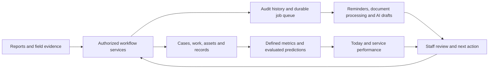

# Government operating model and automation proposal

| Field | Value |
|---|---|
| Status | Proposed for product and LGU review; not an approved organizational chart or implementation contract |
| Version / research date | 1.0 / 18 September 2026 |
| Audience | City Engineer, Assistant City Engineer, Administrative Division, nominated operational representatives |
| Requested phase | Research and proposal only; no product-code changes |
| Proposed accountable sponsor | City Engineer, subject to LGU nomination |
| Proposed delivery owner | Assistant City Engineer or nominated government product owner |
| Evidence boundary | Targeted source-code inspection and public primary-source research; no integrated runtime, production-data, or full security audit |

## 1. Recommendation

Build PULSO around the complete job: receive a concern, determine responsibility, assign work, record field evidence, inspect the result, communicate the outcome, and preserve the infrastructure history. Use one set of linked records to power daily work, reporting, monitoring, and forecasts.

Deliver trustworthy tracking and routine automation first. Introduce AI drafting and vision with review, then predictive recommendations after historical data and evaluation support them. More charts and stronger model claims cannot compensate for missing owners, unreliable state changes, or incomplete maintenance histories.

The user confirmed that **Assets is an existing module that is difficult to understand**. This proposal rebuilds its information structure; it does not interpret “Rebuild Assets” as a technical database command.

The requested government map coverage is both North and South Caloocan. This is an explicit expansion beyond PRODUCT.md's North-focused resident description. Government map coverage must not silently change resident eligibility, service ownership, or staff jurisdiction; those are separate decisions.

## 2. Evidence and local-government references

- Caloocan publishes a [City Engineering Department page](https://caloocancity.gov.ph/category/ced/) that identifies public-works complaints and excavation services, and a [CED Citizen Charter page](https://caloocancity.gov.ph/ced-citizen-charter/). The embedded charter did not expose readable contents in this research session. No internal structure, service deadline, or approval threshold is inferred from that embed.
- The [Quezon City Engineering Department](https://quezoncity.gov.ph/departments/quezon-city-engineering-department/) publishes functional divisions covering administration, planning/design, maintenance, project supervision, technical management, and equipment. These are useful functional references, not proof of Caloocan's organization.
- Its [2023 Project Management Manual](https://quezoncity.gov.ph/wp-content/uploads/2020/09/QCDE-Project-Management-Manual.pdf) covers organizational responsibilities and project stages from preparation through construction and closeout. The chart is described as proposed; this proposal relies on the readable responsibilities, not an assumed approved hierarchy. PDF screenshot retrieval failed, so its chart layout was not visually verified.
- QC also publishes an [Infrastructure Asset Management and Public Maintenance Works Manual](https://quezoncity.gov.ph/wp-content/uploads/2020/09/QCDE-Asset-Management-Manual.pdf). This is a follow-up reference: the 40 MB file exceeded the web reader's limit and was not fully inspected.
- [Section 477 of RA 7160](https://elibrary.judiciary.gov.ph/thebookshelf/showdocs/2/53542) provides statutory engineering responsibilities. It does not establish PULSO's local delegations or automatic signing rights.
- Do not copy procurement rules from the 2023 manual into software. [GPPB published the RA 12009 IRR in 2025](https://www.gppb.gov.ph/exciting-announcement-issuance-and-publication-of-the-irr-for-the-new-government-procurement-act/); applicable transition rules and local authority must be confirmed by the procurement/legal owners.

## 3. Current implementation findings

These are observations from inspected source paths, not assertions about deployed behavior.

| Finding | Evidence | Delivery consequence |
|---|---|---|
| Assets navigation points to projects and groups OBO, procurement, and records | [GovSidebar.jsx](../../frontend/src/components/GovSidebar.jsx), Assets item around line 67 | Separate the physical asset register from projects, work, documents, and regulatory processes |
| Report preview already opens/closes through a selected-report query parameter; its title is plain text | [CitizenReportsPage.jsx](../../frontend/src/pages/CitizenReportsPage.jsx), selection logic and docket header | Extend existing selection/context behavior; add true collapse and a dedicated detail link |
| Request-information handler reports sending without a network operation in that handler | Same file, `handleRequestInfoSubmit` | Persist request and notification state before showing a sent outcome |
| Work-order failure branches show creation success; team is placed in notes | Same file, `handleAssignWorkOrderSubmit` | Correct failed/uncertain outcomes; use validated team IDs and authoritative assignment |
| Multiple dashboard/insight screens contain fixed sample datasets | [page dashboard](../../frontend/src/pages/GovBiDashboard.jsx), [component dashboard](../../frontend/src/components/GovBiDashboard.jsx), [InsightsWorkspacePage.jsx](../../frontend/src/pages/InsightsWorkspacePage.jsx) | Consolidate routes and definitions; operational screens must not silently substitute sample results |
| Projects initialize/fall back to sample projects | [ProjectsWorkspacePage.jsx](../../frontend/src/pages/ProjectsWorkspacePage.jsx), `SAMPLE_PROJECTS` and load handling | Distinguish demo, no data, and unavailable data |
| Analytics map requests a North-only border | [GovAnalyticsPage.jsx](../../frontend/src/pages/GovAnalyticsPage.jsx), `sectorParam` | Add full-city and sector scopes through a shared map contract |
| Analytics imports Google's legacy HeatmapLayer | Same file, imports and layer rendering | Replace the retired rendering feature before reusing the map |
| Forecast fits a straight line to observed weekly buckets; missing weeks are filled later for display | [analytics_service.py](../../backend/analytics_service.py), `get_forecast` | Rebuild a complete time series before training; test forecasting against baselines |
| Predictive endpoints generate random probabilities, recurrence values, dates, and schedule costs | [predictive_router.py](../../backend/predictive_router.py), `/health`, `/schedule`, `/export` | Remove from operational claims; do not present as validated prediction |
| Analytics permission helper uses a role allowlist without differentiating requested module/action | [analytics_router.py](../../backend/analytics_router.py), `_assert_permission` | Separate view, export, draft creation, and approval permissions |
| Jurisdiction relies partly on numeric barangay parsing and permissive text; geometry fallback uses rough boxes | [analytics_service.py](../../backend/analytics_service.py), [geometry_utils.py](../../backend/utils/geometry_utils.py) | Use governed geography and explicit unresolved-location states |
| Infrastructure assets and maintenance-history entities already exist | [gov_models.py](../../backend/gov_models.py), `InfrastructureAsset`, `MaintenanceHistory` | Reuse and strengthen relationships rather than invent a second asset store |

There are also conflicting district descriptions between model comments and geometry logic. North/South operational sectors, legislative districts, barangays, and staff assignments must be separate, validated fields.

## 4. Seven staff-facing modules

| Module | Everyday job | Retain and connect | Primary functional owners |
|---|---|---|---|
| **Today** | Understand priorities and act | Personal decisions, team exceptions, overdue work, short service overview | Every staff member; leadership sees broader authorized scope |
| **Reports** | Receive, review, locate, track, and communicate about concerns | One queue with List/Map views, collapsible preview, full case record, duplicate candidates, referrals, resident updates | Intake/review coordinator; assigned technical reviewer |
| **Work** | Plan and deliver repairs and improvement projects | Work orders, assignments, schedules, materials blockers, field evidence, inspection, project milestones and approval references | Operations coordinator, engineering leads, field teams, inspectors |
| **Assets** | Know what infrastructure exists and what it needs | Permanent asset identity, location/geometry, ownership, condition inspections, linked reports/work/projects, maintenance and warranty history | Asset custodian and relevant technical lead |
| **Records** | Find and track official documents and decisions | Incoming/outgoing register, document versions, routing/receipt, case links, retention/legal hold, audit, authorized exports | Administrative Division and records function |
| **Service performance** | Understand delays, repeat problems, and future workload | Descriptive analytics, barangay comparisons, recurring concerns, evaluated forecasts, preventive-work recommendations | Assistant City Engineer, planning/asset leads, City Engineer |
| **Administration** | Maintain staff responsibilities and operating rules | Staff, teams, scoped permissions, delegation, availability, service calendars, approved routing/deadline rules, notification preferences | Administrative management; separate technical system administrator |

Projects are a distinct work type inside Work, with a separate project lifecycle. A minor repair must not be forced through a capital-project procurement path. Records are available from each case or asset without re-uploading the same document.

Map is a shared view within Reports, Work, Assets, and Service performance, not a competing source of case state. AI assistance is contextual in each module, not a mandatory chat interface. Finance, payroll, comprehensive HR, full procurement, and building permitting stay integration/extension domains until their process owners establish scope. Preserve relevant existing records and routes during migration; do not delete modules based on this proposal.

## 5. Roles without inventing an organizational chart

Only City Engineer, Assistant City Engineer, and Administrative Division are confirmed by the user. The following are **functional assignments in PULSO**, which can be allocated to existing employees without creating official divisions or job titles.

| Functional role | Proposed responsibilities | Limits |
|---|---|---|
| City Engineer | Department priorities, escalated technical decisions, approved delegations, performance and exception review | Only approvals actually delegated by law/local policy; not automatic purchasing, retention, or unrestricted IT authority |
| Assistant City Engineer | Daily coordination, cross-team handoffs, workload review, escalation follow-up | Approval limits and acting authority explicitly recorded |
| Administrative lead | Correspondence, document completeness/routing, staff/team maintenance requests, resource-request tracking | Cannot certify engineering condition or approve their own privileged-access grant |
| Intake/review coordinator | Register reports, request information, confirm jurisdiction, link duplicate candidates, propose/perform authorized routing | No structural certification or unrestricted work acceptance |
| Technical/team lead | Assess scope, estimate effort, assign eligible crews, identify materials blockers, supervise delivery | Scoped to assigned discipline, team, area, and delegated actions |
| Field worker/foreman | View assigned work, record progress, evidence and actual materials, request inspection | Does not approve their own completion as independently accepted work |
| Inspector/reviewer | Record inspection findings; accept, reject, or request rework within authority | Separation from the executor; exception policy required if staffing makes separation impossible |
| Asset/planning custodian | Maintain asset identity and history, review repeat issues, propose maintenance and rehabilitation | AI suggestions do not grant approval authority |
| Records officer/clerk | Register, version, route, retrieve, and release documents within scope | No routine hard deletion; retention/disposition requires its own authority |
| System administrator | Technical accounts, integrations, service health, controlled access administration | No automatic engineering or financial sign-off |
| Auditor/read-only reviewer | Review authorized history and evidence, perform permitted exports | No operational mutation |

For each workflow step record one accountable owner, a responsible employee/team, backup/delegate, deadline policy, required evidence, and next recipient. Staff may hold multiple functions; permissions must still check action, jurisdiction, assignment, record state, and conflict of interest. Never use a department label alone as a security boundary.

### Proposed responsibility map

| Decision/work | Responsible | Accountable |
|---|---|---|
| Register and request missing information | Intake/admin staff | Nominated intake lead |
| Assess issue and recommend scope | Technical reviewer | Relevant technical lead |
| Assign/reassign routine work | Authorized coordinator | Assistant City Engineer or delegated operations lead |
| Carry out work | Assigned field team | Technical/team lead |
| Verify completion | Authorized inspector | Delegated acceptance authority |
| Approve project/major technical change | Nominated technical preparer | Proper delegated approving official; City Engineer only within authority |
| Preserve/release records | Records function | Administrative/records authority |
| Approve model use and thresholds | Data/model owner with engineering reviewers | Government product/process owner |

## 6. One connected record chain

**Report(s) → case → work order(s) → inspection → accepted outcome → asset history → future maintenance.**

A report is an incoming submission; a case is the managed issue; a work order is an instruction to do work; an asset is physical infrastructure; a project is a planned improvement effort. Multiple reports may refer to one case, and multiple work orders may address it. Historical source submissions remain preserved. A case may have no confirmed asset; do not invent an asset to complete a form. A project may affect multiple assets.

Proposed case flow: Received → Under review → Assigned → Work underway → For inspection → Resolved. Information requested, blocked, referred, duplicate-linked, cancelled, and reopened are explicit exception paths with reasons and next owners. These names require mapping to approved backend transitions; they do not replace current enums by declaration.

Example: residents report a blocked drain. Staff link the reports to one issue, confirm its asset or location, assign an eligible team, and record work. An inspector reviews completion evidence. Acceptance creates the authorized resolution event and resident-safe update. Maintenance history receives the verified activity. A later repeat issue becomes a review candidate, not an automatic declaration that the repair failed.

Each consequential change must save actor, time, before/after state, reason, authority, evidence references, record version, and resulting task. Resident updates use a separate privacy-safe projection. Referrals require destination, acknowledgment state, and tracked follow-up; transferring work must not silently claim resolution.

## 7. Report tracking, preview, and integrated map

### Queue and preview

1. Reports defaults to the staff member's permitted scope and useful saved view.
2. A single List/Map switch changes presentation of the same filtered result set. Search and selection remain stable.
3. Selecting a report or its map marker opens a **non-modal right-side preview** on a wide screen. Staff can still use the queue/map.
4. The preview contains the issue title/ID, location, current state, age/deadline, responsible team, latest update, evidence thumbnail, and authorized next action.
5. **Collapse** keeps selection and reduces the preview to a labelled compact handle. **Close** clears selection. Reopening restores the same report; no refetch is implied unless stale.
6. The report name is a real link to a proposed `/gov/reports/:reportId` full page. Offer an explicit “Open full report” link too.
7. Back restores the queue filters, selected row, scroll position, and map extent. Shareable URLs encode safe state; record authorization is rechecked.

Full page: summary and next task first, then evidence/location, related submissions and assets, assigned work, inspection/decisions, documents, resident communication, and immutable activity history. Keep editing within explicit tasks; avoid arbitrary status dropdowns.

### Map rules

- Provide All Caloocan / North / South controls where the user has scope; fit actual geometry rather than one rectangle or latitude threshold.
- Reuse one map component, loader, legend, styling, feature IDs, boundary source, and selection contract throughout the government system.
- Default to actionable case markers/clusters. Density is an optional analytical layer, labelled as report/case density, not infrastructure failure risk.
- Map and list use the same filters. Display unmapped records in the list with “Location needs review”; never place them at an invented center point.
- Display boundary source/version, location uncertainty and last successful refresh when relevant. Address/list alternatives remain usable during provider failure.
- Separate exact operational locations from privacy-safe resident/public projections.
- At narrow widths, use a full-width preview or full detail page with a clear return path; do not compress three desktop panes.

The [PSA listing](https://psa.gov.ph/classification/psgc/barangays/1380100000) reports 193 barangays as of 31 July 2025. Its [2024 change notice](https://psa.gov.ph/system/files/scd/Press-Release-3Q-2024-PSGC.pdf) records the division of Barangay 176 into six barangays. Replace numeric ranges with versioned official identifiers and verified boundaries. Legacy “176” records need historical attribution or review, not an arbitrary assignment to one new barangay. The earlier generated dashboard images used illustrative legacy labels and must be updated before implementation.

## 8. Assets redesign

Keep the navigation label **Assets**, with the page explanation **“Roads, drains, buildings, and other infrastructure the city maintains.”** Lead with records people recognize, not unexplained health scores.

Default list fields: asset name/type, barangay/address, last inspected condition, last inspection date, open issues, responsible team, and next planned action. Suggested views: All assets, Needs inspection, Needs repair, Work underway, and Recently maintained. Views are filters and may overlap; do not add their counts as mutually exclusive totals.

Asset page sections:

1. Identity, owner/maintainer, location and confirmed extent.
2. Latest inspected condition, inspector, date, evidence, and limitations.
3. Current reports, assigned work, blockers, and next scheduled task.
4. Repair and maintenance history with verified costs where recorded.
5. Related rehabilitation/construction projects, turnover and warranty information.
6. Plans, inspection forms, photographs, and records.
7. Suggested preventive work with reasons, evidence, data sufficiency, and reviewer decision.

Keep observed condition, service availability, work status, and predicted concern separate. “Not inspected” is a valid state, not “Good.” A new complaint does not overwrite the last engineering inspection. Retain replaced/retired assets and link successors; do not reset history after rehabilitation. A report cluster is not an authoritative physical asset or surveyed road segment.

## 9. Daily dashboard and nontechnical analytics

Today answers “What should I do?” Service performance answers “What should we improve?” Both use the same authorized metric definitions and source records.

### Today / work and service overview

- Summary: open cases, past due, needs your review, resolved in the selected period, typical resolution time.
- Main region: issue/location → reason for attention → responsible team → next step.
- Supporting views: demand versus completed work, where open cases are, what work is waiting for, and team workload/blockers.
- Inspection/asset alerts appear only when there is an actionable task and sufficient data.
- Default personal/team scope follows assignment; leadership gets authorized departmental scope. No manual role switching is required.

| Plain label | Definition / prerequisite |
|---|---|
| Open cases | Unique managed issues not in a terminal state at the snapshot time; duplicate reports are not extra cases |
| Past due | Open cases past an applicable approved due date; show age instead when deadline policy is absent |
| Needs your review | Tasks this user can act on now, not all department approvals |
| Resolved this period | Distinct cases with an authoritative resolution event in the period; distinguish reopened cases and event counts |
| Typical time to resolve | Median defined start-to-resolution duration for a stated resolved cohort, with count; identify pause/reopen treatment |
| Team workload | Assigned open work plus blockers; not an employee productivity leaderboard |

Snapshot backlog is not restricted to cases created in the trend period. Compare equal periods and label partial periods. For backlog reconciliation use state-entry/exit events, including reopening, referrals, cancellations, scope changes and corrections; do not assume every exit is a resolution. If needed, display “Other changes” with reasons. Distinct resolved-case counts may differ from resolution-event counts when cases reopen and resolve again.

### Service performance

Use three plain-language views: **Service progress**, **Repeated problems**, and **Plan ahead**. Put a concise evidence-backed finding, source period, supporting chart/list, affected records, and next action together. Avoid a separate tab for every algorithm.

Replace “spatial clusters” with “Nearby related reports”; “recurrence rate” with “Issues reported again”; “failure probability” with “Suggested for inspection” until prediction is validated. Keep technical definitions available on demand. Empty, stale, incomplete, and unavailable data are distinct states. Forecasts show ranges and evidence; insufficient data gets an explicit explanation.

This emphasis on audience, essential measures, context, and drill-through is consistent with [Microsoft's dashboard guidance](https://learn.microsoft.com/en-us/power-bi/create-reports/service-dashboards-design-tips).

## 10. Automation, AI assistance, and vision

| Trigger | System assistance | Human decision / control |
|---|---|---|
| Report received | Acknowledge receipt, check required fields, propose category and likely duplicate | Reviewer confirms issue, jurisdiction and duplicate link |
| Case ready for assignment | Recommend eligible team using specialty, area and declared availability | Coordinator assigns; automatic assignment only under a separately approved narrow rule |
| Due date approaches / task stalls | Remind current owner, then escalate through approved policy; suppress duplicate notices | Supervisor resolves escalation; configurable business calendar and pause reasons |
| More information required | Prepare a clear request from missing fields and save communication status | Staff checks message; delivery failure remains visible |
| Field update uploaded | Link evidence, check file quality, prepare progress summary | Staff confirms factual update; offline upload is not a server commitment |
| Work reported complete | Check required evidence and create inspection task | Authorized inspector accepts or requests rework |
| Repeated concern at an asset | Prepare inspection candidate with linked history | Engineer decides whether maintenance, investigation, referral or rehabilitation is appropriate |
| Document received | Extract proposed metadata, suggest case/project links, identify missing fields | Records staff confirms accuracy and classification |
| Weekly review | Generate a draft service summary from approved metrics with source links | Responsible official checks and releases it |

AI functions: summarize a case, draft a resident update, find approved procedures, explain a metric, compare linked histories, and suggest the next permitted task. Answers must cite accessible records and separate retrieved facts from suggestions. Record model/version, evidence references, input scope, output, reviewer corrections and cost/latency metadata as appropriate.

Vision pilot: recognize visible issue categories, identify unusable/blurry photos, suggest regions showing visible damage, and assist before/after review. Evaluate on locally labelled field photos, including poor light, rain, occlusion and different devices. Preserve originals; derived annotations and privacy-redacted copies are separate. Vision cannot establish structural safety, exact damage dimensions/cost, ownership, identity, or accepted completion from an ordinary photo alone.

No model autonomously approves engineering work, spends funds, releases official certificates, deletes records, grants permissions, or closes a case. A read-only assistant should not execute writes. Any later action assistance must present a draft, use the same authorized service command as staff, and require the relevant confirmation. Treat retrieved text/images as untrusted content, not instructions to the assistant; minimize personal information before external processing.

## 11. Recommended technology choices

Retain the inspected React/Vite frontend and FastAPI/SQLAlchemy/PostgreSQL foundation. Strengthen a modular application before introducing many services. Package versions, compatibility, hosting approval and total operating cost need validation during technical design.

| Capability | Recommended starting point | Why / adoption condition |
|---|---|---|
| Authoritative workflow | Explicit transition/permission services in FastAPI; PostgreSQL transactions, record versions and an outbox | One durable decision updates state/history and schedules follow-up reliably |
| Background automation | Celery workers with a durable broker, initially RabbitMQ; database-backed schedules and job history | Retries for reminders, OCR, AI and exports; idempotency required to avoid duplicate actions. See [Celery tasks](https://docs.celeryq.dev/en/stable/userguide/tasks.html) |
| Long-running workflow later | Consider Temporal only if cross-system, long-lived orchestration becomes difficult to operate | Its [durable workflow platform](https://docs.temporal.io/) is an option, not an initial second workflow engine |
| Shared mapping | Preserve Google Maps investment initially; replace retired heatmaps with deck.gl; evaluate MapLibre if map-hosting control becomes a priority | [Google deprecations](https://developers.google.com/maps/deprecations) state Heatmap Layer unavailable since May 2026; [deck.gl integration](https://developers.google.com/maps/documentation/javascript/examples/deckgl-heatmap) provides a supported direction. [MapLibre](https://maplibre.org/maplibre-gl-js/docs/) still needs a licensed/operated tile and geocoding source |
| Spatial data | PostgreSQL + PostGIS; verified city/barangay geometry and asset points/lines/polygons | [Spatial predicates](https://postgis.net/docs/manual-3.7/en/ST_Covers.html) support boundary-aware queries and indexes; uncertain boundary cases still need review |
| Evidence and records | Approved private object storage with versioning, checksums, expiring access, scanning and backup | Separate evidence originals from derivatives; legal hold/retention require records-owner configuration and verified provider support |
| Search / knowledge assistance | PostgreSQL text search first; add pgvector when semantic retrieval demonstrates value | [pgvector](https://github.com/pgvector/pgvector) adds similarity search in the existing database; permission filtering must apply before model exposure |
| AI text and images | Evaluate the existing Gemini integration against a fixed local task set; use a currently supported multimodal model under approved hosting/data terms | [Gemini image understanding](https://ai.google.dev/gemini-api/docs/image-understanding) supports image inputs. Do not add another AI vendor without measured benefit; verify commercial endpoint terms separately |
| Document extraction | Pilot PaddleOCR for locally controlled extraction of scanned forms | [PaddleOCR](https://www.paddleocr.ai/main/en/index.html); test actual municipal scans and handwriting, preserve human correction |
| Prediction | Existing Python/scikit-learn tools, starting with transparent baselines and time-based evaluation | [TimeSeriesSplit](https://scikit-learn.org/stable/modules/generated/sklearn.model_selection.TimeSeriesSplit.html); no random train/test split across time or leakage from future outcomes |
| Crew scheduling later | Rules first; Google OR-Tools when travel, shift, skill and equipment constraints are reliable | [OR-Tools routing](https://developers.google.com/optimization/routing) supports constrained route planning; do not optimize against guessed travel times or absent capacity |
| Data presentation | Shared server-defined metrics and accessible in-app charts/tables | Staff keep actionable records in PULSO. Separate management BI exports are optional; they must not duplicate metric definitions |

Use a mobile-friendly field interface with explicit saved-on-device, uploading, synchronized, and conflict states. Offline personal data storage needs device/security approval. Notification delivery needs persistent status and retry; “queued” is not “delivered.”

### Conceptual architecture

All reads, writes, background jobs, exports and retrievals enforce scope. AI suggestions and analytics never become a second authority for case state.

## 12. Prediction that can support decisions

Start with three separate use cases; do not combine them into one unexplained score.

1. **Expected incoming workload:** forecast unique cases by issue type and area for staffing. Need complete dated case history and reporting-coverage changes. Compare against last-week and seasonal baselines; report error and interval coverage on future-held-out periods.
2. **Work likely to miss its due date:** prioritize supervisor review. Need approved deadlines, assignment changes, stage dwell, blocked reasons and historical outcomes. Evaluate precision/recall at the department's review capacity; exclude facts unavailable at prediction time.
3. **Assets suggested for inspection:** rank repeat problems and overdue inspections using explainable rules first. True failure probabilities require defined failure events, inspected exposure history, sufficient examples, censored-data treatment and calibration. An inverted health score is not a validated probability.

Model release gates: nominated owner; documented purpose/cohort; real non-synthetic data; time/geographic validation; comparison with a simpler baseline; uncertainty; subgroup/data-coverage review; human review; monitoring; rollback/disable path. Do not impose a universal record-count threshold: sufficiency depends on each task and event frequency. More reports can reflect better access to reporting rather than worse infrastructure. Weather inputs need provenance and an approved feed; calendar season alone is not a forecast.

## 13. Delivery sequence and measurable acceptance

Indicative planning envelope: **12–16 weeks for a limited pilot**, assuming two full-time application engineers, a shared designer/product lead, QA support, part-time data/GIS support and weekly LGU-owner access. Re-estimate after discovery. Advanced prediction, full procurement, and citywide historical asset capture are separate increments, not implied deliverables within that estimate.

| Stage | Indicative duration | Output and release evidence |
|---|---|---|
| Discover and agree | 1–2 weeks | Walk through real report, repair, project, inspection and record examples; nominate owners; approve pilot capability/transition map and geography sources |
| Establish trustworthy foundations | 2–3 weeks | Remove operational sample fallbacks/random outputs; correct false success; authoritative permissions, geography and event/metric contracts; migration and rollback plan |
| Deliver a complete work path | 3–4 weeks | Reports List/Map → collapsible preview → full case → assignment → field evidence → inspection → resident-safe outcome/history |
| Connect assets, records and service data | 3–4 weeks | Asset histories, document routing, genuine dashboard and analytics; shared filters and source drill-through |
| Pilot automation and assistance | 2–3 weeks | Reminders/escalations, summaries/OCR/vision suggestions, training, monitored pilot, recovery/rollback rehearsal |
| Evaluate prediction | Data-dependent | Historical validation, staff review trial and model-owner sign-off before operational forecast claims |

Pilot one nominated repair workflow, such as drainage maintenance, with data and location tests for both North and South. Start staff rollout in one team; expand only after observed results. Use real anonymized samples alongside clearly separated synthetic QA fixtures.

### What “all features functional” means

Inventory each visible control and retained service with owner, source API/record, permitted action, saved outcome, failure behavior and acceptance evidence. Classify it as working, partial, mock, duplicate, blocked on policy/data, or deferred. A button or successful toast is not completion.

Required pilot tests:

- Unauthorized detail, map query, export, AI retrieval and mutations are denied server-side.
- Assignment persists a valid team, next task and history; retry/concurrency cannot duplicate work.
- Request-information saves the request and distinguishes queued, delivered and failed notification states.
- Preview collapse preserves selection; title opens the correct full record; Back restores context.
- List/map counts reconcile including unlocated records, pagination and shared filters; both city sectors are covered correctly.
- Completion requires its approved evidence and inspection decision; executor/approver conflict is handled.
- Asset history remains linked after repeat repairs, replacement and project turnover.
- Dashboard numbers reconcile to records and event definitions; no sample fallback on failed fetch.
- AI outage leaves the manual path usable; evidence is not overwritten; restricted sources are not exposed.
- Records version/release/retention controls and backup restoration are exercised.
- Keyboard use, visible 3 px focus, light/dark parity, chart/table and map/list alternatives, 320 px reflow, 200% zoom, reduced motion and forced colors pass.

Measure the baseline before promising gains: time to assignment, age awaiting inspection, time to find a record, repeat data entry, duplicate work orders, notification failures, case reopening, staff task success, and AI correction rate. Capture event timestamps and outcomes through an approved measurement plan; avoid personal rankings or invented savings.

## 14. Decisions and next design action

| Decision | Proposed owner |
|---|---|
| Functional role assignments and delegation limits | City Engineer / LGU administration |
| Case/work/project transitions, inspection and closure rules | Assistant City Engineer with technical leads |
| Deadlines, working calendars, pause and escalation rules | Relevant service owner |
| Current city/barangay geometry, IDs and historical crosswalk | Nominated GIS/planning data steward |
| Asset ownership, inspection criteria and maintenance records | Asset custodian and technical leads |
| Record access, retention, release and AI data handling | Records authority and privacy/security owners |
| Procurement/regulatory integration boundaries | Nominated procurement/legal/regulatory owners |
| Pilot team, historical records, operating budget and support | Government product owner and delivery lead |

The current shared [Figma file](https://www.figma.com/design/1qPgPj4o3smElv8B2B1REi) was inspected earlier in this conversation: the API exposed the foundations page and Civic Aperture v0.2, not the full documented template set. Treat that as an unresolved discrepancy, not proof the missing artifacts were deleted. This proposal does not mutate Figma.

Next design phase: reconcile the live library and paired templates; then specify shared queue/map/preview, full case, asset record, Today and Service performance patterns in light/dark and narrow layouts. Include states, data/permission fields, focus behavior, failure recovery, component versions and acceptance tests. The proposed IA and workflow above remain proposals until their decision owners approve them. Existing 21/22/23 design and implementation documents remain references; this file records a focused new recommendation rather than silently superseding them.
