# Analytics, Map, and Predictive Maintenance: current runtime review

**Date:** 23 October 2026. **Status:** Observed local behavior plus proposed redesign; not LGU-approved workflow. **Scope:** Read-only inspection of the current government website at 1280×720 in dark mode using its existing development engineering account. Local backend and frontend were started for this review. No seed script, data migration, work assignment, AI generation, publication, export, or product-code edit was performed.

The displayed records and figures are local development data, not verified Caloocan operational statistics. Screenshots below were captured and inspected in this run. Source observations explain the visible behavior; they do not establish real-world engineering risk or a validated predictive model.

## Verdict

The confusing overlap is real. The interface mixes three different jobs—deciding on a report, understanding service patterns, and deciding which asset needs inspection—under multiple dashboard/map labels. The default views spend substantial space on summary cards, while the item, evidence, explanation, and next action receive less emphasis.

The previous research response inspected source but did not complete this runtime walkthrough. It also cited `components/GovBiDashboard.jsx` without identifying that the routed Dashboard actually imports `pages/GovBiDashboard.jsx`. Both files exist; this audit distinguishes them. The original proposal's recommendations remain proposals, and this runtime evidence refines their basis.

## 1. Captured steps and health

| Step | Actual route / interaction | Observed health and evidence |
|---|---|---|
| 1 | Sign in → `/gov/my-dashboard` | Renders, but operational metrics are simulated in the routed source. The visible page does not identify them as demo data. |
| 2 | Sidebar Analytics → `/gov/analytics` | Loads backend-backed analytics. Seven KPI cards and AI-brief action precede the default Intelligence Map. Narrow cards break ordinary words across lines. |
| 3 | Analytics → Forecast | Shows the forecast heading and a large blank region for the current local dataset; no explanation of insufficient/no forecast data is visible. |
| 4 | Sidebar Map → `/gov/map`, Triage | Loads the dispatcher application, including report queue, map, detail panel, filters, Triage/Active modes, and assistant controls. This is an operational tool, not merely a map. |
| 5 | Map → Active | Heading changes to Dispatched Work, but with All Statuses the same 13 local records remain, including rejected and pending-review records. |
| 6 | Direct existing `/gov/predictive` route | Redirects to `/gov/insights?view=predictive`; reveals an additional workspace-navigation row that is absent on direct `/gov/analytics`. Overview leads with eight cards and a seasonal banner. |
| 7 | Predictive → Asset Health | Category/barangay/score cards dominate. Specific asset name/ID is not prominent, although the API supplies those fields. “Real-time Asset Health” conflicts with exploratory score messaging. |
| 8 | First Asset Health item → Details & Action Plan | Exposes signal percentages, recurrence, maintenance age, suggested review date, document state, and Generate AI Action Plan. The visible expanded item does not offer a direct manual inspection task action. AI generation was not invoked. |
| 9 | Predictive → Risk Map | This is a barangay summary table, not a geographic map. It reports zero critical assets across the shown groups while overview/health identifies six critical assets. Source inspection identifies different health-score selection paths. |
| 10 | Predictive → Review candidates | Explicitly says no work is scheduled; useful distinction. However, a Week 4 range of Nov 13–20 contains suggested dates in December and February. Illustrative costs dominate the rows. |
| 11 | Workspace → Operational Overview | Opens the same Analytics component as Analytics & GIS Heatmap. Sidebar Analytics, workspace tabs, and five inner tabs create overlapping navigation layers. |

### Step 1 — Actual routed Dashboard

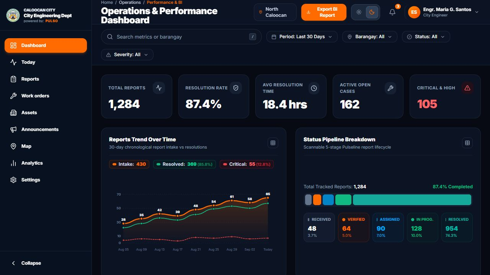

Observed: the page shows 1,284 reports and 87.4% resolution. The pipeline contains 954 resolved / 1,284 total, approximately 74.3%, while the same region says 87.4% completed. The routed component's KPI calculation uses 1,122 resolved instead. These are different static definitions on the same screen, not valid comparisons of periods.

Source: [actual route import](../../../frontend/src/App.jsx#L24); [simulated KPI computation](../../../frontend/src/pages/GovBiDashboard.jsx#L213). The other [BI component](../../../frontend/src/components/GovBiDashboard.jsx) is not the component imported by this route.

### Step 2 — Analytics default

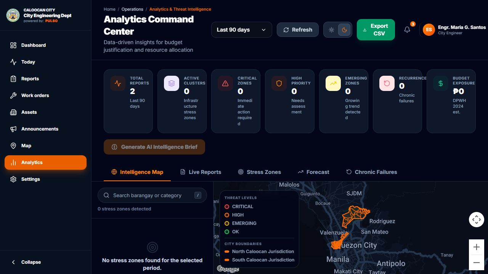

The local result is two reports in the selected 90-day window and zero detected clusters. Those values are not directly comparable to Map's all-period count. The problem here is hierarchy and explanation: seven cards, “Budget Exposure,” and an unavailable AI brief consume most of the first viewport before useful record work. “Threat Intelligence,” “Stress Zones,” and “Command Center” add interpretation burden.

Source: [Analytics tabs](../../../frontend/src/pages/GovAnalyticsPage.jsx#L521), [title and purpose copy](../../../frontend/src/pages/GovAnalyticsPage.jsx#L604), [cost KPI](../../../frontend/src/pages/GovAnalyticsPage.jsx#L649).

### Step 3 — Forecast

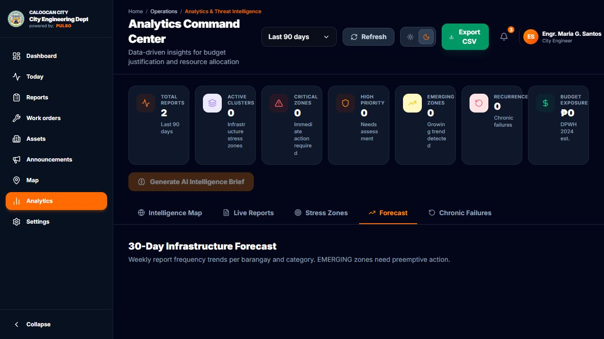

No visible guidance explains whether there is insufficient history, no eligible series, or a failed/partial result. The interface needs a truthful data-coverage state and a useful path back to source records.

### Step 4 — Map / Triage

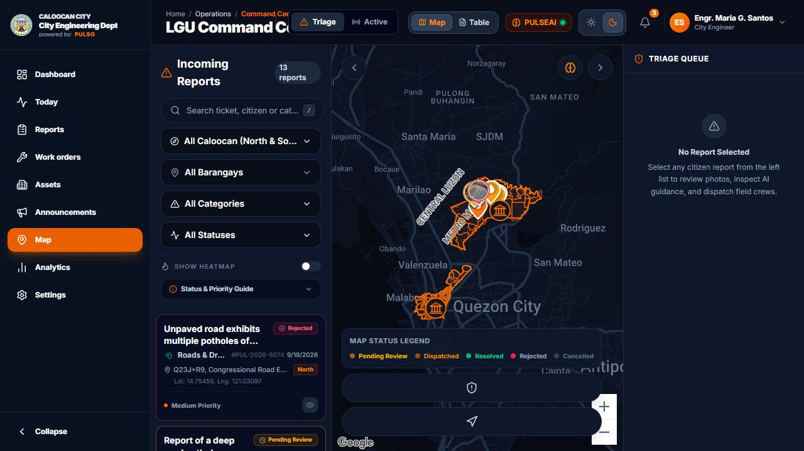

This page has a legitimate distinct purpose: inspect an individual report in place and coordinate response. The label “Map” hides that purpose. At 1280×720 the wide sidebar, filter stack, left report list, center map, and right empty detail panel compete for space; the page title is also crowded by toolbar controls.

### Step 5 — Map / Active

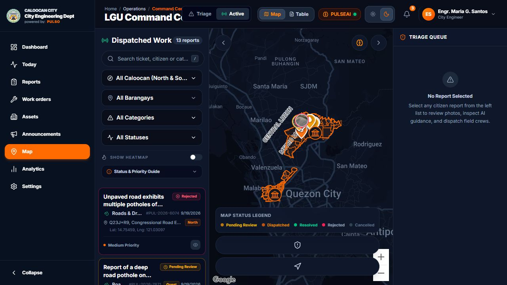

Source [All Statuses behavior](../../../frontend/src/pages/DispatcherDashboard.jsx#L1184) explicitly keeps the full dataset rather than restricting it by Triage/Active mode. The resulting heading “Dispatched Work” is misleading for the visible rejected/pending records. Fix the heading/query contract before redesigning its presentation.

### Step 6 — Predictive overview

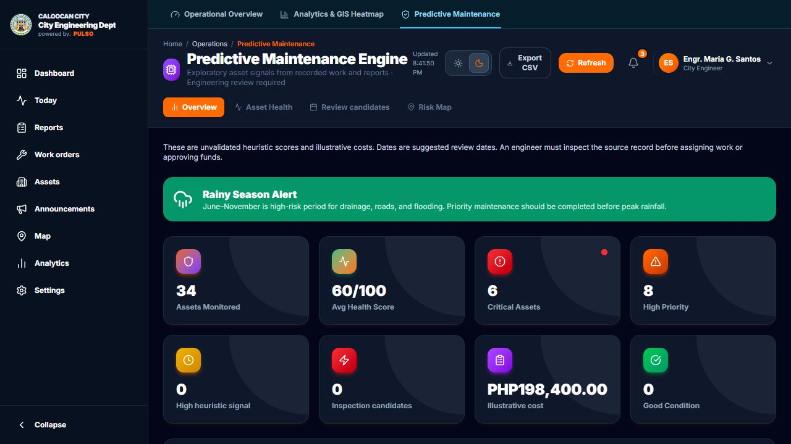

Useful existing strength: the interface acknowledges unvalidated heuristic scores, illustrative costs, and engineering review. However, eight large cards and a seasonal banner push actual review candidates below the fold. “Critical assets” and “Inspection candidates” are distinct rules, but their different meanings are not explained beside the counts.

### Step 7 — Asset Health

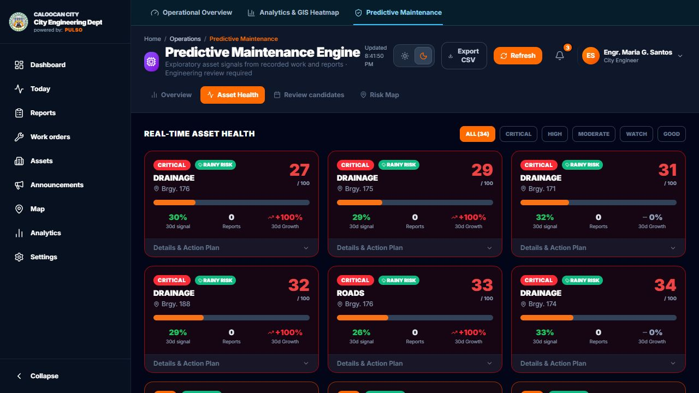

Several items are simply titled DRAINAGE. A staff member must identify the actual asset before scheduling a site visit. The API has `asset_id` and `asset_name`; [the card header renders the category](../../../frontend/src/components/PredictiveMaintenance.jsx#L164).

“0 Reports” beside “+100% 30d Growth” looks contradictory. Source inspection shows that the report count and deterioration calculation use different record types/windows; the growth calculation compares maintenance-history counts over 90-day windows. This is a labeling and definition problem, not evidence that zero mathematically grew by 100%.

### Step 8 — Expanded asset

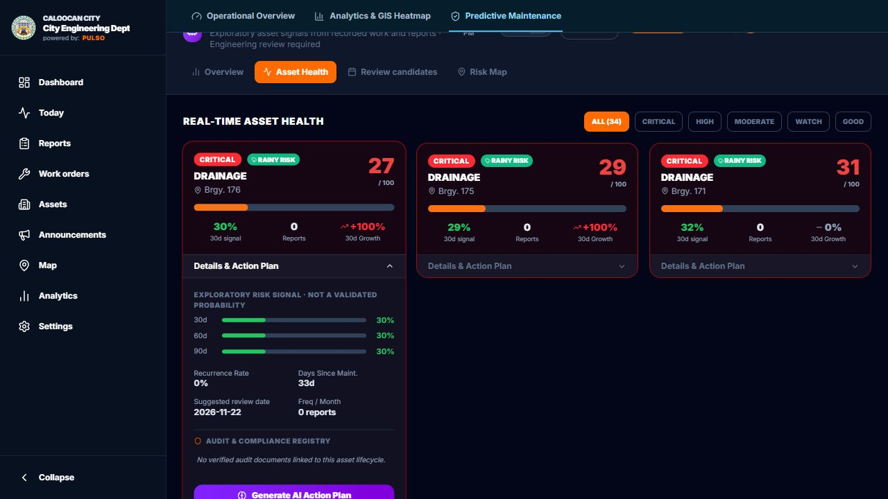

The small disclaimer correctly says percentages are not validated probabilities. Staff still need a clearer answer to “why inspect this asset now?” with named source observations and a manual next action. An AI narrative should assist that decision rather than become the required gateway to a work-order draft.

### Step 9 — Risk Map is a table

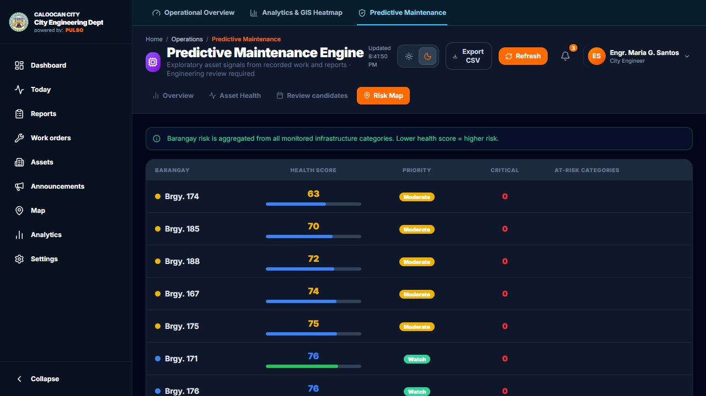

Rename to “By area” if retained. The source of score disagreement is material: [summary/health](../../../backend/predictive_router.py#L142) prefer stored `condition_score` when present; [risk aggregation](../../../backend/predictive_router.py#L401) recalculates `calculate_ahs`. A barangay average can also conceal a single bad asset, so its aggregate priority must never replace asset-level review. The displayed zero critical counts are not an averaging effect alone: the endpoint counts assets using a different score path.

### Step 10 — Review candidates

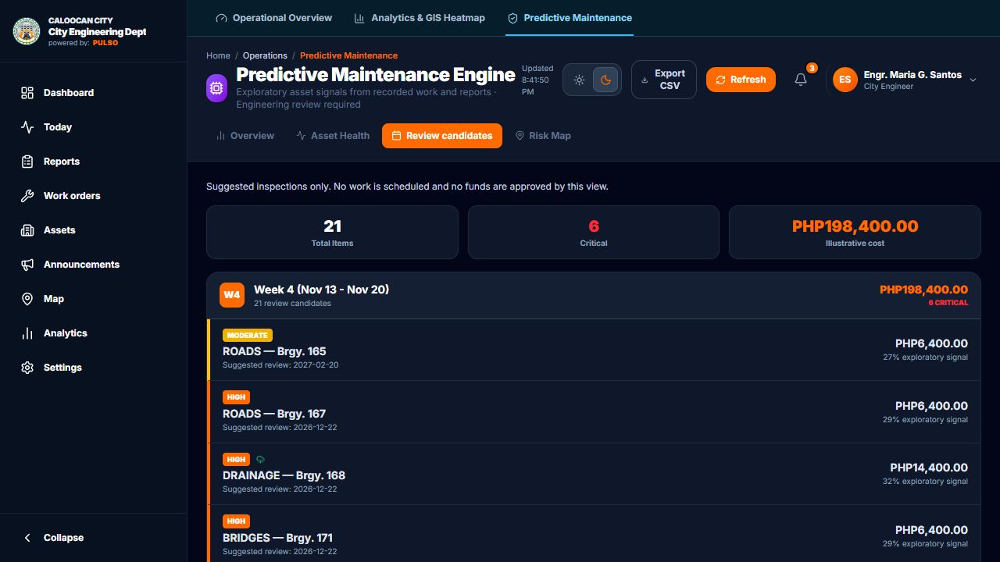

Source [week binning](../../../backend/predictive_router.py) caps all suggested dates into weeks 1–4. This places later dates beneath a nearer calendar label. Remove the false calendar presentation; suggested review dates are not assigned inspection appointments. Under the user's disclosure-only budget scope, remove illustrative intervention prices from the primary decision flow.

### Step 11 — Duplicate Overview destination

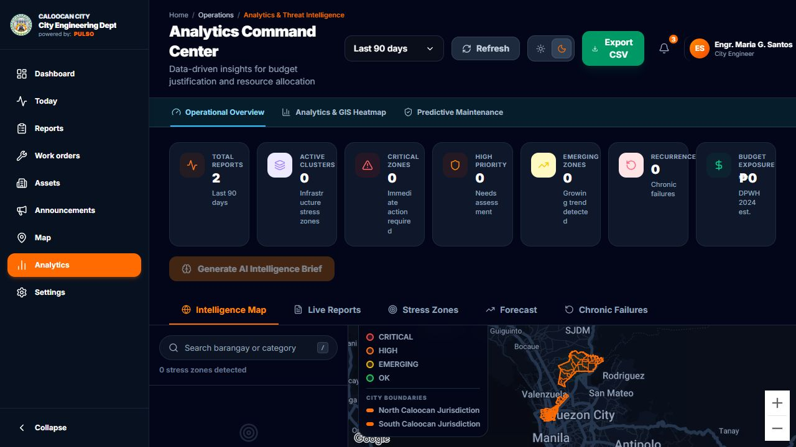

[GovernmentWorkspaceRoute](../../../frontend/src/pages/GovernmentWorkspaceRoute.jsx#L33) maps both `overview` and `analytics` to `GovAnalyticsPage`. Different labels do not deliver distinct jobs. The direct sidebar path also omits the workspace tabs, making Predictive harder to discover from the usual Analytics entry.

## 2. Concrete redesign recommendation

This is a proposed information and interaction structure, not an implemented redesign or approved lifecycle.

**User-confirmed design reference — 23 October 2026:** The current Reports screen at `/gov/reports` is the design to preserve and extend throughout the government portal. Analytics, Maintenance review, Work, Infrastructure, Records, Updates, and Administration should inherit its shared shell, navigation behavior, header hierarchy, typography, search/filter controls, table/detail patterns, surface treatment, restrained palette, and coordinated public-service tone. The work is an extension of the Reports design language. This clarification supersedes any earlier suggestion to introduce a different government visual style or independently recolor the modules. The workflow and data-correctness recommendations below remain proposals.

The current Reports source already composes `GovSidebar`, `GovBreadcrumb`, `SearchInput`, `OrangeSelect`, `TablePagination`, `ThemeToggle`, `GovNotificationDropdown`, and `GovUserDropdown`, with a table and selected-record detail pattern. Reuse and reconcile those primitives before composing the other pages. The Reports screen itself was source-inspected for this clarification; the eleven runtime captures above cover the audited insights/dispatch screens, not a new Reports screenshot.

### A. Reports: review and coordinate a specific concern

Merge the standalone Map destination into the Reports operational workspace as **List | Map** views using one query, source set, selection, and scope. Keep report assessment and authorized assignment available from the docket. Preserve useful dispatch features rather than deleting the dispatcher component's capabilities.

Active field-work location belongs to **Work → Active work → List | Map**, scoped to genuine assigned/active jobs. In the pilot, expose this only where location data is authorized and its freshness is known. A cross-city map can remain a saved shortcut if real staff testing establishes that job; it should not be another independent record inventory.

Primary question: **“What is this concern, and who needs to act next?”**

### B. Analytics: understand service patterns and open the work behind them

Keep the familiar Analytics label initially, with a plain purpose: **“Find delays, recurring concerns, and workload that needs review.”** Consolidate the duplicated Overview/Analytics destinations. Proposed views:

| View | Main content | What staff can do |
|---|---|---|
| Delays | Open work by waiting step and elapsed age; reasons and next owners | Open the filtered queue; assign an eligible reviewer/coordinator |
| Workload | Work by team, type, age, and known availability | Review/reassign within authority; counts alone do not rank staff productivity |
| Recurring concerns | Distinct incidents linked to the same asset/area, alongside accepted repair history | Open the asset; request technical investigation |
| By area | Same scoped concerns, as table first and optional map | Investigate a cluster and open its exact records |

Use one persistent scope/date filter row. Start with a plain explanation, one relevant comparison, and an actionable records table. Avoid seven equal KPI cards. A summary count is useful when it opens a concrete task queue; there is no prescribed quota of cards.

Each chart: question/title; observation; limitation; source/as-of time; accessible data; “View affected work.” Show a partial/no-data explanation when no defensible conclusion exists. Report-frequency Forecast is a demand-planning tool; it must not masquerade as an asset failure forecast. Retain it only when it has adequate history and an identified staffing/planning decision.

### C. Predictive Maintenance: review which infrastructure needs inspection

Keep the underlying capability, but present the primary job as **Maintenance review**. Explain the exploratory model status beside recommendations. Proposed views are **Needs review | Under review | Planned inspections**, backed by actual task states once approved. Existing “Review candidates” is not already an assigned inspection schedule.

The main surface is a compact asset list, not a grid of scores:

| Required column | Purpose |
|---|---|
| Asset name + ID | Know exactly what/where the item is; link to Infrastructure |
| Address/barangay | Support a real site visit; location uncertainty stays visible |
| Why review | Actual sourced observations or a clearly labeled model/rule suggestion |
| Last inspection / maintenance | Dated history, source, and missing-data state |
| Existing work / reviewer | Prevent duplicate tasks and show who owns follow-up |
| Next action | Review evidence; assign inspection; defer with reason; link existing work |

Selecting an item opens evidence and an observation/inspection/repair timeline, recommendation basis, data gaps, existing work, and role-appropriate next actions. Make manual review available without AI. Optional “Draft inspection notes” follows source inspection. Distinguish creating an inspection task from authorizing repair or resolving a resident report.

An optional location view uses the same assets and review filter. Do not add another dedicated Risk Map module. If the barangay summary is retained, show sample size, critical-asset count, missing coverage, and links; a mean health score must not hide a critical individual asset.

Health score, heuristic signal, verified condition, validated model probability, and reported observations are different facts. Present them separately with provenance. Remove “real-time,” false week schedules, unexplained growth percentages, budget exposure, and illustrative intervention costs from primary operational decisions.

## 3. Professional presentation: practical consequences

- Keep routine rows quiet; concentrate emphasis on selected work, evidence, genuine exceptions, and one primary action.
- Use plain labels such as Delays, Related concerns, Review asset, Assign inspection. Remove threat/command vocabulary that staff must translate.
- Limit navigation to one module row and its relevant views; eliminate duplicated Overview aliases and stacked competing tabs.
- Put the usable work surface early in the viewport. Avoid large seasonal banners and summary grids that hide the first actionable record.
- Reuse one map interaction/filter/legend approach where a map answers a spatial question. A map is optional when the question is who, why, or how long.
- Extend the user-selected Reports palette and control treatment consistently; preserve distinct semantic status meanings, identical light/dark task capability, true-color evidence, and visible 3 px focus. Reconcile older Field Blue recommendations and Figma tokens explicitly against this more specific user instruction before implementation.

## 4. Accessibility risks and limits

Visible risks: tiny muted utility labels, word-splitting cards, congested title/toolbars, nested scroll regions, numerous competing navigation controls, repeated generic asset names, and status communicated heavily through color. These need measured contrast, target, keyboard, and screen-reader checks; screenshots alone do not establish WCAG failures or compliance.

The redesigned contracts require native table/list semantics, explicit row links and action buttons, non-color status cues, readable source definitions, chart data tables, map address/list alternatives, and focus return after detail/review. At narrow widths use a full-page record rather than squeezed multi-column panes. Test 320 px, 200% zoom, forced colors, reduced motion, and both themes during design validation. These were not all tested in this bounded desktop review.

## 5. Figma reconciliation and next gate

Read-only live Figma inspection confirmed the three documented pages and reviewer-final Government Citizen reports symbols on page `3:187`: light `8:1067`, dark `8:1416` (marked hidden in metadata). The page also contains a separate Navigation-Rail with Map and Analytics entries. This is evidence of the current design structure, not proof the proposed consolidation has been approved. No Figma writes, binding inspection, prototype validation, or complete visual audit of those templates was performed.

Next design action: capture the current Reports screen in its relevant light/dark, selected-record, and narrow states; reconcile it with the actual shared Figma templates; then extend its reusable patterns to Analytics explanation/source-table and Maintenance review list/docket compositions. Carry the user-selected reference into reusable Figma artifacts and validate before implementation. No new high-fidelity redesign is claimed in this report.

Before coding: agree the module responsibilities; reconcile score definitions; remove operational demo fallbacks; fix date/grouping and mode/filter truth; define manual inspection-task authority and duplicate-work checks. Product implementation still needs separate explicit authorization.

## 6. Review completion

Completed: existing login, Dashboard, Analytics default/Forecast, Map Triage/Active, Predictive overview/health/details/Risk Map/review candidates, and duplicate Overview route; eleven saved screenshots; targeted frontend/backend source tracing; read-only live Figma metadata.

Not exercised: AI/provider calls, work creation/assignment, external messages, public publishing, export downloads, production records, every role, every responsive/theme state, or statistical model validation. Temporary preview services started for this review are stopped at handoff.
